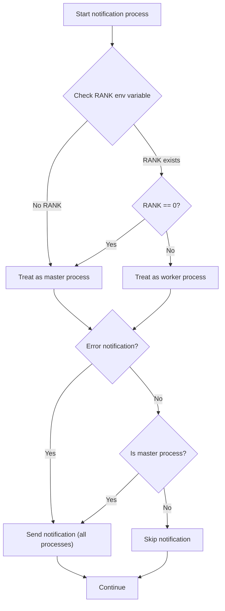

<!-- source: DeepWiki mcp.deepwiki.com · repo huggingface/knockknock · page 4 Notification Channels · fetched 2026-10-26 -->

# Notification Channels

<details>
<summary>Relevant source files</summary>

The following files were used as context for generating this wiki page:

- [README.md](README.md)
- [knockknock/__init__.py](knockknock/__init__.py)

</details>


This document provides an overview of the notification channels supported by KnockKnock. Notification channels are the communication platforms through which KnockKnock can send alerts when long-running processes start, complete, or encounter errors. For specific details about each channel implementation, see the child pages [4.1](#4.1) through [4.7](#4.7).

## Supported Notification Channels

KnockKnock implements 12 different notification channels, each as a separate module with a consistent interface pattern:

| Category | Platforms |
|----------|-----------|
| Desktop | Desktop Notifications (macOS, Linux, Windows 10) |
| Email | Gmail/SMTP |
| Chat Platforms | Slack, Microsoft Teams, Discord, Matrix, Amazon Chime, RocketChat |
| Mobile/SMS | Telegram, SMS (via Twilio) |
| Asian Platforms | DingTalk, WeChat Work |

All notification channels are exposed through the main package and can be imported directly:

```python
from knockknock import email_sender, slack_sender, discord_sender  # etc.
```

Sources: [knockknock/__init__.py:1-12]()

## Architecture

### Notification Channel Implementation Pattern

Each notification channel in KnockKnock follows a common implementation pattern centered around a decorator function that:

1. Captures channel-specific configuration
2. Formats messages for different notification types (start, success, error)
3. Implements platform-specific logic for sending notifications
4. Handles distributed training scenarios properly

### Notification Channel Architecture

```mermaid
classDiagram
    class NotificationSender {
        <<conceptual>>
        +send_start_notification()
        +send_success_notification()
        +send_error_notification()
        +__call__()
    }
    
    class email_sender {
        +sender_email: str
        +recipient_emails: List[str]
        +yagmail: YagmailClient
    }
    
    class slack_sender {
        +webhook_url: str
        +channel: str
        +user_mentions: List[str]
    }
    
    class telegram_sender {
        +token: str
        +chat_id: int
        +requests: HttpClient
    }
    
    class teams_sender {
        +webhook_url: str
        +user_mentions: List[str]
    }
    
    class sms_sender {
        +account_sid: str
        +auth_token: str
        +sender_number: str
        +recipient_number: str
        +twilio: TwilioClient
    }
    
    class discord_sender {
        +webhook_url: str
    }
    
    class desktop_sender {
        +title: str
        +platform_specific_notifier
    }
    
    class matrix_sender {
        +homeserver: str
        +token: str
        +room: str
    }
    
    class chime_sender {
        +webhook_url: str
        +user_mentions: List[str]
    }
    
    class dingtalk_sender {
        +webhook_url: str
        +secret: str
        +keywords: List[str]
        +user_mentions: List[str]
    }
    
    class rocketchat_sender {
        +server_url: str
        +user_id: str
        +auth_token: str
        +channel: str
        +user_mentions: List[str]
        +alias: str
    }
    
    class wechat_sender {
        +webhook_url: str
        +user_mentions: List[str]
        +user_mentions_mobile: List[str]
    }
    
    NotificationSender <|-- email_sender
    NotificationSender <|-- slack_sender
    NotificationSender <|-- telegram_sender
    NotificationSender <|-- teams_sender
    NotificationSender <|-- sms_sender
    NotificationSender <|-- discord_sender
    NotificationSender <|-- desktop_sender
    NotificationSender <|-- matrix_sender
    NotificationSender <|-- chime_sender
    NotificationSender <|-- dingtalk_sender
    NotificationSender <|-- rocketchat_sender
    NotificationSender <|-- wechat_sender
```



Sources: [knockknock/__init__.py:1-12]()

### Notification Flow

```mermaid
sequenceDiagram
    participant UserCode as "User Code"
    participant Decorator as "KnockKnock Decorator"
    participant UserFunction as "Decorated Function"
    participant NotificationPlatform as "Notification Platform"
    
    UserCode->>Decorator: Apply decorator with platform configuration
    UserCode->>UserFunction: Call decorated function
    activate Decorator
    Decorator->>NotificationPlatform: Send "Started" notification
    Note over Decorator,NotificationPlatform: Only master process sends notification in distributed training
    Decorator->>UserFunction: Execute original function
    activate UserFunction
    
    alt Function succeeds
        UserFunction-->>Decorator: Return result
        deactivate UserFunction
        Decorator->>NotificationPlatform: Send "Completed" notification with result
        Decorator-->>UserCode: Return original result
    else Function fails
        UserFunction--xDecorator: Raise exception
        deactivate UserFunction
        Decorator->>NotificationPlatform: Send "Crashed" notification with traceback
        Note over Decorator,NotificationPlatform: All processes send error notifications
        Decorator--xUserCode: Re-raise exception
    end
    deactivate Decorator
```

Sources: [README.md:19-21]()

## Channel Configuration Requirements

Each notification channel requires specific configuration parameters to function properly:

| Channel | Required Configuration | Optional Configuration |
|---------|------------------------|------------------------|
| Email | `sender_email`, `recipient_emails` | None |
| Slack | `webhook_url` | `channel`, `user_mentions` |
| Discord | `webhook_url` | None |
| Telegram | `token`, `chat_id` | None |
| Microsoft Teams | `webhook_url` | `user_mentions` |
| SMS (Twilio) | `account_sid`, `auth_token`, `sender_number`, `recipient_number` | None |
| Desktop | None | `title` |
| Matrix | `homeserver`, `token`, `room` | None |
| Amazon Chime | `webhook_url` | `user_mentions` |
| DingTalk | `webhook_url` | `secret`, `keywords`, `user_mentions` |
| RocketChat | `server_url`, `user_id`, `auth_token`, `channel` | `user_mentions`, `alias` |
| WeChat Work | `webhook_url` | `user_mentions`, `user_mentions_mobile` |

Sources: [README.md:23-39]()

## Authentication Methods

Notification channels use three primary authentication mechanisms:

### 1. Webhook-based Authentication
Several channels (Slack, Discord, Teams, Chime, DingTalk, WeChat Work) use webhook URLs for authentication. These are obtained from the platform's integration settings and allow KnockKnock to send messages to specific channels.

### 2. API Token-based Authentication
Channels like Telegram and Matrix require API tokens and additional identifiers (such as chat IDs or room aliases) for authentication.

### 3. Credential-based Authentication
Email, SMS, and RocketChat require user credentials such as usernames/emails and passwords or authentication tokens.

Sources: [README.md:41-396]()

## Distributed Training Support

KnockKnock provides special handling for distributed training environments to prevent duplicate notifications:



In distributed training environments:
- KnockKnock detects the process rank using the `RANK` environment variable (set by distributed training frameworks)
- Only the master process (RANK=0) sends start and success notifications
- All processes send error notifications to ensure errors are always reported
- This prevents notification flooding when using multiple GPUs/processes

Sources: [README.md:401-405]()

## Usage Patterns

All notification channels follow a similar usage pattern with two primary modes of operation:

### Python Decorator Mode

```python
from knockknock import <channel>_sender

@<channel>_sender(<required_config>, <optional_config>)
def your_function():
    # Your long-running code
    return result
```

### Command-Line Interface Mode

```bash
knockknock <channel> --<config-options> your_command
```

This consistent interface allows for easy switching between notification platforms without changing the overall usage pattern.

Sources: [README.md:19-396]()

## Comparative Analysis

### Webhook vs. API-based Integration

Webhook-based channels (like Slack, Discord, Teams) are generally easier to set up as they only require a single webhook URL. API-based channels (like Telegram, Matrix) offer more flexibility but require more complex authentication.

### Notification Capabilities

Different channels offer varied capabilities:
- User mentions: Supported by most chat platforms (Slack, Teams, RocketChat, DingTalk, WeChat)
- Formatting: Rich formatting in Slack, Discord, Teams; basic text in SMS
- Delivery speed: Desktop notifications are instant; email may have delays

### Platform-Specific Features

Some notification channels implement platform-specific features:
- Desktop: OS-specific notification mechanisms
- DingTalk/WeChat: Keywords for bypassing message filtering
- RocketChat: Alias support for custom sender names

## Additional Resources

For detailed information about specific notification channels, refer to the following pages:
- [Desktop Notifications](#4.1)
- [Email Notifications](#4.2) 
- [Slack and Teams Notifications](#4.3)
- [Discord Notifications](#4.4)
- [Telegram and SMS Notifications](#4.5)
- [Matrix and Chime Notifications](#4.6)
- [Asian Platform Notifications](#4.7)

---

