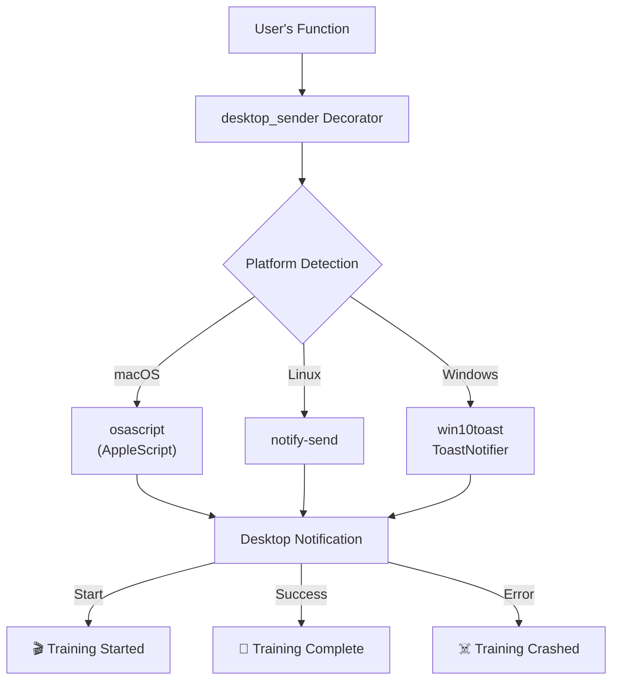
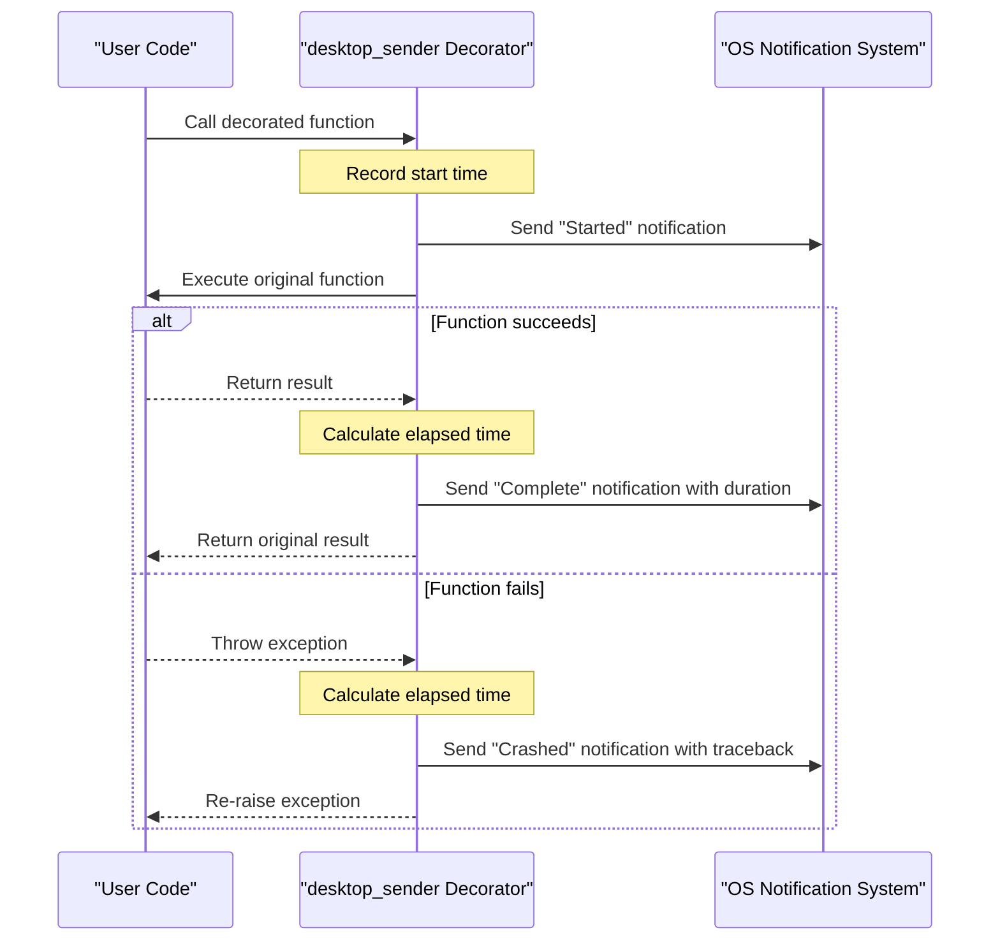
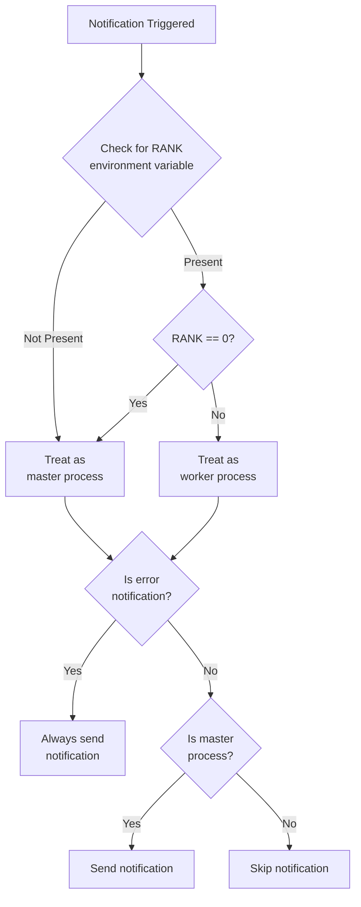
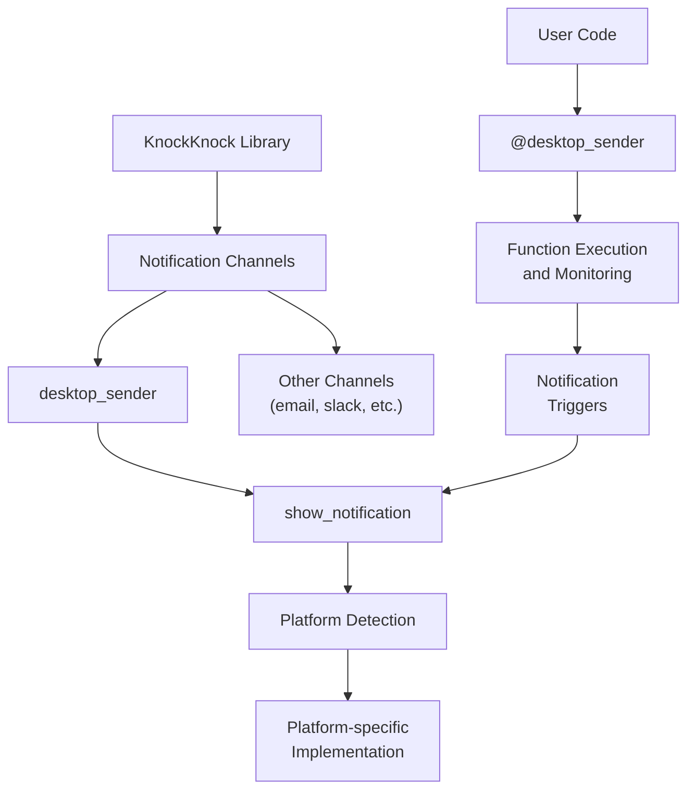

<!-- source: DeepWiki mcp.deepwiki.com · repo huggingface/knockknock · page 4.1 Desktop Notifications · fetched 2026-10-26 -->

# Desktop Notifications

<details>
<summary>Relevant source files</summary>

The following files were used as context for generating this wiki page:

- [knockknock/desktop_sender.py](knockknock/desktop_sender.py)
- [knockknock/tests/__init__.py](knockknock/tests/__init__.py)
- [knockknock/tests/test_senders.py](knockknock/tests/test_senders.py)

</details>


## Purpose and Scope

This document details the Desktop Notifications functionality within KnockKnock, which enables local system notifications for long-running processes. Unlike other notification channels that send alerts to external services (see [Email Notifications](#4.2), [Slack and Teams Notifications](#4.3)), desktop notifications appear directly on your computer, making them ideal for users who work on the same machine where their code executes.

Sources: [knockknock/desktop_sender.py:11-103]()

## Implementation Overview

The desktop notification system uses platform-specific notification APIs to deliver alerts at three key points in a process's lifecycle: when it starts, successfully completes, or crashes. It supports macOS, Linux, and Windows, using different mechanisms for each operating system.



Sources: [knockknock/desktop_sender.py:13-31]()

## Core Components

The desktop notification functionality is encapsulated in two main components:

1. **`desktop_sender` decorator factory** - Creates and returns a decorator that can be applied to any Python function
2. **`show_notification` function** - Handles the platform-specific implementation details for displaying notifications

### Platform Detection and Notification Methods

```mermaid
classDiagram
    class "desktop_sender" {
        +title: str
        +Returns decorator
    }
    
    class "show_notification" {
        +text: str
        +title: str
        +Platform-specific notification
    }
    
    class "PlatformHandlers" {
        <<interface>>
        +Darwin: osascript
        +Linux: notify-send
        +Windows: win10toast
    }
    
    class "decorator_sender" {
        +Wraps user function
        +Sends notifications
        +Handles distributed training
    }
    
    "desktop_sender" --> "decorator_sender" : creates
    "decorator_sender" --> "show_notification" : calls
    "show_notification" --> "PlatformHandlers" : uses
```

Sources: [knockknock/desktop_sender.py:11-32](), [knockknock/desktop_sender.py:33-103]()

## Platform-Specific Implementation Details

The `show_notification` function uses different mechanisms based on the detected operating system:

| Platform | Implementation Method | Requirements |
|----------|----------------------|-------------|
| macOS (Darwin) | AppleScript via `osascript` | Built-in, no dependencies |
| Linux | `notify-send` command | Typically pre-installed on desktop environments |
| Windows | `win10toast` Python library | Requires additional installation: `pip install win10toast==0.9` |

When using Windows, the library attempts to import `win10toast`. If not found, it prints an error message instructing the user to install the dependency.

Sources: [knockknock/desktop_sender.py:13-31]()

## Notification Flow

The desktop notification system follows a standard flow for all functions it decorates:



Sources: [knockknock/desktop_sender.py:33-101]()

## Notification Content

Each notification type includes specific information:

### Start Notification
- "Your training has started 🎬"
- Machine name (hostname)
- Function name
- Start date and time

### Success Notification
- "Your training is complete 🎉"
- Machine name
- Function name
- Start date and time
- End date and time
- Total duration
- Return value (if it can be converted to string)

### Error Notification
- "Your training has crashed ☠️"
- Machine name
- Function name
- Start date and time
- Crash date and time
- Duration before crash
- Error message
- Full traceback

Sources: [knockknock/desktop_sender.py:53-58](), [knockknock/desktop_sender.py:66-80](), [knockknock/desktop_sender.py:87-98]()

## Distributed Training Support

The desktop notification system includes special handling for distributed training environments, particularly for PyTorch:



This design prevents notification flooding in multi-process distributed training environments, ensuring that only the master process sends routine notifications while still allowing all processes to report errors.

Sources: [knockknock/desktop_sender.py:41-50](), [knockknock/desktop_sender.py:52-58](), [knockknock/desktop_sender.py:63-81]()

## Usage Example

Here's how to use the desktop notification decorator in your code:

```python
from knockknock import desktop_sender

@desktop_sender(title="My ML Training")
def train_model(epochs=10):
    # Your long-running training code here
    for epoch in range(epochs):
        # Training loop
        pass
    return {"accuracy": 0.95, "loss": 0.02}

# When this function is called, you'll receive desktop notifications
result = train_model()
```

You can also use it in testing as shown in the test suite:

Sources: [knockknock/tests/test_senders.py:11-17]()

## Integration with KnockKnock

The `desktop_sender` is part of the notification channel ecosystem in KnockKnock:



The desktop notification system follows the same decorator pattern as other notification channels in KnockKnock, making it easy to switch between or combine different notification methods.

Sources: [knockknock/desktop_sender.py:11-103]()

## Troubleshooting

Common issues with desktop notifications:

1. **Windows Notifications Not Working**: Make sure you have installed `win10toast` with `pip install win10toast==0.9`
2. **Linux Notifications Not Working**: Ensure `notify-send` is installed on your system (included in most desktop environments)
3. **No Notifications in Remote Sessions**: Desktop notifications require a graphical environment; they won't work in headless servers without additional configuration

Sources: [knockknock/desktop_sender.py:22-25]()

---

