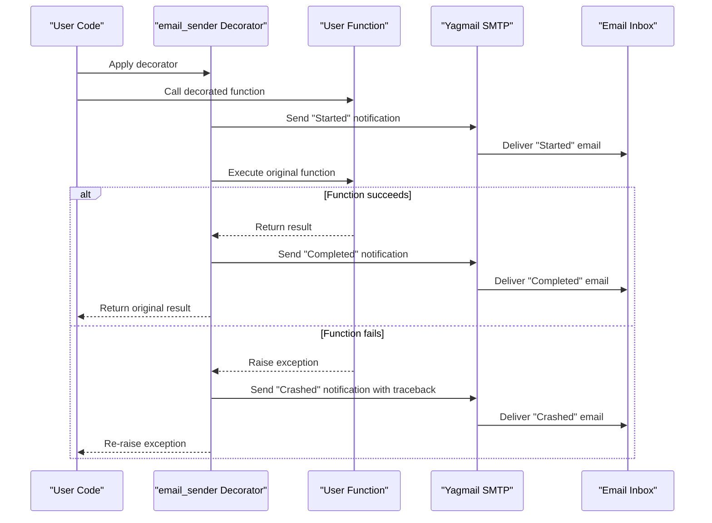
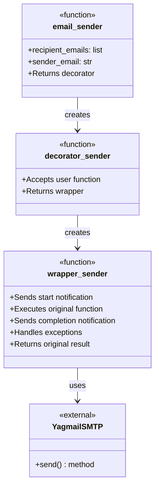
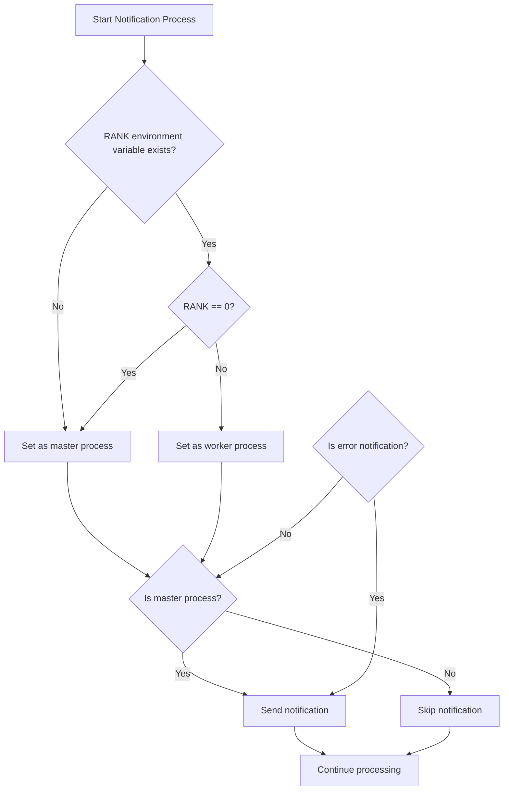
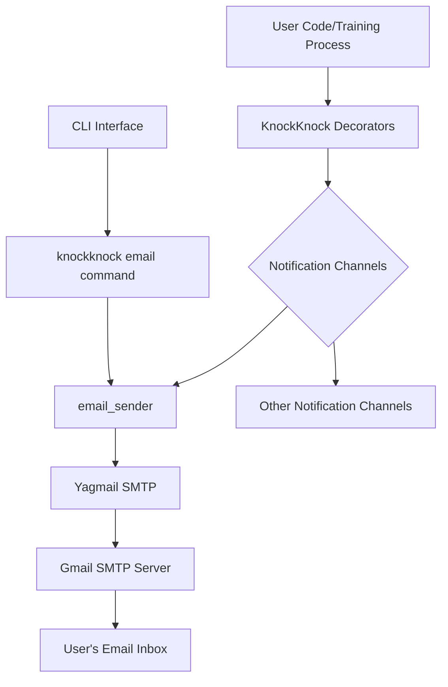

<!-- source: DeepWiki mcp.deepwiki.com · repo huggingface/knockknock · page 4.2 Email Notifications · fetched 2026-10-26 -->

# Email Notifications

<details>
<summary>Relevant source files</summary>

The following files were used as context for generating this wiki page:

- [README.md](README.md)
- [knockknock/email_sender.py](knockknock/email_sender.py)

</details>


## Purpose and Scope

This document describes the email notification functionality in KnockKnock, which enables users to receive email alerts when long-running processes (such as machine learning training jobs) start, complete successfully, or crash unexpectedly. The email notification system uses the Yagmail library to send notifications through Gmail's SMTP server.

For information about other notification channels available in KnockKnock, see [Notification Channels](#4).

Sources: [README.md:40-68]()

## Prerequisites

### Gmail Account Requirements

To use email notifications, you need:
1. A Gmail account (creating a dedicated account for this purpose is recommended)
2. "Less secure apps" access enabled on this Gmail account
   - This setting allows the Python library to authenticate with Gmail's SMTP server

The system will prompt for the sender's email password when first used, which will be securely stored in the system keyring service through the `keyring` Python library.

Sources: [README.md:43-68]()

## Implementation Architecture

### Email Notification Flow



Sources: [email_sender.py:10-99]()

### Component Architecture



Sources: [email_sender.py:10-99]()

## Implementation Details

### Email Sender Decorator

The `email_sender` function in [email_sender.py:10-99]() creates and returns a decorator that wraps the user's function. This decorator:

1. Records the start time and host information before execution
2. Sends a "started" notification email
3. Executes the original function
4. Sends either a "completed" or "crashed" notification email depending on the outcome
5. Returns the original function's result or re-raises any exceptions

### Message Content

The email notifications include:

| Notification Type | Information Included |
|-------------------|----------------------|
| Started | Function name, machine name, start date/time |
| Completed | Function name, machine name, start date/time, end date/time, training duration, returned value (if any) |
| Crashed | Function name, machine name, start date/time, crash date/time, training duration, exception details, full traceback |

Sources: [email_sender.py:47-53](), [email_sender.py:60-75](), [email_sender.py:82-94]()

### Distributed Training Support

The email sender has special handling for distributed training environments:



The system detects distributed training by checking for the `RANK` environment variable (set by PyTorch's distributed.launch). Only the master process (RANK=0) sends start and completion notifications, preventing duplicate alerts, but all processes send crash notifications to ensure failures are captured.

Sources: [email_sender.py:35-44](), [README.md:401-405]()

## Usage Examples

### Python Decorator Usage

To use email notifications in Python code:

```python
from knockknock import email_sender

@email_sender(recipient_emails=["your_email@address.com"], 
              sender_email="sender_email@gmail.com")
def train_model(parameters):
    # Your long-running training code here
    return {"accuracy": 0.95}  # Optional return value
```

Sources: [README.md:47-55]()

### Command-line Usage

To use email notifications from the command line:

```bash
knockknock email \
    --recipient-emails your_email@address.com,second_email@address.com \
    --sender-email sender_email@gmail.com \
    your_long_running_command
```

Sources: [README.md:59-64]()

### Configuration Parameters

| Parameter | Type | Description | Required | Default |
|-----------|------|-------------|----------|---------|
| recipient_emails | list[str] | Email addresses to receive notifications | Yes | - |
| sender_email | str | Email address used to send notifications | No | First recipient email |

Sources: [email_sender.py:10-25](), [README.md:66]()

## Integration with KnockKnock



The email notification system is one of multiple notification channels in KnockKnock. It shares the same basic workflow as other channels but differs in the specific implementation and configuration parameters.

Sources: [README.md:23-38]()

## Technical Implementation

The email notification functionality is implemented in [email_sender.py]() with the following structure:

1. **email_sender function** ([email_sender.py:10-25]()) - Takes configuration parameters and returns a decorator
2. **decorator_sender function** ([email_sender.py:27-97]()) - The actual decorator that wraps user functions
3. **wrapper_sender function** ([email_sender.py:28-95]()) - The wrapper function that handles execution flow and notifications

The implementation uses the Yagmail library to simplify Gmail SMTP communication, initialized with the sender's email credentials before sending any notifications.

Sources: [email_sender.py:10-99]()

## Limitations and Considerations

- Only supports Gmail accounts (not other email providers)
- Requires enabling "Less secure apps" in Gmail security settings
- Google may eventually deprecate the "Less secure apps" option
- Consider using app-specific passwords if two-factor authentication is enabled

For alternatives that don't require email setup, see [Desktop Notifications](#4.1) or [Slack and Teams Notifications](#4.3).

Sources: [README.md:43]()

---

