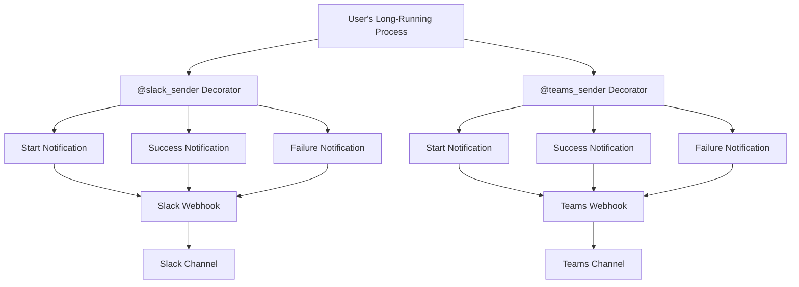
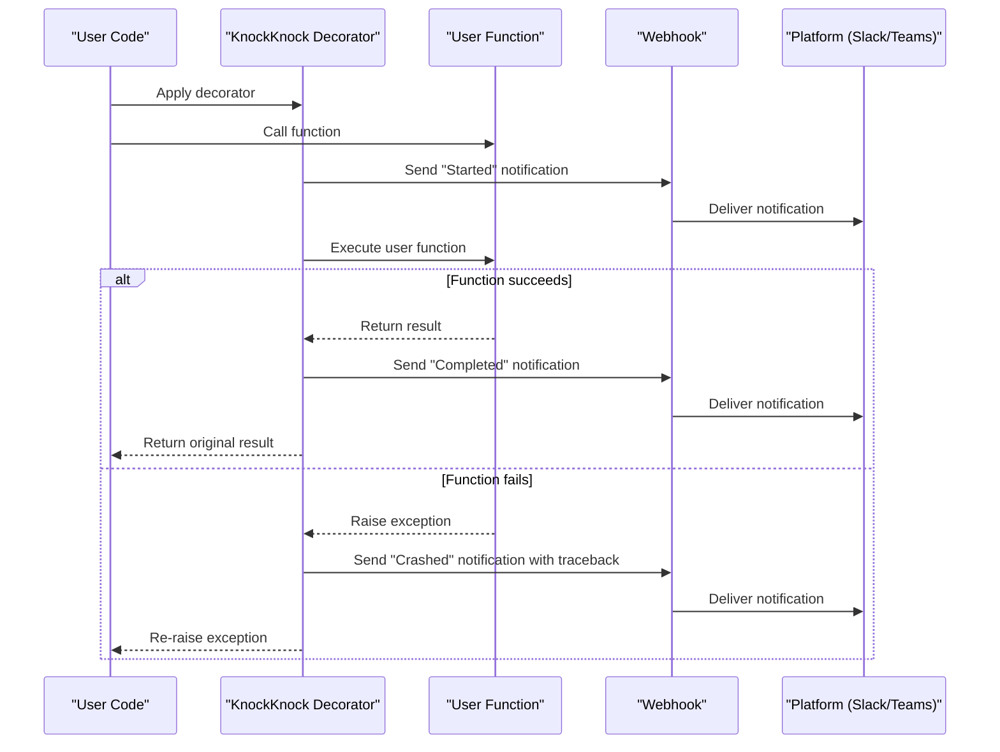
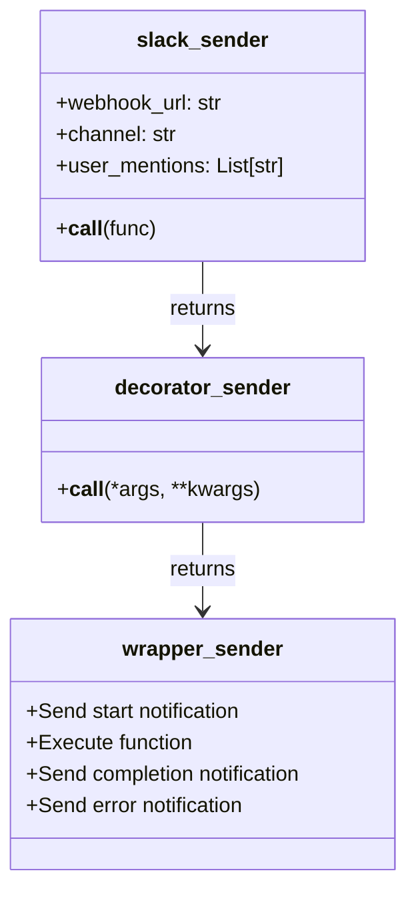
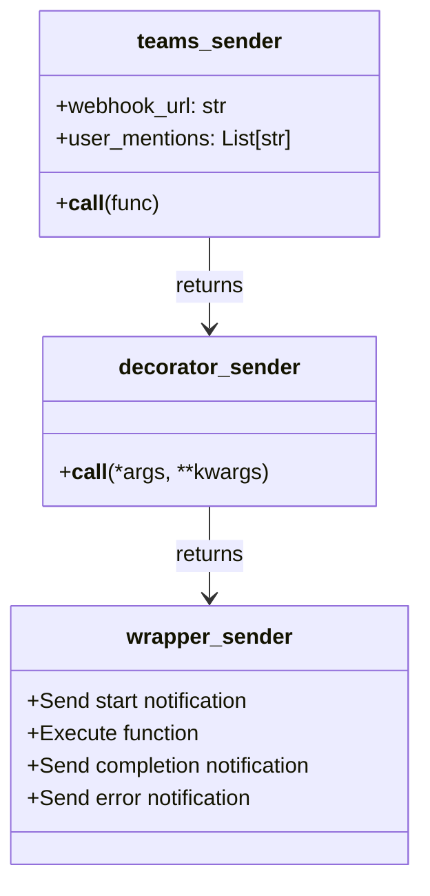
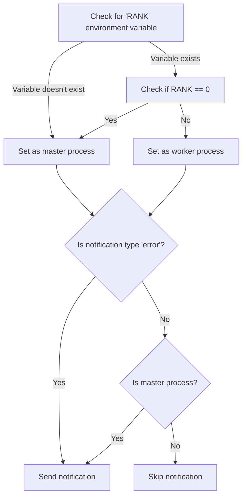
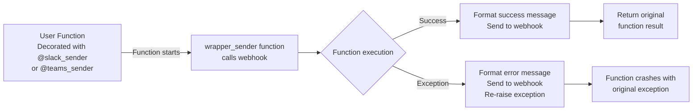

<!-- source: DeepWiki mcp.deepwiki.com · repo huggingface/knockknock · page 4.3 Slack and Teams Notifications · fetched 2026-10-26 -->

# Slack and Teams Notifications

<details>
<summary>Relevant source files</summary>

The following files were used as context for generating this wiki page:

- [knockknock/slack_sender.py](knockknock/slack_sender.py)
- [knockknock/teams_sender.py](knockknock/teams_sender.py)

</details>


## Purpose and Scope

This document details the Slack and Microsoft Teams notification functionality in the KnockKnock library. These notification channels allow users to receive updates about their long-running processes via Slack workspaces or Microsoft Teams channels. The document covers the implementation, configuration, and usage of both notification systems, which operate through webhook-based integrations.

For information about other notification channels, see [Notification Channels](#4).

## Architecture Overview

Both Slack and Microsoft Teams notifications in KnockKnock follow a similar architectural pattern, using webhooks to deliver messages to their respective platforms.



Sources: [knockknock/slack_sender.py:12-109](), [knockknock/teams_sender.py:13-113]()

## Notification Flow

The sequence of operations for both Slack and Teams notifications follows this pattern:



Sources: [knockknock/slack_sender.py:33-107](), [knockknock/teams_sender.py:31-111]()

## Slack Notifications

### Configuration and Setup

To use Slack notifications, you need to:

1. Create an incoming webhook in your Slack workspace
2. Obtain the webhook URL
3. Apply the `slack_sender` decorator to your function

### Implementation Details

The `slack_sender` function is implemented as a decorator factory that returns a wrapper function:



Sources: [knockknock/slack_sender.py:12-32](), [knockknock/slack_sender.py:33-107]()

### Parameters

The `slack_sender` decorator accepts the following parameters:

| Parameter | Type | Description |
|-----------|------|-------------|
| webhook_url | str | The webhook URL for your Slack workspace. Created via Slack API's incoming webhooks feature. |
| channel | str | The Slack channel where notifications will be posted. |
| user_mentions | List[str] | Optional list of user IDs to mention in notifications. |

### Message Format

Slack notifications include:

- Start notification: Information about the function starting execution
- Success notification: Details about completed execution and return value
- Failure notification: Error information and traceback

Sources: [knockknock/slack_sender.py:51-60](), [knockknock/slack_sender.py:65-84](), [knockknock/slack_sender.py:88-104]()

## Microsoft Teams Notifications

### Configuration and Setup

To use Microsoft Teams notifications, you need to:

1. Create an incoming webhook connector in your Teams channel
2. Obtain the webhook URL
3. Apply the `teams_sender` decorator to your function

### Implementation Details

The `teams_sender` function follows the same pattern as the Slack sender:



Sources: [knockknock/teams_sender.py:13-29](), [knockknock/teams_sender.py:31-111]()

### Parameters

The `teams_sender` decorator accepts the following parameters:

| Parameter | Type | Description |
|-----------|------|-------------|
| webhook_url | str | The webhook URL for your Teams channel. Created via Teams connector configuration. |
| user_mentions | List[str] | Optional list of user IDs to mention in notifications. |

### Message Format

Teams notifications follow the same format as Slack notifications, including start, success, and failure messages.

Sources: [knockknock/teams_sender.py:50-58](), [knockknock/teams_sender.py:63-86](), [knockknock/teams_sender.py:90-108]()

## Shared Implementation Features

Both Slack and Teams decorators share several key features:

### Distributed Training Support

Both notification systems handle distributed training environments by checking for the `RANK` environment variable (commonly used in PyTorch distributed training):



This prevents duplicate notifications when running in a distributed environment, with the exception of error notifications which are always sent.

Sources: [knockknock/slack_sender.py:41-50](), [knockknock/teams_sender.py:39-48]()

### Notification Content

Both systems send structured messages containing:

1. **Start Notification**:
   - 🎬 Training started message
   - Machine name (hostname)
   - Function name
   - Starting timestamp
   - User mentions (if provided)

2. **Success Notification**:
   - 🎉 Training complete message
   - Machine name
   - Function name
   - Starting and ending timestamps
   - Training duration
   - Function return value (if possible to convert to string)
   - User mentions

3. **Failure Notification**:
   - ☠️ Training crashed message
   - Machine name
   - Function name
   - Starting and crash timestamps
   - Duration until crash
   - Error message
   - Full traceback
   - User mentions

Sources: [knockknock/slack_sender.py:51-60](), [knockknock/slack_sender.py:65-84](), [knockknock/slack_sender.py:88-104](), [knockknock/teams_sender.py:50-58](), [knockknock/teams_sender.py:63-86](), [knockknock/teams_sender.py:90-108]()

## Usage Examples

### Slack Notification Example

```python
from knockknock import slack_sender

@slack_sender(webhook_url="https://hooks.slack.com/services/YOUR/WEBHOOK/URL", 
              channel="#your-channel",
              user_mentions=["@user1", "@user2"])
def train_model(epochs, learning_rate):
    # Your long-running training code
    return {"accuracy": 0.92, "loss": 0.08}
```

### Microsoft Teams Notification Example

```python
from knockknock import teams_sender

@teams_sender(webhook_url="https://outlook.office.com/webhook/YOUR/WEBHOOK/URL", 
              user_mentions=["User1", "User2"])
def train_model(epochs, learning_rate):
    # Your long-running training code
    return {"accuracy": 0.92, "loss": 0.08}
```

## Implementation Comparison

The following table highlights the differences between Slack and Teams implementations:

| Feature | Slack | Microsoft Teams |
|---------|-------|----------------|
| Webhook Parameter | Requires webhook URL | Requires webhook URL |
| Channel Parameter | Required | Not required (set in webhook) |
| Message Format | Plain text | Plain text |
| User Mentions | Supports Slack user IDs | Supports Teams user mentions |
| Icon/Avatar | Uses emoji (📣,🎉,☠️) | Uses emoji (📣,🎉,☠️) |

Sources: [knockknock/slack_sender.py:12-32](), [knockknock/teams_sender.py:13-29]()

## Setup Guide

### Setting up Slack Webhooks

1. Go to your Slack workspace settings
2. Navigate to "Incoming Webhooks"
3. Click "Add New Webhook to Workspace"
4. Select the channel where notifications should appear
5. Copy the webhook URL

### Setting up Microsoft Teams Webhooks

1. Go to the channel where you want to add the webhook
2. Click the "..." menu and select "Connectors"
3. Find "Incoming Webhook" and click "Configure"
4. Provide a name and upload an image (optional)
5. Click "Create" and copy the webhook URL

## Internal Data Flow



Sources: [knockknock/slack_sender.py:33-107](), [knockknock/teams_sender.py:31-111]()

## Troubleshooting

Common issues with Slack and Teams notifications:

1. **Webhook URL Invalid**: Ensure the webhook URL is correctly copied and has not expired
2. **Missing Permissions**: Verify the webhook has permission to post to the specified channel
3. **Network Issues**: Check that your environment has outbound access to Slack or Teams API endpoints
4. **Message Formatting**: If messages appear malformatted, ensure no special characters are causing issues

---

