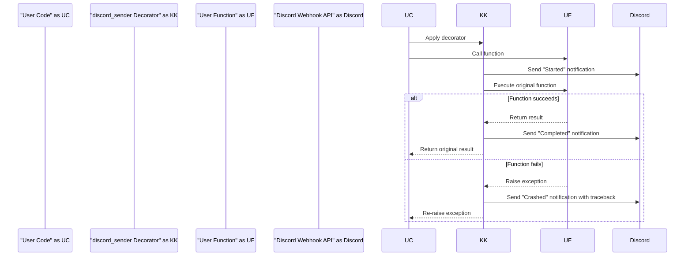
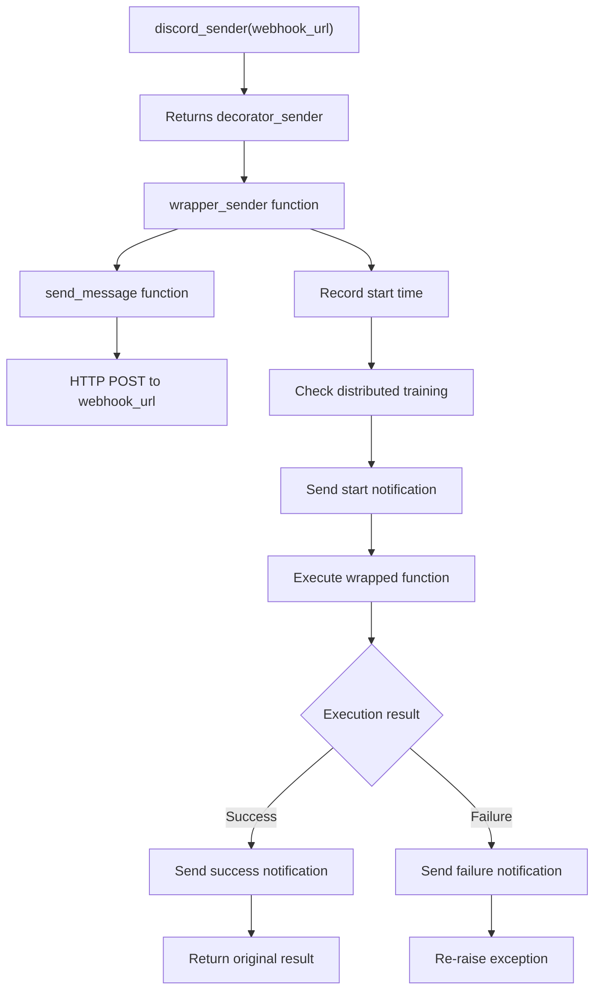
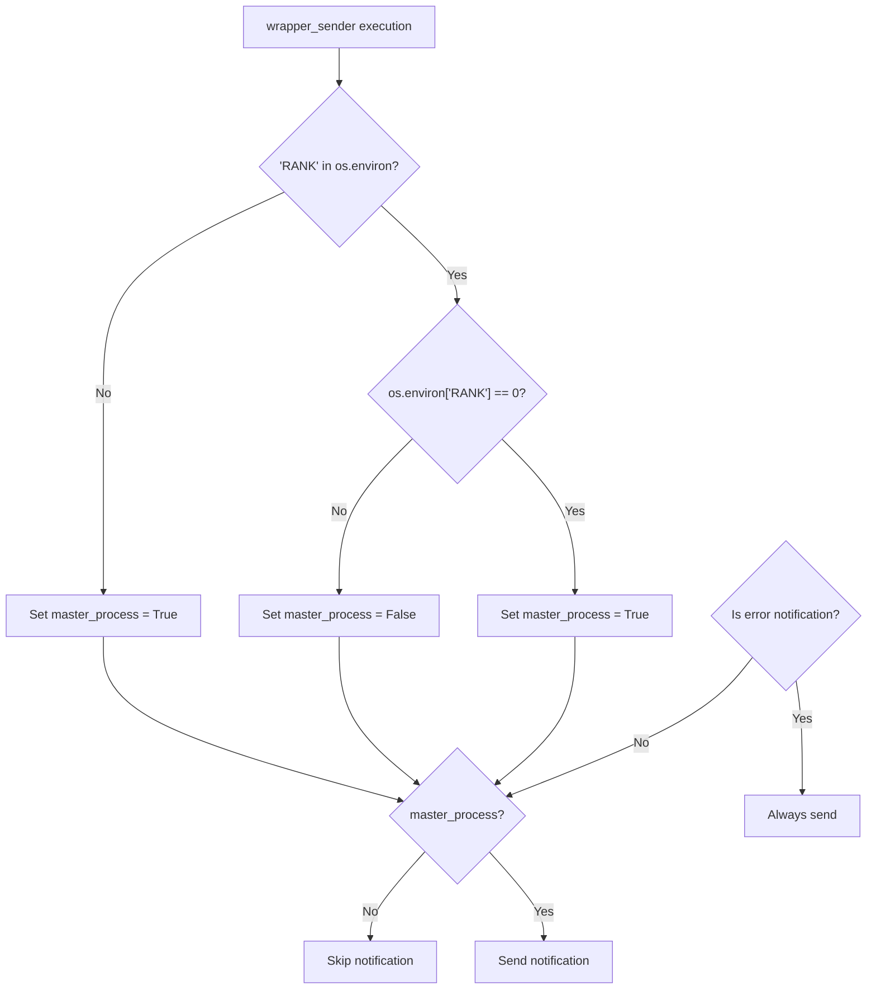

<!-- source: DeepWiki mcp.deepwiki.com · repo huggingface/knockknock · page 4.4 Discord Notifications · fetched 2026-10-26 -->

# Discord Notifications

<details>
<summary>Relevant source files</summary>

The following files were used as context for generating this wiki page:

- [README.md](README.md)
- [knockknock/discord_sender.py](knockknock/discord_sender.py)

</details>


This page documents the Discord notification system within KnockKnock, explaining how to set up and use Discord as a notification channel for your long-running processes. Through this feature, you can receive real-time updates in your Discord channels when your processes start, complete successfully, or crash.

## Overview

The Discord notification system in KnockKnock lets you receive notifications about your long-running processes directly in Discord channels. It works by sending webhook requests to Discord's API at key points during your process execution.



Sources: [knockknock/discord_sender.py:12-98]()

## Configuration Requirements

To use Discord notifications, you need a webhook URL for your Discord channel. The webhook URL serves as the endpoint where KnockKnock will send notification messages.

### Obtaining a Discord Webhook URL

1. Go to your Discord server
2. Open the channel settings where you want to receive notifications
3. Navigate to "Integrations" → "Webhooks"
4. Create a new webhook or use an existing one
5. Copy the webhook URL

## Usage

### Python Decorator

The Discord notification functionality is implemented as a decorator that you can apply to any function:

```python
from knockknock import discord_sender

webhook_url = "<webhook_url_to_your_discord_channel>"
@discord_sender(webhook_url=webhook_url)
def train_your_model(parameters):
    # Your long-running code here
    return {'loss': 0.9}  # Optional return value
```

Sources: [README.md:194-203](), [knockknock/discord_sender.py:12-22]()

### Command-line Interface

For one-off commands or scripts, use the KnockKnock CLI:

```bash
knockknock discord \
    --webhook-url <webhook_url_to_your_discord_channel> \
    <your_command_to_run>
```

Sources: [README.md:207-211]()

## Implementation Details

The Discord notification system is implemented in `discord_sender.py` and follows the decorator pattern used throughout KnockKnock.



Sources: [knockknock/discord_sender.py:12-98]()

### Notification Content

The system sends three types of structured notifications:

| Notification Type | Content |
|-------------------|---------|
| Start | • Training has started 🎬<br>• Machine name<br>• Function name<br>• Start time |
| Success | • Training is complete 🎉<br>• Machine name<br>• Function name<br>• Start time<br>• End time<br>• Training duration<br>• Return value (if any) |
| Failure | • Training has crashed ☠️<br>• Machine name<br>• Function name<br>• Start time<br>• Crash time<br>• Duration before crash<br>• Error message<br>• Full traceback |

Sources: [knockknock/discord_sender.py:48-52](), [knockknock/discord_sender.py:61-75](), [knockknock/discord_sender.py:82-93]()

### Message Sending Mechanism

The `send_message` function formats and sends messages to Discord:

```python
def send_message(text: str):
    headers = {'Content-Type': 'application/json'}
    payload = json.dumps({'content': text})
    r = requests.post(url=webhook_url, data=payload, headers=headers)
```

This function constructs a simple JSON payload with the notification text and sends it to the Discord webhook URL using an HTTP POST request.

Sources: [knockknock/discord_sender.py:24-27]()

## Distributed Training Support

The Discord notification system includes special handling for distributed training environments to prevent duplicate notifications from multiple processes.



When running in a distributed environment:

1. KnockKnock checks for the presence of a `RANK` environment variable (set by PyTorch's distributed launcher)
2. Only the process with `RANK=0` (the master process) sends start and completion notifications
3. Error notifications are sent by any process that encounters an error

This prevents notification flooding while ensuring you're still alerted of any failures in worker processes.

Sources: [knockknock/discord_sender.py:36-45](), [knockknock/discord_sender.py:58-76](), [knockknock/discord_sender.py:79-94]()

## Implementation Code Structure

The main components of the Discord notification implementation are:

1. `discord_sender(webhook_url)` - The main decorator function that takes the webhook URL
2. `decorator_sender(func)` - The actual decorator returned by `discord_sender`
3. `send_message(text)` - Helper function to send messages to Discord
4. `wrapper_sender(*args, **kwargs)` - Function that wraps the original function

This pattern of nested functions allows the decorator to be configured with parameters (the webhook URL) while still functioning as a standard Python decorator.

Sources: [knockknock/discord_sender.py:12-98]()

## Summary

Discord notifications in KnockKnock provide a straightforward way to monitor long-running processes directly in Discord channels. The implementation is simple but effective, requiring minimal setup while providing valuable real-time status updates about your processes.

For information about other notification channels available in KnockKnock, see the [Notification Channels](#4) overview page.

---

