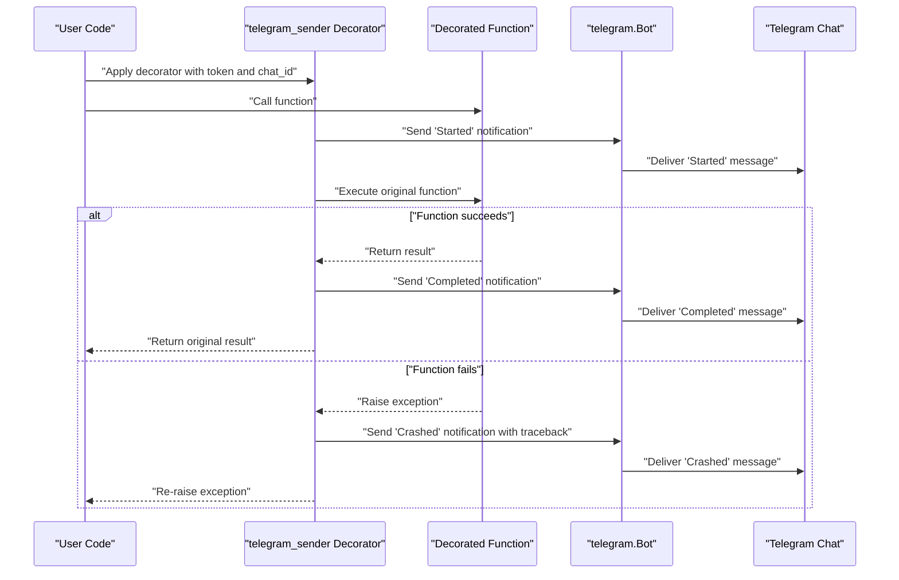
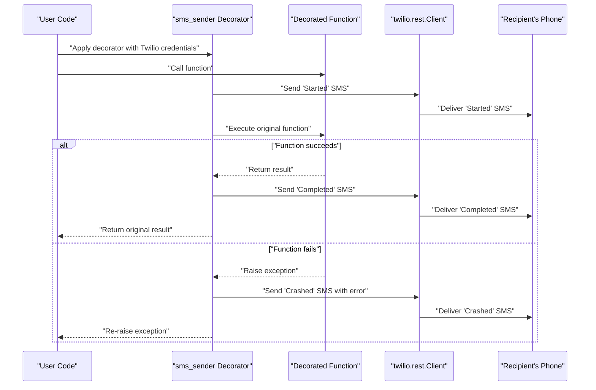
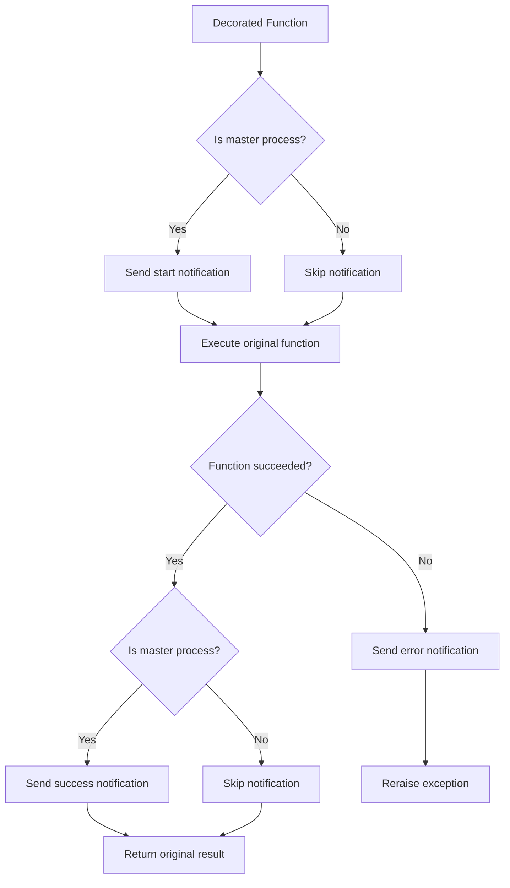
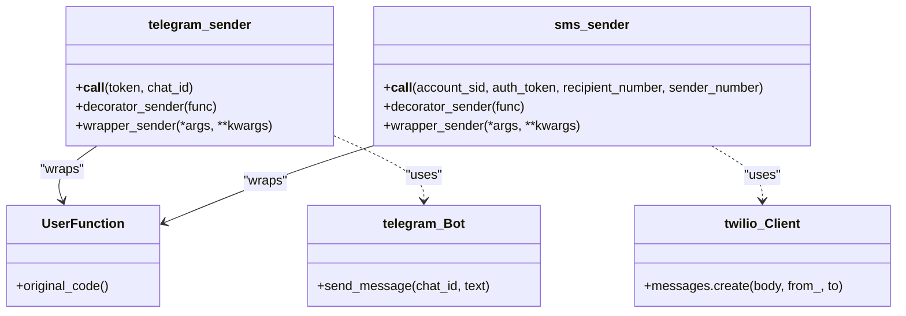

<!-- source: DeepWiki mcp.deepwiki.com · repo huggingface/knockknock · page 4.5 Telegram and SMS Notifications · fetched 2026-10-26 -->

# Telegram and SMS Notifications

<details>
<summary>Relevant source files</summary>

The following files were used as context for generating this wiki page:

- [knockknock/sms_sender.py](knockknock/sms_sender.py)
- [knockknock/telegram_sender.py](knockknock/telegram_sender.py)

</details>


This page documents the Telegram and SMS notification functionality in KnockKnock, which allows users to receive real-time updates about their long-running processes via Telegram messages or SMS (text messages).

## Purpose and Scope

The Telegram and SMS notification features provide ways to receive real-time updates about your long-running processes without having to actively monitor them. These notification channels are particularly useful when:

- You want immediate notifications on your mobile device
- You need notifications in environments where other communication channels might be restricted
- You prefer direct message notifications over email or workplace chat platforms

For information about other notification channels like Discord or Slack, see [Slack and Teams Notifications](#4.3) or [Discord Notifications](#4.4).

## Telegram Notifications

The Telegram notification functionality is implemented in the `telegram_sender.py` file. It uses the Python Telegram Bot API (python-telegram-bot library) to send messages to a specified Telegram chat.

### Setup Requirements

To use Telegram notifications, you need:

1. A Telegram account
2. A Telegram bot (created via BotFather)
3. The bot's API token
4. The chat ID where notifications should be sent

### Implementation Details

The `telegram_sender` function returns a decorator that wraps your function to add notification capabilities. The implementation handles three key events:

1. Function start - sends a notification when your process begins
2. Function completion - sends a notification when your process completes successfully
3. Function failure - sends a notification with error details when your process crashes



Sources: [knockknock/telegram_sender.py:10-97]()

### Example Usage

```python
from knockknock import telegram_sender

@telegram_sender(token="your-telegram-token", chat_id=your-chat-id)
def train_model():
    # Your long-running process here
    return "Training completed"
```

## SMS Notifications via Twilio

The SMS notification functionality in KnockKnock uses Twilio to send text messages to a specified phone number. This implementation is contained in the `sms_sender.py` file.

### Setup Requirements

To use SMS notifications, you need:

1. A Twilio account
2. Your Twilio Account SID
3. Your Twilio Auth Token
4. A Twilio phone number (sender)
5. A recipient phone number

### Implementation Details

The `sms_sender` function takes Twilio credentials and phone numbers as parameters and returns a decorator that wraps your function to add SMS notification capabilities.



Sources: [knockknock/sms_sender.py:11-83]()

### Example Usage

```python
from knockknock import sms_sender

@sms_sender(
    account_sid="your-account-sid",
    auth_token="your-auth-token",
    recipient_number="+1234567890",
    sender_number="+1098765432"
)
def train_model():
    # Your long-running process here
    return "Training completed"
```

## Implementation Architecture

Both Telegram and SMS notification senders follow a similar decorator pattern structure that's consistent with the overall KnockKnock architecture.

### Code Structure and Execution Flow



Sources: 
- [knockknock/telegram_sender.py:27-95]()
- [knockknock/sms_sender.py:13-81]()

### Component Relationships



Sources: 
- [knockknock/telegram_sender.py:10-97]()
- [knockknock/sms_sender.py:11-83]()

## Message Format

Both notification channels send structured messages that include details about the process:

### Start Message

```
Your training has started 🎬
Machine name: [hostname]
Main call: [function_name]
Starting date: [timestamp]
```

### Success Message

```
Your training is complete 🎉
Machine name: [hostname]
Main call: [function_name]
Starting date: [timestamp]
End date: [timestamp]
Training duration: [elapsed_time]
Main call returned value: [return_value]
```

### Error Message

```
Your training has crashed ☠️
Machine name: [hostname]
Main call: [function_name]
Starting date: [timestamp]
Crash date: [timestamp]
Crashed training duration: [elapsed_time]

Here's the error:
[exception]

Traceback:
[traceback]
```

Sources: 
- [knockknock/telegram_sender.py:47-92]()
- [knockknock/sms_sender.py:33-78]()

## Handling Distributed Training

Both notification senders include special handling for distributed training environments:

1. They detect distributed training by checking for the `RANK` environment variable (typically set by PyTorch's distributed training launcher)
2. Only the master process (RANK=0) sends start and success notifications to avoid duplicate messages
3. All processes send error notifications to ensure failures are captured

This behavior is implemented at lines [knockknock/telegram_sender.py:35-44]() and [knockknock/sms_sender.py:21-30]().

## Feature Comparison

| Feature | Telegram | SMS |
|---------|----------|-----|
| Provider | Telegram Bot API | Twilio |
| Required Credentials | Bot token, Chat ID | Account SID, Auth Token, Phone numbers |
| Cost | Free | Paid (per message) |
| Character Limit | 4,096 characters | 160 characters (may be concatenated) |
| Rich Content | Supports emoji, formatting | Basic text only |
| Error Tracebacks | Full traceback | May be truncated due to SMS limits |
| Implementation File | `telegram_sender.py` | `sms_sender.py` |
| External Dependencies | `python-telegram-bot` | `twilio` |

Sources: 
- [knockknock/telegram_sender.py:1-97]()
- [knockknock/sms_sender.py:1-83]()

## Known Limitations

- For SMS notifications, long error messages and tracebacks may be truncated due to SMS character limits
- Telegram Bot API has rate limits that might affect notifications for processes that crash repeatedly in a short time
- Both notification channels require Internet connectivity
- SMS notifications incur costs through Twilio's service

---

