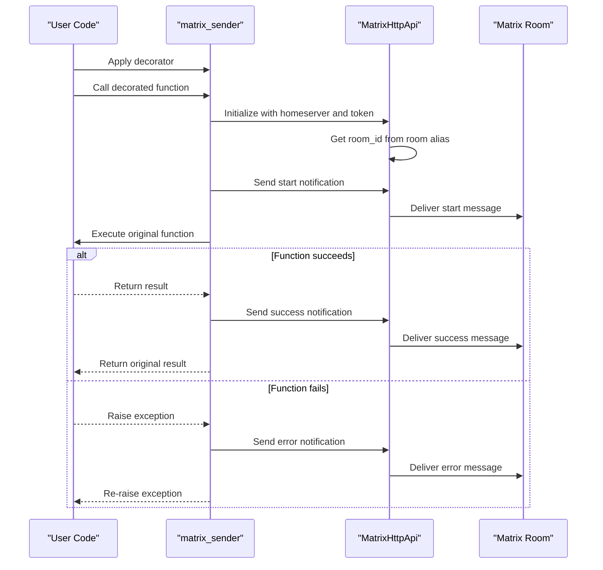
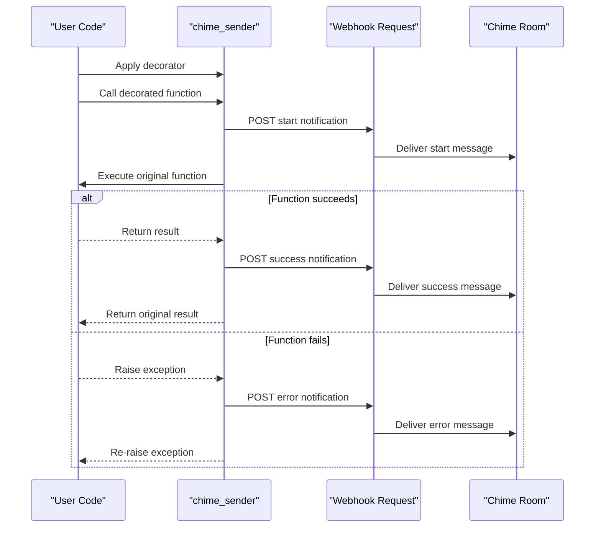
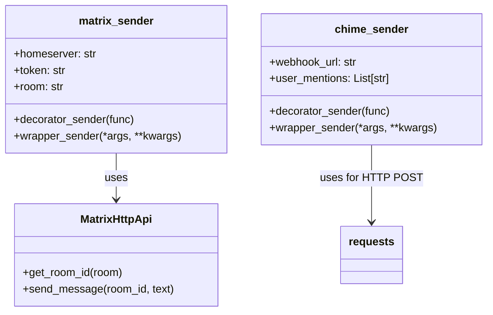
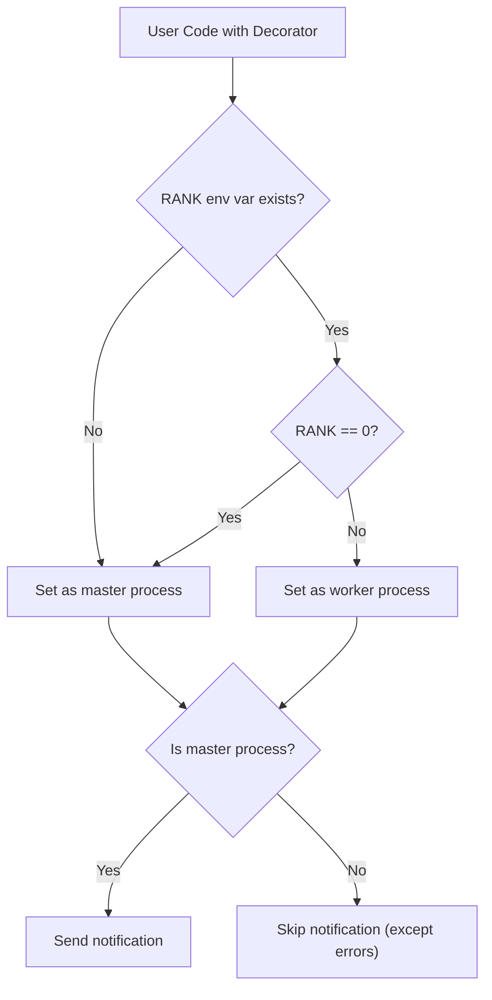

<!-- source: DeepWiki mcp.deepwiki.com · repo huggingface/knockknock · page 4.6 Matrix and Chime Notifications · fetched 2026-10-26 -->

# Matrix and Chime Notifications

<details>
<summary>Relevant source files</summary>

The following files were used as context for generating this wiki page:

- [knockknock/chime_sender.py](knockknock/chime_sender.py)
- [knockknock/matrix_sender.py](knockknock/matrix_sender.py)

</details>


This page documents the Matrix and Amazon Chime notification capabilities in KnockKnock. These notification channels allow you to receive updates about your long-running processes in Matrix chat rooms or Amazon Chime chat rooms. For information about other notification channels, see [Notification Channels](#4).

## Matrix Notifications

Matrix is an open network for secure, decentralized communication. KnockKnock's Matrix integration allows you to send notifications to any Matrix-compatible client (like Element, formerly Riot) about the status of your long-running functions.

### Configuration Requirements

To use Matrix notifications, you need:

1. A Matrix account and access to a Matrix homeserver
2. An access token for authentication
3. A room where notifications will be sent

The `matrix_sender` decorator takes the following parameters:

- `homeserver`: The URL of the Matrix homeserver (e.g., 'https://matrix.org')
- `token`: Your Matrix access token
- `room`: The alias of the Matrix room where notifications will be sent

Sources: [knockknock/matrix_sender.py:10-29]()

### Matrix Notification Flow

Matrix Notification Process Flow


Sources: [knockknock/matrix_sender.py:34-103]()

## Amazon Chime Notifications

Amazon Chime is AWS's communication service that offers team messaging, video conferencing, and audio calling. KnockKnock can send notifications to a Chime chat room about the status of your long-running functions.

### Configuration Requirements

To use Chime notifications, you need:

1. Access to an Amazon Chime chat room
2. A webhook URL for that room

The `chime_sender` decorator takes the following parameters:

- `webhook_url`: The webhook URL for your Chime chat room
- `user_mentions`: (Optional) A list of user aliases or email addresses to mention in notifications

Sources: [knockknock/chime_sender.py:13-24]()

### Chime Notification Flow

Chime Notification Process Flow


Sources: [knockknock/chime_sender.py:28-104]()

## Notification Content

Both Matrix and Chime notifications include detailed information about your function's execution. The following table displays the information included in each type of notification:

| Notification Type | Information Included |
|-------------------|----------------------|
| Start | • Training started 🎬<br>• Machine name<br>• Function name<br>• Start time |
| Success | • Training complete 🎉<br>• Machine name<br>• Function name<br>• Start time<br>• End time<br>• Duration<br>• Return value (if available) |
| Error | • Training crashed ☠️<br>• Machine name<br>• Function name<br>• Start time<br>• Crash time<br>• Duration before crash<br>• Error message<br>• Full traceback |

Sources: 
- [knockknock/matrix_sender.py:54-59](), [knockknock/matrix_sender.py:68-81](), [knockknock/matrix_sender.py:89-100]()
- [knockknock/chime_sender.py:48-56](), [knockknock/chime_sender.py:64-82](), [knockknock/chime_sender.py:89-101]()

## Implementation Architecture

The following diagram shows the key components of the Matrix and Chime notification implementations:

Code Architecture Comparison


Sources: 
- [knockknock/matrix_sender.py:10-105]()
- [knockknock/chime_sender.py:13-106]()

### Key Implementation Differences

1. **Matrix**: Uses the `MatrixHttpApi` client from the `matrix_client` package to send messages to Matrix rooms
2. **Chime**: Uses direct HTTP POST requests via the `requests` package to send messages to a webhook URL

### Distributed Training Support

Both notification channels handle distributed training environments by checking for the `RANK` environment variable. This prevents duplicate notifications when using distributed training frameworks like PyTorch.

Distributed Training Handling Process


Sources: 
- [knockknock/matrix_sender.py:42-51]()
- [knockknock/chime_sender.py:36-45]()

## Usage Examples

### Python Decorator Usage

#### Matrix Example

```python
from knockknock import matrix_sender

@matrix_sender(
    homeserver="https://matrix.org",
    token="your_access_token",
    room="#notifications:matrix.org"
)
def train_model(epochs=10):
    # Your long-running function
    for epoch in range(epochs):
        # Training code
        pass
    return "Training complete!"
```

#### Chime Example

```python
from knockknock import chime_sender

@chime_sender(
    webhook_url="https://hooks.chime.aws/incomingwebhooks/...",
    user_mentions=["@user1", "user2@example.com"]
)
def train_model(epochs=10):
    # Your long-running function
    for epoch in range(epochs):
        # Training code
        pass
    return "Training complete!"
```

### Command-Line Interface Usage

Both Matrix and Chime notifications can also be used via KnockKnock's command-line interface:

#### Matrix CLI Usage

```bash
knockknock matrix --homeserver https://matrix.org --token YOUR_TOKEN --room "#notifications:matrix.org" python train.py
```

#### Chime CLI Usage

```bash
knockknock chime --webhook-url https://hooks.chime.aws/incomingwebhooks/... python train.py
```

To mention users in Chime notifications via CLI:

```bash
knockknock chime --webhook-url https://hooks.chime.aws/incomingwebhooks/... --user-mentions "@user1" "user2@example.com" python train.py
```

For more information about the command-line interface, see [Command-Line Interface](#3).

Sources: 
- [knockknock/matrix_sender.py:10-105]()
- [knockknock/chime_sender.py:13-106]()

## Technical Details

### Matrix Sender

The Matrix sender utilizes the `matrix_client.api.MatrixHttpApi` class to interact with the Matrix API. The implementation follows these steps:

1. Initialize the Matrix HTTP API with the homeserver and token
2. Get the room ID from the provided room alias
3. Send messages to the room at appropriate times (start, completion, error)

The Matrix notifications are sent as plain text messages with line breaks separating different pieces of information.

Sources: [knockknock/matrix_sender.py:31-33](), [knockknock/matrix_sender.py:60](), [knockknock/matrix_sender.py:82](), [knockknock/matrix_sender.py:100]()

### Chime Sender

The Chime sender uses the `requests` library to send HTTP POST requests to the provided webhook URL. The implementation follows these steps:

1. Format the notification message as a string with line breaks
2. Create a JSON payload with a `Content` field containing the message
3. Send the payload to the webhook URL using an HTTP POST request

The Chime notifications support mentioning users by including their aliases or email addresses at the end of the message.

Sources: [knockknock/chime_sender.py:26-27](), [knockknock/chime_sender.py:55-56](), [knockknock/chime_sender.py:81-82](), [knockknock/chime_sender.py:100-101]()

---

