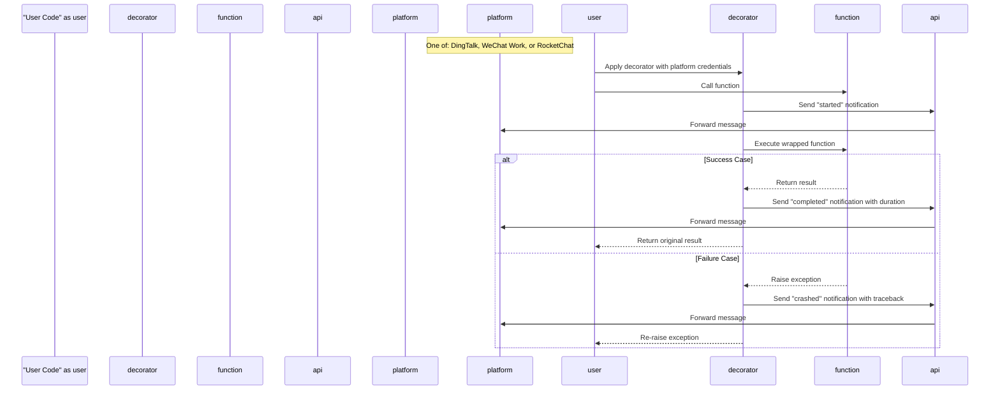
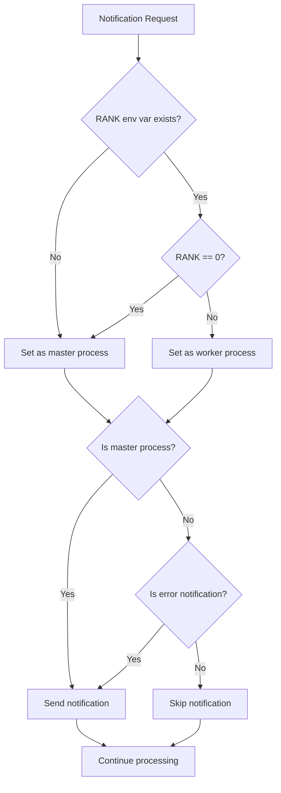
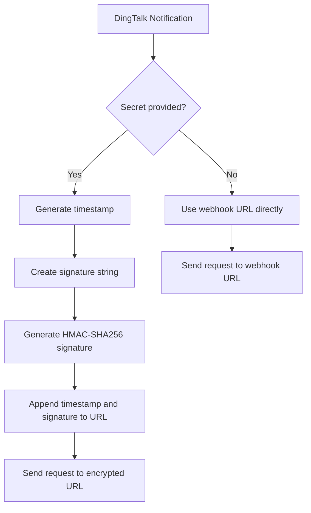
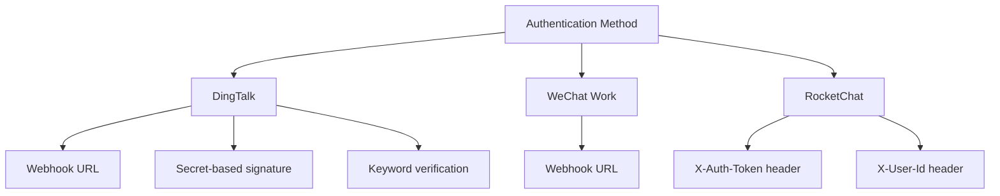
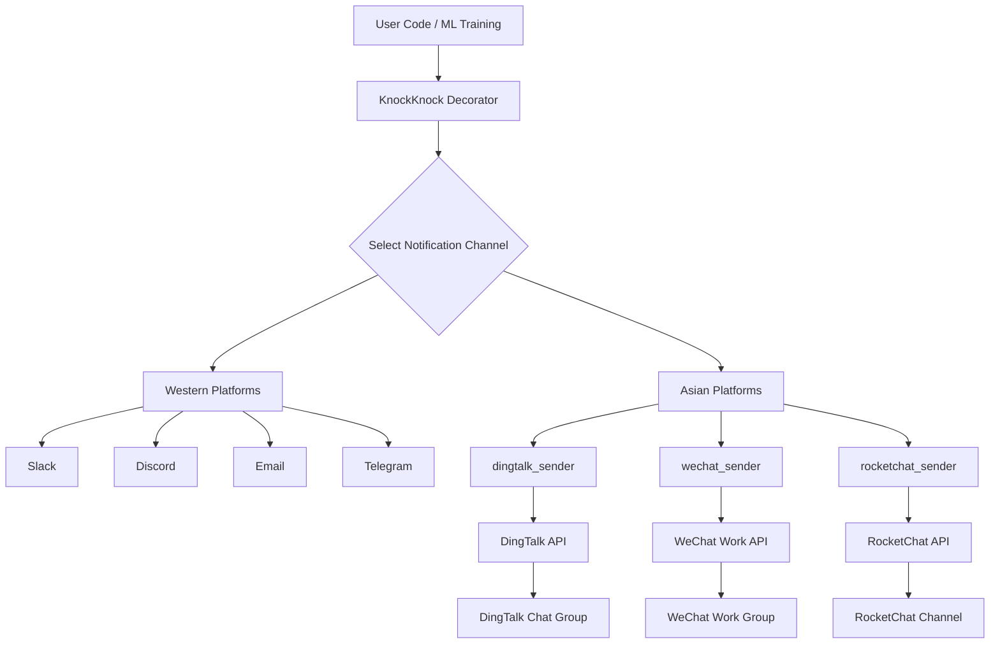

<!-- source: DeepWiki mcp.deepwiki.com · repo huggingface/knockknock · page 4.7 Asian Platform Notifications · fetched 2026-10-26 -->

# Asian Platform Notifications

<details>
<summary>Relevant source files</summary>

The following files were used as context for generating this wiki page:

- [knockknock/dingtalk_sender.py](knockknock/dingtalk_sender.py)
- [knockknock/rocketchat_sender.py](knockknock/rocketchat_sender.py)
- [knockknock/wechat_sender.py](knockknock/wechat_sender.py)

</details>


## Overview

This page documents the notification functionality for three platforms that are particularly popular in Asia: DingTalk, WeChat Work, and RocketChat. KnockKnock provides dedicated sender implementations for these platforms to facilitate notifications at the start, successful completion, or failure of long-running processes such as machine learning training jobs.

Sources: [knockknock/dingtalk_sender.py:15-162](), [knockknock/wechat_sender.py:12-118](), [knockknock/rocketchat_sender.py:11-143]()

## Common Architecture

All three notification platforms follow the same architectural pattern established in the knockknock library's decorator framework, providing:

1. A function that returns a decorator
2. Handling for distributed training environments
3. Notifications at three critical points: start, success, and failure
4. Customizable message formatting

### Notification Flow



Sources: [knockknock/dingtalk_sender.py:68-162](), [knockknock/wechat_sender.py:42-118](), [knockknock/rocketchat_sender.py:53-143]()

### Distributed Training Support

All three platforms handle distributed training environments by checking for the `RANK` environment variable to determine if the current process is the master process. Only the master process sends notifications for start and success events, while failure notifications are sent regardless of rank to ensure no errors are missed.



Sources: [knockknock/dingtalk_sender.py:76-86](), [knockknock/wechat_sender.py:50-60](), [knockknock/rocketchat_sender.py:64-74]()

## Platform Specific Implementations

### DingTalk

DingTalk (钉钉) is an enterprise communication and collaboration platform developed by Alibaba Group. The `dingtalk_sender` function creates a decorator that sends notifications to a DingTalk chatroom via a webhook URL.

#### Configuration Parameters

| Parameter | Type | Description |
|-----------|------|-------------|
| `webhook_url` | `str` | The webhook URL for the DingTalk chatroom |
| `user_mentions` | `List[str]` | Optional list of user phone numbers to notify |
| `secret` | `str` | Optional security signature for the DingTalk chatbot |
| `keywords` | `List[str]` | Optional keywords for keyword-based security |

#### Security Methods

DingTalk requires at least one of three security methods:
1. IP restriction (configured in the DingTalk admin panel)
2. Keyword verification (requires specific keywords in the message)
3. Secret-based signature verification (requires HMAC-SHA256 encryption)



Sources: [knockknock/dingtalk_sender.py:54-66](), [knockknock/dingtalk_sender.py:96-100]()

### WeChat Work

WeChat Work (企业微信), also known as WeCom, is an enterprise communication and collaboration platform developed by Tencent. The `wechat_sender` function creates a decorator that sends notifications to a WeChat Work group via a webhook URL.

#### Configuration Parameters

| Parameter | Type | Description |
|-----------|------|-------------|
| `webhook_url` | `str` | The webhook URL for the WeChat Work group |
| `user_mentions` | `List[str]` | Optional list of user IDs to notify |
| `user_mentions_mobile` | `List[str]` | Optional list of user mobile numbers to notify |

#### Message Structure

```mermaid
classDiagram
    class "WeChat Message" {
        msgtype: "text"
        text: Content
        text.content: String
        text.mentioned_list: List[String]
        text.mentioned_mobile_list: List[String]
    }
```

Sources: [knockknock/wechat_sender.py:33-40]()

### RocketChat

RocketChat is an open-source chat platform that can be self-hosted. While not exclusively Asian, it has significant adoption in Asia. The `rocketchat_sender` function creates a decorator that sends notifications to a RocketChat channel via the RocketChat API.

#### Configuration Parameters

| Parameter | Type | Description |
|-----------|------|-------------|
| `rocketchat_server_url` | `str` | The RocketChat server URL |
| `rocketchat_user_id` | `str` | The RocketChat user ID for authentication |
| `rocketchat_auth_token` | `str` | The personal access token for authentication |
| `channel` | `str` | The RocketChat channel to send notifications to |
| `user_mentions` | `List[str]` | Optional list of usernames to notify |
| `alias` | `str` | Optional alias to use for the notification |

#### Authentication and API Usage

```mermaid
classDiagram
    class "RocketChat Headers" {
        Content-type: "application/json"
        X-Auth-Token: String
        X-User-Id: String
    }
    
    class "RocketChat Message" {
        alias: String
        channel: String
        emoji: ":bell:"
        text: String
    }
```

Unlike DingTalk and WeChat Work which use simple webhook URLs, RocketChat requires authentication headers and sends messages to an API endpoint constructed from the server URL.

Sources: [knockknock/rocketchat_sender.py:41-51](), [knockknock/rocketchat_sender.py:57-58]()

## Comparison of Platforms

### Message Formatting

| Platform | Format | Emoji Support | Markdown Support | User Mentions |
|----------|--------|--------------|-----------------|--------------|
| DingTalk | Plain text | ✅ | ❌ | @phone_number |
| WeChat Work | Plain text | ✅ | ❌ | user_id or mobile |
| RocketChat | Markdown | ✅ | ✅ | @username |

### Authentication Methods



Sources: [knockknock/dingtalk_sender.py:17-20](), [knockknock/wechat_sender.py:13-15](), [knockknock/rocketchat_sender.py:14-19]()

## Usage Examples

### DingTalk Example

To use DingTalk notifications, you need to:
1. Create a DingTalk group
2. Add a chatbot to the group and configure it
3. Get the webhook URL
4. Apply the `dingtalk_sender` decorator to your function

```python
from knockknock import dingtalk_sender

@dingtalk_sender(
    webhook_url="https://oapi.dingtalk.com/robot/send?access_token=your_token",
    user_mentions=["1234567890"],  # Phone numbers to notify
    secret="your_secret_key",  # Optional
    keywords=["training"]  # Optional for keyword security
)
def train_model():
    # Your long-running function
    pass
```

### WeChat Work Example

To use WeChat Work notifications, you need to:
1. Create a WeChat Work group
2. Add a Group Robot to the group
3. Get the webhook URL
4. Apply the `wechat_sender` decorator to your function

```python
from knockknock import wechat_sender

@wechat_sender(
    webhook_url="https://qyapi.weixin.qq.com/cgi-bin/webhook/send?key=your_key",
    user_mentions=["user1", "user2"],  # Optional user IDs
    user_mentions_mobile=["1234567890"]  # Optional phone numbers
)
def train_model():
    # Your long-running function
    pass
```

### RocketChat Example

To use RocketChat notifications, you need to:
1. Have access to a RocketChat server
2. Create a personal access token
3. Apply the `rocketchat_sender` decorator to your function

```python
from knockknock import rocketchat_sender

@rocketchat_sender(
    rocketchat_server_url="https://your-rocketchat-server.com",
    rocketchat_user_id="your_user_id",
    rocketchat_auth_token="your_auth_token",
    channel="#general",
    user_mentions=["username1", "username2"],  # Optional
    alias="Training Bot"  # Optional
)
def train_model():
    # Your long-running function
    pass
```

Sources: [knockknock/dingtalk_sender.py:17-42](), [knockknock/wechat_sender.py:13-31](), [knockknock/rocketchat_sender.py:14-39]()

## Integration with knockknock Architecture



Sources: [knockknock/dingtalk_sender.py:15-162](), [knockknock/wechat_sender.py:12-118](), [knockknock/rocketchat_sender.py:11-143]()

---

