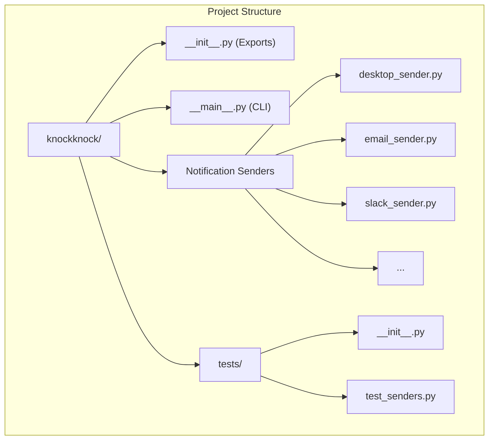
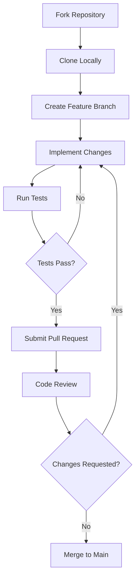
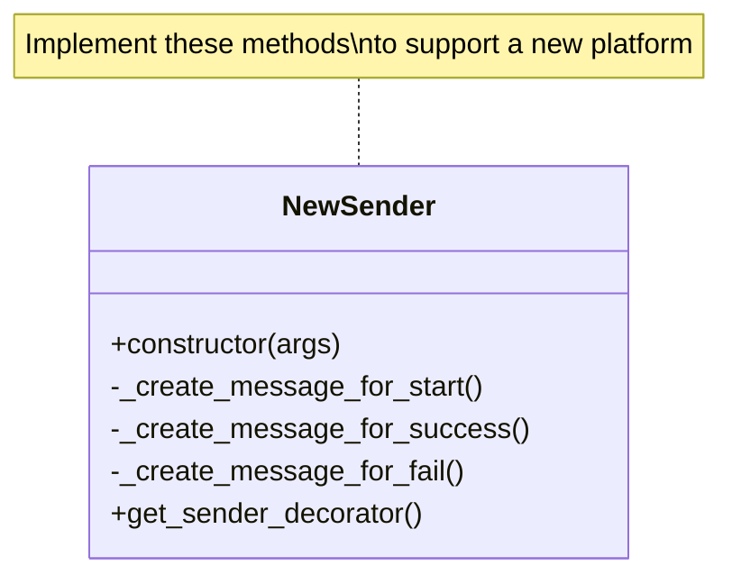
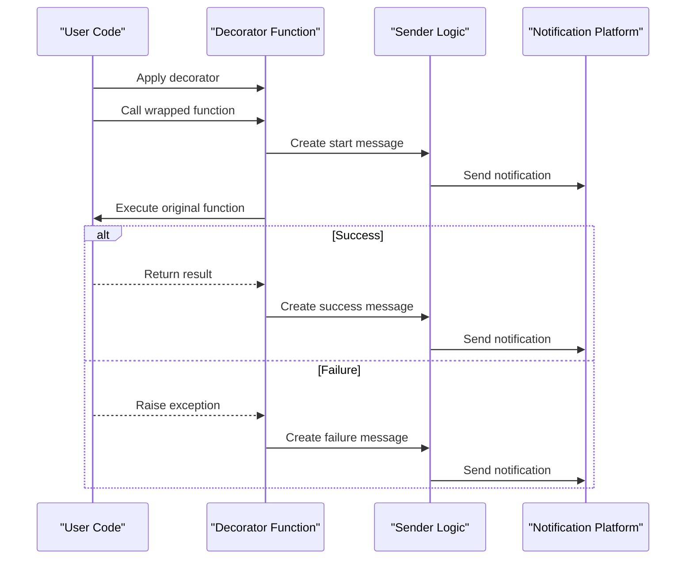
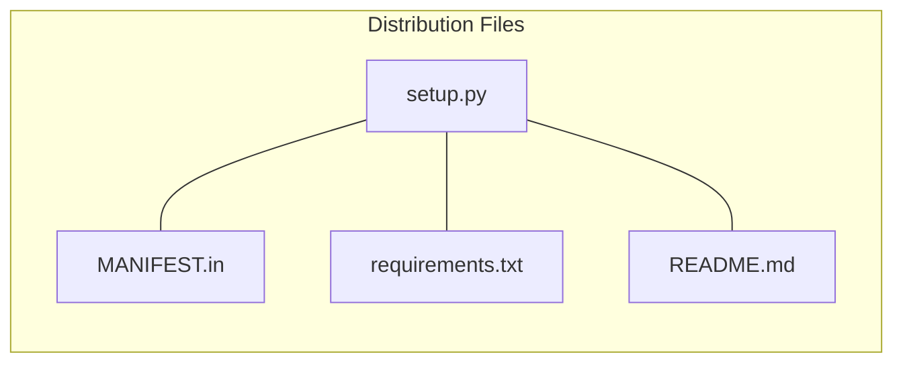

<!-- source: DeepWiki mcp.deepwiki.com · repo huggingface/knockknock · page 5 Development · fetched 2026-10-26 -->

# Development

<details>
<summary>Relevant source files</summary>

The following files were used as context for generating this wiki page:

- [.gitignore](.gitignore)
- [knockknock/tests/__init__.py](knockknock/tests/__init__.py)
- [knockknock/tests/test_senders.py](knockknock/tests/test_senders.py)

</details>


This page provides essential information for developers who want to contribute to the KnockKnock library. It covers setting up a development environment, understanding the project structure, and getting started with contributions. For detailed testing procedures, see [Testing](#5.1). For license details and contribution guidelines, see [License and Contributing](#5.2).

## Setting Up a Development Environment

To start contributing to KnockKnock, you'll need to set up a local development environment.

### Prerequisites

- Python 3.6 or higher
- Git

### Cloning and Installation

```bash
# Clone the repository
git clone https://github.com/huggingface/knockknock
cd knockknock

# Create a virtual environment (recommended)
python -m venv venv
source venv/bin/activate  # On Windows: venv\Scripts\activate

# Install in development mode
pip install -e .
```

Installing in development mode (`-e` flag) allows you to modify the code and see changes without reinstalling the package.

Sources: [.gitignore:9-16]()

## Project Structure

KnockKnock follows a modular architecture with each notification channel implemented as a separate module.



### Core Components for Developers

1. **Notification Senders**: Each notification platform has its own implementation file (e.g., `desktop_sender.py`, `slack_sender.py`).
2. **CLI Interface**: Implemented in `__main__.py` to provide command-line functionality.
3. **Tests**: Located in the `tests/` directory.

Sources: [knockknock/tests/__init__.py:1](), [knockknock/tests/test_senders.py:1-4]()

## Development Workflow

When contributing to KnockKnock, follow this typical development workflow:



Sources: [.gitignore:1-41]()

## Adding a New Notification Sender

One common contribution is adding support for a new notification platform. The following diagram illustrates the components you need to implement:



### Implementation Steps

1. Create a new file `new_platform_sender.py` in the knockknock root directory
2. Implement the required methods:
   - Constructor to handle authentication/configuration
   - Message creation methods for different states
   - Decorator function that wraps user code
3. Export the sender in `__init__.py`
4. Add CLI support in `__main__.py`
5. Create tests in `tests/test_senders.py`

## Example Pattern for Notification Senders

All notification senders follow a similar pattern. Understanding this pattern is crucial for development.



This sequence shows how notification senders interact with user code and external platforms.

Sources: [knockknock/tests/test_senders.py:7-17]()

## Testing During Development

KnockKnock uses Python's built-in unittest framework. A basic test example:

```python
# Example test case from test_senders.py
@desktop_sender(title="Test Desktop")
def train():
    import time
    time.sleep(5)
    return {"loss": 1}
self.assertEqual(train(), {"loss": 1})
```

To run the tests during development:

```bash
python -m unittest discover -v knockknock.tests
```

For more detailed testing information, see [Testing](#5.1).

Sources: [knockknock/tests/test_senders.py:3-20]()

## Distribution and Packaging

When preparing a new release, ensure your changes adhere to the following standards:

### Package Structure



### Creating Distribution Packages

```bash
# Build distribution packages
python setup.py sdist bdist_wheel

# Check packages for errors
pip install twine
twine check dist/*
```

Sources: [.gitignore:18-37]()

## Development Best Practices

1. **Code Style**: Follow PEP 8 guidelines
2. **Documentation**: Document all public functions and classes
3. **Error Handling**: Implement proper error handling for external APIs
4. **Backward Compatibility**: Maintain compatibility with existing code
5. **Tests**: Write tests for new features and bug fixes

By following these guidelines, you can contribute effectively to the KnockKnock project and help improve its functionality and reliability.

---

