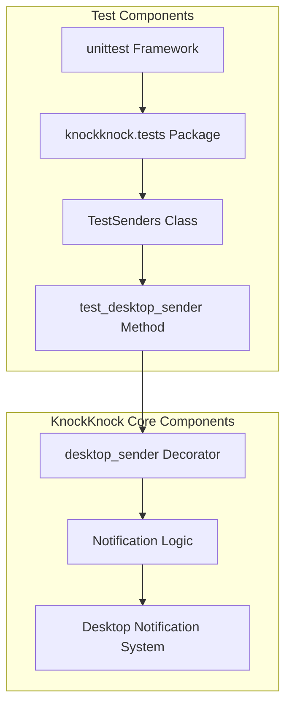
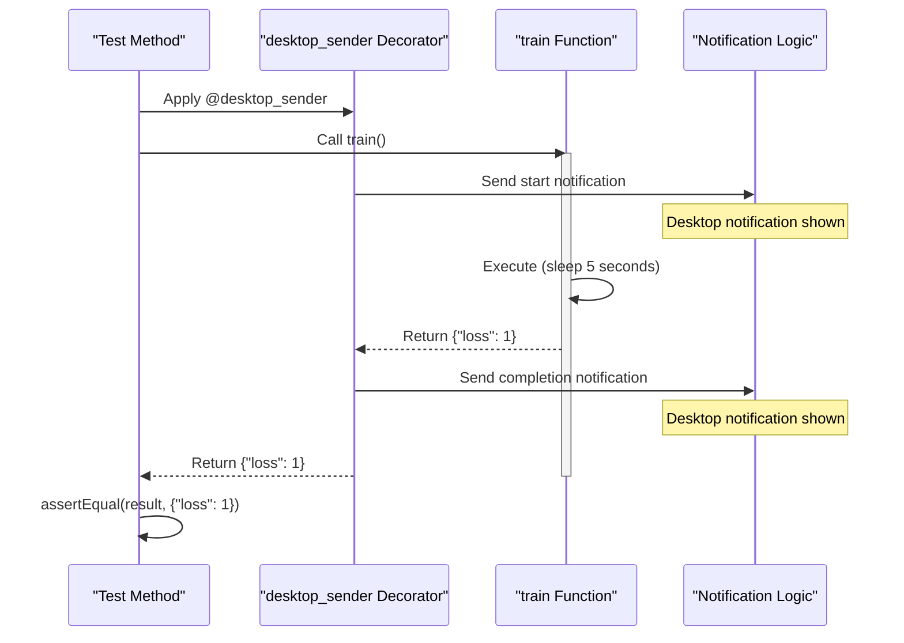
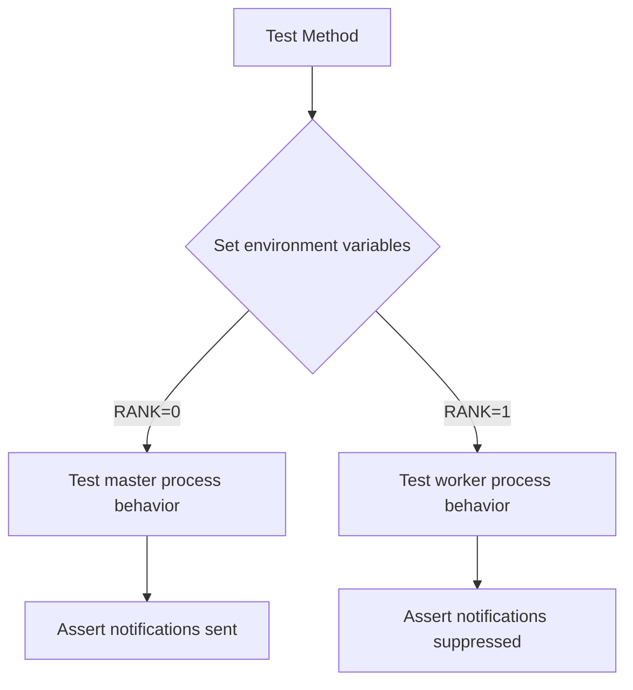

<!-- source: DeepWiki mcp.deepwiki.com · repo huggingface/knockknock · page 5.1 Testing · fetched 2026-10-26 -->

# Testing

<details>
<summary>Relevant source files</summary>

The following files were used as context for generating this wiki page:

- [knockknock/tests/__init__.py](knockknock/tests/__init__.py)
- [knockknock/tests/test_senders.py](knockknock/tests/test_senders.py)

</details>


This document explains the testing framework and processes for the KnockKnock library. It covers how to run tests, the structure of the test suite, current test coverage, and guidelines for writing new tests. For information about contributing to the project in general, see [License and Contributing](#5.2).

## Test Structure and Organization

KnockKnock uses Python's built-in unittest framework. The tests are located in the `knockknock/tests/` directory with the following structure:

```
knockknock/
└── tests/
    ├── __init__.py
    └── test_senders.py
```

- `__init__.py`: An empty file that makes the directory a Python package.
- `test_senders.py`: Contains tests for the notification sender functionality.

Sources: [knockknock/tests/__init__.py](), [knockknock/tests/test_senders.py]()

## Running Tests

Tests can be run using the following command from the root directory of the repository:

```bash
python -m unittest discover -v knockknock.tests
```

This command discovers and runs all test cases in the tests directory, as specified in the test file header comment.

Sources: [knockknock/tests/test_senders.py:1-4]()

## Current Test Coverage

The current test suite is minimal, with a focus on the `desktop_sender` functionality. The main test class is `TestSenders` in `test_senders.py`, which verifies that a function decorated with `@desktop_sender` executes correctly and returns its original result.

```python
def test_desktop_sender(self):
    @desktop_sender(title="Test Desktop")
    def train():
        import time
        time.sleep(5)
        return {"loss": 1}
    self.assertEqual(train(), {"loss": 1})
```

This test ensures that the desktop notification sender correctly wraps the function, allows it to execute, and returns the expected result.

Sources: [knockknock/tests/test_senders.py:9-17]()

## Test Architecture

The following diagram shows how the test framework interacts with the KnockKnock components:



Sources: [knockknock/tests/test_senders.py]()

The sequence diagram below illustrates the flow of a typical test for a notification sender:



Sources: [knockknock/tests/test_senders.py:11-17]()

## Writing New Tests

To add new tests for KnockKnock, follow these guidelines:

1. Add new test methods to the `TestSenders` class in `test_senders.py` or create new test classes for different components.
2. Follow the pattern of existing tests: wrap a function with the notification sender decorator and verify its execution.
3. For notification senders that require external services (like Slack, Email, etc.), use mocks to avoid actual API calls during tests.

Example of how you might add a test for another sender (this is illustrative):

```python
from unittest.mock import patch

def test_slack_sender(self):
    # Mock the Slack API call
    with patch('knockknock.slack_sender.requests.post') as mock_post:
        mock_post.return_value.status_code = 200
        
        @slack_sender(webhook_url="https://hooks.slack.com/services/XXX")
        def train():
            return {"accuracy": 0.95}
            
        self.assertEqual(train(), {"accuracy": 0.95})
        self.assertTrue(mock_post.called)
```

## Testing Distributed Training Support

KnockKnock supports distributed training environments by checking the `RANK` environment variable. To test this functionality, you'll need to simulate different rank values using environment variable mocking:



Example test code:

```python
def test_distributed_training(self):
    # Test with RANK=0 (master process)
    with patch.dict('os.environ', {'RANK': '0'}):
        @some_sender()
        def master_process():
            return "master"
        result = master_process()
        self.assertEqual(result, "master")
        # Assert notifications were sent
        
    # Test with RANK=1 (worker process)
    with patch.dict('os.environ', {'RANK': '1'}):
        @some_sender()
        def worker_process():
            return "worker"
        result = worker_process()
        self.assertEqual(result, "worker")
        # Assert notifications were not sent
```

## Future Test Improvements

The current test suite could be expanded to include:

1. Tests for all notification senders (email, Slack, Discord, Telegram, etc.)
2. Tests for the CLI interface (`__main__.py`)
3. Tests for error handling and exception cases
4. Integration tests for notification formatting
5. Tests for distributed training scenarios

| Component | Current Test Coverage | Suggested Improvements |
|-----------|----------------------|------------------------|
| Desktop Sender | Basic functionality | Error handling, notification content |
| Email Sender | None | Mock email service, verify formats |
| Slack/Discord | None | Mock API calls, verify payloads |
| CLI Interface | None | Command parsing, execution flow |
| Distributed Training | None | Various rank scenarios |

Contributors are encouraged to improve test coverage by adding tests for new functionality or when fixing bugs.

## Recommended Testing Tools

While the current test suite uses Python's built-in unittest framework, other testing tools that could enhance the testing process include:

- **pytest**: For more concise test syntax
- **coverage.py**: For measuring code coverage
- **tox**: For testing across multiple Python versions
- **mock**: For more advanced mocking capabilities

These tools could be integrated into the testing workflow to improve the overall testing process for KnockKnock.

---

