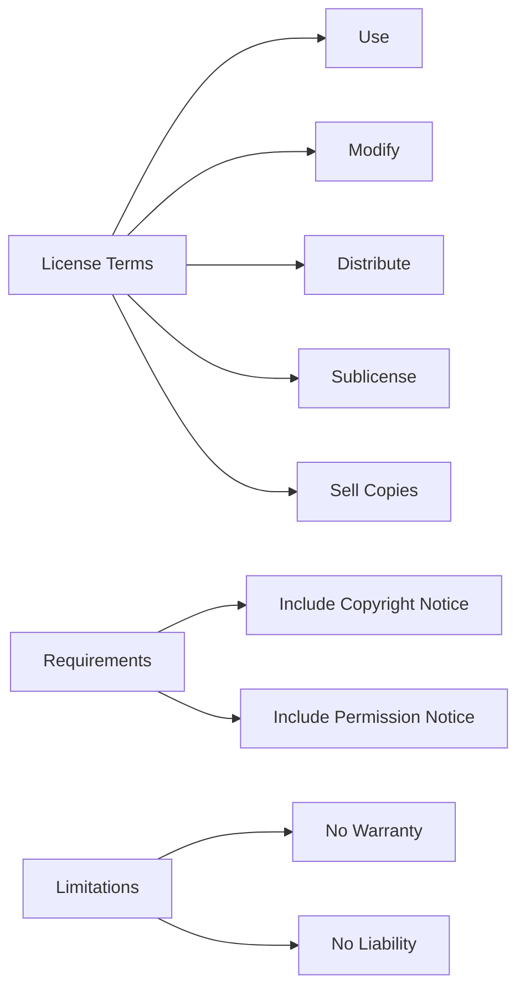
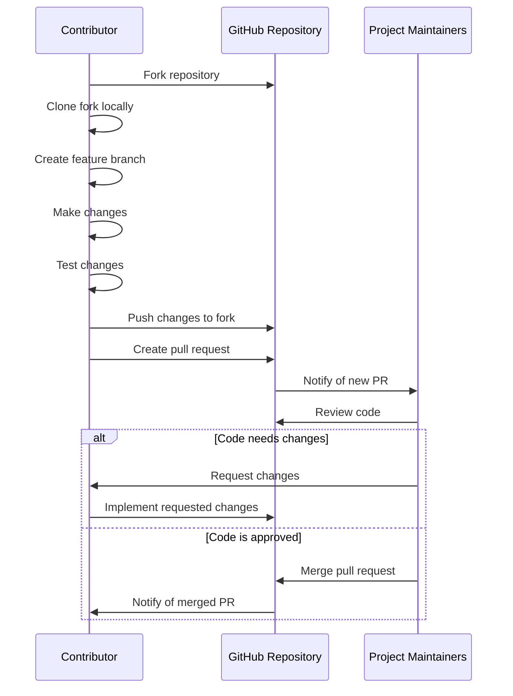
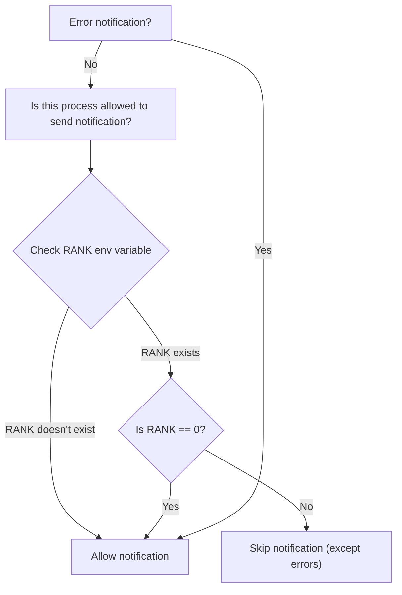

<!-- source: DeepWiki mcp.deepwiki.com · repo huggingface/knockknock · page 5.2 License and Contributing · fetched 2026-10-26 -->

# License and Contributing

<details>
<summary>Relevant source files</summary>

The following files were used as context for generating this wiki page:

- [LICENSE](LICENSE)
- [README.md](README.md)

</details>


This page provides comprehensive information about the license under which KnockKnock is distributed and how to contribute to the project. For information about testing the library, see [Testing](#5.1).

## License

KnockKnock is released under the MIT License, a permissive open-source license that allows for broad use, modification, and distribution of the software.

### MIT License Terms

The MIT License grants the following permissions to users of KnockKnock:



The full text of the license can be found in the LICENSE file in the root directory of the project. The copyright is held by Victor SANH and Hugging Face (2019).

Sources: [LICENSE:1-22]()

## Contributing to KnockKnock

KnockKnock welcomes contributions from the community. The project has already benefited from numerous external contributors who have added support for various notification platforms.

### Contribution Workflow



Sources: [README.md:25-38]()

### Setting Up Development Environment

To set up your development environment for contributing to KnockKnock:

1. Fork the repository on GitHub
2. Clone your fork locally
3. Install the package in development mode:

```bash
git clone https://github.com/yourusername/knockknock.git
cd knockknock
pip install -e .
```

### Adding New Notification Channels

One of the most common contributions to KnockKnock is adding support for new notification platforms. The codebase follows a consistent pattern for implementing notification channels:

```mermaid
classDiagram
    class "New Channel Module" {
        +decorator_function()
        +send_start_notification()
        +send_end_notification()
        +send_error_notification()
        +handle_distributed_training()
    }
    
    class "__init__.py" {
        +Import and expose new module
    }
    
    class "__main__.py" {
        +Add CLI support for new channel
    }
    
    "New Channel Module" --> "__init__.py": Export
    "New Channel Module" --> "__main__.py": CLI integration
```

When adding a new notification channel, you should:

1. Create a new Python module in the main package
2. Implement the notification functions following the pattern of existing channels
3. Add support for the channel to the CLI in `__main__.py`
4. Add documentation for the channel in the README
5. Test the channel functionality

Sources: [README.md:25-38](), [README.md:40-396]()

### Community Contributors

KnockKnock has benefited from contributions by many developers who have expanded the notification capabilities:

| Notification Platform | External Contributors |
| --------------------- | -------------------- |
| Microsoft Teams | @noklam |
| Text Message (SMS) | @abhishekkrthakur |
| Discord | @watkinsm |
| Desktop Notification | @atakanyenel, @eyalmazuz |
| Matrix | @jcklie |
| Amazon Chime | @prabhakar267 |
| DingTalk | @wuutiing |
| RocketChat | @radao |
| WeChat Work | @jcyk |

Sources: [README.md:25-38]()

### Handling Distributed Training

When contributing features to KnockKnock, it's important to consider distributed training environments. The library has a specific approach to handle notifications in multi-process scenarios:



This ensures that only the master process sends notifications (except for error notifications, which are always sent from any process) to prevent duplicate notifications in distributed training environments.

Sources: [README.md:401-405]()

### Submitting Pull Requests

When submitting a pull request:

1. Ensure your code follows the style of the existing codebase
2. Include tests for new functionality
3. Update documentation, including the README if needed
4. Make sure all tests pass
5. Create a clear, descriptive pull request that explains the changes and their purpose

### Reporting Issues

If you encounter bugs or have feature requests:

1. Check existing issues to avoid duplicates
2. Open a new issue with a clear description of the problem or feature request
3. Include steps to reproduce bugs and any relevant environment information
4. If possible, suggest a solution or implementation approach

## Future Development Opportunities

The following areas could benefit from further contributions:

1. Additional notification platforms
2. Enhanced customization of notification messages
3. Improved error handling and recovery
4. Expanded testing coverage
5. Enhanced documentation and examples

Sources: [README.md:5-7]()