# Page: Overview

# Overview

<details>
<summary>Relevant source files</summary>

The following files were used as context for generating this wiki page:

- [README.md](README.md)
- [setup.py](setup.py)

</details>


Knockknock is a lightweight Python library that provides notification capabilities for long-running processes, particularly machine learning training jobs. With minimal code modification (just adding a decorator), users can receive notifications when their processes start, complete successfully, or crash.

## Purpose and Scope

The primary purpose of knockknock is to solve a common problem in machine learning and other computational fields: monitoring long-running processes without constant supervision. When training deep learning models with early stopping, it's difficult to predict exactly when training will finish. Knockknock addresses this by automatically sending notifications across various communication platforms.

For detailed installation instructions, see [Installation](#1.1).
For a quick start guide, see [Quick Start](#1.2).

## Core Architecture

Knockknock uses the decorator pattern to wrap around user functions, enabling it to execute notification actions before the function runs, after successful completion, and when errors occur.

### Decorator Flow

The following diagram illustrates how the decorator pattern is used to implement notifications:

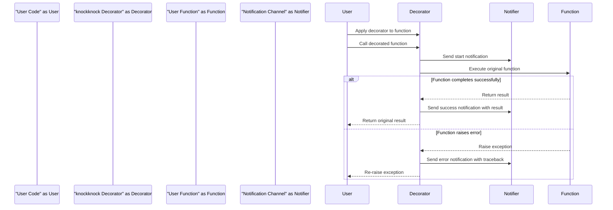

Sources: [README.md:20-22]()

### System Components

Knockknock consists of several key components that work together to provide notification functionality:

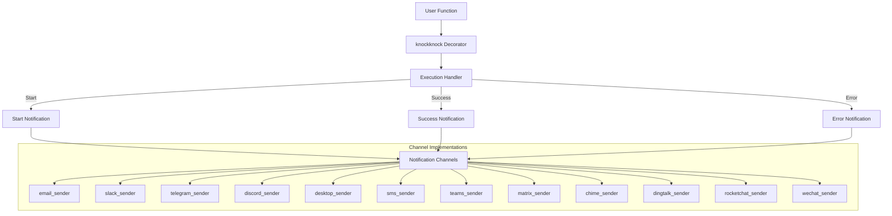

Sources: [README.md:23-38](), [setup.py:22-29]()

## Notification Channels

Knockknock supports twelve different notification channels:

| Channel | Required Configuration | Python Import | CLI Command |
|---------|------------------------|---------------|-------------|
| Email | Sender email, Recipient email(s) | `email_sender` | `email` |
| Slack | Webhook URL, Channel | `slack_sender` | `slack` |
| Telegram | Token, Chat ID | `telegram_sender` | `telegram` |
| Discord | Webhook URL | `discord_sender` | `discord` |
| Desktop | Title (optional) | `desktop_sender` | `desktop` |
| SMS/Twilio | Account SID, Auth Token, Recipient Number, Sender Number | `sms_sender` | `sms` |
| Microsoft Teams | Webhook URL | `teams_sender` | `teams` |
| Matrix | Homeserver, Token, Room | `matrix_sender` | `matrix` |
| Amazon Chime | Webhook URL | `chime_sender` | `chime` |
| DingTalk | Webhook URL, Secret/Keywords | `dingtalk_sender` | `dingtalk` |
| RocketChat | Server URL, User ID, Auth Token, Channel | `rocketchat_sender` | `rocketchat` |
| WeChat Work | Webhook URL | `wechat_sender` | `wechat` |

Sources: [README.md:23-38](), [README.md:41-396]()

For more detailed information about specific notification channels, see [Notification Channels](#4).

## Usage Patterns

Knockknock can be used in two ways: as a Python decorator or via the command-line interface.

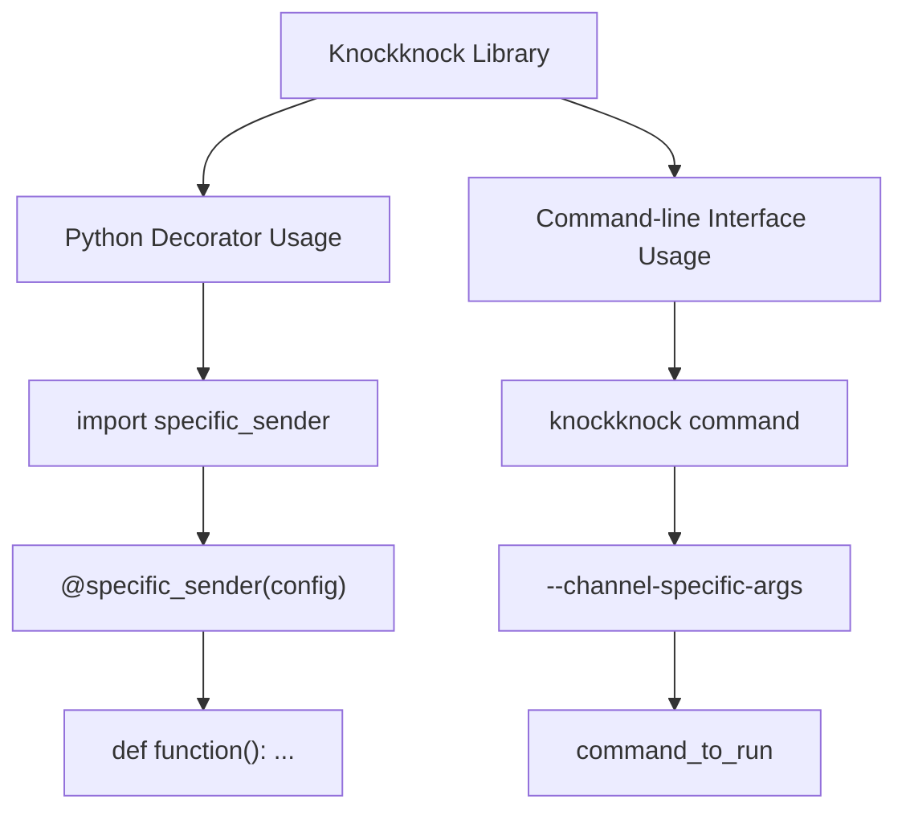

Sources: [README.md:19-22](), [setup.py:15-19]()

### Python Decorator Usage

The primary way to use knockknock is as a decorator in Python code:

```python
from knockknock import slack_sender

@slack_sender(webhook_url="<webhook_url>", channel="<channel>")
def train_model(parameters):
    # Long-running training process
    return {"loss": 0.9}  # Optional return value
```

Sources: [README.md:47-55](), [README.md:76-86]()

### Command-line Interface

Knockknock also provides a command-line interface for executing commands with notifications:

```bash
knockknock slack --webhook-url <url> --channel <channel> sleep 10
```

This allows users to run any command and get notifications without modifying code.

Sources: [README.md:57-64](), [README.md:91-97]()

## Distributed Training Support

Knockknock intelligently handles distributed training environments to prevent duplicate notifications:

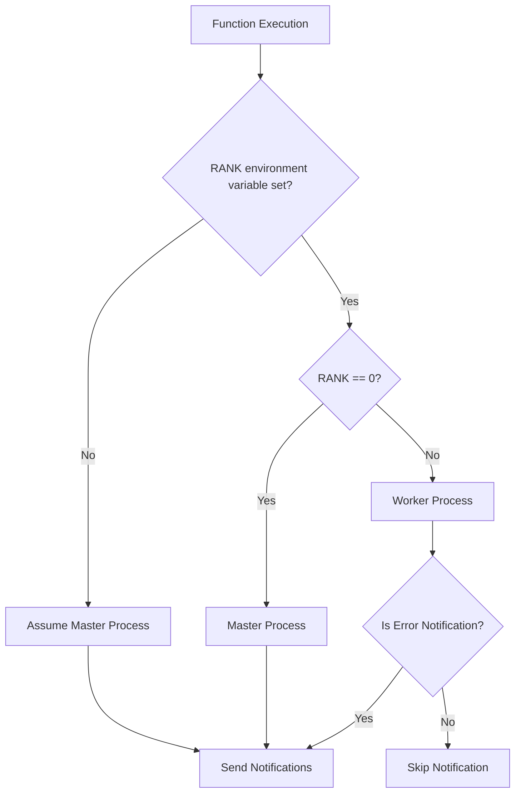

In distributed training setups (like those using PyTorch's distributed.launch), the RANK environment variable identifies each process. Knockknock uses this to ensure that only the master process (RANK=0) sends notifications, except for error notifications which are always sent.

Sources: [README.md:401-405]()

## Package Structure

The knockknock package is organized into modules for each notification channel and includes a command-line interface:

```mermaid
classDiagram
    class "__main__" {
        +main()
        +parse_args()
        +execute_command()
    }
    
    class "Notification Decorators" {
        <<conceptual>>
        +decorator()
        +wrapper()
        +send_start_notification()
        +send_end_notification()
        +send_error_notification()
    }
    
    "__main__" --> "Notification Decorators" : Uses
    
    "Notification Decorators" <|-- "email_sender"
    "Notification Decorators" <|-- "slack_sender"
    "Notification Decorators" <|-- "telegram_sender"
    "Notification Decorators" <|-- "discord_sender"
    "Notification Decorators" <|-- "desktop_sender"
    "Notification Decorators" <|-- "sms_sender"
    "Notification Decorators" <|-- "teams_sender"
    "Notification Decorators" <|-- "matrix_sender"
    "Notification Decorators" <|-- "chime_sender"
    "Notification Decorators" <|-- "dingtalk_sender"
    "Notification Decorators" <|-- "rocketchat_sender"
    "Notification Decorators" <|-- "wechat_sender"
```

Sources: [README.md:23-38](), [setup.py:14-19](), [setup.py:22-29]()

## Summary

Knockknock provides a simple, elegant solution for monitoring long-running processes by sending notifications at key events. With support for multiple notification platforms and a flexible decorator-based architecture, it can be easily integrated into existing code with minimal changes. The library also handles distributed training environments to prevent notification spam.

For more details on the architecture, see [Architecture](#2).
For more information about the command-line interface, see [Command-Line Interface](#3).
For detailed documentation on specific notification channels, see [Notification Channels](#4).

Sources: [README.md:5-7](), [setup.py:7-8]()

---

# Page: Installation

# Installation

<details>
<summary>Relevant source files</summary>

The following files were used as context for generating this wiki page:

- [README.md](README.md)
- [setup.py](setup.py)

</details>


This document provides detailed instructions for installing the knockknock library, a lightweight notification tool that allows you to receive alerts when your long-running processes (like machine learning training jobs) complete or crash. For information about using knockknock after installation, see [Quick Start](#1.2).

## System Requirements

knockknock requires **Python 3.6 or later** to function properly. The library has been primarily tested on Python 3.6+ environments, as specified in the package setup.

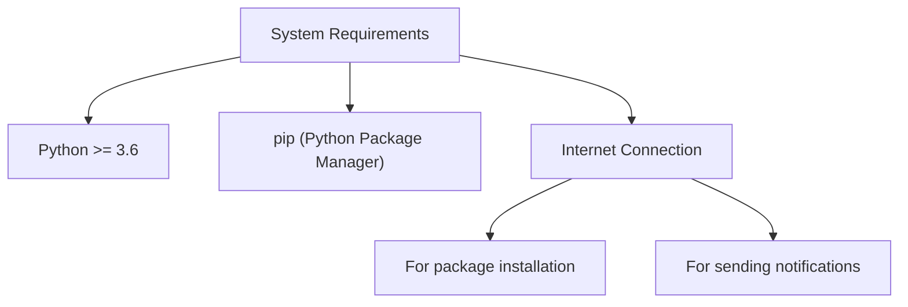

Sources: [README.md:17](), [setup.py:21]()

## Standard Installation

The simplest way to install knockknock is via pip:

```bash
pip install knockknock
```

This command installs the latest stable version of knockknock from PyPI along with all required dependencies.

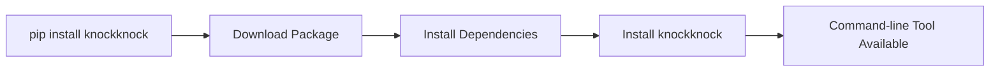

Sources: [README.md:11-15](), [setup.py:4-7]()

## Package Dependencies

When you install knockknock, several dependencies are automatically installed to support various notification channels:

| Dependency | Purpose | Required For |
|------------|---------|--------------|
| yagmail (≥0.11.214) | Gmail/SMTP client | Email notifications |
| keyring | Secure credential storage | Email credentials |
| matrix_client | Matrix protocol client | Matrix notifications |
| python-telegram-bot | Telegram API client | Telegram notifications |
| requests | HTTP requests | Most web-based notifications (Slack, Discord, etc.) |
| twilio | SMS gateway client | Text message notifications |

Additional platform-specific dependencies may be required for desktop notifications, which vary by operating system.

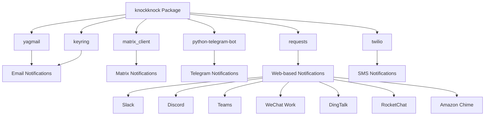

Sources: [setup.py:22-29]()

## Command-line Installation

The installation of knockknock automatically makes the `knockknock` command-line tool available in your environment. This CLI tool provides the same notification functionality as the Python decorators but is usable directly from the command line.

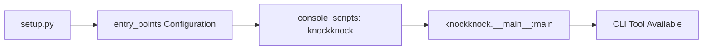

Sources: [setup.py:15-19]()

## Verifying Installation

To verify that knockknock has been installed correctly, you can run the following command in your terminal:

```bash
pip list | grep knockknock
```

This should display the installed version of knockknock. Alternatively, you can check if the command-line interface is available:

```bash
knockknock --help
```

## Platform-specific Considerations

### Desktop Notifications

The desktop notification functionality has specific requirements depending on your operating system:

- **MacOS**: No additional requirements
- **Linux**: Requires a notification server and the `notify-send` command (available in most desktop environments)
- **Windows 10**: No additional requirements

### Email Notifications

For email notifications, you'll need to:

1. Have a Gmail account (for the sender)
2. Allow "less secure apps" access to your Gmail account
3. Store the password securely using the keyring library

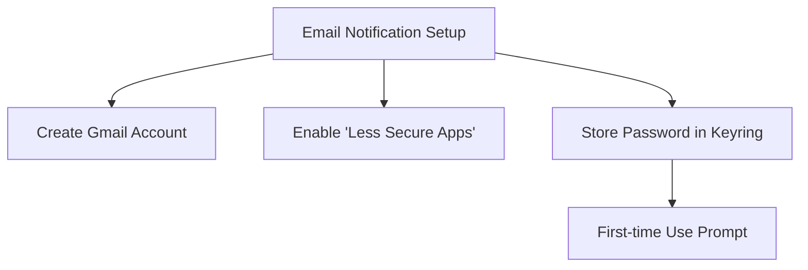

Sources: [README.md:43-46]()

## Advanced Installation

### Installing from Source

For the latest development version or to contribute to the project, you can install directly from the GitHub repository:

```bash
git clone https://github.com/huggingface/knockknock.git
cd knockknock
pip install -e .
```

## Package Structure

knockknock's installation and package structure are designed for simplicity and extensibility:

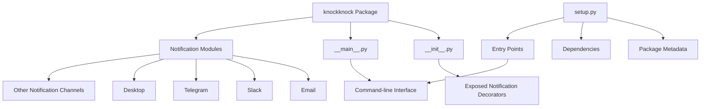

Sources: [setup.py:1-37]()

## Troubleshooting

### Common Installation Issues

1. **Permission Errors**: If you encounter permission errors during installation, try:
   ```bash
   pip install --user knockknock
   ```

2. **Dependency Conflicts**: If you have conflicts with existing packages, consider using a virtual environment:
   ```bash
   python -m venv knockknock-env
   source knockknock-env/bin/activate  # On Windows: knockknock-env\Scripts\activate
   pip install knockknock
   ```

3. **Keyring Issues**: On headless servers, the keyring library might have trouble storing credentials. Consider using environment variables or configuration files instead.

---

# Page: Quick Start

# Quick Start

<details>
<summary>Relevant source files</summary>

The following files were used as context for generating this wiki page:

- [README.md](README.md)
- [knockknock/__init__.py](knockknock/__init__.py)

</details>


This guide provides a quick introduction to get you started with knockknock, a Python library that sends notifications when your long-running processes start, complete, or fail. If you're looking for installation instructions, see [Installation](#1.1), or for a detailed overview of all notification channels, see [Notification Channels](#4).

## What is knockknock?

knockknock is a lightweight notification library that requires minimal code changes to implement. With just a decorator added to your function, you can receive notifications across various platforms when your long-running processes (like machine learning training jobs) start, complete successfully, or crash unexpectedly.

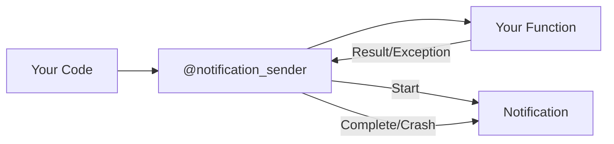

Sources: [README.md:5-7](), [knockknock/__init__.py:1-12]()

## Basic Usage Pattern

The fundamental pattern in knockknock is the decorator pattern. You simply add a decorator to your main function, and knockknock handles sending notifications at appropriate times.

### Decorator Workflow

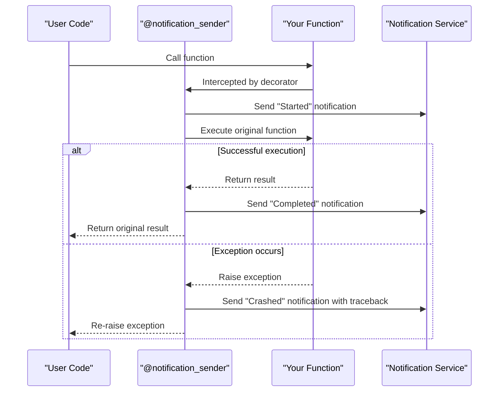

Sources: [README.md:21-22]()

## Simple Example: Email Notification

Here's a basic example using email notifications:

```python
from knockknock import email_sender

@email_sender(recipient_emails=["your_email@example.com"], 
              sender_email="notification_sender@gmail.com")
def train_model(parameters):
    # Your long-running code here
    import time
    time.sleep(100)  # Simulating long process
    return {"accuracy": 0.95}  # Optional return value
```

The first time you run this code, you'll be prompted for the sender's email password. It will be securely stored in your system's keyring.

Sources: [README.md:48-55](), [README.md:43-44]()

## Command-Line Interface

You can also use knockknock directly from the command line:

```bash
knockknock email \
    --recipient-emails your_email@example.com \
    --sender-email notification_sender@gmail.com \
    python train_model.py
```

This will run the `train_model.py` script and send notifications when it starts and completes.

Sources: [README.md:59-64]()

## Available Notification Channels

knockknock supports multiple notification channels:

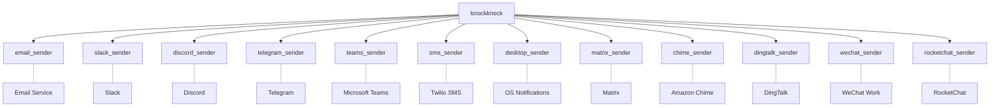

Sources: [knockknock/__init__.py:1-12](), [README.md:23-38]()

### Comparison: Decorator vs CLI Usage

| Feature | Python Decorator | Command-Line Interface |
|---------|------------------|------------------------|
| Integration | Added directly to your code | Wraps around an existing command |
| Configuration | Parameters in decorator | Command-line arguments |
| Best for | Integrating into existing Python code | Quick use with existing scripts |
| Example | `@email_sender(recipient_emails=["me@example.com"])` | `knockknock email --recipient-emails me@example.com python script.py` |

Sources: [README.md:45-68](), [README.md:19-22]()

## Platform-Specific Configuration

Each notification platform requires specific configuration:

1. **Email**: Requires Gmail account (or other SMTP) and needs to [allow less secure apps](https://devanswers.co/allow-less-secure-apps-access-gmail-account/)
2. **Slack**: Requires webhook URL and optionally channel name
3. **Discord**: Requires webhook URL
4. **Telegram**: Requires API token and chat ID
5. **Desktop**: Works on macOS, Linux, and Windows 10

For detailed configuration of each platform, see [Notification Channels](#4).

Sources: [README.md:41-44](), [README.md:72-73](), [README.md:190-191](), [README.md:104-106](), [README.md:216-217]()

## Distributed Training Support

knockknock intelligently handles distributed training environments, sending notifications only from the master process to avoid duplicate notifications.

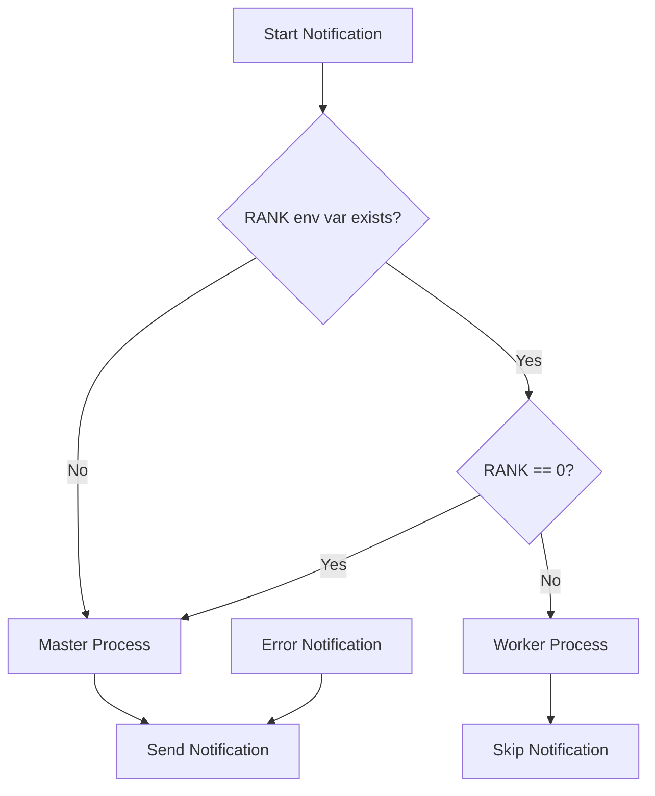

Sources: [README.md:401-405]()

## Next Steps

For more detailed information on:
- Each notification channel's configuration, see [Notification Channels](#4)
- Understanding the decorator pattern in knockknock, see [Decorator Pattern](#2.1)
- Using the CLI with examples, see [CLI Usage Examples](#3.1)

---

# Page: Architecture

# Architecture

<details>
<summary>Relevant source files</summary>

The following files were used as context for generating this wiki page:

- [README.md](README.md)
- [knockknock/__init__.py](knockknock/__init__.py)
- [knockknock/__main__.py](knockknock/__main__.py)

</details>


This document provides a technical overview of the design and architecture of the knockknock library. It explains the core components, their relationships, and the underlying patterns that enable the notification functionality. For information about installation and usage, see [Overview](#1) and [Quick Start](#1.2).

## Overview

KnockKnock is a Python library that provides notification capabilities for long-running processes, particularly machine learning training jobs. The library implements a decorator-based approach that allows users to receive notifications when their processes start, complete successfully, or crash.

The architecture follows a simple yet effective design centered around the decorator pattern. This enables users to add notification capabilities to their existing code with minimal modifications.

### High-Level Architecture

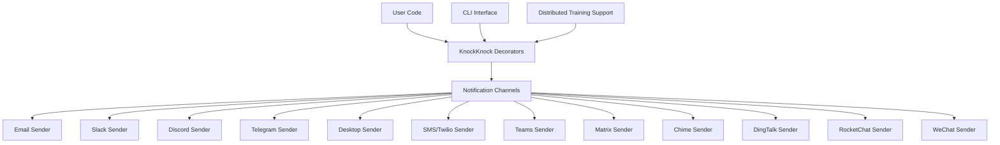

Sources: [README.md:1-406](), [knockknock/__init__.py:1-13](), [knockknock/__main__.py:1-212]()

## Core Components

KnockKnock consists of several key components that work together to provide the notification functionality:

1. **Decorators**: Python function decorators that wrap user-defined functions to add notification capabilities.
2. **Notification Senders**: Specialized modules that handle sending notifications to different platforms.
3. **CLI Interface**: Command-line interface for using KnockKnock without modifying code.
4. **Distributed Training Support**: Logic to handle notifications in distributed environments.

### Component Relationships

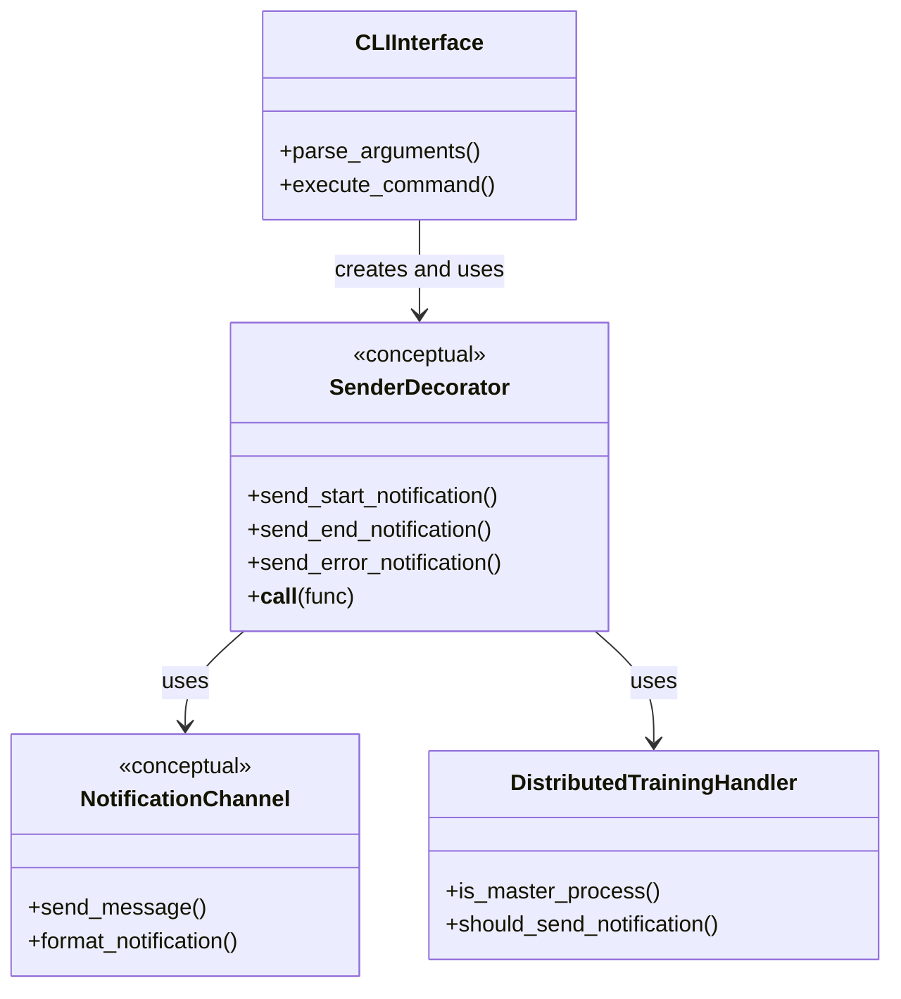

Sources: [README.md:19-69](), [knockknock/__main__.py:17-207]()

## Decorator Pattern Implementation

The decorator pattern is central to KnockKnock's design. It allows the library to intercept function calls, send notifications at appropriate times, and handle errors, all while being transparent to the wrapped function.

### Execution Flow

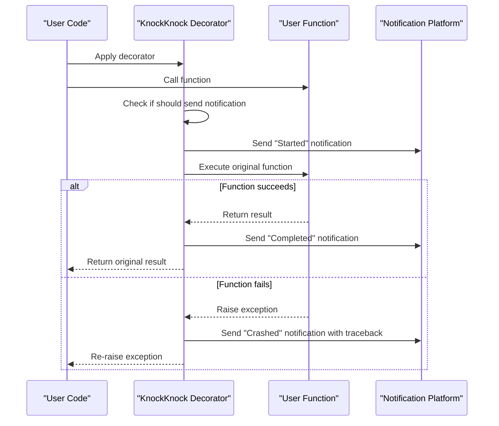

Sources: [README.md:46-55](), [README.md:77-86](), [README.md:112-119]()

## Notification Channels

KnockKnock supports multiple notification channels, each implemented as a separate module. Despite their different implementations, all channels follow a common pattern.

### Channel Structure

```mermaid
classDiagram
    class BaseSender {
        <<conceptual>>
        +send_start_notification()
        +send_success_notification()
        +send_failure_notification()
        +handle_distributed_training()
    }
    
    class email_sender {
        +configure_email_settings()
        +send_via_yagmail()
    }
    
    class slack_sender {
        +configure_webhook()
        +send_via_webhook()
    }
    
    class discord_sender {
        +configure_webhook()
        +send_via_webhook()
    }
    
    class telegram_sender {
        +configure_bot()
        +send_via_bot_api()
    }
    
    class teams_sender {
        +configure_webhook()
        +send_via_webhook()
    }
    
    class sms_sender {
        +configure_twilio()
        +send_via_twilio()
    }
    
    class desktop_sender {
        +detect_platform()
        +send_os_notification()
    }
    
    class matrix_sender {
        +configure_client()
        +send_via_matrix_api()
    }
    
    class chime_sender {
        +configure_webhook()
        +send_via_webhook()
    }
    
    class dingtalk_sender {
        +configure_webhook()
        +send_via_webhook()
    }
    
    class rocketchat_sender {
        +configure_client()
        +send_via_api()
    }
    
    class wechat_sender {
        +configure_webhook()
        +send_via_webhook()
    }
    
    BaseSender <|-- email_sender
    BaseSender <|-- slack_sender
    BaseSender <|-- discord_sender
    BaseSender <|-- telegram_sender
    BaseSender <|-- teams_sender
    BaseSender <|-- sms_sender
    BaseSender <|-- desktop_sender
    BaseSender <|-- matrix_sender
    BaseSender <|-- chime_sender
    BaseSender <|-- dingtalk_sender
    BaseSender <|-- rocketchat_sender
    BaseSender <|-- wechat_sender
```

Sources: [knockknock/__init__.py:1-13](), [README.md:41-399]()

## Command-Line Interface

KnockKnock provides a command-line interface that allows users to utilize its notification capabilities without modifying their code. The CLI is implemented in [knockknock/__main__.py]() and supports all the notification channels available in the library.

### CLI Flow

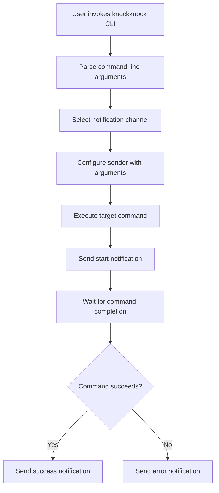

Sources: [knockknock/__main__.py:17-207]()

### CLI Structure

The CLI implementation defines a separate subparser for each notification channel, with specific arguments required for that channel.

```mermaid
graph TD
    A["ArgumentParser"] --> B["Subparsers"]
    
    B --> C["email"]
    B --> D["slack"]
    B --> E["discord"]
    B --> F["telegram"]
    B --> G["desktop"]
    B --> H["sms"]
    B --> I["teams"]
    B --> J["matrix"]
    B --> K["chime"]
    B --> L["dingtalk"]
    B --> M["rocketchat"]
    B --> N["wechat"]
    
    C --> O["sender_func=email_sender"]
    D --> P["sender_func=slack_sender"]
    E --> Q["sender_func=discord_sender"]
    F --> R["sender_func=telegram_sender"]
    G --> S["sender_func=desktop_sender"]
    H --> T["sender_func=sms_sender"]
    I --> U["sender_func=teams_sender"]
    J --> V["sender_func=matrix_sender"]
    K --> W["sender_func=chime_sender"]
    L --> X["sender_func=dingtalk_sender"]
    M --> Y["sender_func=rocketchat_sender"]
    N --> Z["sender_func=wechat_sender"]
```

Sources: [knockknock/__main__.py:17-192]()

## Distributed Training Support

KnockKnock includes support for distributed training environments, particularly for PyTorch distributed training. This prevents multiple notification messages from being sent when using multiple processes.

### Distributed Training Logic

```mermaid
flowchart TD
    A["Start Notification Process"] --> B{"RANK environment variable exists?"}
    B -->|Yes| C{"RANK == 0?"}
    B -->|No| D["Set as master process"]
    C -->|Yes| D
    C -->|No| E["Set as worker process"]
    
    D --> F{"Is master process?"}
    E --> F
    
    F -->|Yes| G["Send notification"]
    F -->|No| H["Skip notification"]
    
    G --> I["Continue processing"]
    H --> I
    
    J["Error notification?"] -->|Yes| G
    J -->|No| F
```

Sources: [README.md:401-405]()

## Integration Methods

KnockKnock provides two main integration methods: Python decorators and the command-line interface.

### Integration Comparison

| Feature | Python Decorator | CLI |
|---------|------------------|-----|
| Code Modification | Requires adding decorators to functions | No code changes required |
| Configuration | Done in code | Done via command-line arguments |
| Flexibility | Can wrap any Python function | Wraps command-line commands |
| Function Return Value | Preserved and included in notification | Command exit code only |
| Integration Ease | Simple for Python code | Works with any executable |

Sources: [README.md:19-399]()

## Extensibility

KnockKnock's architecture is designed to be extensible, making it easy to add support for new notification channels. Each notification channel is implemented as a separate module with a similar interface.

### Adding a New Channel

To add a new notification channel, one would need to:

1. Create a new module in the knockknock package
2. Implement a decorator function that configures the notification channel
3. Add the notification sending logic
4. Update `__init__.py` to expose the new sender
5. Add CLI support in `__main__.py`

```mermaid
flowchart TD
    A["Create new_channel_sender.py"] --> B["Implement decorator function"]
    B --> C["Add notification sending logic"]
    C --> D["Update __init__.py"]
    D --> E["Add CLI support in __main__.py"]
```

Sources: [knockknock/__init__.py:1-13](), [knockknock/__main__.py:17-192]()

## Summary

KnockKnock employs a simple yet effective architecture centered around the decorator pattern. This allows it to provide notification capabilities with minimal code changes. The library supports multiple notification channels and offers both programmatic and command-line interfaces for integration.

The system's distributed training support ensures that notifications work correctly in multi-process environments, preventing duplicate notifications while ensuring that error notifications are always sent.

Sources: [README.md:1-406](), [knockknock/__init__.py:1-13](), [knockknock/__main__.py:1-212]()

---

# Page: Decorator Pattern

# Decorator Pattern

<details>
<summary>Relevant source files</summary>

The following files were used as context for generating this wiki page:

- [knockknock/desktop_sender.py](knockknock/desktop_sender.py)
- [knockknock/email_sender.py](knockknock/email_sender.py)
- [knockknock/slack_sender.py](knockknock/slack_sender.py)

</details>


## Purpose and Scope

This page explains how the decorator pattern is implemented and used in the KnockKnock library. The decorator pattern is the central mechanism enabling KnockKnock to wrap long-running functions with notification capabilities, allowing users to receive alerts when their processes start, complete, or fail.

For information about the overall architecture of KnockKnock, see [Architecture](#2), and for specific notification channels, see [Notification Channels](#4).

## What is the Decorator Pattern?

In Python, decorators are a syntactic sugar for function wrappers, allowing you to modify the behavior of functions or methods without changing their actual code. KnockKnock uses decorators to intercept function calls and inject notification logic before execution, after successful completion, and when exceptions occur.

## KnockKnock's Decorator Structure

KnockKnock implements a three-level nested function structure for its decorators:

```mermaid
classDiagram
    class "OuterFunction" {
        +Configuration parameters
        +Returns decorator_sender
    }
    class "decorator_sender" {
        +Takes func as argument
        +Returns wrapper_sender
    }
    class "wrapper_sender" {
        +Takes *args, **kwargs
        +Send start notification
        +Execute func
        +Send result notification
        +Return func's return value
    }
    "OuterFunction" --> "decorator_sender" : returns
    "decorator_sender" --> "wrapper_sender" : returns
```

**Level 1: Outer Configuration Function**
- Accepts channel-specific configuration parameters
- Returns the actual decorator function
- Examples: `desktop_sender()`, `email_sender()`, `slack_sender()`

**Level 2: Decorator Function**
- Takes the function to be decorated as its argument
- Returns the wrapper function
- Implementation named `decorator_sender` in all notification modules

**Level 3: Wrapper Function**
- Captures the starting state (time, host, function name)
- Sends the "started" notification
- Executes the original function
- Sends "completed" or "crashed" notification based on outcome
- Returns the original function's return value or re-raises exceptions

Sources:
- [knockknock/desktop_sender.py:11-103]()
- [knockknock/email_sender.py:10-99]()
- [knockknock/slack_sender.py:12-109]()

## Execution Flow

Here's the execution flow when using a KnockKnock decorator:

```mermaid
sequenceDiagram
    participant UC as "User Code"
    participant DC as "Decorator"
    participant WR as "Wrapper Function"
    participant OF as "Original Function"
    participant NP as "Notification Platform"
    
    UC->>DC: Apply decorator to function
    UC->>WR: Call decorated function
    WR->>WR: Record start time
    WR->>WR: Check if master process
    alt Is master process
        WR->>NP: Send "Started" notification
    end
    WR->>OF: Execute original function
    
    alt Function succeeds
        OF-->>WR: Return result
        WR->>WR: Record end time
        alt Is master process
            WR->>NP: Send "Completed" notification
        end
        WR-->>UC: Return original result
    else Function fails
        OF-->>WR: Raise exception
        WR->>WR: Record end time
        WR->>NP: Send "Crashed" notification
        WR-->>UC: Re-raise exception
    end
```

This sequence diagram illustrates how KnockKnock's decorators intercept the function call, execute the original function within a try-except block, and send appropriate notifications based on the outcome.

Sources:
- [knockknock/desktop_sender.py:35-99]()
- [knockknock/email_sender.py:29-95]()
- [knockknock/slack_sender.py:35-105]()

## Common Implementation Pattern

All notification channels follow the same implementation pattern for the wrapper function:

1. **Record starting information**:
   ```python
   start_time = datetime.datetime.now()
   host_name = socket.gethostname()
   func_name = func.__name__
   ```

2. **Handle distributed training**:
   ```python
   if 'RANK' in os.environ:
       master_process = (int(os.environ['RANK']) == 0)
       host_name += ' - RANK: %s' % os.environ['RANK']
   else:
       master_process = True
   ```

3. **Send start notification** (if master process)
4. **Execute original function** in a try-except block
5. **On success**:
   - Record end time and calculate duration
   - Format success message with timing information
   - Add return value (if possible)
   - Send completion notification (if master process)
   - Return the original return value
6. **On exception**:
   - Record end time and calculate duration
   - Format error message with traceback
   - Send crash notification
   - Re-raise the exception

Sources:
- [knockknock/desktop_sender.py:35-99]()
- [knockknock/email_sender.py:29-95]()
- [knockknock/slack_sender.py:35-105]()

## Channel-Specific Implementations

While the decorator structure remains consistent, each notification channel implements its own sending mechanism:

| Channel | Configuration Parameters | Notification Method |
|---------|--------------------------|---------------------|
| Desktop | `title` | OS-specific notifications (AppleScript/notify-send/win10toast) |
| Email   | `recipient_emails`, `sender_email` | Sends emails via `yagmail` |
| Slack   | `webhook_url`, `channel`, `user_mentions` | Posts messages via webhook API |

Sources:
- [knockknock/desktop_sender.py:13-31]()
- [knockknock/email_sender.py:10-26]()
- [knockknock/slack_sender.py:12-32]()

## Handling Distributed Training

A key feature of KnockKnock's decorator pattern is its ability to handle distributed training environments intelligently:

```mermaid
flowchart TD
    A["Check RANK environment variable"] --> B{"RANK exists?"}
    B -->|"Yes"| C{"RANK == 0?"}
    B -->|"No"| D["Set as master process"]
    C -->|"Yes"| D
    C -->|"No"| E["Set as worker process"]
    D --> F{"Is error notification?"}
    E --> F
    F -->|"Yes"| G["Send notification"]
    F -->|"No"| H{"Is master process?"}
    H -->|"Yes"| G
    H -->|"No"| I["Skip notification"]
    G --> J["Continue execution"]
    I --> J
```

In distributed training environments (like those using PyTorch's distributed module), multiple processes execute the same code. To prevent duplicate notifications:

1. KnockKnock checks for the `RANK` environment variable (set by frameworks like PyTorch)
2. Only the master process (`RANK=0`) sends start and completion notifications
3. All processes send crash notifications to ensure errors are not missed

This ensures users receive exactly one notification for each event, even when running in distributed mode.

Sources:
- [knockknock/desktop_sender.py:41-51]()
- [knockknock/email_sender.py:35-45]()
- [knockknock/slack_sender.py:41-51]()

## Benefits of the Decorator Pattern in KnockKnock

The decorator pattern provides several key benefits to KnockKnock:

1. **Non-invasive Integration**: Users can add notifications to existing code with minimal changes - just add a decorator
2. **Separation of Concerns**: Notification logic is completely separate from the actual task logic
3. **Configurability**: The outer function allows for configuration without changing the core wrapping behavior
4. **Consistent Interface**: All notification channels follow the same usage pattern
5. **Exception Transparency**: Original exceptions are preserved and re-raised after sending crash notifications

## Summary

The decorator pattern is the core mechanism enabling KnockKnock's notification functionality. By using a three-level nested function structure, KnockKnock provides a clean, consistent interface for adding notifications to long-running functions.

The pattern allows KnockKnock to intercept function calls, send start notifications, execute the original function, and then send appropriate completion or crash notifications. Through intelligent handling of distributed training environments, the library ensures appropriate notification behavior even in complex multi-process scenarios.

All notification channels follow the same structural pattern while implementing channel-specific sending mechanisms, making the library both consistent and extensible.

Sources:
- [knockknock/desktop_sender.py]()
- [knockknock/email_sender.py]()
- [knockknock/slack_sender.py]()

---

# Page: Distributed Training Support

# Distributed Training Support

<details>
<summary>Relevant source files</summary>

The following files were used as context for generating this wiki page:

- [knockknock/desktop_sender.py](knockknock/desktop_sender.py)
- [knockknock/email_sender.py](knockknock/email_sender.py)
- [knockknock/telegram_sender.py](knockknock/telegram_sender.py)

</details>


## Purpose and Scope

This page documents how KnockKnock handles notifications in distributed training environments. The primary purpose of this functionality is to prevent duplicate notifications when multiple training processes are running concurrently, which is common in distributed machine learning workflows. Instead of receiving multiple identical notifications (one from each process), KnockKnock intelligently determines which process should send notifications.

For information about using the notification decorators themselves, see [Decorator Pattern](#2.1).

## Distributed Training Challenge

In distributed machine learning training setups, especially those using frameworks like PyTorch's Distributed Data Parallel (DDP), multiple processes run the same code simultaneously across different devices or machines. Without proper handling, this would result in multiple identical notifications being sent for the same logical training job, creating notification spam.

KnockKnock solves this by:
1. Detecting distributed training environments
2. Identifying the master process
3. Limiting notifications to the master process (with exceptions for errors)

Sources: [knockknock/desktop_sender.py:41-50](). [knockknock/email_sender.py:35-44](), [knockknock/telegram_sender.py:35-44]()

## Detection Mechanism

### How KnockKnock Identifies Distributed Training

KnockKnock detects distributed training by checking for the presence of a `RANK` environment variable, which is commonly set by distributed training frameworks like PyTorch's distributed launcher.

```mermaid
flowchart TD
    A["Start Notification Process"] --> B{"RANK environment variable exists?"}
    B -->|"Yes"| C{"RANK == 0?"}
    B -->|"No"| D["Set as master process"]
    C -->|"Yes"| D
    C -->|"No"| E["Set as worker process"]
    D --> F["Add host information"]
    E --> F
```

### Master Process Determination

The process with `RANK=0` (or any process if `RANK` doesn't exist) is considered the master process. Only the master process sends start and completion notifications, while all processes send error notifications.

Sources: [knockknock/desktop_sender.py:41-50](). [knockknock/email_sender.py:35-44](), [knockknock/telegram_sender.py:35-44]()

## Notification Flow in Distributed Environments

KnockKnock uses a consistent pattern across all notification senders to handle distributed training:

```mermaid
sequenceDiagram
    participant MasterProcess as "Master Process (RANK=0)"
    participant WorkerProcess as "Worker Process (RANK>0)"
    participant NotificationService as "Notification Service"
    
    Note over MasterProcess,WorkerProcess: Training starts
    
    MasterProcess->>MasterProcess: Check RANK (=0)
    MasterProcess->>NotificationService: Send start notification
    
    WorkerProcess->>WorkerProcess: Check RANK (>0)
    
    Note over MasterProcess,WorkerProcess: Training in progress
    
    alt Successful completion
        MasterProcess->>MasterProcess: Check RANK (=0)
        MasterProcess->>NotificationService: Send completion notification
        WorkerProcess->>WorkerProcess: Check RANK (>0)
        Note over WorkerProcess: No notification sent
    else Training error
        MasterProcess->>NotificationService: Send error notification
        WorkerProcess->>NotificationService: Send error notification
    end
```

### Hostname Enrichment

In distributed environments, KnockKnock appends the rank information to the hostname to make it clear which process sent the notification:

```
hostname - RANK: X
```

This helps identify the source of error notifications when they come from non-master processes.

Sources: [knockknock/desktop_sender.py:38-48](). [knockknock/email_sender.py:32-42](), [knockknock/telegram_sender.py:32-42]()

## Implementation Details

### Notification Control Flow

The distributed training support is implemented consistently across all notification channels. Here's the typical control flow:

```mermaid
flowchart TD
    A["Start notification function"] --> B{"Check for RANK env var"}
    B -->|"Present"| C{"Is RANK == 0?"}
    B -->|"Not present"| D["Set master_process = True"]
    C -->|"Yes"| E["Set master_process = True<br>Append RANK to hostname"]
    C -->|"No"| F["Set master_process = False<br>Append RANK to hostname"]
    
    E --> G{"Is this for start/success?"}
    F --> G
    D --> G
    
    G -->|"Yes"| H{"Is master_process?"}
    G -->|"No (error)"| I["Send notification<br>regardless of rank"]
    
    H -->|"Yes"| J["Send notification"]
    H -->|"No"| K["Skip notification"]
    
    J --> L["Continue execution"]
    K --> L
    I --> L
```

### Code Pattern

The code pattern used in all notification senders follows this structure:

1. Check for the `RANK` environment variable
2. Determine if this is the master process
3. For start and success notifications, only send if it's the master process
4. For error notifications, always send (to ensure errors are never missed)

Sources: [knockknock/desktop_sender.py:41-98](). [knockknock/email_sender.py:35-95](), [knockknock/telegram_sender.py:35-92]()

## PyTorch Integration

KnockKnock is specifically designed to work with PyTorch's distributed training framework. The code includes comments that reference PyTorch's distributed launch logic:

```
# In PyTorch, the launch of `torch.distributed.launch` sets up a RANK environment variable for each process.
# This can be used to detect the master process.
# See https://github.com/pytorch/pytorch/blob/master/torch/distributed/launch.py#L211
```

This allows seamless integration with PyTorch's distributed training capabilities.

Sources: [knockknock/desktop_sender.py:36-39](). [knockknock/email_sender.py:36-39](), [knockknock/telegram_sender.py:36-39]()

## Usage Example

When using KnockKnock with distributed training, no special configuration is needed. Simply apply the decorator to your training function as usual:

```python
from knockknock import email_sender

@email_sender(recipient_emails=["your-email@example.com"])
def train_model():
    # Your distributed training code here
    # When launched with torch.distributed.launch
    # Only RANK 0 will send start/success notifications
    pass
```

When launching the training job with PyTorch's distributed launcher, KnockKnock will automatically handle the notification logic:

```bash
python -m torch.distributed.launch --nproc_per_node=4 train_script.py
```

## Special Case: Error Notifications

An important design decision in KnockKnock is that error notifications are always sent, regardless of whether the process is a master or worker. This ensures that no errors are missed, even if they occur only in specific worker processes.

The trade-off is that in case of an error that affects all processes, you may receive multiple error notifications (one from each process). However, this is considered better than missing error notifications.

Sources: [knockknock/desktop_sender.py:84-99](). [knockknock/email_sender.py:79-95](), [knockknock/telegram_sender.py:78-93]()

## Notification Content Differences

In distributed training environments, the notification content is slightly modified to include the rank information in the hostname. This provides context about which process sent the notification, particularly useful for error notifications from non-master processes.

| Notification Type | Master Process (RANK=0) | Worker Process (RANK>0) |
|------------------|------------------------|------------------------|
| Start            | Sends with hostname + rank | Does not send |
| Success          | Sends with hostname + rank | Does not send |
| Error            | Sends with hostname + rank | Sends with hostname + rank |

Sources: [knockknock/desktop_sender.py:38-48](). [knockknock/email_sender.py:32-42](), [knockknock/telegram_sender.py:32-42]()

---

# Page: Command-Line Interface

# Command-Line Interface

<details>
<summary>Relevant source files</summary>

The following files were used as context for generating this wiki page:

- [README.md](README.md)
- [knockknock/__main__.py](knockknock/__main__.py)

</details>


This document describes the command-line interface (CLI) provided by the KnockKnock library. The CLI allows users to receive notifications when their long-running processes start, complete successfully, or fail, without having to modify their existing code. For information about using KnockKnock as a Python decorator in your code, see [Decorator Pattern](#2.1).

## Overview

The KnockKnock CLI provides a simple way to wrap any shell command with notification capabilities. When executed, it will:

1. Send a notification that the command has started
2. Run the specified command
3. Send a notification when the command completes or fails

All notification channels available through the Python API are also accessible through the CLI.

## CLI Architecture

The diagram below illustrates how the KnockKnock CLI is structured and processes commands:

```mermaid
flowchart TD
    A["User Command"] --> B["knockknock CLI"]
    B --> C["Argument Parser"]
    C --> D["Channel Selection"]
    D --> E["Notification Setup"]
    E --> F["Command Execution"] 
    F --> G1["Start Notification"]
    G1 --> H["Run User Command"]
    H --> I{"Command\nSuccessful?"}
    I -->|Yes| J["Success Notification"]
    I -->|No| K["Failure Notification"]
    
    subgraph "Notification Channels"
        N1["email"]
        N2["slack"]
        N3["telegram"]
        N4["teams"]
        N5["sms"]
        N6["discord"]
        N7["desktop"]
        N8["matrix"]
        N9["chime"]
        N10["dingtalk"]
        N11["rocketchat"]
        N12["wechat"]
    end
    
    D --> Notification Channels
```

Sources: [knockknock/__main__.py:1-211]()

## Command Structure

The general syntax for the KnockKnock CLI is:

```
knockknock [--verbose] <notification-channel> [channel-specific-options] <command-to-execute>
```

Where:
- `--verbose`: Optional flag to show the full command in the notification
- `<notification-channel>`: The notification channel to use (e.g., email, slack, telegram)
- `[channel-specific-options]`: Options specific to the chosen notification channel
- `<command-to-execute>`: The command you want to run and be notified about

Sources: [knockknock/__main__.py:17-22](), [knockknock/__main__.py:192-206]()

## Implementation Details

The CLI is implemented in the `__main__.py` file and follows these steps:

1. Parse command-line arguments using `argparse`
2. Determine which notification sender to use based on the subcommand
3. Create a function that runs the user's command using `subprocess.run`
4. Apply the selected notification sender as a decorator to this function
5. Execute the decorated function

```mermaid
sequenceDiagram
    participant User
    participant ArgParser as "Argument Parser"
    participant Sender as "Notification Sender"
    participant Command as "User Command"
    
    User->>ArgParser: Invoke knockknock with arguments
    ArgParser->>Sender: Select appropriate sender
    Sender->>Sender: Configure with provided options
    Sender->>Command: Send start notification
    Sender->>Command: Execute command
    
    alt Command succeeds
        Command-->>Sender: Return exit code 0
        Sender->>User: Send success notification
    else Command fails
        Command-->>Sender: Return non-zero exit code
        Sender->>User: Send failure notification
    end
```

Sources: [knockknock/__main__.py:17-211]()

## Supported Notification Channels

KnockKnock CLI supports the following notification channels, each with its own set of required and optional parameters:

### Email

Sends notifications via email.

```bash
knockknock email \
    --recipient-emails <emails> \
    [--sender-email <email>] \
    <command>
```

Sources: [knockknock/__main__.py:54-64]()

### Slack

Sends notifications to a Slack channel.

```bash
knockknock slack \
    --webhook-url <webhook_url> \
    --channel <channel> \
    [--user-mentions <user_ids>] \
    <command>
```

Sources: [knockknock/__main__.py:67-78]()

### Telegram

Sends notifications via Telegram.

```bash
knockknock telegram \
    --token <api_token> \
    --chat-id <chat_id> \
    <command>
```

Sources: [knockknock/__main__.py:99-108]()

### Microsoft Teams

Sends notifications to a Microsoft Teams channel.

```bash
knockknock teams \
    --webhook-url <webhook_url> \
    [--user-mentions <user_ids>] \
    <command>
```

Sources: [knockknock/__main__.py:111-120]()

### SMS (Twilio)

Sends SMS notifications via Twilio.

```bash
knockknock sms \
    --account-sid <account_sid> \
    --auth-token <auth_token> \
    --recipient-number <recipient_number> \
    --sender-number <sender_number> \
    <command>
```

Sources: [knockknock/__main__.py:123-137]()

### Discord

Sends notifications to a Discord channel.

```bash
knockknock discord \
    --webhook-url <webhook_url> \
    <command>
```

Sources: [knockknock/__main__.py:45-51]()

### Desktop

Sends desktop notifications.

```bash
knockknock desktop \
    [--title <title>] \
    <command>
```

Sources: [knockknock/__main__.py:37-42]()

### Matrix

Sends notifications via Matrix.

```bash
knockknock matrix \
    --homeserver <homeserver> \
    --token <token> \
    --room <room> \
    <command>
```

Sources: [knockknock/__main__.py:140-152]()

### Amazon Chime

Sends notifications to an Amazon Chime room.

```bash
knockknock chime \
    --webhook-url <webhook_url> \
    [--user-mentions <user_mentions>] \
    <command>
```

Sources: [knockknock/__main__.py:25-34]()

### DingTalk

Sends notifications to a DingTalk chatroom.

```bash
knockknock dingtalk \
    --webhook-url <webhook_url> \
    [--user-mentions <phone_numbers>] \
    [--secret <secret>] \
    [--keywords <keywords>] \
    <command>
```

Sources: [knockknock/__main__.py:81-96]()

### RocketChat

Sends notifications to a RocketChat channel.

```bash
knockknock rocketchat \
    --rocketchat-server-url <server_url> \
    --rocketchat-user-id <user_id> \
    --rocketchat-auth-token <auth_token> \
    --channel <channel> \
    [--user-mentions <user_names>] \
    [--alias <alias>] \
    <command>
```

Sources: [knockknock/__main__.py:155-175]()

### WeChat Work

Sends notifications to a WeChat Work chatroom.

```bash
knockknock wechat \
    --webhook-url <webhook_url> \
    [--user-mentions <user_ids>] \
    [--user-mentions-mobile <phone_numbers>] \
    <command>
```

Sources: [knockknock/__main__.py:178-190]()

## Command Execution Process

When you run a command with KnockKnock CLI, the following process occurs:

```mermaid
flowchart TD
    A["knockknock <channel> [options] <command>"] --> B["Parse Arguments"]
    B --> C["Extract sender_func from channel"]
    C --> D["Create run_func to execute command"]
    D --> E["Apply sender_func as decorator to run_func"]
    E --> F["Execute decorated function"]
    F --> G["Send start notification"]
    G --> H["Execute user command"]
    H --> I{"Command\nSuccessful?"}
    I -->|Yes| J["Send success notification\nwith execution time"]
    I -->|No| K["Send failure notification\nwith error details"]
```

Sources: [knockknock/__main__.py:192-207]()

## Handling Distributed Training

The CLI, like the decorator API, is designed to handle distributed training environments. To prevent duplicate notifications, it checks for environment variables that indicate whether the current process is the master process. For more information about this feature, see [Distributed Training Support](#2.2).

Sources: [README.md:401-405]()

## CLI Usage Examples

Here are some practical examples of using the KnockKnock CLI:

### Training a Deep Learning Model with Email Notifications

```bash
knockknock email \
    --recipient-emails john@example.com,jane@example.com \
    python train_model.py --epochs 100 --batch-size 32
```

### Running a Data Processing Job with Slack Notifications

```bash
knockknock slack \
    --webhook-url https://hooks.slack.com/services/XXX/YYY/ZZZ \
    --channel "#ml-experiments" \
    --user-mentions U01234567,U76543210 \
    python process_data.py --input large_dataset.csv --output processed_data.csv
```

### Running a Long Download with Desktop Notifications

```bash
knockknock desktop \
    --title "Download Task" \
    wget https://example.com/large_file.zip
```

Sources: [README.md:57-396]()

## Internal Implementation

The CLI functionality is implemented through these key steps:

1. The main function in `__main__.py` sets up an argument parser with subparsers for each notification channel
2. Each subparser defines its own set of required and optional arguments
3. The parser creates a `sender_func` based on the selected notification channel
4. A wrapper function `run_func` is created to execute the user's command using `subprocess.run`
5. The `sender_func` is applied as a decorator to `run_func`
6. The decorated function is called, which:
   - Sends a start notification
   - Executes the command
   - Sends a success or failure notification depending on the outcome

The CLI architecture closely mirrors the decorator pattern used in the Python API, providing a consistent experience regardless of which interface is used.

Sources: [knockknock/__main__.py:17-211](), [README.md:19-22]()

---

# Page: CLI Usage Examples

# CLI Usage Examples

<details>
<summary>Relevant source files</summary>

The following files were used as context for generating this wiki page:

- [README.md](README.md)
- [knockknock/__main__.py](knockknock/__main__.py)

</details>


## Purpose and Scope

This page provides comprehensive examples of using knockknock's command-line interface (CLI) to receive notifications when long-running processes start, complete, or crash. For information about using knockknock as a Python decorator in your code, see [Decorator Pattern](#2.1).

## CLI Structure and Command Flow

The knockknock CLI allows you to wrap any command-line process with notification capabilities without modifying its code.

### Command Pattern

```
knockknock [--verbose] <notification-channel> [channel-specific-options] <command>
```

Where:
- `[--verbose]` (optional) - Shows the full command in notifications
- `<notification-channel>` - The platform to send notifications through (e.g., slack, email)
- `[channel-specific-options]` - Configuration required for the chosen channel
- `<command>` - The command to execute and receive notifications for

### Command Structure Diagram

```mermaid
graph TD
    A["knockknock"] --> B["<channel>"]
    B --> C["[--channel-options]"]
    C --> D["<command>"]
    
    E["--verbose (optional)"] --> A
    
    subgraph "Available Channels"
        F["email"]
        G["slack"]
        H["discord"]
        I["telegram"]
        J["desktop"]
        K["sms"]
        L["teams"]
        M["matrix"]
        N["chime"]
        O["dingtalk"]
        P["rocketchat"]
        Q["wechat"]
    end
    
    B --> Available Channels
```

Sources: [knockknock/__main__.py:17-22](), [knockknock/__main__.py:192-198]()

### Execution Flow Diagram

```mermaid
sequenceDiagram
    participant User
    participant CLI as "knockknock CLI"
    participant Sender as "Notification Sender"
    participant Command as "User Command"
    
    User->>CLI: "knockknock <channel> [options] <command>"
    CLI->>Sender: "Configure sender"
    Sender->>User: "Send Started notification"
    CLI->>Command: "Execute command"
    
    alt "Command succeeds"
        Command-->>CLI: "Exit successfully"
        Sender->>User: "Send Completed notification"
    else "Command fails"
        Command-->>CLI: "Exit with error"
        Sender->>User: "Send Failed notification with error"
    end
```

Sources: [knockknock/__main__.py:192-207](), [knockknock/__main__.py:203-207]()

## Notification Channel Examples

This section provides examples for each supported notification channel.

### Email Notifications

```bash
knockknock email \
    --recipient-emails your_email@address.com,second_email@address.com \
    --sender-email sender_email@gmail.com \
    sleep 10
```

| Argument | Description | Required |
|----------|-------------|----------|
| `--recipient-emails` | Comma-separated list of email addresses to notify | Yes |
| `--sender-email` | Email address to send from | No (defaults to first recipient) |

Note: You'll be prompted for the sender's email password, which will be securely stored in your system's keyring.

Sources: [knockknock/__main__.py:54-64](), [README.md:57-64]()

### Slack Notifications

```bash
knockknock slack \
    --webhook-url https://hooks.slack.com/services/T00000000/B00000000/XXXXXXXX \
    --channel your-channel-name \
    sleep 10
```

| Argument | Description | Required |
|----------|-------------|----------|
| `--webhook-url` | The webhook URL for your Slack workspace | Yes |
| `--channel` | The Slack channel to send notifications to | Yes |
| `--user-mentions` | Comma-separated list of Slack user IDs to mention | No |

Sources: [knockknock/__main__.py:67-78](), [README.md:93-97]()

### Discord Notifications

```bash
knockknock discord \
    --webhook-url https://discord.com/api/webhooks/XXXXXXXX/XXXXXXXX \
    sleep 10
```

| Argument | Description | Required |
|----------|-------------|----------|
| `--webhook-url` | The webhook URL for your Discord server | Yes |

Sources: [knockknock/__main__.py:45-51](), [README.md:208-211]()

### Telegram Notifications

```bash
knockknock telegram \
    --token 123456789:ABCDEFGHIJKLMNOPQRSTUVWXYZ \
    --chat-id 123456789 \
    sleep 10
```

| Argument | Description | Required |
|----------|-------------|----------|
| `--token` | Your Telegram bot token | Yes |
| `--chat-id` | Your chat ID with the bot | Yes |

Sources: [knockknock/__main__.py:99-108](), [README.md:124-127]()

### Desktop Notifications

```bash
knockknock desktop \
    --title "My Long-Running Process" \
    sleep 10
```

| Argument | Description | Required |
|----------|-------------|----------|
| `--title` | The title of the notification | No (defaults to "knockknock") |

Sources: [knockknock/__main__.py:37-42](), [README.md:232-236]()

### SMS Notifications (via Twilio)

```bash
knockknock sms \
    --account-sid ACXXXXXXXXXXXXXXXXXXXXXXXXXXXXXXXX \
    --auth-token your_auth_token \
    --recipient-number +1234567890 \
    --sender-number +0987654321 \
    sleep 10
```

| Argument | Description | Required |
|----------|-------------|----------|
| `--account-sid` | Your Twilio account SID | Yes |
| `--auth-token` | Your Twilio auth token | Yes |
| `--recipient-number` | The phone number to receive notifications | Yes |
| `--sender-number` | Your Twilio phone number | Yes |

Sources: [knockknock/__main__.py:123-137](), [README.md:179-184]()

### Microsoft Teams Notifications

```bash
knockknock teams \
    --webhook-url https://outlook.office.com/webhook/XXXXXXXX/IncomingWebhook/YYYYYYYYY/ZZZZZZZZ \
    sleep 10
```

| Argument | Description | Required |
|----------|-------------|----------|
| `--webhook-url` | The webhook URL for your Microsoft Teams channel | Yes |
| `--user-mentions` | Comma-separated list of Teams user IDs to mention | No |

Sources: [knockknock/__main__.py:111-120](), [README.md:151-152]()

### Matrix Notifications

```bash
knockknock matrix \
    --homeserver https://matrix.org \
    --token your_access_token \
    --room #roomalias:matrix.org \
    sleep 10
```

| Argument | Description | Required |
|----------|-------------|----------|
| `--homeserver` | Your Matrix homeserver URL | Yes |
| `--token` | Your Matrix access token | Yes |
| `--room` | The alias of the room to send notifications to | Yes |

Sources: [knockknock/__main__.py:140-152](), [README.md:266-271]()

### Amazon Chime Notifications

```bash
knockknock chime \
    --webhook-url https://hooks.chime.aws/incomingwebhooks/XXXXXXXX?token=YYYYYYYY \
    sleep 10
```

| Argument | Description | Required |
|----------|-------------|----------|
| `--webhook-url` | The webhook URL for your Amazon Chime room | Yes |
| `--user-mentions` | Comma-separated list of user aliases to mention | No |

Sources: [knockknock/__main__.py:25-34](), [README.md:294-297]()

### DingTalk Notifications

```bash
knockknock dingtalk \
    --webhook-url https://oapi.dingtalk.com/robot/send?access_token=XXXXXXXX \
    --secret your_secret \
    sleep 10
```

| Argument | Description | Required |
|----------|-------------|----------|
| `--webhook-url` | The webhook URL for your DingTalk chatroom robot | Yes |
| `--secret` | Your DingTalk chatroom robot's secret | No |
| `--keywords` | Comma-separated list of accepted keywords | No |
| `--user-mentions` | Comma-separated list of phone numbers to notify | No |

Sources: [knockknock/__main__.py:81-96](), [README.md:322-326]()

### RocketChat Notifications

```bash
knockknock rocketchat \
    --rocketchat-server-url https://your-rocketchat-server.com \
    --rocketchat-user-id your_user_id \
    --rocketchat-auth-token your_auth_token \
    --channel general \
    sleep 10
```

| Argument | Description | Required |
|----------|-------------|----------|
| `--rocketchat-server-url` | Your RocketChat server URL | Yes |
| `--rocketchat-user-id` | Your RocketChat user ID | Yes |
| `--rocketchat-auth-token` | Your RocketChat personal access token | Yes |
| `--channel` | The RocketChat channel to send notifications to | Yes |
| `--user-mentions` | Comma-separated list of usernames to notify | No |
| `--alias` | Alias to use for the notification | No |

Sources: [knockknock/__main__.py:155-175](), [README.md:364-369]()

### WeChat Work Notifications

```bash
knockknock wechat \
    --webhook-url https://qyapi.weixin.qq.com/cgi-bin/webhook/send?key=XXXXXXXX \
    sleep 10
```

| Argument | Description | Required |
|----------|-------------|----------|
| `--webhook-url` | The webhook URL for your WeChat Work chatroom robot | Yes |
| `--user-mentions` | Comma-separated list of user IDs to notify | No |
| `--user-mentions-mobile` | Comma-separated list of phone numbers to notify | No |

Sources: [knockknock/__main__.py:178-190](), [README.md:393-396]()

## CLI Implementation Architecture

The knockknock CLI architecture is implemented in [knockknock/__main__.py]() and follows a modular design that routes commands to the appropriate notification sender.

```mermaid
graph TD
    A["main()"] --> B["Parse arguments using argparse"]
    B --> C["Select notification sender function"]
    C --> D["Create run_func for command"]
    D --> E["Execute sender function with run_func"]
    
    F["subparsers"] --> C
    G["subprocess.run"] --> D
    H["sender_func"] --> E
    
    subgraph "Implementation Structure"
        I["__main__.main()"]
        J["argparse.ArgumentParser"]
        K["sender_func = args.pop('sender_func')"]
        L["run_func = subprocess.run"]
        M["sender_func(**args)(run_func)()"]
    end
    
    A --> I
    B --> J
    C --> K
    D --> L
    E --> M
```

Sources: [knockknock/__main__.py:17-207](), [knockknock/__main__.py:192-207]()

## Advanced Usage Examples

### Verbose Output

To include the full command in notifications:

```bash
knockknock --verbose slack \
    --webhook-url https://hooks.slack.com/services/TXXXXXX/BXXXXXX/XXXXXXXX \
    --channel your-channel-name \
    python train_model.py --epochs 100 --batch-size 32
```

Sources: [knockknock/__main__.py:20-21](), [knockknock/__main__.py:204-205]()

### Machine Learning Training Example

```bash
knockknock telegram \
    --token 123456789:ABCDEFGHIJKLMNOPQRSTUVWXYZ \
    --chat-id 123456789 \
    python train_model.py --dataset mnist --batch-size 64 --epochs 50
```

This example will notify you when the training starts, finishes successfully, or crashes during execution.

### Long Data Processing Job Example

```bash
knockknock email \
    --recipient-emails your_email@address.com \
    python process_data.py --input large_dataset.csv --output processed_data.csv
```

### Complex Pipeline Example

For complex commands with their own options, you might need to use `--` to separate knockknock options:

```bash
knockknock slack \
    --webhook-url https://hooks.slack.com/services/TXXXXXX/BXXXXXX/XXXXXXXX \
    --channel your-channel-name \
    -- python pipeline.py --step1 --step2 --output-dir="./results"
```

## Summary

The knockknock CLI provides a flexible way to add notification capabilities to any command-line process without modifying its code. By selecting the appropriate notification channel and providing the necessary credentials, you can receive alerts when your long-running processes start, complete successfully, or crash.

---

# Page: Notification Channels

# Notification Channels

<details>
<summary>Relevant source files</summary>

The following files were used as context for generating this wiki page:

- [README.md](README.md)
- [knockknock/__init__.py](knockknock/__init__.py)

</details>


This document provides an overview of the notification channels supported by KnockKnock. Notification channels are the communication platforms through which KnockKnock can send alerts when long-running processes start, complete, or encounter errors. For specific details about each channel implementation, see the child pages [4.1](#4.1) through [4.7](#4.7).

## Supported Notification Channels

KnockKnock implements 12 different notification channels, each as a separate module with a consistent interface pattern:

| Category | Platforms |
|----------|-----------|
| Desktop | Desktop Notifications (macOS, Linux, Windows 10) |
| Email | Gmail/SMTP |
| Chat Platforms | Slack, Microsoft Teams, Discord, Matrix, Amazon Chime, RocketChat |
| Mobile/SMS | Telegram, SMS (via Twilio) |
| Asian Platforms | DingTalk, WeChat Work |

All notification channels are exposed through the main package and can be imported directly:

```python
from knockknock import email_sender, slack_sender, discord_sender  # etc.
```

Sources: [knockknock/__init__.py:1-12]()

## Architecture

### Notification Channel Implementation Pattern

Each notification channel in KnockKnock follows a common implementation pattern centered around a decorator function that:

1. Captures channel-specific configuration
2. Formats messages for different notification types (start, success, error)
3. Implements platform-specific logic for sending notifications
4. Handles distributed training scenarios properly

### Notification Channel Architecture

```mermaid
classDiagram
    class NotificationSender {
        <<conceptual>>
        +send_start_notification()
        +send_success_notification()
        +send_error_notification()
        +__call__()
    }
    
    class email_sender {
        +sender_email: str
        +recipient_emails: List[str]
        +yagmail: YagmailClient
    }
    
    class slack_sender {
        +webhook_url: str
        +channel: str
        +user_mentions: List[str]
    }
    
    class telegram_sender {
        +token: str
        +chat_id: int
        +requests: HttpClient
    }
    
    class teams_sender {
        +webhook_url: str
        +user_mentions: List[str]
    }
    
    class sms_sender {
        +account_sid: str
        +auth_token: str
        +sender_number: str
        +recipient_number: str
        +twilio: TwilioClient
    }
    
    class discord_sender {
        +webhook_url: str
    }
    
    class desktop_sender {
        +title: str
        +platform_specific_notifier
    }
    
    class matrix_sender {
        +homeserver: str
        +token: str
        +room: str
    }
    
    class chime_sender {
        +webhook_url: str
        +user_mentions: List[str]
    }
    
    class dingtalk_sender {
        +webhook_url: str
        +secret: str
        +keywords: List[str]
        +user_mentions: List[str]
    }
    
    class rocketchat_sender {
        +server_url: str
        +user_id: str
        +auth_token: str
        +channel: str
        +user_mentions: List[str]
        +alias: str
    }
    
    class wechat_sender {
        +webhook_url: str
        +user_mentions: List[str]
        +user_mentions_mobile: List[str]
    }
    
    NotificationSender <|-- email_sender
    NotificationSender <|-- slack_sender
    NotificationSender <|-- telegram_sender
    NotificationSender <|-- teams_sender
    NotificationSender <|-- sms_sender
    NotificationSender <|-- discord_sender
    NotificationSender <|-- desktop_sender
    NotificationSender <|-- matrix_sender
    NotificationSender <|-- chime_sender
    NotificationSender <|-- dingtalk_sender
    NotificationSender <|-- rocketchat_sender
    NotificationSender <|-- wechat_sender
```

Sources: [knockknock/__init__.py:1-12]()

### Notification Flow

```mermaid
sequenceDiagram
    participant UserCode as "User Code"
    participant Decorator as "KnockKnock Decorator"
    participant UserFunction as "Decorated Function"
    participant NotificationPlatform as "Notification Platform"
    
    UserCode->>Decorator: Apply decorator with platform configuration
    UserCode->>UserFunction: Call decorated function
    activate Decorator
    Decorator->>NotificationPlatform: Send "Started" notification
    Note over Decorator,NotificationPlatform: Only master process sends notification in distributed training
    Decorator->>UserFunction: Execute original function
    activate UserFunction
    
    alt Function succeeds
        UserFunction-->>Decorator: Return result
        deactivate UserFunction
        Decorator->>NotificationPlatform: Send "Completed" notification with result
        Decorator-->>UserCode: Return original result
    else Function fails
        UserFunction--xDecorator: Raise exception
        deactivate UserFunction
        Decorator->>NotificationPlatform: Send "Crashed" notification with traceback
        Note over Decorator,NotificationPlatform: All processes send error notifications
        Decorator--xUserCode: Re-raise exception
    end
    deactivate Decorator
```

Sources: [README.md:19-21]()

## Channel Configuration Requirements

Each notification channel requires specific configuration parameters to function properly:

| Channel | Required Configuration | Optional Configuration |
|---------|------------------------|------------------------|
| Email | `sender_email`, `recipient_emails` | None |
| Slack | `webhook_url` | `channel`, `user_mentions` |
| Discord | `webhook_url` | None |
| Telegram | `token`, `chat_id` | None |
| Microsoft Teams | `webhook_url` | `user_mentions` |
| SMS (Twilio) | `account_sid`, `auth_token`, `sender_number`, `recipient_number` | None |
| Desktop | None | `title` |
| Matrix | `homeserver`, `token`, `room` | None |
| Amazon Chime | `webhook_url` | `user_mentions` |
| DingTalk | `webhook_url` | `secret`, `keywords`, `user_mentions` |
| RocketChat | `server_url`, `user_id`, `auth_token`, `channel` | `user_mentions`, `alias` |
| WeChat Work | `webhook_url` | `user_mentions`, `user_mentions_mobile` |

Sources: [README.md:23-39]()

## Authentication Methods

Notification channels use three primary authentication mechanisms:

### 1. Webhook-based Authentication
Several channels (Slack, Discord, Teams, Chime, DingTalk, WeChat Work) use webhook URLs for authentication. These are obtained from the platform's integration settings and allow KnockKnock to send messages to specific channels.

### 2. API Token-based Authentication
Channels like Telegram and Matrix require API tokens and additional identifiers (such as chat IDs or room aliases) for authentication.

### 3. Credential-based Authentication
Email, SMS, and RocketChat require user credentials such as usernames/emails and passwords or authentication tokens.

Sources: [README.md:41-396]()

## Distributed Training Support

KnockKnock provides special handling for distributed training environments to prevent duplicate notifications:

```mermaid
flowchart TD
    A["Start notification process"] --> B{"Check RANK env variable"}
    B -->|"RANK exists"| C{"RANK == 0?"}
    B -->|"No RANK"| D["Treat as master process"]
    
    C -->|"Yes"| D
    C -->|"No"| E["Treat as worker process"]
    
    D --> F{"Error notification?"}
    E --> F
    
    F -->|"Yes"| G["Send notification (all processes)"]
    F -->|"No"| H{"Is master process?"}
    
    H -->|"Yes"| G
    H -->|"No"| I["Skip notification"]
    
    G --> J["Continue"]
    I --> J
```

In distributed training environments:
- KnockKnock detects the process rank using the `RANK` environment variable (set by distributed training frameworks)
- Only the master process (RANK=0) sends start and success notifications
- All processes send error notifications to ensure errors are always reported
- This prevents notification flooding when using multiple GPUs/processes

Sources: [README.md:401-405]()

## Usage Patterns

All notification channels follow a similar usage pattern with two primary modes of operation:

### Python Decorator Mode

```python
from knockknock import <channel>_sender

@<channel>_sender(<required_config>, <optional_config>)
def your_function():
    # Your long-running code
    return result
```

### Command-Line Interface Mode

```bash
knockknock <channel> --<config-options> your_command
```

This consistent interface allows for easy switching between notification platforms without changing the overall usage pattern.

Sources: [README.md:19-396]()

## Comparative Analysis

### Webhook vs. API-based Integration

Webhook-based channels (like Slack, Discord, Teams) are generally easier to set up as they only require a single webhook URL. API-based channels (like Telegram, Matrix) offer more flexibility but require more complex authentication.

### Notification Capabilities

Different channels offer varied capabilities:
- User mentions: Supported by most chat platforms (Slack, Teams, RocketChat, DingTalk, WeChat)
- Formatting: Rich formatting in Slack, Discord, Teams; basic text in SMS
- Delivery speed: Desktop notifications are instant; email may have delays

### Platform-Specific Features

Some notification channels implement platform-specific features:
- Desktop: OS-specific notification mechanisms
- DingTalk/WeChat: Keywords for bypassing message filtering
- RocketChat: Alias support for custom sender names

## Additional Resources

For detailed information about specific notification channels, refer to the following pages:
- [Desktop Notifications](#4.1)
- [Email Notifications](#4.2) 
- [Slack and Teams Notifications](#4.3)
- [Discord Notifications](#4.4)
- [Telegram and SMS Notifications](#4.5)
- [Matrix and Chime Notifications](#4.6)
- [Asian Platform Notifications](#4.7)

---

# Page: Desktop Notifications

# Desktop Notifications

<details>
<summary>Relevant source files</summary>

The following files were used as context for generating this wiki page:

- [knockknock/desktop_sender.py](knockknock/desktop_sender.py)
- [knockknock/tests/__init__.py](knockknock/tests/__init__.py)
- [knockknock/tests/test_senders.py](knockknock/tests/test_senders.py)

</details>


## Purpose and Scope

This document details the Desktop Notifications functionality within KnockKnock, which enables local system notifications for long-running processes. Unlike other notification channels that send alerts to external services (see [Email Notifications](#4.2), [Slack and Teams Notifications](#4.3)), desktop notifications appear directly on your computer, making them ideal for users who work on the same machine where their code executes.

Sources: [knockknock/desktop_sender.py:11-103]()

## Implementation Overview

The desktop notification system uses platform-specific notification APIs to deliver alerts at three key points in a process's lifecycle: when it starts, successfully completes, or crashes. It supports macOS, Linux, and Windows, using different mechanisms for each operating system.

```mermaid
flowchart TD
    A["User's Function"] --> B["desktop_sender Decorator"]
    B --> C{"Platform Detection"}
    C -->|"macOS"| D["osascript\n(AppleScript)"]
    C -->|"Linux"| E["notify-send"]
    C -->|"Windows"| F["win10toast\nToastNotifier"]
    D --> G["Desktop Notification"]
    E --> G
    F --> G
    G -->|"Start"| H["🎬 Training Started"]
    G -->|"Success"| I["🎉 Training Complete"]
    G -->|"Error"| J["☠️ Training Crashed"]
```

Sources: [knockknock/desktop_sender.py:13-31]()

## Core Components

The desktop notification functionality is encapsulated in two main components:

1. **`desktop_sender` decorator factory** - Creates and returns a decorator that can be applied to any Python function
2. **`show_notification` function** - Handles the platform-specific implementation details for displaying notifications

### Platform Detection and Notification Methods

```mermaid
classDiagram
    class "desktop_sender" {
        +title: str
        +Returns decorator
    }
    
    class "show_notification" {
        +text: str
        +title: str
        +Platform-specific notification
    }
    
    class "PlatformHandlers" {
        <<interface>>
        +Darwin: osascript
        +Linux: notify-send
        +Windows: win10toast
    }
    
    class "decorator_sender" {
        +Wraps user function
        +Sends notifications
        +Handles distributed training
    }
    
    "desktop_sender" --> "decorator_sender" : creates
    "decorator_sender" --> "show_notification" : calls
    "show_notification" --> "PlatformHandlers" : uses
```

Sources: [knockknock/desktop_sender.py:11-32](), [knockknock/desktop_sender.py:33-103]()

## Platform-Specific Implementation Details

The `show_notification` function uses different mechanisms based on the detected operating system:

| Platform | Implementation Method | Requirements |
|----------|----------------------|-------------|
| macOS (Darwin) | AppleScript via `osascript` | Built-in, no dependencies |
| Linux | `notify-send` command | Typically pre-installed on desktop environments |
| Windows | `win10toast` Python library | Requires additional installation: `pip install win10toast==0.9` |

When using Windows, the library attempts to import `win10toast`. If not found, it prints an error message instructing the user to install the dependency.

Sources: [knockknock/desktop_sender.py:13-31]()

## Notification Flow

The desktop notification system follows a standard flow for all functions it decorates:

```mermaid
sequenceDiagram
    participant User as "User Code"
    participant Decorator as "desktop_sender Decorator"
    participant Platform as "OS Notification System"
    
    User->>Decorator: Call decorated function
    Note over Decorator: Record start time
    Decorator->>Platform: Send "Started" notification
    Decorator->>User: Execute original function
    
    alt Function succeeds
        User-->>Decorator: Return result
        Note over Decorator: Calculate elapsed time
        Decorator->>Platform: Send "Complete" notification with duration
        Decorator-->>User: Return original result
    else Function fails
        User-->>Decorator: Throw exception
        Note over Decorator: Calculate elapsed time
        Decorator->>Platform: Send "Crashed" notification with traceback
        Decorator-->>User: Re-raise exception
    end
```

Sources: [knockknock/desktop_sender.py:33-101]()

## Notification Content

Each notification type includes specific information:

### Start Notification
- "Your training has started 🎬"
- Machine name (hostname)
- Function name
- Start date and time

### Success Notification
- "Your training is complete 🎉"
- Machine name
- Function name
- Start date and time
- End date and time
- Total duration
- Return value (if it can be converted to string)

### Error Notification
- "Your training has crashed ☠️"
- Machine name
- Function name
- Start date and time
- Crash date and time
- Duration before crash
- Error message
- Full traceback

Sources: [knockknock/desktop_sender.py:53-58](), [knockknock/desktop_sender.py:66-80](), [knockknock/desktop_sender.py:87-98]()

## Distributed Training Support

The desktop notification system includes special handling for distributed training environments, particularly for PyTorch:

```mermaid
flowchart TD
    A["Notification Triggered"] --> B{"Check for RANK\nenvironment variable"}
    B -->|"Present"| C{"RANK == 0?"}
    B -->|"Not Present"| D["Treat as\nmaster process"]
    C -->|"Yes"| D
    C -->|"No"| E["Treat as\nworker process"]
    
    D --> F{"Is error\nnotification?"}
    E --> F
    
    F -->|"Yes"| G["Always send\nnotification"]
    F -->|"No"| H{"Is master\nprocess?"}
    
    H -->|"Yes"| I["Send notification"]
    H -->|"No"| J["Skip notification"]
```

This design prevents notification flooding in multi-process distributed training environments, ensuring that only the master process sends routine notifications while still allowing all processes to report errors.

Sources: [knockknock/desktop_sender.py:41-50](), [knockknock/desktop_sender.py:52-58](), [knockknock/desktop_sender.py:63-81]()

## Usage Example

Here's how to use the desktop notification decorator in your code:

```python
from knockknock import desktop_sender

@desktop_sender(title="My ML Training")
def train_model(epochs=10):
    # Your long-running training code here
    for epoch in range(epochs):
        # Training loop
        pass
    return {"accuracy": 0.95, "loss": 0.02}

# When this function is called, you'll receive desktop notifications
result = train_model()
```

You can also use it in testing as shown in the test suite:

Sources: [knockknock/tests/test_senders.py:11-17]()

## Integration with KnockKnock

The `desktop_sender` is part of the notification channel ecosystem in KnockKnock:

```mermaid
graph TD
    A["KnockKnock Library"] --> B["Notification Channels"]
    B --> C["desktop_sender"]
    B --> D["Other Channels\n(email, slack, etc.)"]
    
    C --> E["show_notification"]
    E --> F["Platform Detection"]
    F --> G["Platform-specific\nImplementation"]
    
    H["User Code"] --> I["@desktop_sender"]
    I --> J["Function Execution\nand Monitoring"]
    J --> K["Notification\nTriggers"]
    K --> E
```

The desktop notification system follows the same decorator pattern as other notification channels in KnockKnock, making it easy to switch between or combine different notification methods.

Sources: [knockknock/desktop_sender.py:11-103]()

## Troubleshooting

Common issues with desktop notifications:

1. **Windows Notifications Not Working**: Make sure you have installed `win10toast` with `pip install win10toast==0.9`
2. **Linux Notifications Not Working**: Ensure `notify-send` is installed on your system (included in most desktop environments)
3. **No Notifications in Remote Sessions**: Desktop notifications require a graphical environment; they won't work in headless servers without additional configuration

Sources: [knockknock/desktop_sender.py:22-25]()

---

# Page: Email Notifications

# Email Notifications

<details>
<summary>Relevant source files</summary>

The following files were used as context for generating this wiki page:

- [README.md](README.md)
- [knockknock/email_sender.py](knockknock/email_sender.py)

</details>


## Purpose and Scope

This document describes the email notification functionality in KnockKnock, which enables users to receive email alerts when long-running processes (such as machine learning training jobs) start, complete successfully, or crash unexpectedly. The email notification system uses the Yagmail library to send notifications through Gmail's SMTP server.

For information about other notification channels available in KnockKnock, see [Notification Channels](#4).

Sources: [README.md:40-68]()

## Prerequisites

### Gmail Account Requirements

To use email notifications, you need:
1. A Gmail account (creating a dedicated account for this purpose is recommended)
2. "Less secure apps" access enabled on this Gmail account
   - This setting allows the Python library to authenticate with Gmail's SMTP server

The system will prompt for the sender's email password when first used, which will be securely stored in the system keyring service through the `keyring` Python library.

Sources: [README.md:43-68]()

## Implementation Architecture

### Email Notification Flow

```mermaid
sequenceDiagram
    participant User as "User Code"
    participant Decorator as "email_sender Decorator"
    participant Function as "User Function"
    participant SMTP as "Yagmail SMTP"
    participant Inbox as "Email Inbox"
    
    User->>Decorator: Apply decorator
    User->>Function: Call decorated function
    Decorator->>SMTP: Send "Started" notification
    SMTP->>Inbox: Deliver "Started" email
    Decorator->>Function: Execute original function
    
    alt Function succeeds
        Function-->>Decorator: Return result
        Decorator->>SMTP: Send "Completed" notification
        SMTP->>Inbox: Deliver "Completed" email
        Decorator-->>User: Return original result
    else Function fails
        Function-->>Decorator: Raise exception
        Decorator->>SMTP: Send "Crashed" notification with traceback
        SMTP->>Inbox: Deliver "Crashed" email
        Decorator-->>User: Re-raise exception
    end
```

Sources: [email_sender.py:10-99]()

### Component Architecture

```mermaid
classDiagram
    class email_sender {
        <<function>>
        +recipient_emails: list
        +sender_email: str
        +Returns decorator
    }
    
    class decorator_sender {
        <<function>>
        +Accepts user function
        +Returns wrapper
    }
    
    class wrapper_sender {
        <<function>>
        +Sends start notification
        +Executes original function
        +Sends completion notification
        +Handles exceptions
        +Returns original result
    }
    
    class YagmailSMTP {
        <<external>>
        +send() method
    }
    
    email_sender --> decorator_sender: creates
    decorator_sender --> wrapper_sender: creates
    wrapper_sender --> YagmailSMTP: uses
```

Sources: [email_sender.py:10-99]()

## Implementation Details

### Email Sender Decorator

The `email_sender` function in [email_sender.py:10-99]() creates and returns a decorator that wraps the user's function. This decorator:

1. Records the start time and host information before execution
2. Sends a "started" notification email
3. Executes the original function
4. Sends either a "completed" or "crashed" notification email depending on the outcome
5. Returns the original function's result or re-raises any exceptions

### Message Content

The email notifications include:

| Notification Type | Information Included |
|-------------------|----------------------|
| Started | Function name, machine name, start date/time |
| Completed | Function name, machine name, start date/time, end date/time, training duration, returned value (if any) |
| Crashed | Function name, machine name, start date/time, crash date/time, training duration, exception details, full traceback |

Sources: [email_sender.py:47-53](), [email_sender.py:60-75](), [email_sender.py:82-94]()

### Distributed Training Support

The email sender has special handling for distributed training environments:

```mermaid
flowchart TD
    A["Start Notification Process"] --> B{"RANK environment variable exists?"}
    B -->|"Yes"| C{"RANK == 0?"}
    B -->|"No"| D["Set as master process"]
    C -->|"Yes"| D
    C -->|"No"| E["Set as worker process"]
    
    D --> F{"Is master process?"}
    E --> F
    
    F -->|"Yes"| G["Send notification"]
    F -->|"No"| H["Skip notification"]
    
    G --> I["Continue processing"]
    H --> I
    
    J{"Is error notification?"} -->|"Yes"| G
    J -->|"No"| F
```

The system detects distributed training by checking for the `RANK` environment variable (set by PyTorch's distributed.launch). Only the master process (RANK=0) sends start and completion notifications, preventing duplicate alerts, but all processes send crash notifications to ensure failures are captured.

Sources: [email_sender.py:35-44](), [README.md:401-405]()

## Usage Examples

### Python Decorator Usage

To use email notifications in Python code:

```python
from knockknock import email_sender

@email_sender(recipient_emails=["your_email@address.com"], 
              sender_email="sender_email@gmail.com")
def train_model(parameters):
    # Your long-running training code here
    return {"accuracy": 0.95}  # Optional return value
```

Sources: [README.md:47-55]()

### Command-line Usage

To use email notifications from the command line:

```bash
knockknock email \
    --recipient-emails your_email@address.com,second_email@address.com \
    --sender-email sender_email@gmail.com \
    your_long_running_command
```

Sources: [README.md:59-64]()

### Configuration Parameters

| Parameter | Type | Description | Required | Default |
|-----------|------|-------------|----------|---------|
| recipient_emails | list[str] | Email addresses to receive notifications | Yes | - |
| sender_email | str | Email address used to send notifications | No | First recipient email |

Sources: [email_sender.py:10-25](), [README.md:66]()

## Integration with KnockKnock

```mermaid
graph TD
    A["User Code/Training Process"] --> B["KnockKnock Decorators"]
    B --> C{"Notification Channels"}
    
    C --> D["email_sender"]
    C --> E["Other Notification Channels"]
    
    D --> F["Yagmail SMTP"]
    F --> G["Gmail SMTP Server"]
    G --> H["User's Email Inbox"]
    
    I["CLI Interface"] --> J["knockknock email command"]
    J --> D
```

The email notification system is one of multiple notification channels in KnockKnock. It shares the same basic workflow as other channels but differs in the specific implementation and configuration parameters.

Sources: [README.md:23-38]()

## Technical Implementation

The email notification functionality is implemented in [email_sender.py]() with the following structure:

1. **email_sender function** ([email_sender.py:10-25]()) - Takes configuration parameters and returns a decorator
2. **decorator_sender function** ([email_sender.py:27-97]()) - The actual decorator that wraps user functions
3. **wrapper_sender function** ([email_sender.py:28-95]()) - The wrapper function that handles execution flow and notifications

The implementation uses the Yagmail library to simplify Gmail SMTP communication, initialized with the sender's email credentials before sending any notifications.

Sources: [email_sender.py:10-99]()

## Limitations and Considerations

- Only supports Gmail accounts (not other email providers)
- Requires enabling "Less secure apps" in Gmail security settings
- Google may eventually deprecate the "Less secure apps" option
- Consider using app-specific passwords if two-factor authentication is enabled

For alternatives that don't require email setup, see [Desktop Notifications](#4.1) or [Slack and Teams Notifications](#4.3).

Sources: [README.md:43]()

---

# Page: Slack and Teams Notifications

# Slack and Teams Notifications

<details>
<summary>Relevant source files</summary>

The following files were used as context for generating this wiki page:

- [knockknock/slack_sender.py](knockknock/slack_sender.py)
- [knockknock/teams_sender.py](knockknock/teams_sender.py)

</details>


## Purpose and Scope

This document details the Slack and Microsoft Teams notification functionality in the KnockKnock library. These notification channels allow users to receive updates about their long-running processes via Slack workspaces or Microsoft Teams channels. The document covers the implementation, configuration, and usage of both notification systems, which operate through webhook-based integrations.

For information about other notification channels, see [Notification Channels](#4).

## Architecture Overview

Both Slack and Microsoft Teams notifications in KnockKnock follow a similar architectural pattern, using webhooks to deliver messages to their respective platforms.

```mermaid
flowchart TD
    A["User's Long-Running Process"] --> B["@slack_sender Decorator"]
    A --> C["@teams_sender Decorator"]
    
    B --> D["Start Notification"]
    B --> E["Success Notification"]
    B --> F["Failure Notification"]
    
    C --> G["Start Notification"]
    C --> H["Success Notification"]
    C --> I["Failure Notification"]
    
    D --> J["Slack Webhook"]
    E --> J
    F --> J
    
    G --> K["Teams Webhook"]
    H --> K
    I --> K
    
    J --> L["Slack Channel"]
    K --> M["Teams Channel"]
```

Sources: [knockknock/slack_sender.py:12-109](), [knockknock/teams_sender.py:13-113]()

## Notification Flow

The sequence of operations for both Slack and Teams notifications follows this pattern:

```mermaid
sequenceDiagram
    participant U as "User Code"
    participant D as "KnockKnock Decorator"
    participant F as "User Function"
    participant W as "Webhook"
    participant P as "Platform (Slack/Teams)"
    
    U->>D: Apply decorator
    U->>F: Call function
    D->>W: Send "Started" notification
    W->>P: Deliver notification
    D->>F: Execute user function
    
    alt Function succeeds
        F-->>D: Return result
        D->>W: Send "Completed" notification
        W->>P: Deliver notification
        D-->>U: Return original result
    else Function fails
        F-->>D: Raise exception
        D->>W: Send "Crashed" notification with traceback
        W->>P: Deliver notification
        D-->>U: Re-raise exception
    end
```

Sources: [knockknock/slack_sender.py:33-107](), [knockknock/teams_sender.py:31-111]()

## Slack Notifications

### Configuration and Setup

To use Slack notifications, you need to:

1. Create an incoming webhook in your Slack workspace
2. Obtain the webhook URL
3. Apply the `slack_sender` decorator to your function

### Implementation Details

The `slack_sender` function is implemented as a decorator factory that returns a wrapper function:

```mermaid
classDiagram
    class slack_sender {
        +__call__(func)
        +webhook_url: str
        +channel: str
        +user_mentions: List[str]
    }
    
    class decorator_sender {
        +__call__(*args, **kwargs)
    }
    
    class wrapper_sender {
        +Send start notification
        +Execute function
        +Send completion notification
        +Send error notification
    }
    
    slack_sender --> decorator_sender: returns
    decorator_sender --> wrapper_sender: returns
```

Sources: [knockknock/slack_sender.py:12-32](), [knockknock/slack_sender.py:33-107]()

### Parameters

The `slack_sender` decorator accepts the following parameters:

| Parameter | Type | Description |
|-----------|------|-------------|
| webhook_url | str | The webhook URL for your Slack workspace. Created via Slack API's incoming webhooks feature. |
| channel | str | The Slack channel where notifications will be posted. |
| user_mentions | List[str] | Optional list of user IDs to mention in notifications. |

### Message Format

Slack notifications include:

- Start notification: Information about the function starting execution
- Success notification: Details about completed execution and return value
- Failure notification: Error information and traceback

Sources: [knockknock/slack_sender.py:51-60](), [knockknock/slack_sender.py:65-84](), [knockknock/slack_sender.py:88-104]()

## Microsoft Teams Notifications

### Configuration and Setup

To use Microsoft Teams notifications, you need to:

1. Create an incoming webhook connector in your Teams channel
2. Obtain the webhook URL
3. Apply the `teams_sender` decorator to your function

### Implementation Details

The `teams_sender` function follows the same pattern as the Slack sender:

```mermaid
classDiagram
    class teams_sender {
        +__call__(func)
        +webhook_url: str
        +user_mentions: List[str]
    }
    
    class decorator_sender {
        +__call__(*args, **kwargs)
    }
    
    class wrapper_sender {
        +Send start notification
        +Execute function
        +Send completion notification
        +Send error notification
    }
    
    teams_sender --> decorator_sender: returns
    decorator_sender --> wrapper_sender: returns
```

Sources: [knockknock/teams_sender.py:13-29](), [knockknock/teams_sender.py:31-111]()

### Parameters

The `teams_sender` decorator accepts the following parameters:

| Parameter | Type | Description |
|-----------|------|-------------|
| webhook_url | str | The webhook URL for your Teams channel. Created via Teams connector configuration. |
| user_mentions | List[str] | Optional list of user IDs to mention in notifications. |

### Message Format

Teams notifications follow the same format as Slack notifications, including start, success, and failure messages.

Sources: [knockknock/teams_sender.py:50-58](), [knockknock/teams_sender.py:63-86](), [knockknock/teams_sender.py:90-108]()

## Shared Implementation Features

Both Slack and Teams decorators share several key features:

### Distributed Training Support

Both notification systems handle distributed training environments by checking for the `RANK` environment variable (commonly used in PyTorch distributed training):

```mermaid
flowchart TD
    A["Check for 'RANK' environment variable"] -->|"Variable exists"| B["Check if RANK == 0"]
    A -->|"Variable doesn't exist"| C["Set as master process"]
    
    B -->|"Yes"| C
    B -->|"No"| D["Set as worker process"]
    
    C --> E{"Is notification type 'error'?"}
    D --> E
    
    E -->|"No"| F{"Is master process?"}
    E -->|"Yes"| G["Send notification"]
    
    F -->|"Yes"| G
    F -->|"No"| H["Skip notification"]
```

This prevents duplicate notifications when running in a distributed environment, with the exception of error notifications which are always sent.

Sources: [knockknock/slack_sender.py:41-50](), [knockknock/teams_sender.py:39-48]()

### Notification Content

Both systems send structured messages containing:

1. **Start Notification**:
   - 🎬 Training started message
   - Machine name (hostname)
   - Function name
   - Starting timestamp
   - User mentions (if provided)

2. **Success Notification**:
   - 🎉 Training complete message
   - Machine name
   - Function name
   - Starting and ending timestamps
   - Training duration
   - Function return value (if possible to convert to string)
   - User mentions

3. **Failure Notification**:
   - ☠️ Training crashed message
   - Machine name
   - Function name
   - Starting and crash timestamps
   - Duration until crash
   - Error message
   - Full traceback
   - User mentions

Sources: [knockknock/slack_sender.py:51-60](), [knockknock/slack_sender.py:65-84](), [knockknock/slack_sender.py:88-104](), [knockknock/teams_sender.py:50-58](), [knockknock/teams_sender.py:63-86](), [knockknock/teams_sender.py:90-108]()

## Usage Examples

### Slack Notification Example

```python
from knockknock import slack_sender

@slack_sender(webhook_url="https://hooks.slack.com/services/YOUR/WEBHOOK/URL", 
              channel="#your-channel",
              user_mentions=["@user1", "@user2"])
def train_model(epochs, learning_rate):
    # Your long-running training code
    return {"accuracy": 0.92, "loss": 0.08}
```

### Microsoft Teams Notification Example

```python
from knockknock import teams_sender

@teams_sender(webhook_url="https://outlook.office.com/webhook/YOUR/WEBHOOK/URL", 
              user_mentions=["User1", "User2"])
def train_model(epochs, learning_rate):
    # Your long-running training code
    return {"accuracy": 0.92, "loss": 0.08}
```

## Implementation Comparison

The following table highlights the differences between Slack and Teams implementations:

| Feature | Slack | Microsoft Teams |
|---------|-------|----------------|
| Webhook Parameter | Requires webhook URL | Requires webhook URL |
| Channel Parameter | Required | Not required (set in webhook) |
| Message Format | Plain text | Plain text |
| User Mentions | Supports Slack user IDs | Supports Teams user mentions |
| Icon/Avatar | Uses emoji (📣,🎉,☠️) | Uses emoji (📣,🎉,☠️) |

Sources: [knockknock/slack_sender.py:12-32](), [knockknock/teams_sender.py:13-29]()

## Setup Guide

### Setting up Slack Webhooks

1. Go to your Slack workspace settings
2. Navigate to "Incoming Webhooks"
3. Click "Add New Webhook to Workspace"
4. Select the channel where notifications should appear
5. Copy the webhook URL

### Setting up Microsoft Teams Webhooks

1. Go to the channel where you want to add the webhook
2. Click the "..." menu and select "Connectors"
3. Find "Incoming Webhook" and click "Configure"
4. Provide a name and upload an image (optional)
5. Click "Create" and copy the webhook URL

## Internal Data Flow

```mermaid
flowchart LR
    A["User Function\nDecorated with @slack_sender\nor @teams_sender"] -->|"Function starts"| B["wrapper_sender function\ncalls webhook"]
    
    B --> C{"Function execution"}
    
    C -->|"Success"| D["Format success message\nSend to webhook"]
    C -->|"Exception"| E["Format error message\nSend to webhook\nRe-raise exception"]
    
    D --> F["Return original\nfunction result"]
    E --> G["Function crashes with\noriginal exception"]
```

Sources: [knockknock/slack_sender.py:33-107](), [knockknock/teams_sender.py:31-111]()

## Troubleshooting

Common issues with Slack and Teams notifications:

1. **Webhook URL Invalid**: Ensure the webhook URL is correctly copied and has not expired
2. **Missing Permissions**: Verify the webhook has permission to post to the specified channel
3. **Network Issues**: Check that your environment has outbound access to Slack or Teams API endpoints
4. **Message Formatting**: If messages appear malformatted, ensure no special characters are causing issues

---

# Page: Discord Notifications

# Discord Notifications

<details>
<summary>Relevant source files</summary>

The following files were used as context for generating this wiki page:

- [README.md](README.md)
- [knockknock/discord_sender.py](knockknock/discord_sender.py)

</details>


This page documents the Discord notification system within KnockKnock, explaining how to set up and use Discord as a notification channel for your long-running processes. Through this feature, you can receive real-time updates in your Discord channels when your processes start, complete successfully, or crash.

## Overview

The Discord notification system in KnockKnock lets you receive notifications about your long-running processes directly in Discord channels. It works by sending webhook requests to Discord's API at key points during your process execution.

```mermaid
sequenceDiagram
    participant "User Code" as UC
    participant "discord_sender Decorator" as KK
    participant "User Function" as UF
    participant "Discord Webhook API" as Discord
    
    UC->>KK: Apply decorator
    UC->>UF: Call function
    KK->>Discord: Send "Started" notification
    KK->>UF: Execute original function
    
    alt Function succeeds
        UF-->>KK: Return result
        KK->>Discord: Send "Completed" notification
        KK-->>UC: Return original result
    else Function fails
        UF-->>KK: Raise exception
        KK->>Discord: Send "Crashed" notification with traceback
        KK-->>UC: Re-raise exception
    end
```

Sources: [knockknock/discord_sender.py:12-98]()

## Configuration Requirements

To use Discord notifications, you need a webhook URL for your Discord channel. The webhook URL serves as the endpoint where KnockKnock will send notification messages.

### Obtaining a Discord Webhook URL

1. Go to your Discord server
2. Open the channel settings where you want to receive notifications
3. Navigate to "Integrations" → "Webhooks"
4. Create a new webhook or use an existing one
5. Copy the webhook URL

## Usage

### Python Decorator

The Discord notification functionality is implemented as a decorator that you can apply to any function:

```python
from knockknock import discord_sender

webhook_url = "<webhook_url_to_your_discord_channel>"
@discord_sender(webhook_url=webhook_url)
def train_your_model(parameters):
    # Your long-running code here
    return {'loss': 0.9}  # Optional return value
```

Sources: [README.md:194-203](), [knockknock/discord_sender.py:12-22]()

### Command-line Interface

For one-off commands or scripts, use the KnockKnock CLI:

```bash
knockknock discord \
    --webhook-url <webhook_url_to_your_discord_channel> \
    <your_command_to_run>
```

Sources: [README.md:207-211]()

## Implementation Details

The Discord notification system is implemented in `discord_sender.py` and follows the decorator pattern used throughout KnockKnock.

```mermaid
flowchart TD
    A["discord_sender(webhook_url)"] --> B["Returns decorator_sender"]
    B --> C["wrapper_sender function"]
    C --> D["send_message function"]
    D --> E["HTTP POST to webhook_url"]
    
    C --> F["Record start time"]
    F --> G["Check distributed training"]
    G --> H["Send start notification"]
    H --> I["Execute wrapped function"]
    I --> J{"Execution result"}
    
    J -->|"Success"| K["Send success notification"]
    J -->|"Failure"| L["Send failure notification"]
    
    K --> M["Return original result"]
    L --> N["Re-raise exception"]
```

Sources: [knockknock/discord_sender.py:12-98]()

### Notification Content

The system sends three types of structured notifications:

| Notification Type | Content |
|-------------------|---------|
| Start | • Training has started 🎬<br>• Machine name<br>• Function name<br>• Start time |
| Success | • Training is complete 🎉<br>• Machine name<br>• Function name<br>• Start time<br>• End time<br>• Training duration<br>• Return value (if any) |
| Failure | • Training has crashed ☠️<br>• Machine name<br>• Function name<br>• Start time<br>• Crash time<br>• Duration before crash<br>• Error message<br>• Full traceback |

Sources: [knockknock/discord_sender.py:48-52](), [knockknock/discord_sender.py:61-75](), [knockknock/discord_sender.py:82-93]()

### Message Sending Mechanism

The `send_message` function formats and sends messages to Discord:

```python
def send_message(text: str):
    headers = {'Content-Type': 'application/json'}
    payload = json.dumps({'content': text})
    r = requests.post(url=webhook_url, data=payload, headers=headers)
```

This function constructs a simple JSON payload with the notification text and sends it to the Discord webhook URL using an HTTP POST request.

Sources: [knockknock/discord_sender.py:24-27]()

## Distributed Training Support

The Discord notification system includes special handling for distributed training environments to prevent duplicate notifications from multiple processes.

```mermaid
flowchart TD
    A["wrapper_sender execution"] --> B{"'RANK' in os.environ?"}
    B -->|"Yes"| C{"os.environ['RANK'] == 0?"}
    B -->|"No"| D["Set master_process = True"]
    C -->|"Yes"| E["Set master_process = True"]
    C -->|"No"| F["Set master_process = False"]
    
    E --> G{"master_process?"}
    D --> G
    F --> G
    
    G -->|"Yes"| H["Send notification"]
    G -->|"No"| I["Skip notification"]
    
    J{"Is error notification?"} -->|"Yes"| K["Always send"]
    J -->|"No"| G
```

When running in a distributed environment:

1. KnockKnock checks for the presence of a `RANK` environment variable (set by PyTorch's distributed launcher)
2. Only the process with `RANK=0` (the master process) sends start and completion notifications
3. Error notifications are sent by any process that encounters an error

This prevents notification flooding while ensuring you're still alerted of any failures in worker processes.

Sources: [knockknock/discord_sender.py:36-45](), [knockknock/discord_sender.py:58-76](), [knockknock/discord_sender.py:79-94]()

## Implementation Code Structure

The main components of the Discord notification implementation are:

1. `discord_sender(webhook_url)` - The main decorator function that takes the webhook URL
2. `decorator_sender(func)` - The actual decorator returned by `discord_sender`
3. `send_message(text)` - Helper function to send messages to Discord
4. `wrapper_sender(*args, **kwargs)` - Function that wraps the original function

This pattern of nested functions allows the decorator to be configured with parameters (the webhook URL) while still functioning as a standard Python decorator.

Sources: [knockknock/discord_sender.py:12-98]()

## Summary

Discord notifications in KnockKnock provide a straightforward way to monitor long-running processes directly in Discord channels. The implementation is simple but effective, requiring minimal setup while providing valuable real-time status updates about your processes.

For information about other notification channels available in KnockKnock, see the [Notification Channels](#4) overview page.

---

# Page: Telegram and SMS Notifications

# Telegram and SMS Notifications

<details>
<summary>Relevant source files</summary>

The following files were used as context for generating this wiki page:

- [knockknock/sms_sender.py](knockknock/sms_sender.py)
- [knockknock/telegram_sender.py](knockknock/telegram_sender.py)

</details>


This page documents the Telegram and SMS notification functionality in KnockKnock, which allows users to receive real-time updates about their long-running processes via Telegram messages or SMS (text messages).

## Purpose and Scope

The Telegram and SMS notification features provide ways to receive real-time updates about your long-running processes without having to actively monitor them. These notification channels are particularly useful when:

- You want immediate notifications on your mobile device
- You need notifications in environments where other communication channels might be restricted
- You prefer direct message notifications over email or workplace chat platforms

For information about other notification channels like Discord or Slack, see [Slack and Teams Notifications](#4.3) or [Discord Notifications](#4.4).

## Telegram Notifications

The Telegram notification functionality is implemented in the `telegram_sender.py` file. It uses the Python Telegram Bot API (python-telegram-bot library) to send messages to a specified Telegram chat.

### Setup Requirements

To use Telegram notifications, you need:

1. A Telegram account
2. A Telegram bot (created via BotFather)
3. The bot's API token
4. The chat ID where notifications should be sent

### Implementation Details

The `telegram_sender` function returns a decorator that wraps your function to add notification capabilities. The implementation handles three key events:

1. Function start - sends a notification when your process begins
2. Function completion - sends a notification when your process completes successfully
3. Function failure - sends a notification with error details when your process crashes

```mermaid
sequenceDiagram
    participant User as "User Code"
    participant TelegramDecorator as "telegram_sender Decorator"
    participant Function as "Decorated Function"
    participant TelegramBot as "telegram.Bot"
    participant Chat as "Telegram Chat"

    User->>TelegramDecorator: "Apply decorator with token and chat_id"
    User->>Function: "Call function"
    TelegramDecorator->>TelegramBot: "Send 'Started' notification"
    TelegramBot->>Chat: "Deliver 'Started' message"
    TelegramDecorator->>Function: "Execute original function"
    
    alt "Function succeeds"
        Function-->>TelegramDecorator: "Return result"
        TelegramDecorator->>TelegramBot: "Send 'Completed' notification"
        TelegramBot->>Chat: "Deliver 'Completed' message"
        TelegramDecorator-->>User: "Return original result"
    else "Function fails"
        Function-->>TelegramDecorator: "Raise exception"
        TelegramDecorator->>TelegramBot: "Send 'Crashed' notification with traceback"
        TelegramBot->>Chat: "Deliver 'Crashed' message"
        TelegramDecorator-->>User: "Re-raise exception"
    end
```

Sources: [knockknock/telegram_sender.py:10-97]()

### Example Usage

```python
from knockknock import telegram_sender

@telegram_sender(token="your-telegram-token", chat_id=your-chat-id)
def train_model():
    # Your long-running process here
    return "Training completed"
```

## SMS Notifications via Twilio

The SMS notification functionality in KnockKnock uses Twilio to send text messages to a specified phone number. This implementation is contained in the `sms_sender.py` file.

### Setup Requirements

To use SMS notifications, you need:

1. A Twilio account
2. Your Twilio Account SID
3. Your Twilio Auth Token
4. A Twilio phone number (sender)
5. A recipient phone number

### Implementation Details

The `sms_sender` function takes Twilio credentials and phone numbers as parameters and returns a decorator that wraps your function to add SMS notification capabilities.

```mermaid
sequenceDiagram
    participant User as "User Code"
    participant SMSDecorator as "sms_sender Decorator"
    participant Function as "Decorated Function"
    participant TwilioClient as "twilio.rest.Client"
    participant Phone as "Recipient's Phone"

    User->>SMSDecorator: "Apply decorator with Twilio credentials"
    User->>Function: "Call function"
    SMSDecorator->>TwilioClient: "Send 'Started' SMS"
    TwilioClient->>Phone: "Deliver 'Started' SMS"
    SMSDecorator->>Function: "Execute original function"
    
    alt "Function succeeds"
        Function-->>SMSDecorator: "Return result"
        SMSDecorator->>TwilioClient: "Send 'Completed' SMS"
        TwilioClient->>Phone: "Deliver 'Completed' SMS"
        SMSDecorator-->>User: "Return original result"
    else "Function fails"
        Function-->>SMSDecorator: "Raise exception"
        SMSDecorator->>TwilioClient: "Send 'Crashed' SMS with error"
        TwilioClient->>Phone: "Deliver 'Crashed' SMS"
        SMSDecorator-->>User: "Re-raise exception"
    end
```

Sources: [knockknock/sms_sender.py:11-83]()

### Example Usage

```python
from knockknock import sms_sender

@sms_sender(
    account_sid="your-account-sid",
    auth_token="your-auth-token",
    recipient_number="+1234567890",
    sender_number="+1098765432"
)
def train_model():
    # Your long-running process here
    return "Training completed"
```

## Implementation Architecture

Both Telegram and SMS notification senders follow a similar decorator pattern structure that's consistent with the overall KnockKnock architecture.

### Code Structure and Execution Flow

```mermaid
flowchart TD
    A["Decorated Function"] --> B{"Is master process?"}
    
    B -->|"Yes"| C["Send start notification"]
    B -->|"No"| D["Skip notification"]
    
    C --> E["Execute original function"]
    D --> E
    
    E --> F{"Function succeeded?"}
    
    F -->|"Yes"| G{"Is master process?"}
    F -->|"No"| H["Send error notification"]
    
    G -->|"Yes"| I["Send success notification"]
    G -->|"No"| J["Skip notification"]
    
    I --> K["Return original result"]
    J --> K
    H --> L["Reraise exception"]
```

Sources: 
- [knockknock/telegram_sender.py:27-95]()
- [knockknock/sms_sender.py:13-81]()

### Component Relationships

```mermaid
classDiagram
    class telegram_sender {
        +__call__(token, chat_id)
        +decorator_sender(func)
        +wrapper_sender(*args, **kwargs)
    }
    
    class sms_sender {
        +__call__(account_sid, auth_token, recipient_number, sender_number)
        +decorator_sender(func)
        +wrapper_sender(*args, **kwargs)
    }
    
    class UserFunction {
        +original_code()
    }
    
    telegram_sender --> UserFunction : "wraps"
    sms_sender --> UserFunction : "wraps"
    
    class telegram_Bot {
        +send_message(chat_id, text)
    }
    
    class twilio_Client {
        +messages.create(body, from_, to)
    }
    
    telegram_sender ..> telegram_Bot : "uses"
    sms_sender ..> twilio_Client : "uses"
```

Sources: 
- [knockknock/telegram_sender.py:10-97]()
- [knockknock/sms_sender.py:11-83]()

## Message Format

Both notification channels send structured messages that include details about the process:

### Start Message

```
Your training has started 🎬
Machine name: [hostname]
Main call: [function_name]
Starting date: [timestamp]
```

### Success Message

```
Your training is complete 🎉
Machine name: [hostname]
Main call: [function_name]
Starting date: [timestamp]
End date: [timestamp]
Training duration: [elapsed_time]
Main call returned value: [return_value]
```

### Error Message

```
Your training has crashed ☠️
Machine name: [hostname]
Main call: [function_name]
Starting date: [timestamp]
Crash date: [timestamp]
Crashed training duration: [elapsed_time]

Here's the error:
[exception]

Traceback:
[traceback]
```

Sources: 
- [knockknock/telegram_sender.py:47-92]()
- [knockknock/sms_sender.py:33-78]()

## Handling Distributed Training

Both notification senders include special handling for distributed training environments:

1. They detect distributed training by checking for the `RANK` environment variable (typically set by PyTorch's distributed training launcher)
2. Only the master process (RANK=0) sends start and success notifications to avoid duplicate messages
3. All processes send error notifications to ensure failures are captured

This behavior is implemented at lines [knockknock/telegram_sender.py:35-44]() and [knockknock/sms_sender.py:21-30]().

## Feature Comparison

| Feature | Telegram | SMS |
|---------|----------|-----|
| Provider | Telegram Bot API | Twilio |
| Required Credentials | Bot token, Chat ID | Account SID, Auth Token, Phone numbers |
| Cost | Free | Paid (per message) |
| Character Limit | 4,096 characters | 160 characters (may be concatenated) |
| Rich Content | Supports emoji, formatting | Basic text only |
| Error Tracebacks | Full traceback | May be truncated due to SMS limits |
| Implementation File | `telegram_sender.py` | `sms_sender.py` |
| External Dependencies | `python-telegram-bot` | `twilio` |

Sources: 
- [knockknock/telegram_sender.py:1-97]()
- [knockknock/sms_sender.py:1-83]()

## Known Limitations

- For SMS notifications, long error messages and tracebacks may be truncated due to SMS character limits
- Telegram Bot API has rate limits that might affect notifications for processes that crash repeatedly in a short time
- Both notification channels require Internet connectivity
- SMS notifications incur costs through Twilio's service

---

# Page: Matrix and Chime Notifications

# Matrix and Chime Notifications

<details>
<summary>Relevant source files</summary>

The following files were used as context for generating this wiki page:

- [knockknock/chime_sender.py](knockknock/chime_sender.py)
- [knockknock/matrix_sender.py](knockknock/matrix_sender.py)

</details>


This page documents the Matrix and Amazon Chime notification capabilities in KnockKnock. These notification channels allow you to receive updates about your long-running processes in Matrix chat rooms or Amazon Chime chat rooms. For information about other notification channels, see [Notification Channels](#4).

## Matrix Notifications

Matrix is an open network for secure, decentralized communication. KnockKnock's Matrix integration allows you to send notifications to any Matrix-compatible client (like Element, formerly Riot) about the status of your long-running functions.

### Configuration Requirements

To use Matrix notifications, you need:

1. A Matrix account and access to a Matrix homeserver
2. An access token for authentication
3. A room where notifications will be sent

The `matrix_sender` decorator takes the following parameters:

- `homeserver`: The URL of the Matrix homeserver (e.g., 'https://matrix.org')
- `token`: Your Matrix access token
- `room`: The alias of the Matrix room where notifications will be sent

Sources: [knockknock/matrix_sender.py:10-29]()

### Matrix Notification Flow

Matrix Notification Process Flow
```mermaid
sequenceDiagram
    participant UserCode as "User Code"
    participant MatrixSender as "matrix_sender"
    participant MatrixApi as "MatrixHttpApi"
    participant MatrixRoom as "Matrix Room"

    UserCode->>MatrixSender: Apply decorator
    UserCode->>MatrixSender: Call decorated function
    
    MatrixSender->>MatrixApi: Initialize with homeserver and token
    MatrixApi->>MatrixApi: Get room_id from room alias
    
    MatrixSender->>MatrixApi: Send start notification
    MatrixApi->>MatrixRoom: Deliver start message
    
    MatrixSender->>UserCode: Execute original function
    
    alt Function succeeds
        UserCode-->>MatrixSender: Return result
        MatrixSender->>MatrixApi: Send success notification
        MatrixApi->>MatrixRoom: Deliver success message
        MatrixSender-->>UserCode: Return original result
    else Function fails
        UserCode-->>MatrixSender: Raise exception
        MatrixSender->>MatrixApi: Send error notification
        MatrixApi->>MatrixRoom: Deliver error message
        MatrixSender-->>UserCode: Re-raise exception
    end
```

Sources: [knockknock/matrix_sender.py:34-103]()

## Amazon Chime Notifications

Amazon Chime is AWS's communication service that offers team messaging, video conferencing, and audio calling. KnockKnock can send notifications to a Chime chat room about the status of your long-running functions.

### Configuration Requirements

To use Chime notifications, you need:

1. Access to an Amazon Chime chat room
2. A webhook URL for that room

The `chime_sender` decorator takes the following parameters:

- `webhook_url`: The webhook URL for your Chime chat room
- `user_mentions`: (Optional) A list of user aliases or email addresses to mention in notifications

Sources: [knockknock/chime_sender.py:13-24]()

### Chime Notification Flow

Chime Notification Process Flow
```mermaid
sequenceDiagram
    participant UserCode as "User Code"
    participant ChimeSender as "chime_sender"
    participant WebhookReq as "Webhook Request"
    participant ChimeRoom as "Chime Room"

    UserCode->>ChimeSender: Apply decorator
    UserCode->>ChimeSender: Call decorated function
    
    ChimeSender->>WebhookReq: POST start notification
    WebhookReq->>ChimeRoom: Deliver start message
    
    ChimeSender->>UserCode: Execute original function
    
    alt Function succeeds
        UserCode-->>ChimeSender: Return result
        ChimeSender->>WebhookReq: POST success notification
        WebhookReq->>ChimeRoom: Deliver success message
        ChimeSender-->>UserCode: Return original result
    else Function fails
        UserCode-->>ChimeSender: Raise exception
        ChimeSender->>WebhookReq: POST error notification
        WebhookReq->>ChimeRoom: Deliver error message
        ChimeSender-->>UserCode: Re-raise exception
    end
```

Sources: [knockknock/chime_sender.py:28-104]()

## Notification Content

Both Matrix and Chime notifications include detailed information about your function's execution. The following table displays the information included in each type of notification:

| Notification Type | Information Included |
|-------------------|----------------------|
| Start | • Training started 🎬<br>• Machine name<br>• Function name<br>• Start time |
| Success | • Training complete 🎉<br>• Machine name<br>• Function name<br>• Start time<br>• End time<br>• Duration<br>• Return value (if available) |
| Error | • Training crashed ☠️<br>• Machine name<br>• Function name<br>• Start time<br>• Crash time<br>• Duration before crash<br>• Error message<br>• Full traceback |

Sources: 
- [knockknock/matrix_sender.py:54-59](), [knockknock/matrix_sender.py:68-81](), [knockknock/matrix_sender.py:89-100]()
- [knockknock/chime_sender.py:48-56](), [knockknock/chime_sender.py:64-82](), [knockknock/chime_sender.py:89-101]()

## Implementation Architecture

The following diagram shows the key components of the Matrix and Chime notification implementations:

Code Architecture Comparison
```mermaid
classDiagram
    class matrix_sender {
        +decorator_sender(func)
        +wrapper_sender(*args, **kwargs)
        +homeserver: str
        +token: str
        +room: str
    }
    
    class chime_sender {
        +decorator_sender(func)
        +wrapper_sender(*args, **kwargs)
        +webhook_url: str
        +user_mentions: List[str]
    }
    
    class MatrixHttpApi {
        +get_room_id(room)
        +send_message(room_id, text)
    }
    
    matrix_sender --> MatrixHttpApi: uses
    chime_sender --> requests: uses for HTTP POST
```

Sources: 
- [knockknock/matrix_sender.py:10-105]()
- [knockknock/chime_sender.py:13-106]()

### Key Implementation Differences

1. **Matrix**: Uses the `MatrixHttpApi` client from the `matrix_client` package to send messages to Matrix rooms
2. **Chime**: Uses direct HTTP POST requests via the `requests` package to send messages to a webhook URL

### Distributed Training Support

Both notification channels handle distributed training environments by checking for the `RANK` environment variable. This prevents duplicate notifications when using distributed training frameworks like PyTorch.

Distributed Training Handling Process
```mermaid
graph TD
    UserCode["User Code with Decorator"] --> RankExists{"RANK env var exists?"}
    RankExists -->|Yes| RankZero{"RANK == 0?"}
    RankExists -->|No| MasterProcess["Set as master process"]
    RankZero -->|Yes| MasterProcess
    RankZero -->|No| WorkerProcess["Set as worker process"]
    
    MasterProcess --> IsMaster{"Is master process?"}
    WorkerProcess --> IsMaster
    
    IsMaster -->|Yes| SendNotif["Send notification"]
    IsMaster -->|No| SkipNotif["Skip notification (except errors)"]
```

Sources: 
- [knockknock/matrix_sender.py:42-51]()
- [knockknock/chime_sender.py:36-45]()

## Usage Examples

### Python Decorator Usage

#### Matrix Example

```python
from knockknock import matrix_sender

@matrix_sender(
    homeserver="https://matrix.org",
    token="your_access_token",
    room="#notifications:matrix.org"
)
def train_model(epochs=10):
    # Your long-running function
    for epoch in range(epochs):
        # Training code
        pass
    return "Training complete!"
```

#### Chime Example

```python
from knockknock import chime_sender

@chime_sender(
    webhook_url="https://hooks.chime.aws/incomingwebhooks/...",
    user_mentions=["@user1", "user2@example.com"]
)
def train_model(epochs=10):
    # Your long-running function
    for epoch in range(epochs):
        # Training code
        pass
    return "Training complete!"
```

### Command-Line Interface Usage

Both Matrix and Chime notifications can also be used via KnockKnock's command-line interface:

#### Matrix CLI Usage

```bash
knockknock matrix --homeserver https://matrix.org --token YOUR_TOKEN --room "#notifications:matrix.org" python train.py
```

#### Chime CLI Usage

```bash
knockknock chime --webhook-url https://hooks.chime.aws/incomingwebhooks/... python train.py
```

To mention users in Chime notifications via CLI:

```bash
knockknock chime --webhook-url https://hooks.chime.aws/incomingwebhooks/... --user-mentions "@user1" "user2@example.com" python train.py
```

For more information about the command-line interface, see [Command-Line Interface](#3).

Sources: 
- [knockknock/matrix_sender.py:10-105]()
- [knockknock/chime_sender.py:13-106]()

## Technical Details

### Matrix Sender

The Matrix sender utilizes the `matrix_client.api.MatrixHttpApi` class to interact with the Matrix API. The implementation follows these steps:

1. Initialize the Matrix HTTP API with the homeserver and token
2. Get the room ID from the provided room alias
3. Send messages to the room at appropriate times (start, completion, error)

The Matrix notifications are sent as plain text messages with line breaks separating different pieces of information.

Sources: [knockknock/matrix_sender.py:31-33](), [knockknock/matrix_sender.py:60](), [knockknock/matrix_sender.py:82](), [knockknock/matrix_sender.py:100]()

### Chime Sender

The Chime sender uses the `requests` library to send HTTP POST requests to the provided webhook URL. The implementation follows these steps:

1. Format the notification message as a string with line breaks
2. Create a JSON payload with a `Content` field containing the message
3. Send the payload to the webhook URL using an HTTP POST request

The Chime notifications support mentioning users by including their aliases or email addresses at the end of the message.

Sources: [knockknock/chime_sender.py:26-27](), [knockknock/chime_sender.py:55-56](), [knockknock/chime_sender.py:81-82](), [knockknock/chime_sender.py:100-101]()

---

# Page: Asian Platform Notifications

# Asian Platform Notifications

<details>
<summary>Relevant source files</summary>

The following files were used as context for generating this wiki page:

- [knockknock/dingtalk_sender.py](knockknock/dingtalk_sender.py)
- [knockknock/rocketchat_sender.py](knockknock/rocketchat_sender.py)
- [knockknock/wechat_sender.py](knockknock/wechat_sender.py)

</details>


## Overview

This page documents the notification functionality for three platforms that are particularly popular in Asia: DingTalk, WeChat Work, and RocketChat. KnockKnock provides dedicated sender implementations for these platforms to facilitate notifications at the start, successful completion, or failure of long-running processes such as machine learning training jobs.

Sources: [knockknock/dingtalk_sender.py:15-162](), [knockknock/wechat_sender.py:12-118](), [knockknock/rocketchat_sender.py:11-143]()

## Common Architecture

All three notification platforms follow the same architectural pattern established in the knockknock library's decorator framework, providing:

1. A function that returns a decorator
2. Handling for distributed training environments
3. Notifications at three critical points: start, success, and failure
4. Customizable message formatting

### Notification Flow

```mermaid
sequenceDiagram
    participant "User Code" as user
    participant "Decorator" as decorator
    participant "Function" as function
    participant "API" as api
    participant "Platform" as platform
    
    Note over platform: One of: DingTalk, WeChat Work, or RocketChat
    
    user->>decorator: Apply decorator with platform credentials
    user->>function: Call function
    
    decorator->>api: Send "started" notification
    api->>platform: Forward message
    
    decorator->>function: Execute wrapped function
    
    alt Success Case
        function-->>decorator: Return result
        decorator->>api: Send "completed" notification with duration
        api->>platform: Forward message
        decorator-->>user: Return original result
    else Failure Case
        function-->>decorator: Raise exception
        decorator->>api: Send "crashed" notification with traceback
        api->>platform: Forward message
        decorator-->>user: Re-raise exception
    end
```

Sources: [knockknock/dingtalk_sender.py:68-162](), [knockknock/wechat_sender.py:42-118](), [knockknock/rocketchat_sender.py:53-143]()

### Distributed Training Support

All three platforms handle distributed training environments by checking for the `RANK` environment variable to determine if the current process is the master process. Only the master process sends notifications for start and success events, while failure notifications are sent regardless of rank to ensure no errors are missed.

```mermaid
flowchart TD
    A["Notification Request"] --> B{"RANK env var exists?"}
    B -->|"Yes"| C{"RANK == 0?"}
    B -->|"No"| D["Set as master process"]
    C -->|"Yes"| D
    C -->|"No"| E["Set as worker process"]
    
    D --> F{"Is master process?"}
    E --> F
    
    F -->|"Yes"| G["Send notification"]
    F -->|"No"| H{"Is error notification?"}
    
    H -->|"Yes"| G
    H -->|"No"| I["Skip notification"]
    
    G --> J["Continue processing"]
    I --> J
```

Sources: [knockknock/dingtalk_sender.py:76-86](), [knockknock/wechat_sender.py:50-60](), [knockknock/rocketchat_sender.py:64-74]()

## Platform Specific Implementations

### DingTalk

DingTalk (钉钉) is an enterprise communication and collaboration platform developed by Alibaba Group. The `dingtalk_sender` function creates a decorator that sends notifications to a DingTalk chatroom via a webhook URL.

#### Configuration Parameters

| Parameter | Type | Description |
|-----------|------|-------------|
| `webhook_url` | `str` | The webhook URL for the DingTalk chatroom |
| `user_mentions` | `List[str]` | Optional list of user phone numbers to notify |
| `secret` | `str` | Optional security signature for the DingTalk chatbot |
| `keywords` | `List[str]` | Optional keywords for keyword-based security |

#### Security Methods

DingTalk requires at least one of three security methods:
1. IP restriction (configured in the DingTalk admin panel)
2. Keyword verification (requires specific keywords in the message)
3. Secret-based signature verification (requires HMAC-SHA256 encryption)

```mermaid
flowchart TD
    A["DingTalk Notification"] --> B{"Secret provided?"}
    B -->|"Yes"| C["Generate timestamp"]
    B -->|"No"| F["Use webhook URL directly"]
    
    C --> D["Create signature string"]
    D --> E["Generate HMAC-SHA256 signature"]
    E --> G["Append timestamp and signature to URL"]
    
    G --> H["Send request to encrypted URL"]
    F --> I["Send request to webhook URL"]
```

Sources: [knockknock/dingtalk_sender.py:54-66](), [knockknock/dingtalk_sender.py:96-100]()

### WeChat Work

WeChat Work (企业微信), also known as WeCom, is an enterprise communication and collaboration platform developed by Tencent. The `wechat_sender` function creates a decorator that sends notifications to a WeChat Work group via a webhook URL.

#### Configuration Parameters

| Parameter | Type | Description |
|-----------|------|-------------|
| `webhook_url` | `str` | The webhook URL for the WeChat Work group |
| `user_mentions` | `List[str]` | Optional list of user IDs to notify |
| `user_mentions_mobile` | `List[str]` | Optional list of user mobile numbers to notify |

#### Message Structure

```mermaid
classDiagram
    class "WeChat Message" {
        msgtype: "text"
        text: Content
        text.content: String
        text.mentioned_list: List[String]
        text.mentioned_mobile_list: List[String]
    }
```

Sources: [knockknock/wechat_sender.py:33-40]()

### RocketChat

RocketChat is an open-source chat platform that can be self-hosted. While not exclusively Asian, it has significant adoption in Asia. The `rocketchat_sender` function creates a decorator that sends notifications to a RocketChat channel via the RocketChat API.

#### Configuration Parameters

| Parameter | Type | Description |
|-----------|------|-------------|
| `rocketchat_server_url` | `str` | The RocketChat server URL |
| `rocketchat_user_id` | `str` | The RocketChat user ID for authentication |
| `rocketchat_auth_token` | `str` | The personal access token for authentication |
| `channel` | `str` | The RocketChat channel to send notifications to |
| `user_mentions` | `List[str]` | Optional list of usernames to notify |
| `alias` | `str` | Optional alias to use for the notification |

#### Authentication and API Usage

```mermaid
classDiagram
    class "RocketChat Headers" {
        Content-type: "application/json"
        X-Auth-Token: String
        X-User-Id: String
    }
    
    class "RocketChat Message" {
        alias: String
        channel: String
        emoji: ":bell:"
        text: String
    }
```

Unlike DingTalk and WeChat Work which use simple webhook URLs, RocketChat requires authentication headers and sends messages to an API endpoint constructed from the server URL.

Sources: [knockknock/rocketchat_sender.py:41-51](), [knockknock/rocketchat_sender.py:57-58]()

## Comparison of Platforms

### Message Formatting

| Platform | Format | Emoji Support | Markdown Support | User Mentions |
|----------|--------|--------------|-----------------|--------------|
| DingTalk | Plain text | ✅ | ❌ | @phone_number |
| WeChat Work | Plain text | ✅ | ❌ | user_id or mobile |
| RocketChat | Markdown | ✅ | ✅ | @username |

### Authentication Methods

```mermaid
flowchart TD
    A["Authentication Method"] --> B["DingTalk"]
    A --> C["WeChat Work"]
    A --> D["RocketChat"]
    
    B --> B1["Webhook URL"]
    B --> B2["Secret-based signature"]
    B --> B3["Keyword verification"]
    
    C --> C1["Webhook URL"]
    
    D --> D1["X-Auth-Token header"]
    D --> D2["X-User-Id header"]
```

Sources: [knockknock/dingtalk_sender.py:17-20](), [knockknock/wechat_sender.py:13-15](), [knockknock/rocketchat_sender.py:14-19]()

## Usage Examples

### DingTalk Example

To use DingTalk notifications, you need to:
1. Create a DingTalk group
2. Add a chatbot to the group and configure it
3. Get the webhook URL
4. Apply the `dingtalk_sender` decorator to your function

```python
from knockknock import dingtalk_sender

@dingtalk_sender(
    webhook_url="https://oapi.dingtalk.com/robot/send?access_token=your_token",
    user_mentions=["1234567890"],  # Phone numbers to notify
    secret="your_secret_key",  # Optional
    keywords=["training"]  # Optional for keyword security
)
def train_model():
    # Your long-running function
    pass
```

### WeChat Work Example

To use WeChat Work notifications, you need to:
1. Create a WeChat Work group
2. Add a Group Robot to the group
3. Get the webhook URL
4. Apply the `wechat_sender` decorator to your function

```python
from knockknock import wechat_sender

@wechat_sender(
    webhook_url="https://qyapi.weixin.qq.com/cgi-bin/webhook/send?key=your_key",
    user_mentions=["user1", "user2"],  # Optional user IDs
    user_mentions_mobile=["1234567890"]  # Optional phone numbers
)
def train_model():
    # Your long-running function
    pass
```

### RocketChat Example

To use RocketChat notifications, you need to:
1. Have access to a RocketChat server
2. Create a personal access token
3. Apply the `rocketchat_sender` decorator to your function

```python
from knockknock import rocketchat_sender

@rocketchat_sender(
    rocketchat_server_url="https://your-rocketchat-server.com",
    rocketchat_user_id="your_user_id",
    rocketchat_auth_token="your_auth_token",
    channel="#general",
    user_mentions=["username1", "username2"],  # Optional
    alias="Training Bot"  # Optional
)
def train_model():
    # Your long-running function
    pass
```

Sources: [knockknock/dingtalk_sender.py:17-42](), [knockknock/wechat_sender.py:13-31](), [knockknock/rocketchat_sender.py:14-39]()

## Integration with knockknock Architecture

```mermaid
graph TD
    A["User Code / ML Training"] --> B["KnockKnock Decorator"]
    B --> C{"Select Notification Channel"}
    
    C --> D["Western Platforms"]
    C --> E["Asian Platforms"]
    
    D --> D1["Slack"]
    D --> D2["Discord"]
    D --> D3["Email"]
    D --> D4["Telegram"]
    
    E --> E1["dingtalk_sender"]
    E --> E2["wechat_sender"]
    E --> E3["rocketchat_sender"]
    
    E1 --> F1["DingTalk API"]
    E2 --> F2["WeChat Work API"]
    E3 --> F3["RocketChat API"]
    
    F1 --> G["DingTalk Chat Group"]
    F2 --> H["WeChat Work Group"]
    F3 --> I["RocketChat Channel"]
```

Sources: [knockknock/dingtalk_sender.py:15-162](), [knockknock/wechat_sender.py:12-118](), [knockknock/rocketchat_sender.py:11-143]()

---

# Page: Development

# Development

<details>
<summary>Relevant source files</summary>

The following files were used as context for generating this wiki page:

- [.gitignore](.gitignore)
- [knockknock/tests/__init__.py](knockknock/tests/__init__.py)
- [knockknock/tests/test_senders.py](knockknock/tests/test_senders.py)

</details>


This page provides essential information for developers who want to contribute to the KnockKnock library. It covers setting up a development environment, understanding the project structure, and getting started with contributions. For detailed testing procedures, see [Testing](#5.1). For license details and contribution guidelines, see [License and Contributing](#5.2).

## Setting Up a Development Environment

To start contributing to KnockKnock, you'll need to set up a local development environment.

### Prerequisites

- Python 3.6 or higher
- Git

### Cloning and Installation

```bash
# Clone the repository
git clone https://github.com/huggingface/knockknock
cd knockknock

# Create a virtual environment (recommended)
python -m venv venv
source venv/bin/activate  # On Windows: venv\Scripts\activate

# Install in development mode
pip install -e .
```

Installing in development mode (`-e` flag) allows you to modify the code and see changes without reinstalling the package.

Sources: [.gitignore:9-16]()

## Project Structure

KnockKnock follows a modular architecture with each notification channel implemented as a separate module.

```mermaid
graph TD
    subgraph "Project Structure"
        A["knockknock/"] --> B["__init__.py (Exports)"]
        A --> C["__main__.py (CLI)"]
        A --> D["Notification Senders"]
        A --> E["tests/"]
        
        D --> D1["desktop_sender.py"]
        D --> D2["email_sender.py"]
        D --> D3["slack_sender.py"]
        D --> D4["..." ]
        
        E --> E1["__init__.py"]
        E --> E2["test_senders.py"]
    end
```

### Core Components for Developers

1. **Notification Senders**: Each notification platform has its own implementation file (e.g., `desktop_sender.py`, `slack_sender.py`).
2. **CLI Interface**: Implemented in `__main__.py` to provide command-line functionality.
3. **Tests**: Located in the `tests/` directory.

Sources: [knockknock/tests/__init__.py:1](), [knockknock/tests/test_senders.py:1-4]()

## Development Workflow

When contributing to KnockKnock, follow this typical development workflow:

```mermaid
flowchart TD
    A["Fork Repository"] --> B["Clone Locally"]
    B --> C["Create Feature Branch"]
    C --> D["Implement Changes"]
    D --> E["Run Tests"]
    E --> F{"Tests Pass?"}
    F -->|No| D
    F -->|Yes| G["Submit Pull Request"]
    G --> H["Code Review"]
    H --> I{"Changes Requested?"}
    I -->|Yes| D
    I -->|No| J["Merge to Main"]
```

Sources: [.gitignore:1-41]()

## Adding a New Notification Sender

One common contribution is adding support for a new notification platform. The following diagram illustrates the components you need to implement:

```mermaid
classDiagram
    class NewSender {
        +constructor(args)
        -_create_message_for_start()
        -_create_message_for_success()
        -_create_message_for_fail()
        +get_sender_decorator()
    }
    
    note for NewSender "Implement these methods\nto support a new platform"
```

### Implementation Steps

1. Create a new file `new_platform_sender.py` in the knockknock root directory
2. Implement the required methods:
   - Constructor to handle authentication/configuration
   - Message creation methods for different states
   - Decorator function that wraps user code
3. Export the sender in `__init__.py`
4. Add CLI support in `__main__.py`
5. Create tests in `tests/test_senders.py`

## Example Pattern for Notification Senders

All notification senders follow a similar pattern. Understanding this pattern is crucial for development.

```mermaid
sequenceDiagram
    participant U as "User Code"
    participant D as "Decorator Function"
    participant S as "Sender Logic"
    participant N as "Notification Platform"
    
    U->>D: Apply decorator
    U->>D: Call wrapped function
    D->>S: Create start message
    S->>N: Send notification
    D->>U: Execute original function
    
    alt Success
        U-->>D: Return result
        D->>S: Create success message
        S->>N: Send notification
    else Failure
        U-->>D: Raise exception
        D->>S: Create failure message
        S->>N: Send notification
    end
```

This sequence shows how notification senders interact with user code and external platforms.

Sources: [knockknock/tests/test_senders.py:7-17]()

## Testing During Development

KnockKnock uses Python's built-in unittest framework. A basic test example:

```python
# Example test case from test_senders.py
@desktop_sender(title="Test Desktop")
def train():
    import time
    time.sleep(5)
    return {"loss": 1}
self.assertEqual(train(), {"loss": 1})
```

To run the tests during development:

```bash
python -m unittest discover -v knockknock.tests
```

For more detailed testing information, see [Testing](#5.1).

Sources: [knockknock/tests/test_senders.py:3-20]()

## Distribution and Packaging

When preparing a new release, ensure your changes adhere to the following standards:

### Package Structure

```mermaid
graph LR
    subgraph "Distribution Files"
        A["setup.py"] --- B["MANIFEST.in"]
        A --- C["requirements.txt"]
        A --- D["README.md"]
    end
```

### Creating Distribution Packages

```bash
# Build distribution packages
python setup.py sdist bdist_wheel

# Check packages for errors
pip install twine
twine check dist/*
```

Sources: [.gitignore:18-37]()

## Development Best Practices

1. **Code Style**: Follow PEP 8 guidelines
2. **Documentation**: Document all public functions and classes
3. **Error Handling**: Implement proper error handling for external APIs
4. **Backward Compatibility**: Maintain compatibility with existing code
5. **Tests**: Write tests for new features and bug fixes

By following these guidelines, you can contribute effectively to the KnockKnock project and help improve its functionality and reliability.

---

# Page: Testing

# Testing

<details>
<summary>Relevant source files</summary>

The following files were used as context for generating this wiki page:

- [knockknock/tests/__init__.py](knockknock/tests/__init__.py)
- [knockknock/tests/test_senders.py](knockknock/tests/test_senders.py)

</details>


This document explains the testing framework and processes for the KnockKnock library. It covers how to run tests, the structure of the test suite, current test coverage, and guidelines for writing new tests. For information about contributing to the project in general, see [License and Contributing](#5.2).

## Test Structure and Organization

KnockKnock uses Python's built-in unittest framework. The tests are located in the `knockknock/tests/` directory with the following structure:

```
knockknock/
└── tests/
    ├── __init__.py
    └── test_senders.py
```

- `__init__.py`: An empty file that makes the directory a Python package.
- `test_senders.py`: Contains tests for the notification sender functionality.

Sources: [knockknock/tests/__init__.py](), [knockknock/tests/test_senders.py]()

## Running Tests

Tests can be run using the following command from the root directory of the repository:

```bash
python -m unittest discover -v knockknock.tests
```

This command discovers and runs all test cases in the tests directory, as specified in the test file header comment.

Sources: [knockknock/tests/test_senders.py:1-4]()

## Current Test Coverage

The current test suite is minimal, with a focus on the `desktop_sender` functionality. The main test class is `TestSenders` in `test_senders.py`, which verifies that a function decorated with `@desktop_sender` executes correctly and returns its original result.

```python
def test_desktop_sender(self):
    @desktop_sender(title="Test Desktop")
    def train():
        import time
        time.sleep(5)
        return {"loss": 1}
    self.assertEqual(train(), {"loss": 1})
```

This test ensures that the desktop notification sender correctly wraps the function, allows it to execute, and returns the expected result.

Sources: [knockknock/tests/test_senders.py:9-17]()

## Test Architecture

The following diagram shows how the test framework interacts with the KnockKnock components:

```mermaid
graph TD
    A["unittest Framework"] --> B["knockknock.tests Package"]
    B --> C["TestSenders Class"]
    C --> D["test_desktop_sender Method"]
    D --> E["desktop_sender Decorator"]
    E --> F["Notification Logic"]
    F --> G["Desktop Notification System"]
    
    subgraph "KnockKnock Core Components"
        E
        F
        G
    end
    
    subgraph "Test Components"
        A
        B
        C
        D
    end
```

Sources: [knockknock/tests/test_senders.py]()

The sequence diagram below illustrates the flow of a typical test for a notification sender:

```mermaid
sequenceDiagram
    participant Test as "Test Method"
    participant Decorator as "desktop_sender Decorator"
    participant Function as "train Function"
    participant Notification as "Notification Logic"
    
    Test->>Decorator: Apply @desktop_sender
    Test->>Function: Call train()
    activate Function
    Decorator->>Notification: Send start notification
    Note over Notification: Desktop notification shown
    Function->>Function: Execute (sleep 5 seconds)
    Function-->>Decorator: Return {"loss": 1}
    Decorator->>Notification: Send completion notification
    Note over Notification: Desktop notification shown
    Decorator-->>Test: Return {"loss": 1}
    deactivate Function
    Test->>Test: assertEqual(result, {"loss": 1})
```

Sources: [knockknock/tests/test_senders.py:11-17]()

## Writing New Tests

To add new tests for KnockKnock, follow these guidelines:

1. Add new test methods to the `TestSenders` class in `test_senders.py` or create new test classes for different components.
2. Follow the pattern of existing tests: wrap a function with the notification sender decorator and verify its execution.
3. For notification senders that require external services (like Slack, Email, etc.), use mocks to avoid actual API calls during tests.

Example of how you might add a test for another sender (this is illustrative):

```python
from unittest.mock import patch

def test_slack_sender(self):
    # Mock the Slack API call
    with patch('knockknock.slack_sender.requests.post') as mock_post:
        mock_post.return_value.status_code = 200
        
        @slack_sender(webhook_url="https://hooks.slack.com/services/XXX")
        def train():
            return {"accuracy": 0.95}
            
        self.assertEqual(train(), {"accuracy": 0.95})
        self.assertTrue(mock_post.called)
```

## Testing Distributed Training Support

KnockKnock supports distributed training environments by checking the `RANK` environment variable. To test this functionality, you'll need to simulate different rank values using environment variable mocking:

```mermaid
flowchart TD
    A["Test Method"] --> B{"Set environment variables"}
    B -->|"RANK=0"| C["Test master process behavior"]
    B -->|"RANK=1"| D["Test worker process behavior"]
    C --> E["Assert notifications sent"]
    D --> F["Assert notifications suppressed"]
```

Example test code:

```python
def test_distributed_training(self):
    # Test with RANK=0 (master process)
    with patch.dict('os.environ', {'RANK': '0'}):
        @some_sender()
        def master_process():
            return "master"
        result = master_process()
        self.assertEqual(result, "master")
        # Assert notifications were sent
        
    # Test with RANK=1 (worker process)
    with patch.dict('os.environ', {'RANK': '1'}):
        @some_sender()
        def worker_process():
            return "worker"
        result = worker_process()
        self.assertEqual(result, "worker")
        # Assert notifications were not sent
```

## Future Test Improvements

The current test suite could be expanded to include:

1. Tests for all notification senders (email, Slack, Discord, Telegram, etc.)
2. Tests for the CLI interface (`__main__.py`)
3. Tests for error handling and exception cases
4. Integration tests for notification formatting
5. Tests for distributed training scenarios

| Component | Current Test Coverage | Suggested Improvements |
|-----------|----------------------|------------------------|
| Desktop Sender | Basic functionality | Error handling, notification content |
| Email Sender | None | Mock email service, verify formats |
| Slack/Discord | None | Mock API calls, verify payloads |
| CLI Interface | None | Command parsing, execution flow |
| Distributed Training | None | Various rank scenarios |

Contributors are encouraged to improve test coverage by adding tests for new functionality or when fixing bugs.

## Recommended Testing Tools

While the current test suite uses Python's built-in unittest framework, other testing tools that could enhance the testing process include:

- **pytest**: For more concise test syntax
- **coverage.py**: For measuring code coverage
- **tox**: For testing across multiple Python versions
- **mock**: For more advanced mocking capabilities

These tools could be integrated into the testing workflow to improve the overall testing process for KnockKnock.

---

# Page: License and Contributing

# License and Contributing

<details>
<summary>Relevant source files</summary>

The following files were used as context for generating this wiki page:

- [LICENSE](LICENSE)
- [README.md](README.md)

</details>


This page provides comprehensive information about the license under which KnockKnock is distributed and how to contribute to the project. For information about testing the library, see [Testing](#5.1).

## License

KnockKnock is released under the MIT License, a permissive open-source license that allows for broad use, modification, and distribution of the software.

### MIT License Terms

The MIT License grants the following permissions to users of KnockKnock:

```mermaid
flowchart LR
    A["License Terms"] --> B["Use"]
    A --> C["Modify"]
    A --> D["Distribute"]
    A --> E["Sublicense"]
    A --> F["Sell Copies"]
    
    G["Requirements"] --> H["Include Copyright Notice"]
    G --> I["Include Permission Notice"]
    
    J["Limitations"] --> K["No Warranty"]
    J --> L["No Liability"]
```

The full text of the license can be found in the LICENSE file in the root directory of the project. The copyright is held by Victor SANH and Hugging Face (2019).

Sources: [LICENSE:1-22]()

## Contributing to KnockKnock

KnockKnock welcomes contributions from the community. The project has already benefited from numerous external contributors who have added support for various notification platforms.

### Contribution Workflow

```mermaid
sequenceDiagram
    participant Contributor
    participant GitHub as GitHub Repository
    participant Maintainers as Project Maintainers
    
    Contributor->>GitHub: Fork repository
    Contributor->>Contributor: Clone fork locally
    Contributor->>Contributor: Create feature branch
    Contributor->>Contributor: Make changes
    Contributor->>Contributor: Test changes
    Contributor->>GitHub: Push changes to fork
    Contributor->>GitHub: Create pull request
    GitHub->>Maintainers: Notify of new PR
    Maintainers->>GitHub: Review code
    
    alt Code needs changes
        Maintainers->>Contributor: Request changes
        Contributor->>GitHub: Implement requested changes
    else Code is approved
        Maintainers->>GitHub: Merge pull request
        GitHub->>Contributor: Notify of merged PR
    end
```

Sources: [README.md:25-38]()

### Setting Up Development Environment

To set up your development environment for contributing to KnockKnock:

1. Fork the repository on GitHub
2. Clone your fork locally
3. Install the package in development mode:

```bash
git clone https://github.com/yourusername/knockknock.git
cd knockknock
pip install -e .
```

### Adding New Notification Channels

One of the most common contributions to KnockKnock is adding support for new notification platforms. The codebase follows a consistent pattern for implementing notification channels:

```mermaid
classDiagram
    class "New Channel Module" {
        +decorator_function()
        +send_start_notification()
        +send_end_notification()
        +send_error_notification()
        +handle_distributed_training()
    }
    
    class "__init__.py" {
        +Import and expose new module
    }
    
    class "__main__.py" {
        +Add CLI support for new channel
    }
    
    "New Channel Module" --> "__init__.py": Export
    "New Channel Module" --> "__main__.py": CLI integration
```

When adding a new notification channel, you should:

1. Create a new Python module in the main package
2. Implement the notification functions following the pattern of existing channels
3. Add support for the channel to the CLI in `__main__.py`
4. Add documentation for the channel in the README
5. Test the channel functionality

Sources: [README.md:25-38](), [README.md:40-396]()

### Community Contributors

KnockKnock has benefited from contributions by many developers who have expanded the notification capabilities:

| Notification Platform | External Contributors |
| --------------------- | -------------------- |
| Microsoft Teams | @noklam |
| Text Message (SMS) | @abhishekkrthakur |
| Discord | @watkinsm |
| Desktop Notification | @atakanyenel, @eyalmazuz |
| Matrix | @jcklie |
| Amazon Chime | @prabhakar267 |
| DingTalk | @wuutiing |
| RocketChat | @radao |
| WeChat Work | @jcyk |

Sources: [README.md:25-38]()

### Handling Distributed Training

When contributing features to KnockKnock, it's important to consider distributed training environments. The library has a specific approach to handle notifications in multi-process scenarios:

```mermaid
flowchart TD
    A["Is this process allowed to send notification?"] --> B{"Check RANK env variable"}
    B -->|"RANK exists"| C{"Is RANK == 0?"}
    B -->|"RANK doesn't exist"| D["Allow notification"]
    C -->|"Yes"| D
    C -->|"No"| E["Skip notification (except errors)"]
    
    F["Error notification?"] -->|"Yes"| D
    F -->|"No"| A
```

This ensures that only the master process sends notifications (except for error notifications, which are always sent from any process) to prevent duplicate notifications in distributed training environments.

Sources: [README.md:401-405]()

### Submitting Pull Requests

When submitting a pull request:

1. Ensure your code follows the style of the existing codebase
2. Include tests for new functionality
3. Update documentation, including the README if needed
4. Make sure all tests pass
5. Create a clear, descriptive pull request that explains the changes and their purpose

### Reporting Issues

If you encounter bugs or have feature requests:

1. Check existing issues to avoid duplicates
2. Open a new issue with a clear description of the problem or feature request
3. Include steps to reproduce bugs and any relevant environment information
4. If possible, suggest a solution or implementation approach

## Future Development Opportunities

The following areas could benefit from further contributions:

1. Additional notification platforms
2. Enhanced customization of notification messages
3. Improved error handling and recovery
4. Expanded testing coverage
5. Enhanced documentation and examples

Sources: [README.md:5-7]()