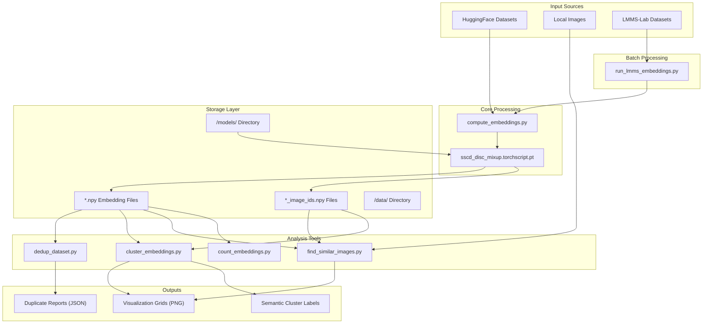
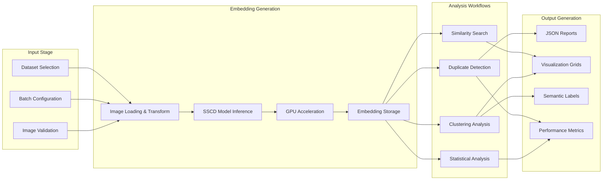

<!-- source: DeepWiki mcp.deepwiki.com · repo huggingface/large-scale-image-deduplication · page 1 Overview · fetched 2026-10-26 -->

# Overview

<details>
<summary>Relevant source files</summary>

The following files were used as context for generating this wiki page:

- [.gitignore](.gitignore)
- [README.md](README.md)

</details>


## Purpose and Scope

This document provides a comprehensive overview of the Large-Scale Image Deduplication Toolkit, a specialized system for detecting duplicate images within and across vision datasets using Facebook's SSCD (Self-Supervised Copy Detection) model. The toolkit transforms images into numerical embeddings and provides various analysis tools for duplicate detection, clustering, and similarity search operations.

For detailed information about the core embedding generation system, see [Embedding Generation System](#2). For specific analysis tools and their usage, see [Analysis & Deduplication Tools](#3). For setup instructions and project configuration, see [Setup & Configuration](#5).

Sources: [README.md:1-21]()

## System Architecture

The toolkit is built around a modular architecture where the `compute_embeddings.py` system serves as the central processing engine, transforming input images into SSCD embeddings that feed into multiple specialized analysis tools.

### Core System Components



Sources: [README.md:7-21](), System diagrams from context

## Core Components

### Embedding Generation Engine

The `compute_embeddings.py` system serves as the foundation of the toolkit, transforming input images into 512-dimensional SSCD embeddings. This component handles dataset loading, image preprocessing, GPU-accelerated inference, and embedding persistence.

**Key Responsibilities:**
- Loading images from HuggingFace datasets or local sources
- Applying SSCD model transformations and normalization
- Batch processing with configurable sizes for memory efficiency
- Persisting embeddings as `.npy` arrays with corresponding image ID mappings

### Analysis Tools Suite

The toolkit provides four specialized analysis tools that operate on precomputed embeddings:

| Tool | File | Primary Function |
|------|------|------------------|
| **Dataset Deduplication** | `dedup_dataset.py` | Compare new datasets against reference embeddings using cosine similarity |
| **Clustering Analysis** | `cluster_embeddings.py` | Group similar images using UMAP + DBSCAN with semantic labeling |
| **Similarity Search** | `find_similar_images.py` | Query-based retrieval of most similar images |
| **Statistics Analysis** | `count_embeddings.py` | Report statistics on computed embedding collections |

### Batch Processing Infrastructure

The `run_lmms_embeddings.py` script provides automated batch processing capabilities for predefined LMMS-Lab dataset collections, orchestrating multiple `compute_embeddings.py` executions with standardized configurations.

Sources: [README.md:58-155]()

## Data Flow Architecture

The system follows a clear data flow pattern from input sources through embedding generation to analysis outputs:

### Processing Pipeline



Sources: [README.md:58-104](), System diagrams from context

## Key Features and Capabilities

### High-Performance Computing
- **GPU Acceleration**: CUDA-optimized inference with `torch.cuda.empty_cache()` memory management
- **Batch Processing**: Configurable batch sizes for optimal memory utilization
- **Parallel Data Loading**: Multi-worker data loading with `num_workers=8` configuration

### Precision and Scale
- **High-Precision Detection**: Cosine similarity with default threshold of 0.90 for duplicate detection
- **Sub-second Search**: FAISS-accelerated similarity search for interactive querying
- **Large Dataset Support**: Seamless integration with HuggingFace dataset ecosystem

### Visualization and Analysis
- **Automatic Clustering**: UMAP dimensionality reduction with DBSCAN clustering
- **Semantic Labeling**: Vision-Language Model integration for automatic cluster labeling
- **Interactive Visualizations**: Grid-based image displays with similarity scores

### Robustness and Monitoring
- **Error Handling**: Robust image validation with `_is_valid_image` checks
- **Progress Tracking**: `tqdm` integration for real-time processing updates
- **Performance Metrics**: Comprehensive timing instrumentation and statistics

Sources: [README.md:14-21](), [README.md:83-104]()

## Technical Foundation

### SSCD Model Integration

The toolkit is built around Facebook's SSCD (Self-Supervised Copy Detection) model, specifically the `sscd_disc_mixup.torchscript.pt` variant. This model produces 512-dimensional embeddings optimized for copy detection tasks, enabling high-precision duplicate identification across diverse image content.

**Model Characteristics:**
- Pre-trained TorchScript format for optimized inference
- 512-dimensional embedding output
- Robust to various image transformations and quality variations
- Designed specifically for copy detection and near-duplicate identification

### Storage and File Organization

The toolkit maintains a structured file organization pattern:

```
/models/                    # Pre-trained model weights
/embeddings/               # Computed embedding arrays (.npy)
/data/                     # Raw dataset storage
/assets/                   # Generated visualizations
```

**File Naming Conventions:**
- Embeddings: `{dataset_name}_{split}_embeddings.npy`
- Image IDs: `{dataset_name}_{split}_image_ids.npy`
- Reports: `{dataset_name}_duplicates.json`

Sources: [README.md:39-55](), [.gitignore:1-15]()

---

