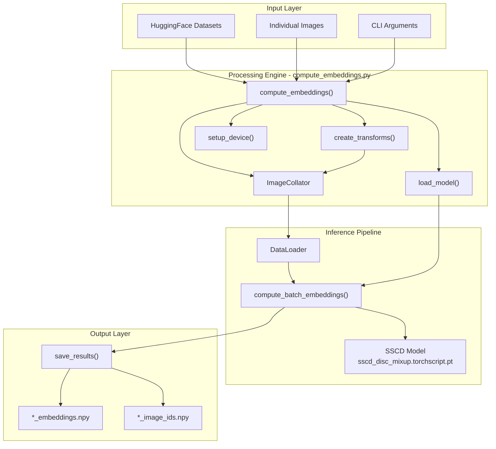
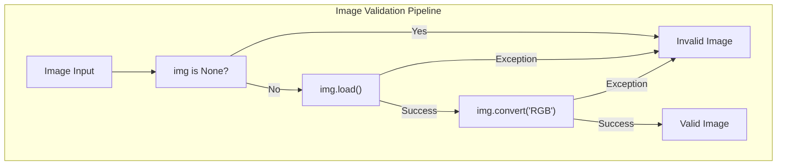
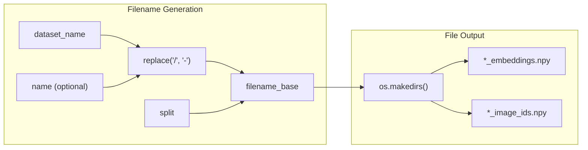
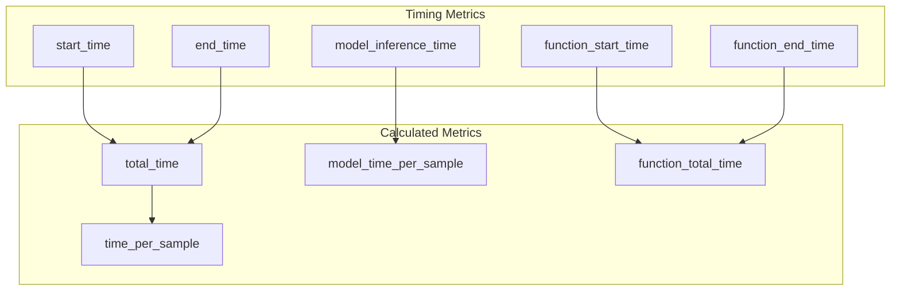

<!-- source: DeepWiki mcp.deepwiki.com · repo huggingface/large-scale-image-deduplication · page 2 Embedding Generation System · fetched 2026-10-26 -->

# Embedding Generation System

Relevant source files

The following files were used as context for generating this wiki page:

- [compute_embeddings.py](compute_embeddings.py)

## Purpose and Scope

The Embedding Generation System is the core processing engine of the Large-Scale Image Deduplication Toolkit, responsible for transforming images from various dataset sources into numerical vector representations using Facebook's SSCD (Self-Supervised Copy Detection) model. This system serves as the foundation for all downstream analysis tasks including duplicate detection, clustering, and similarity search.

For information about tools that analyze the generated embeddings, see [Analysis & Deduplication Tools](#3). For batch processing workflows that orchestrate this system, see [Batch Processing & Utilities](#4).

## System Architecture

The embedding generation system centers around the `compute_embeddings.py` script and follows a modular pipeline architecture with clear separation of concerns:

### Core System Components

Sources: [compute_embeddings.py:190-234]()

### Data Flow Pipeline

Sources: [compute_embeddings.py:190-221](), [compute_embeddings.py:140-157](), [compute_embeddings.py:39-109]()

## Core Components

### ImageCollator Class

The `ImageCollator` class handles batch processing and image validation with support for multiple dataset formats and optional deduplication:

| Component | Purpose | Key Methods |
|-----------|---------|-------------|
| `__init__()` | Initialize collator with transforms and deduplication settings | Sets up `transform`, `deduplicate`, `seen_ids` |
| `_is_valid_image()` | Validate image integrity before processing | Tests `img.load()` and `img.convert('RGB')` |
| `__call__()` | Process batches with multiple image key patterns | Handles `image`, `images`, `image_N` patterns |

The collator supports flexible image key patterns including single images (`image`), image lists (`images`), and numbered sequences (`image_0`, `image_1`, etc.).

Sources: [compute_embeddings.py:15-109]()

### Model Management Functions

The system provides dedicated functions for device and model setup:

Sources: [compute_embeddings.py:112-137]()

### Batch Processing Engine

The `compute_batch_embeddings()` function orchestrates the core inference loop:

| Phase | Operations | Timing Tracked |
|-------|------------|----------------|
| Setup | `torch.no_grad()` context, progress tracking with `tqdm` | - |
| Processing | `batch_tensor.to(device)`, `model(batch_tensor)` | `model_inference_time` |
| Collection | `embeddings.cpu().numpy()`, `image_ids.extend()` | - |

The function returns embeddings, image IDs, and detailed timing information for performance analysis.

Sources: [compute_embeddings.py:140-157]()

## Processing Pipeline

### Input Validation and Preprocessing

The system implements robust image validation through the `_is_valid_image()` method:

The validation catches `OSError`, `IOError`, `Image.DecompressionBombError`, and other exceptions to ensure only processable images enter the pipeline.

Sources: [compute_embeddings.py:24-37]()

### SSCD Model Configuration

The system uses a standardized transform pipeline optimized for the SSCD model:

| Transform Stage | Configuration | Purpose |
|----------------|---------------|---------|
| Resize | `[320, 320]` | Standardize input dimensions |
| ToTensor | Default | Convert PIL to tensor format |
| Normalize | `mean=[0.485, 0.456, 0.406]`, `std=[0.229, 0.224, 0.225]` | ImageNet normalization |

Sources: [compute_embeddings.py:128-137]()

### Output Management

The `save_results()` function handles file organization and naming:

Sources: [compute_embeddings.py:160-173]()

## Configuration and Usage

### Command Line Interface

The system accepts the following parameters through `argparse`:

| Parameter | Type | Default | Purpose |
|-----------|------|---------|---------|
| `--dataset` | string | required | HuggingFace dataset identifier |
| `--split` | string | `"val"` | Dataset split to process |
| `--name` | string | `None` | Dataset subset name |
| `--output_dir` | string | `"embeddings"` | Output directory path |
| `--batch_size` | integer | `32` | Processing batch size |
| `--deduplicate` | flag | `False` | Enable ID-based deduplication |
| `--id_column` | string | `"image_id"` | Column name for image IDs |

Sources: [compute_embeddings.py:223-234]()

### Performance Monitoring

The system provides comprehensive timing instrumentation:

The `print_results()` function outputs detailed performance statistics including per-sample timing and model inference overhead.

Sources: [compute_embeddings.py:176-187](), [compute_embeddings.py:192](), [compute_embeddings.py:218-220]()

---

