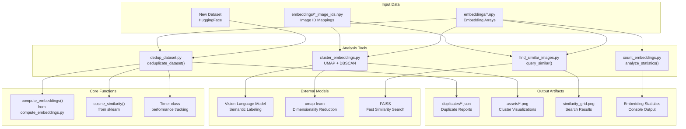
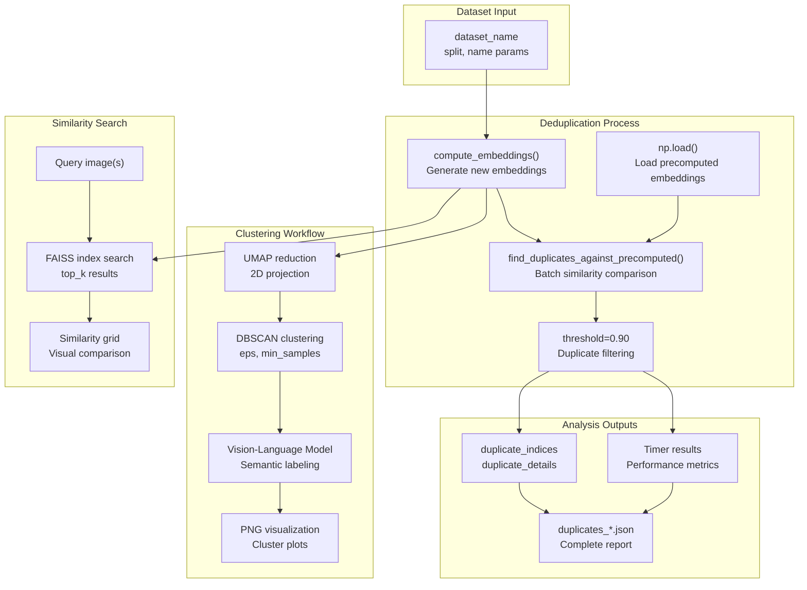

<!-- source: DeepWiki mcp.deepwiki.com · repo huggingface/large-scale-image-deduplication · page 3 Analysis & Deduplication Tools · fetched 2026-10-26 -->

# Analysis & Deduplication Tools

Relevant source files

The following files were used as context for generating this wiki page:

- [README.md](README.md)
- [dedup_dataset.py](dedup_dataset.py)

This document covers the analysis and deduplication tools that operate on pre-computed embeddings to detect duplicates, perform clustering analysis, and search for similar images. These tools form the analytical layer of the toolkit, consuming embeddings generated by the core embedding system to provide insights into dataset structure and composition.

For information about generating embeddings from raw images, see [Embedding Generation System](#2). For batch processing workflows, see [Batch Processing & Utilities](#4).

## Purpose and Scope

The analysis tools in this toolkit transform numerical embeddings into actionable insights through three primary operations:

1. **Duplicate Detection** - Comparing new datasets against existing embedding databases to identify duplicate images
2. **Clustering Analysis** - Grouping similar images and generating semantic labels for dataset structure visualization  
3. **Similarity Search** - Finding the most similar images to query inputs using efficient search algorithms

All tools operate on standardized `.npy` embedding files and image ID arrays produced by the embedding generation system.

## Analysis Tools Architecture

The following diagram shows how the core analysis tools interact with embedding data and external systems:

**Sources:** [README.md:72-154](), [dedup_dataset.py:1-152]()

## Analysis Workflow Pipeline

This diagram illustrates the typical workflow for analyzing a new dataset using the analysis tools:

**Sources:** [dedup_dataset.py:77-141](), [README.md:72-142]()

## Dataset Deduplication Tool

The `dedup_dataset.py` script provides the primary duplicate detection functionality by comparing new datasets against precomputed embedding databases. The core function `deduplicate_dataset()` orchestrates the entire process including embedding computation, similarity comparison, and result reporting.

### Key Functions

| Function | Purpose | Performance Features |
|----------|---------|---------------------|
| `deduplicate_dataset()` | Main orchestration function | Integrated timing with `Timer` class |
| `find_duplicates_against_precomputed()` | Batch similarity comparison | Configurable batch sizes, memory management |
| `Timer` class | Performance monitoring | Context manager for operation timing |

The tool uses `cosine_similarity()` from scikit-learn with a default threshold of 0.90 to identify duplicates. Results include detailed timing breakdowns and duplicate indices with similarity scores.

**Sources:** [dedup_dataset.py:24-75](), [dedup_dataset.py:77-141]()

## Clustering Analysis Tool

The `cluster_embeddings.py` system performs unsupervised analysis of embedding spaces using UMAP for dimensionality reduction and DBSCAN for clustering. The tool integrates with Vision-Language Models to automatically generate semantic labels for discovered clusters.

### Analysis Pipeline

1. **Dimensionality Reduction** - UMAP projects high-dimensional embeddings to 2D space
2. **Clustering** - DBSCAN groups similar embeddings with configurable `eps` and `min_samples` parameters  
3. **Semantic Labeling** - Vision-Language Models analyze cluster contents to generate descriptive labels
4. **Visualization** - PNG outputs show cluster structures with semantic annotations

The clustering tool is particularly effective for understanding dataset composition and identifying semantic groupings within large image collections.

**Sources:** [README.md:122-142]()

## Similarity Search Tool

The `find_similar_images.py` utility enables interactive querying of precomputed embedding databases to find the most similar images to one or more input queries. The tool leverages FAISS for efficient similarity search with sub-second response times.

### Search Capabilities

- **Multi-query Support** - Process multiple input images simultaneously
- **Configurable Results** - Specify `top_k` number of similar images to return
- **Visual Output** - Generates similarity grids showing query and result images
- **Embedding Integration** - Works with any precomputed embedding and image ID arrays

The search tool supports both individual image files and HuggingFace dataset integration for streamlined workflows.

**Sources:** [README.md:106-120]()

## Statistics and Monitoring

The `count_embeddings.py` utility provides comprehensive statistics about computed embedding collections, including dataset sizes, embedding dimensions, and storage usage across the embedding directory structure.

### Performance Monitoring

All analysis tools incorporate performance monitoring through the `Timer` class, providing detailed timing breakdowns for:

- **Embedding Computation** - Time spent generating new embeddings
- **Loading Operations** - Precomputed embedding loading performance  
- **Similarity Search** - Core comparison algorithm timing
- **Total Execution** - End-to-end operation duration

This timing information enables optimization of batch sizes and hardware allocation for large-scale analysis workflows.

**Sources:** [dedup_dataset.py:10-23](), [dedup_dataset.py:115-137](), [README.md:149-155]()

---

