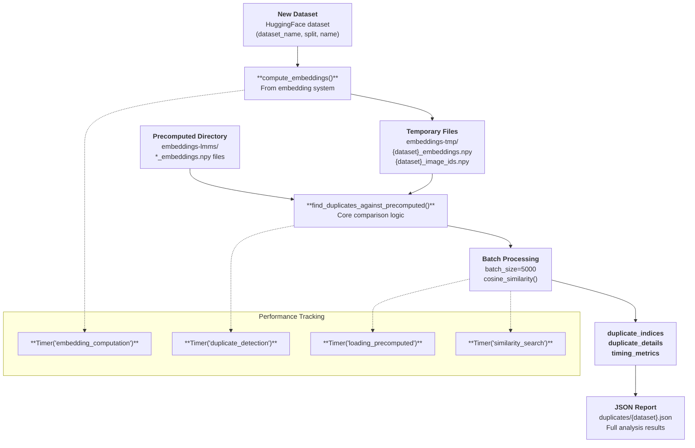
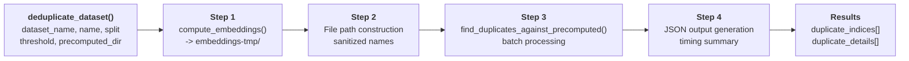
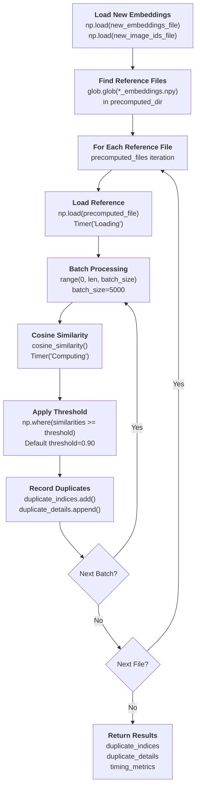

<!-- source: DeepWiki mcp.deepwiki.com · repo huggingface/large-scale-image-deduplication · page 3.1 Dataset Deduplication · fetched 2026-10-26 -->

# Dataset Deduplication

<details>
<summary>Relevant source files</summary>

The following files were used as context for generating this wiki page:

- [dedup_dataset.py](dedup_dataset.py)

</details>


This document covers the `dedup_dataset.py` system, which identifies duplicate images between a new dataset and a collection of precomputed embeddings. The system computes embeddings for a target dataset, then performs similarity comparisons against reference embeddings to detect duplicates above a configurable threshold.

For information about computing embeddings from source datasets, see [Embedding Generation System](#2). For interactive similarity search capabilities, see [Similarity Search](#3.3).

## Purpose and Workflow

The dataset deduplication system enables detection of duplicate images across large-scale vision datasets by:

1. Computing SSCD embeddings for a new target dataset
2. Loading precomputed reference embeddings from multiple sources  
3. Performing batched cosine similarity comparisons
4. Identifying duplicates above a similarity threshold (default 0.90)
5. Generating detailed JSON reports with timing metrics

## Core Architecture



Sources: [dedup_dataset.py:77-141]()

## Core Functions

### `deduplicate_dataset`

The main orchestration function that coordinates the complete deduplication workflow:



| Parameter | Type | Default | Description |
|-----------|------|---------|-------------|
| `dataset_name` | str | required | HuggingFace dataset identifier |
| `name` | str | None | Dataset subset name |
| `split` | str | 'test' | Dataset split to process |
| `threshold` | float | 0.90 | Cosine similarity threshold |
| `precomputed_dir` | str | 'embeddings-lmms' | Reference embeddings directory |
| `output_dir` | str | 'duplicates' | Output directory for results |

Sources: [dedup_dataset.py:77-141]()

### `find_duplicates_against_precomputed`

The core duplicate detection algorithm that performs similarity comparisons:



| Parameter | Type | Default | Description |
|-----------|------|---------|-------------|
| `new_embeddings_file` | str | required | Path to new dataset embeddings |
| `new_image_ids_file` | str | required | Path to corresponding image IDs |
| `precomputed_dir` | str | required | Directory with reference embeddings |
| `batch_size` | int | 5000 | Batch size for similarity computation |
| `threshold` | float | 0.90 | Minimum similarity for duplicate detection |

Sources: [dedup_dataset.py:24-75]()

## Performance Optimization

### Timer Class

The system includes comprehensive timing instrumentation using a context manager:

| Timer Category | Measures | Location |
|----------------|----------|----------|
| `total_time` | Complete execution | [dedup_dataset.py:80]() |
| `embedding_computation` | SSCD model inference | [dedup_dataset.py:83]() |
| `duplicate_detection` | Overall comparison process | [dedup_dataset.py:99]() |
| `loading_precomputed` | Reference embedding I/O | [dedup_dataset.py:46]() |
| `similarity_search` | Cosine similarity computation | [dedup_dataset.py:56]() |

### Batch Processing Strategy

The system processes embeddings in configurable batches to manage memory usage:

- Default batch size: 5000 embeddings per batch
- Prevents memory overflow on large datasets
- Maintains performance through vectorized operations
- Progress tracking via batch iteration

Sources: [dedup_dataset.py:10-23](), [dedup_dataset.py:51-60]()

## Output Format

### JSON Report Structure

The system generates detailed JSON reports with the following structure:

```json
{
  "dataset_name": "string",
  "name": "string|null", 
  "split": "string",
  "threshold": 0.90,
  "total_images": 1000,
  "timing": {
    "total_time": 45.67,
    "embedding_computation": 30.12,
    "duplicate_detection": 15.55,
    "loading_precomputed": 8.23,
    "similarity_search": 7.32
  },
  "duplicate_count": 25,
  "duplicate_indices": [12, 45, 78],
  "duplicate_details": [
    {
      "new_idx": 12,
      "new_image_id": 456,
      "source_file": "dataset1_embeddings.npy",
      "source_idx": 789,
      "similarity": 0.95
    }
  ]
}
```

### File Naming Convention

Output files follow a standardized naming pattern:

- Dataset without subset: `duplicates_{dataset-name}_{split}.json`
- Dataset with subset: `duplicates_{dataset-name}_{subset-name}_{split}.json`
- Special characters in names are replaced with hyphens

Sources: [dedup_dataset.py:87-93](), [dedup_dataset.py:105-129]()

## Command Line Interface

The system provides a command-line interface for standalone execution:

| Argument | Required | Default | Description |
|----------|----------|---------|-------------|
| `--dataset` | Yes | - | HuggingFace dataset name |
| `--split` | No | "val" | Dataset split to process |
| `--name` | No | None | Dataset subset name |
| `--precomputed_dir` | No | "embeddings-lmms" | Reference embeddings directory |
| `--threshold` | No | 0.90 | Similarity threshold |
| `--output_dir` | No | "duplicates" | Output directory |

Example usage:
```bash
python dedup_dataset.py --dataset "imagenet-1k" --split "validation" --threshold 0.85
```

Sources: [dedup_dataset.py:142-152]()

---

