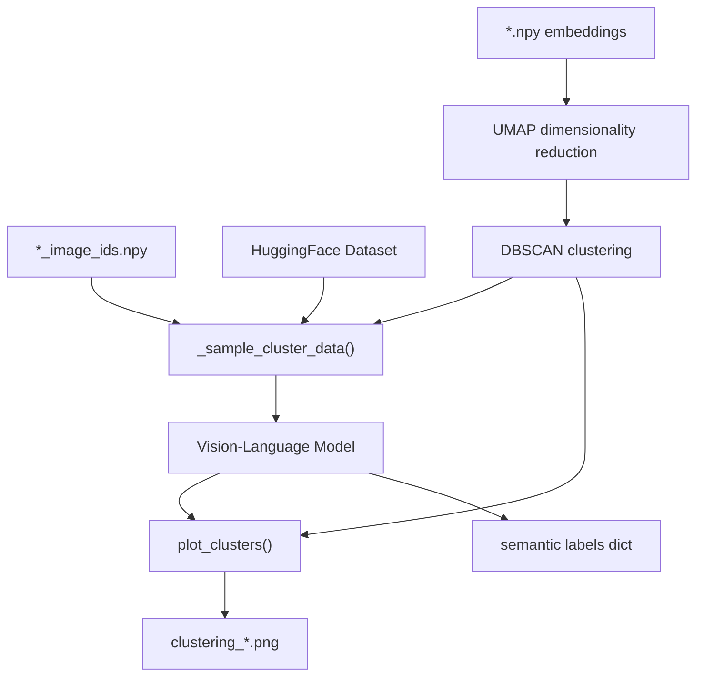
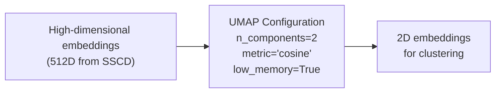
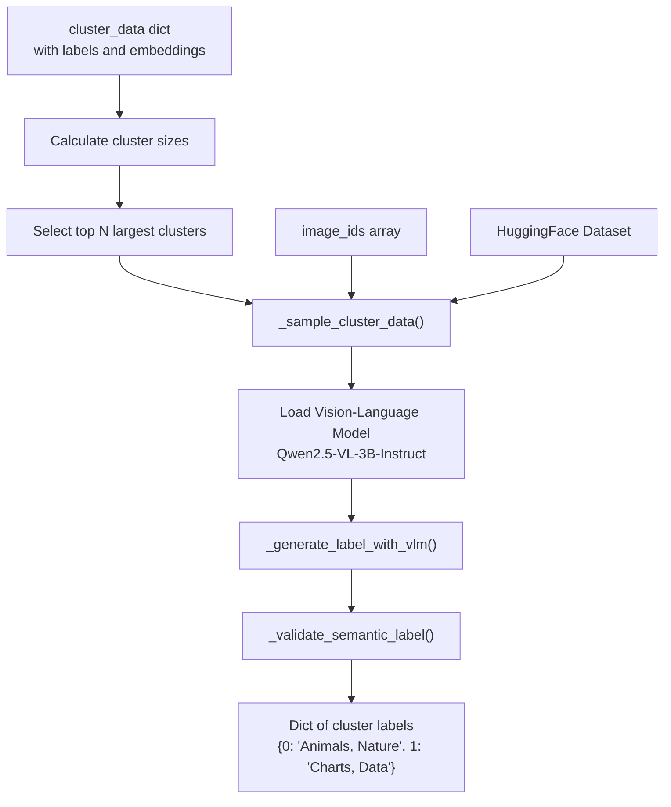
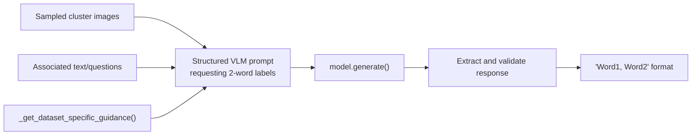
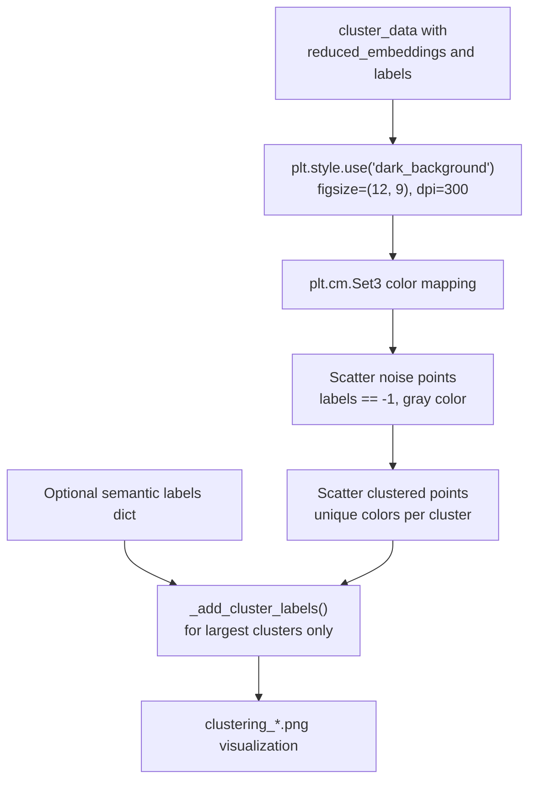

<!-- source: DeepWiki mcp.deepwiki.com · repo huggingface/large-scale-image-deduplication · page 3.2 Clustering Analysis · fetched 2026-10-26 -->

# Clustering Analysis

<details>
<summary>Relevant source files</summary>

The following files were used as context for generating this wiki page:

- [cluster_embeddings.py](cluster_embeddings.py)

</details>


This document covers the clustering analysis system implemented in `cluster_embeddings.py`, which groups similar image embeddings using unsupervised machine learning techniques and generates semantic labels for the resulting clusters. The system uses UMAP for dimensionality reduction, DBSCAN for clustering, and vision-language models for automated cluster labeling.

For information about computing the embeddings that feed into this system, see [Embedding Generation System](#2). For dataset-level deduplication without clustering, see [Dataset Deduplication](#3.1).

## System Architecture

The clustering analysis system operates as a multi-stage pipeline that transforms high-dimensional image embeddings into meaningful cluster visualizations with semantic labels.



**Core Clustering Pipeline**
Sources: [cluster_embeddings.py:17-72]()

The system accepts pre-computed embeddings from the embedding generation system and applies a two-stage dimensionality reduction and clustering approach. The `cluster_embeddings()` function serves as the main entry point, orchestrating UMAP reduction followed by DBSCAN clustering.

## Dimensionality Reduction and Clustering

### UMAP Dimensionality Reduction

The system uses UMAP (Uniform Manifold Approximation and Projection) to reduce high-dimensional embeddings to 2D space for visualization and improved clustering performance.



**UMAP Configuration**
Sources: [cluster_embeddings.py:26-33]()

The UMAP reducer is configured with cosine distance metric to preserve semantic relationships between image embeddings. The `low_memory=True` setting optimizes memory usage for large datasets, while `n_jobs` enables parallel processing.

### DBSCAN Clustering

After dimensionality reduction, DBSCAN (Density-Based Spatial Clustering of Applications with Noise) groups similar embeddings into clusters.

| Parameter | Default Value | Purpose |
|-----------|---------------|---------|
| `eps` | 0.3 | Maximum distance between samples in the same neighborhood |
| `min_samples` | 15 | Minimum samples required to form a dense region |
| `n_jobs` | 12 | Number of parallel jobs for computation |

Sources: [cluster_embeddings.py:36-44]()

The algorithm automatically determines the number of clusters and identifies noise points (outliers) that don't belong to any cluster. The system computes silhouette scores for quality assessment when multiple clusters are found.

## Semantic Labeling System

The semantic labeling system automatically generates human-readable labels for clusters by analyzing representative images from each cluster using vision-language models.



**Cluster Selection and Sampling**
Sources: [cluster_embeddings.py:447-460](), [cluster_embeddings.py:293-333]()

The system prioritizes the largest clusters for semantic labeling to maximize impact, processing only the top `max_clusters` (default 10) by size. For each selected cluster, it samples `n_examples` (default 10) representative images.

### Vision-Language Model Integration

The semantic labeling process uses the Qwen2.5-VL model series to analyze cluster content and generate descriptive labels.



**Dataset-Specific Guidance**
Sources: [cluster_embeddings.py:336-357](), [cluster_embeddings.py:360-438]()

The system provides dataset-specific context to the VLM to generate more relevant labels. For example, MMMU datasets receive guidance about academic subjects, while ChartQA focuses on chart types and data domains.

### Label Validation

The `_validate_semantic_label()` function ensures generated labels meet quality criteria:

- Must be 1-3 comma-separated parts
- Each part should be 1-3 words with reasonable length
- Filters out generic terms and default cluster names
- Rejects hallucinated or invalid responses

Sources: [cluster_embeddings.py:137-165]()

## Visualization System

The plotting system creates dark-themed scatter plots showing cluster distributions with optional semantic labels overlaid.



**Label Placement Algorithm**
Sources: [cluster_embeddings.py:168-195]()

The `_add_cluster_labels()` function calculates cluster centroids and places validated semantic labels only for the largest clusters, preventing visual clutter. Labels are displayed with semi-transparent white backgrounds for readability.

## Command Line Interface

The system provides a comprehensive CLI through the `main()` function with the following parameter categories:

### Clustering Parameters

| Argument | Type | Default | Description |
|----------|------|---------|-------------|
| `--embeddings` | str | Required | Path to embeddings .npy file |
| `--n-components` | int | 2 | UMAP dimensions |
| `--metric` | str | cosine | UMAP distance metric |
| `--eps` | float | 0.3 | DBSCAN eps parameter |
| `--min-samples` | int | 15 | DBSCAN min_samples |
| `--n-jobs` | int | 12 | Number of parallel jobs |

### Semantic Labeling Parameters

| Argument | Type | Default | Description |
|----------|------|---------|-------------|
| `--generate-labels` | flag | False | Enable semantic labeling |
| `--dataset` | str | Required for labeling | HuggingFace dataset name |
| `--subset` | str | None | Dataset subset name |
| `--split` | str | test | Dataset split |
| `--n-examples` | int | 10 | Examples per cluster for labeling |
| `--vl-model` | str | Qwen/Qwen2.5-VL-7B-Instruct | Vision-language model |
| `--max-clusters` | int | 12 | Maximum clusters to label |

Sources: [cluster_embeddings.py:507-553]()

### Example Usage

```bash
# Basic clustering without semantic labels
python cluster_embeddings.py --embeddings data/dataset_embeddings.npy

# Clustering with semantic labeling
python cluster_embeddings.py \
    --embeddings data/mmmu_embeddings.npy \
    --generate-labels \
    --dataset lmms-lab/MMMU \
    --eps 0.25 \
    --min-samples 10 \
    --max-clusters 15
```

The system automatically generates output files with sanitized dataset names (e.g., `clustering_lmms-lab-MMMU.png`) and handles GPU memory management for VLM inference.

Sources: [cluster_embeddings.py:125-134](), [cluster_embeddings.py:496-503]()

---

