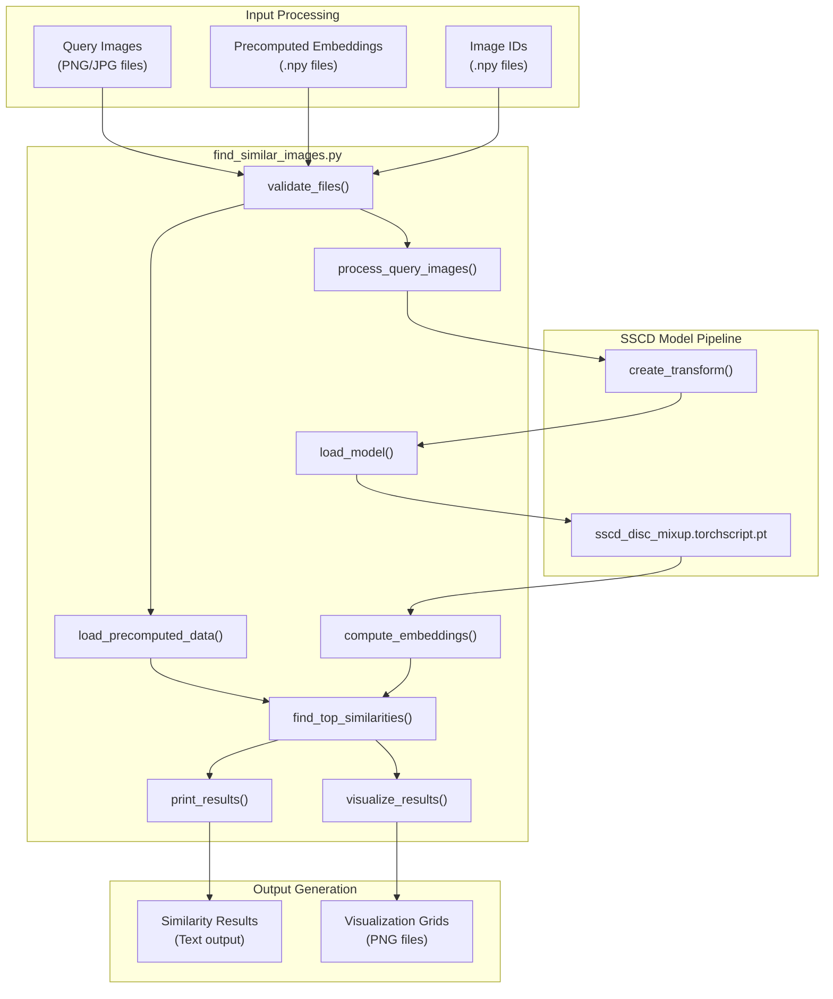
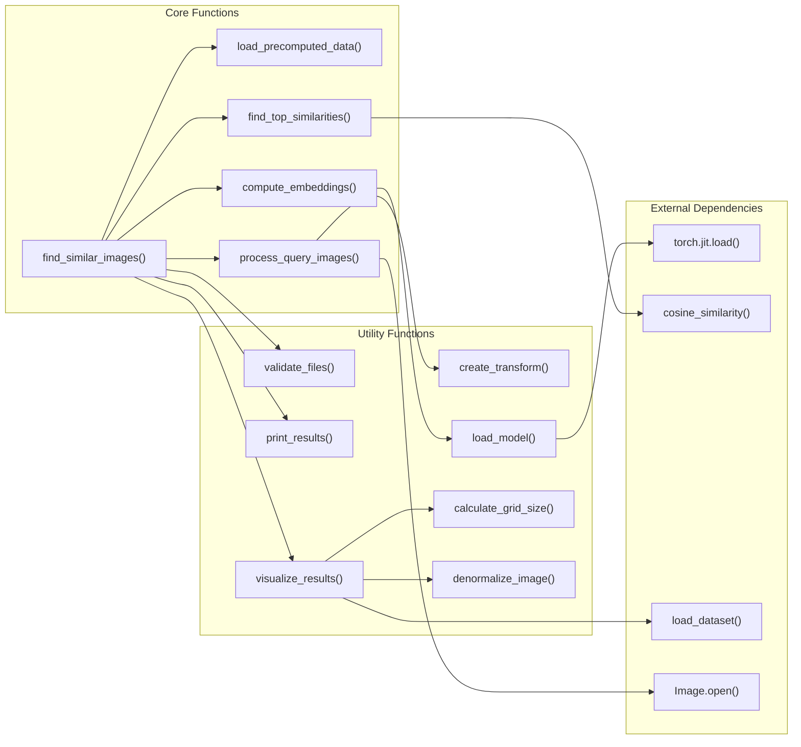
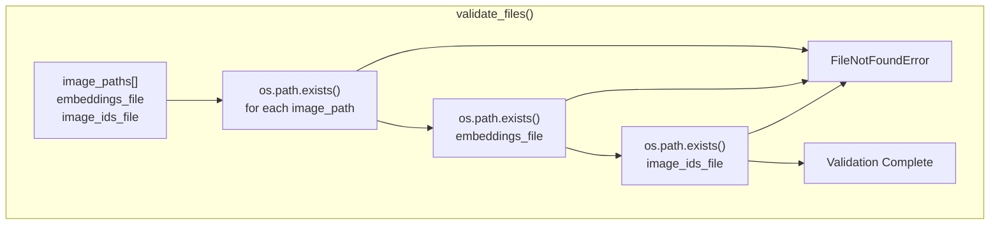
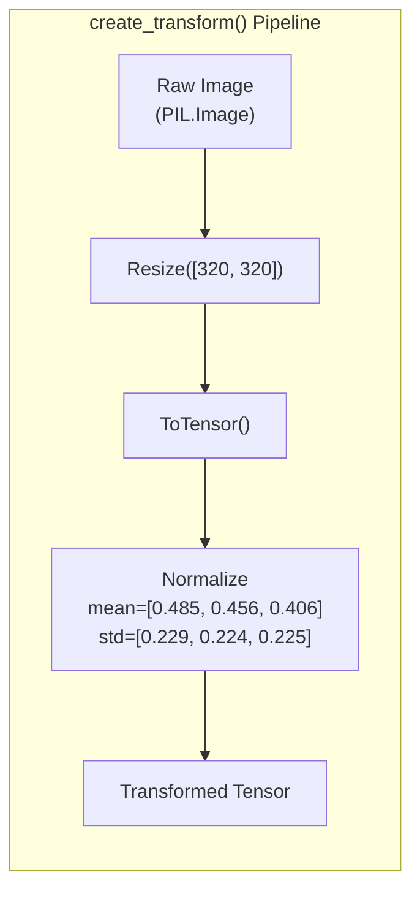
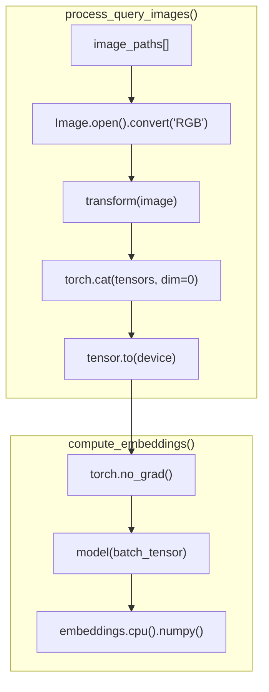
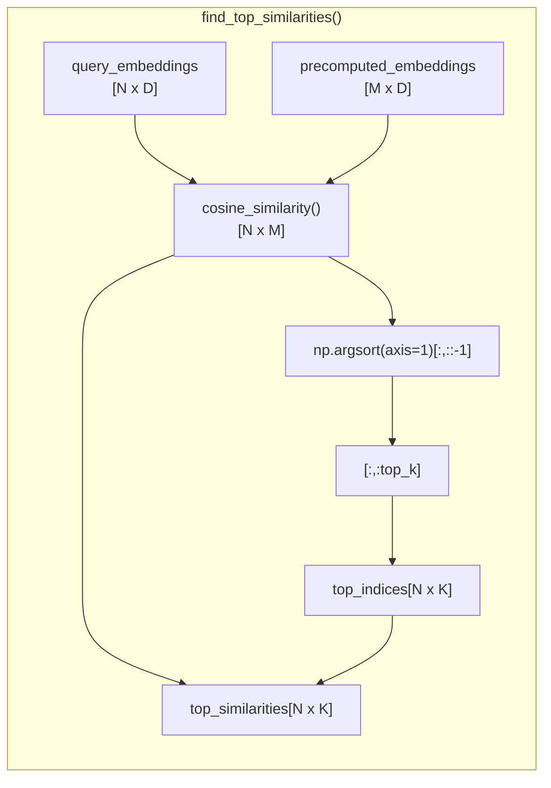
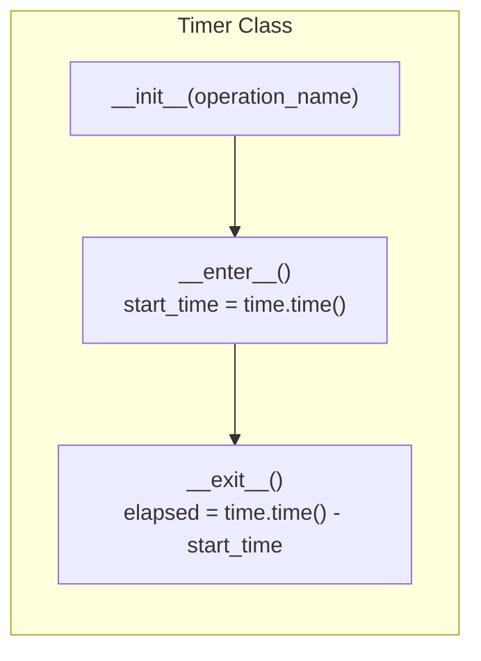
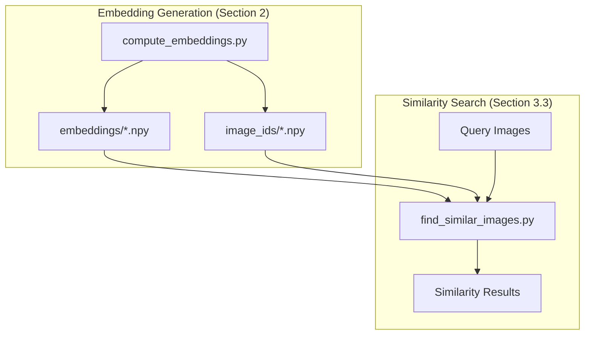

<!-- source: DeepWiki mcp.deepwiki.com · repo huggingface/large-scale-image-deduplication · page 3.3 Similarity Search · fetched 2026-10-26 -->

# Similarity Search

<details>
<summary>Relevant source files</summary>

The following files were used as context for generating this wiki page:

- [utils/find_similar_images.py](utils/find_similar_images.py)

</details>


## Purpose and Scope

This document covers the similarity search functionality implemented in `find_similar_images.py`, which enables querying for the most similar images to one or more input images using precomputed embeddings. The system computes embeddings for query images using the SSCD model and performs efficient similarity search against large collections of precomputed embeddings.

For information about generating the precomputed embeddings used by this system, see [Embedding Generation System](#2). For dataset-wide duplicate detection, see [Dataset Deduplication](#3.1).

## System Architecture

The similarity search system operates as a standalone query tool that leverages precomputed embeddings to enable sub-second similarity search across large image collections.

### Core Workflow



Sources: [utils/find_similar_images.py:1-307]()

### Component Interface Map



Sources: [utils/find_similar_images.py:33-38](), [utils/find_similar_images.py:52-57](), [utils/find_similar_images.py:59-69](), [utils/find_similar_images.py:71-75](), [utils/find_similar_images.py:77-86]()

## Input Processing and Validation

The system requires three types of input files and validates their existence before processing.

### Input Requirements

| Input Type | File Format | Description | Example Path |
|------------|-------------|-------------|--------------|
| Query Images | PNG/JPG | Images to find similarities for | `query.jpg` |
| Precomputed Embeddings | `.npy` | Numpy array of embeddings | `embeddings/dataset_embeddings.npy` |
| Image IDs | `.npy` | Numpy array of image identifiers | `embeddings/dataset_image_ids.npy` |

### File Validation Process



Sources: [utils/find_similar_images.py:264-274]()

## Embedding Computation Pipeline

Query images are processed through the same SSCD model pipeline used for precomputed embeddings to ensure compatibility.

### Image Transformation Pipeline

The `create_transform()` function establishes the preprocessing pipeline that must match the original embedding generation:



Sources: [utils/find_similar_images.py:40-50](), [utils/find_similar_images.py:14-15]()

### Batch Processing Architecture



Sources: [utils/find_similar_images.py:59-69](), [utils/find_similar_images.py:71-75]()

## Similarity Search Implementation

The core similarity computation uses scikit-learn's cosine similarity function for efficient comparison against large embedding collections.

### Similarity Computation Process

| Step | Function | Input | Output | Performance Note |
|------|----------|-------|--------|------------------|
| 1 | `cosine_similarity()` | Query embeddings, Precomputed embeddings | Similarity matrix | Vectorized operation |
| 2 | `np.argsort()` | Similarity matrix | Sorted indices | Descending order |
| 3 | `np.take_along_axis()` | Similarities, Top indices | Top-k similarities | Efficient indexing |

### Top-K Retrieval Algorithm



Sources: [utils/find_similar_images.py:77-86]()

## Visualization System

When a dataset name is provided, the system generates visual grids showing query images alongside their most similar matches.

### Grid Layout Calculation

The visualization system calculates optimal grid dimensions for displaying results:


Sources: [utils/find_similar_images.py:121-131]()

### Visualization Pipeline


Sources: [utils/find_similar_images.py:133-217]()

## Performance Monitoring

The system includes comprehensive timing instrumentation to monitor performance across different stages.

### Timer Context Manager



### Performance Breakdown

| Operation | Timer Name | Typical Duration | Performance Impact |
|-----------|------------|------------------|-------------------|
| Data Loading | `loading_timer` | ~1-5 seconds | I/O bound |
| Model Inference | `model_timer` | ~0.1-1 seconds | GPU/CPU bound |
| Similarity Search | `similarity_timer` | ~0.01-0.5 seconds | Memory bound |
| Total Execution | `total_timer` | Sum of above | End-to-end |

Sources: [utils/find_similar_images.py:18-31](), [utils/find_similar_images.py:105-113]()

## Command Line Interface

The system provides a comprehensive CLI for standalone usage and integration into larger workflows.

### CLI Argument Structure

| Argument | Type | Required | Default | Description |
|----------|------|----------|---------|-------------|
| `--images` | `str` (nargs='+') | Yes | - | Query image path(s) |
| `--embeddings` | `str` | Yes | - | Precomputed embeddings file |
| `--image_ids` | `str` | Yes | - | Image IDs file |
| `--dataset` | `str` | No | None | HuggingFace dataset for visualization |
| `--name` | `str` | No | None | Dataset subset name |
| `--split` | `str` | No | "test" | Dataset split |
| `--top_k` | `int` | No | 5 | Number of similar images |

### Usage Examples

```bash
# Basic similarity search
python utils/find_similar_images.py \
  --images query.jpg \
  --embeddings embeddings/laion_embeddings.npy \
  --image_ids embeddings/laion_image_ids.npy

# Multiple query images with visualization
python utils/find_similar_images.py \
  --images query1.jpg query2.jpg \
  --embeddings embeddings/coco_embeddings.npy \
  --image_ids embeddings/coco_image_ids.npy \
  --dataset "HuggingFaceM4/COCO" \
  --top_k 10
```

Sources: [utils/find_similar_images.py:276-307]()

## Integration with Larger System

The similarity search functionality integrates with the broader deduplication toolkit by consuming precomputed embeddings generated by the embedding generation system.

### Data Dependencies



### File Format Compatibility

The system expects embedding files in the same format produced by `compute_embeddings.py`:

- **Embeddings**: Numpy arrays with shape `[N, embedding_dim]` where N is the number of images
- **Image IDs**: Numpy arrays with shape `[N]` containing dataset indices or identifiers
- **Naming Convention**: Corresponding files should have matching base names (e.g., `dataset_embeddings.npy` and `dataset_image_ids.npy`)

Sources: [utils/find_similar_images.py:52-57](), [utils/find_similar_images.py:219-262]()

---

