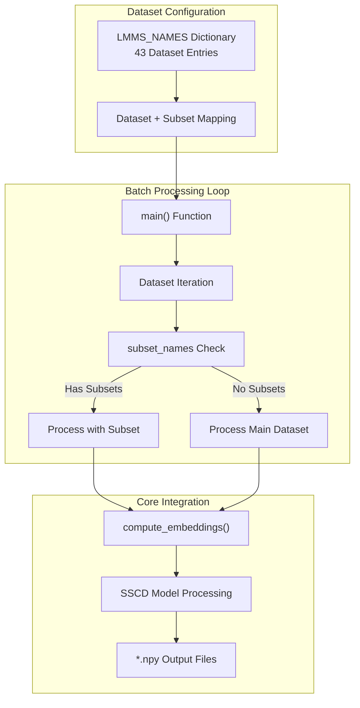
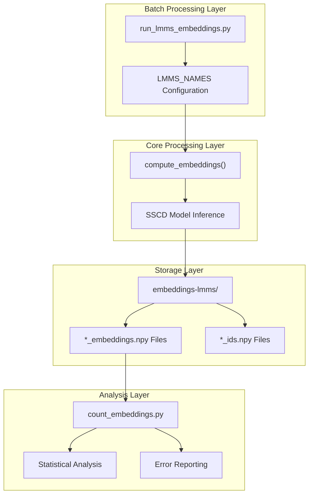

<!-- source: DeepWiki mcp.deepwiki.com · repo huggingface/large-scale-image-deduplication · page 4 Batch Processing & Utilities · fetched 2026-10-26 -->

# Batch Processing & Utilities

Relevant source files

The following files were used as context for generating this wiki page:

- [run_lmms_embeddings.py](run_lmms_embeddings.py)
- [utils/count_embeddings.py](utils/count_embeddings.py)

This section documents the batch processing infrastructure and utility tools that automate and analyze large-scale embedding operations. These tools provide orchestration capabilities for processing multiple datasets and analysis utilities for examining computed embeddings.

The batch processing system enables automated computation of embeddings across predefined dataset collections, while the utility tools provide statistical analysis and management capabilities for large embedding collections. For detailed information about the core embedding generation process, see [Embedding Generation System](#2). For specific analysis tools that operate on embeddings, see [Analysis & Deduplication Tools](#3).

## Batch Processing System Overview

The batch processing system centers around automated execution of embedding computation across large collections of datasets. The primary component is the `run_lmms_embeddings.py` script, which orchestrates the processing of 43 predefined LMMS-Lab datasets with their respective subset configurations.

### LMMS Dataset Processing Workflow

Sources: [run_lmms_embeddings.py:1-57]()

The batch processing system operates by iterating through the `LMMS_NAMES` dictionary, which contains dataset names as keys and subset lists as values. For datasets with subsets, each subset is processed individually using the `name` parameter of `compute_embeddings()`. Datasets without subsets are processed directly.

### Dataset Collection Structure

The system processes a comprehensive collection of vision-language datasets:

| Dataset Category | Example Datasets | Subset Configuration |
|------------------|------------------|---------------------|
| Visual QA | VQAv2, GQA, DocVQA | Some with subsets (e.g., GQA: test_all_images) |
| Captioning | COCO-Caption, TextCaps, NoCaps | Mostly single configurations |
| Benchmarks | MMBench_EN, MMMU, LiveBench | Time-based subsets (LiveBench: 2024-05 to 2024-09) |
| Specialized | Egothink, VisualWebBench | Multiple task-specific subsets |

Sources: [run_lmms_embeddings.py:5-44]()

## Utility Tools Overview

The utility infrastructure provides analysis and management capabilities for computed embeddings through specialized tools that operate on the generated `.npy` files and directory structures.

### Embedding Statistics System

```mermaid
graph LR
    subgraph "Input Discovery"
        EMBEDDINGS_DIR["embeddings-lmms/"]
        PATTERN["*_embeddings.npy Pattern"]
        GLOB_SEARCH["glob.glob() Discovery"]
    end
    
    subgraph "Analysis Pipeline"
        COUNT_FUNC["count_embeddings()"]
        NP_LOAD["np.load() Processing"]
        SHAPE_ANALYSIS["Shape Analysis"]
        ERROR_HANDLING["Exception Handling"]
    end
    
    subgraph "Statistics Generation"
        DATASET_COUNTS["dataset_counts List"]
        PRINT_STATISTICS["print_statistics()"]
        SIZE_DISTRIBUTION["Size Distribution Analysis"]
        TOP_DATASETS["Top 15 Ranking"]
    end
    
    subgraph "Output Reports"
        TOTAL_COUNT["Total Embeddings Count"]
        ERROR_SUMMARY["Error Summary"]
        DISTRIBUTION_STATS["Distribution Statistics"]
    end
    
    EMBEDDINGS_DIR --> PATTERN
    PATTERN --> GLOB_SEARCH
    GLOB_SEARCH --> COUNT_FUNC
    COUNT_FUNC --> NP_LOAD
    NP_LOAD --> SHAPE_ANALYSIS
    SHAPE_ANALYSIS --> ERROR_HANDLING
    ERROR_HANDLING --> DATASET_COUNTS
    DATASET_COUNTS --> PRINT_STATISTICS
    PRINT_STATISTICS --> SIZE_DISTRIBUTION
    PRINT_STATISTICS --> TOP_DATASETS
    SIZE_DISTRIBUTION --> DISTRIBUTION_STATS
    TOP_DATASETS --> TOTAL_COUNT
    ERROR_HANDLING --> ERROR_SUMMARY
```

Sources: [utils/count_embeddings.py:17-67](), [utils/count_embeddings.py:70-116]()

The `count_embeddings.py` utility provides comprehensive analysis of embedding collections by scanning the `embeddings-lmms` directory for files matching the `*_embeddings.npy` pattern. The tool extracts embedding counts, dimensions, and generates detailed statistics including size distribution analysis and error reporting.

## Integration with Core Systems

The batch processing and utility tools integrate seamlessly with the core embedding generation system through standardized interfaces and file conventions.

### Data Flow and Dependencies

Sources: [run_lmms_embeddings.py:3](), [run_lmms_embeddings.py:51](), [run_lmms_embeddings.py:54](), [utils/count_embeddings.py:33-34]()

The batch processing system invokes `compute_embeddings()` imported from the core module, maintaining consistent parameter interfaces and output formats. The utility tools operate on the standardized `.npy` file outputs, enabling seamless analysis of batch-processed results.

## File Naming and Organization Patterns

The system employs consistent naming conventions for managing large collections of embeddings:

### Naming Convention Analysis

| Pattern Component | Purpose | Example |
|------------------|---------|---------|
| `lmms-lab-` prefix | Dataset source identifier | `lmms-lab-ai2d_embeddings.npy` |
| Dataset name | Core dataset identifier | `VQAv2`, `COCO-Caption2017` |
| Subset suffix | Subset differentiation | `test_embeddings.npy` for subsets |
| File extension | Data type indicator | `.npy` for embeddings, `_ids.npy` for identifiers |

Sources: [utils/count_embeddings.py:56-58]()

The `count_embeddings.py` utility includes logic to clean dataset names for display by removing the `lmms-lab-` prefix and `_test_embeddings.npy` suffix, providing readable dataset identification in statistical reports.

## Usage Patterns and Scalability

### Batch Processing Execution Model

The batch processing system is designed for unattended execution across large dataset collections. The main execution pattern involves:

1. **Sequential Processing**: Datasets are processed one at a time to manage memory usage
2. **Subset Handling**: Automatic detection and processing of dataset subsets
3. **Progress Reporting**: Console output for tracking processing status
4. **Error Resilience**: Continuation of processing despite individual dataset failures

Sources: [run_lmms_embeddings.py:46-57]()

### Statistical Analysis Capabilities

The utility tools provide multi-level analysis including:

- **Volume Analysis**: Total embedding counts across all datasets
- **Distribution Analysis**: Size-based categorization (Tiny <1k, Small 1k-10k, Medium 10k-100k, Large >100k)
- **Ranking Systems**: Top 15 datasets by embedding count
- **Error Reporting**: Comprehensive error tracking and display

Sources: [utils/count_embeddings.py:103-115]()

The statistical analysis supports large-scale operations by providing insights into dataset characteristics, processing completeness, and potential issues in the embedding generation pipeline.

---

