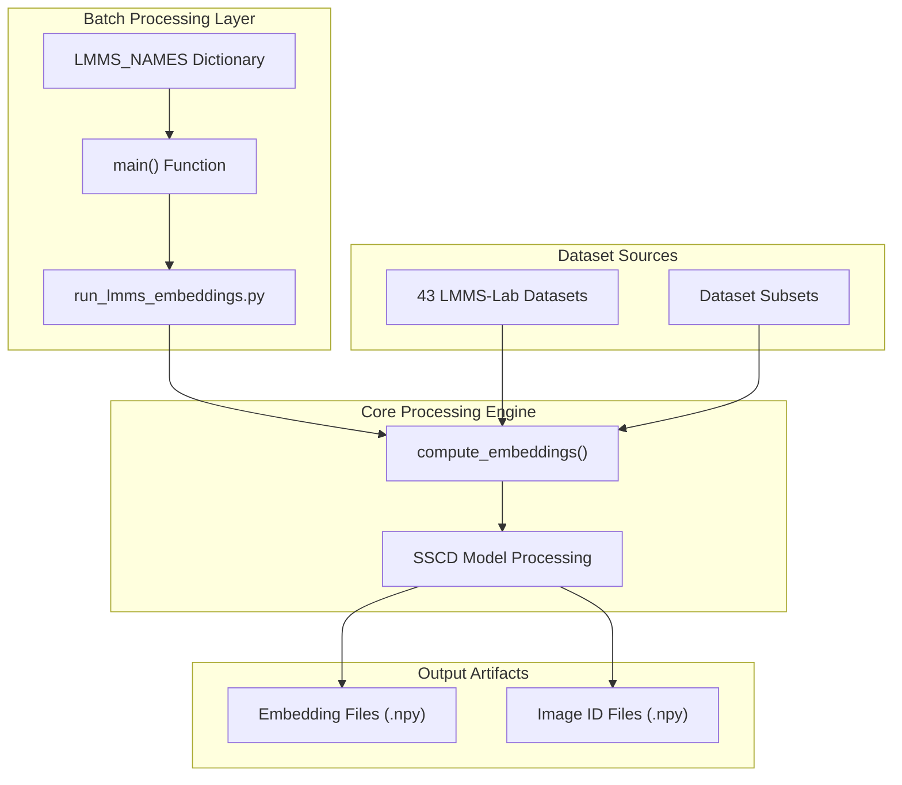
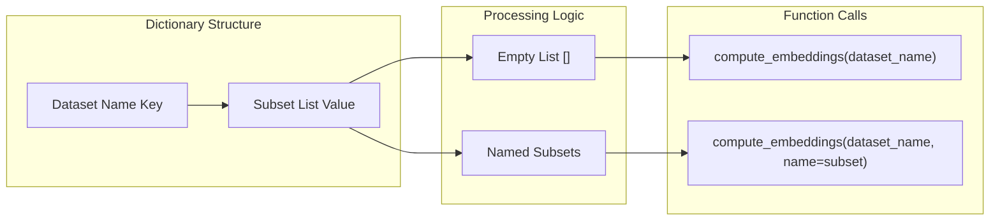
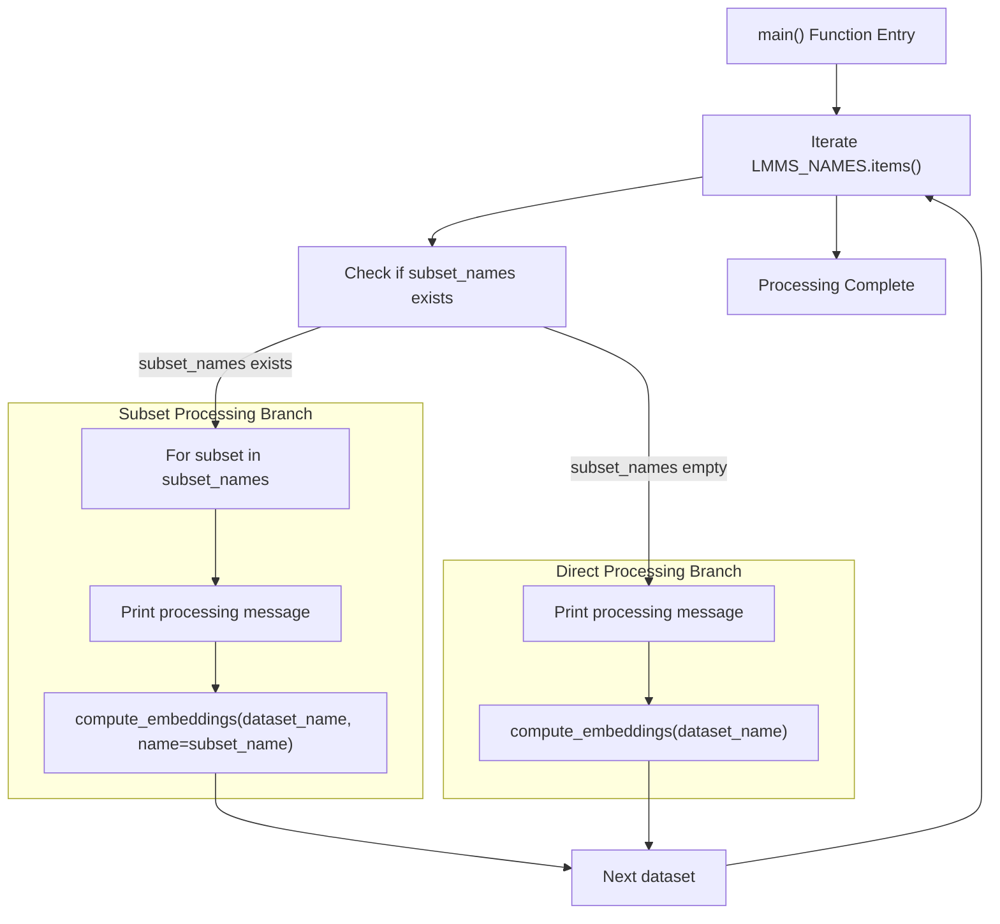
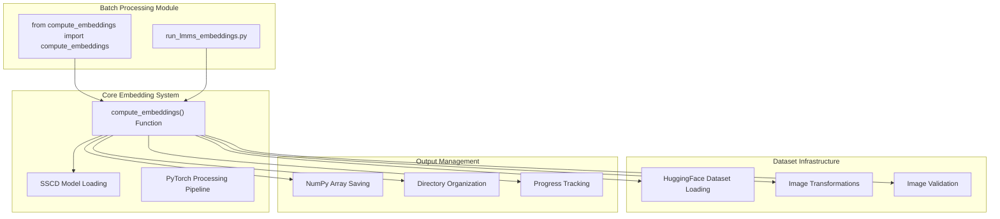

<!-- source: DeepWiki mcp.deepwiki.com · repo huggingface/large-scale-image-deduplication · page 4.1 Batch Processing · fetched 2026-10-26 -->

# Batch Processing

<details>
<summary>Relevant source files</summary>

The following files were used as context for generating this wiki page:

- [run_lmms_embeddings.py](run_lmms_embeddings.py)

</details>


This page documents the automated batch processing system for computing embeddings across multiple LMMS-Lab datasets. The batch processing functionality is implemented in `run_lmms_embeddings.py`, which orchestrates the systematic computation of embeddings for a predefined collection of vision-language datasets.

For information about the core embedding computation engine that this batch processor invokes, see [Embedding Generation System](#2). For details about analyzing computed embeddings, see [Analysis & Deduplication Tools](#3).

## Purpose and Architecture

The batch processing system provides automated execution of embedding computation across 43 predefined LMMS-Lab datasets. Rather than manually invoking the embedding computation for each dataset, this system iterates through a configured list of datasets and their subsets, calling the core `compute_embeddings` function for each.

### System Overview



Sources: [run_lmms_embeddings.py:1-57]()

## Dataset Configuration

The batch processing system operates on a predefined collection of LMMS-Lab datasets configured in the `LMMS_NAMES` dictionary. This configuration maps dataset names to their subset specifications.

### Dataset Categories

| Dataset Category | Examples | Subset Handling |
|------------------|----------|----------------|
| Single Dataset | `lmms-lab/ai2d`, `lmms-lab/ChartQA` | No subsets (`[]`) |
| Multi-Subset | `lmms-lab/DocVQA`, `lmms-lab/ScienceQA` | Named subsets |
| Time-Series | `lmms-lab/LiveBench` | Monthly subsets |
| Task-Specific | `lmms-lab/Egothink`, `lmms-lab/VisualWebBench` | Functional subsets |

### Configuration Structure

The `LMMS_NAMES` dictionary follows this pattern:



Sources: [run_lmms_embeddings.py:5-44]()

## Execution Workflow

The batch processing execution follows a systematic iteration pattern through the configured datasets and their subsets.

### Processing Flow



Sources: [run_lmms_embeddings.py:46-57]()

### Function Call Patterns

The batch processor uses two distinct calling patterns based on dataset structure:

**Pattern 1: Direct Dataset Processing**
- Used when `subset_names` is empty (`[]`)
- Calls `compute_embeddings(dataset_name)` [run_lmms_embeddings.py:54]()

**Pattern 2: Subset-Based Processing**  
- Used when `subset_names` contains named subsets
- Calls `compute_embeddings(dataset_name, name=subset_name)` [run_lmms_embeddings.py:51]()

## Integration with Core Systems

The batch processing system serves as a high-level orchestrator that delegates the actual embedding computation to the core `compute_embeddings` function from the main embedding generation system.

### System Dependencies



Sources: [run_lmms_embeddings.py:3]()

### Execution Context

The batch processor operates as a standalone script that can be executed directly:

```bash
python run_lmms_embeddings.py
```

Each invocation processes all 43 configured datasets sequentially, with progress messages printed for each dataset and subset combination being processed [run_lmms_embeddings.py:50,53]().

## Dataset Coverage

The current configuration covers 43 distinct LMMS-Lab datasets spanning multiple vision-language domains:

### Domain Distribution

| Domain | Dataset Count | Examples |
|--------|---------------|----------|
| Visual Question Answering | 12 | `MMBench_EN`, `VQAv2`, `GQA` |
| Document Understanding | 6 | `DocVQA`, `OCRBench-v2`, `ST-VQA` |
| Chart/Graph Analysis | 3 | `ChartQA`, `AI2D` variations |
| Caption Generation | 4 | `COCO-Caption`, `TextCaps`, `NoCaps` |
| Specialized Benchmarks | 18 | `LiveBench`, `Egothink`, `VisualWebBench` |

The complete dataset list spans from general-purpose vision-language tasks to specialized evaluation benchmarks, providing comprehensive coverage for large-scale deduplication analysis across the LMMS ecosystem.

Sources: [run_lmms_embeddings.py:5-44]()

---

