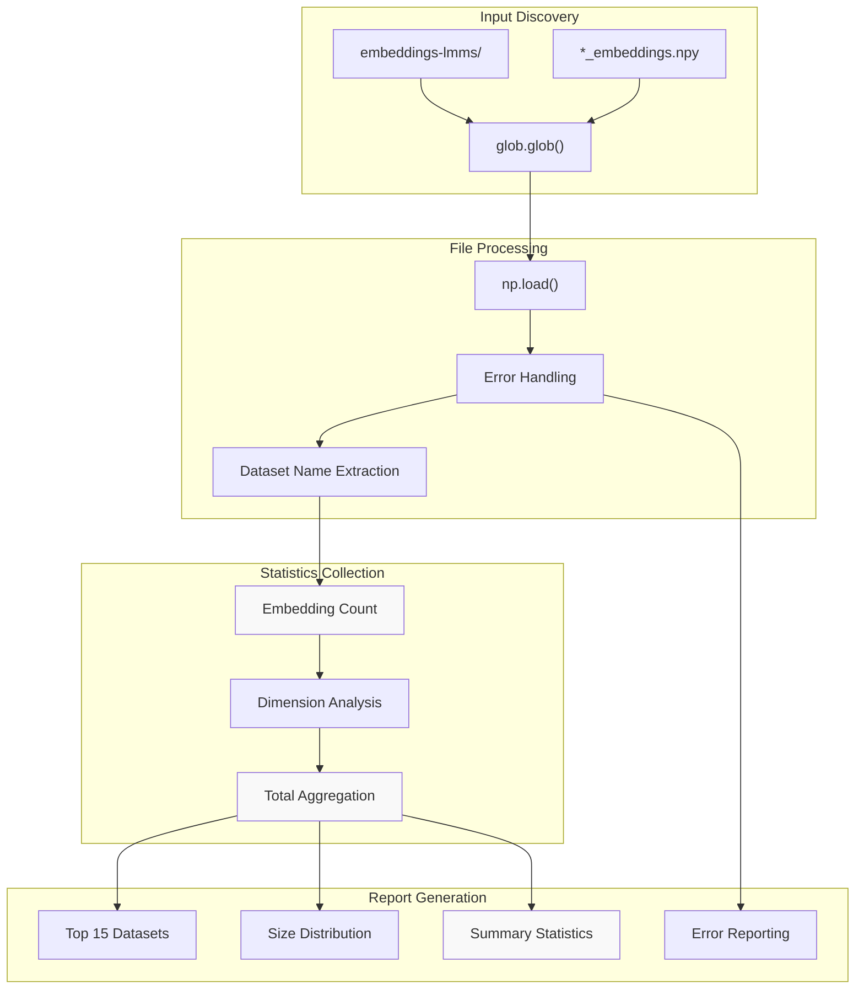
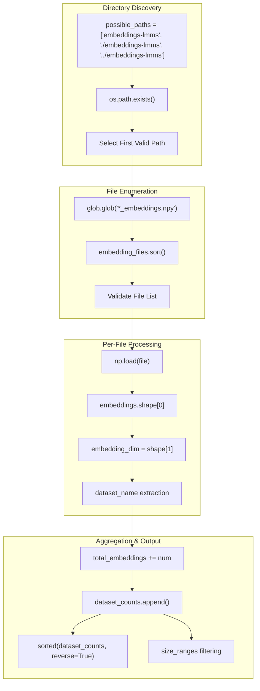
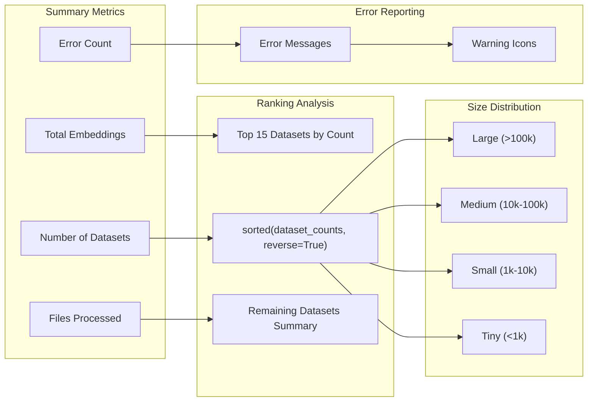
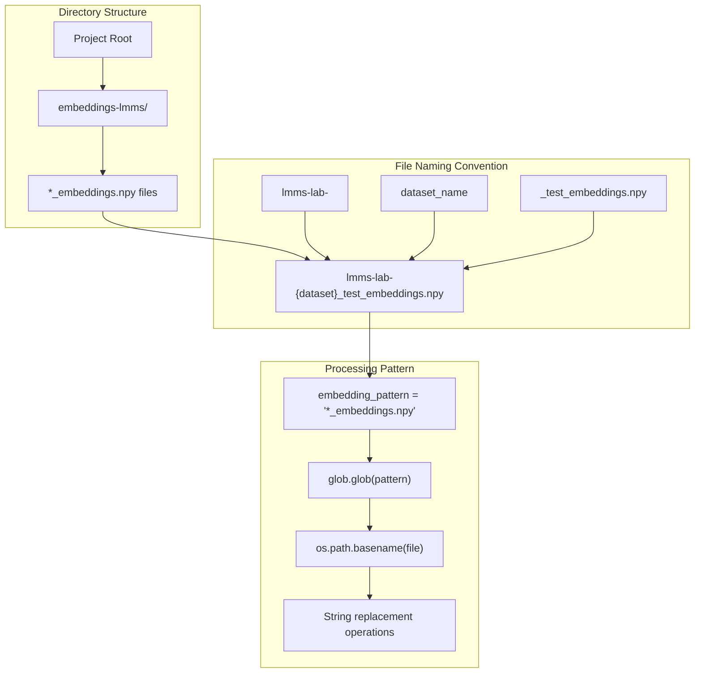
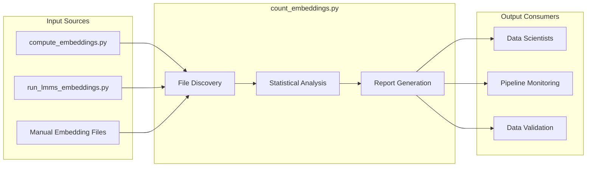

<!-- source: DeepWiki mcp.deepwiki.com · repo huggingface/large-scale-image-deduplication · page 4.2 Embedding Statistics · fetched 2026-10-26 -->

# Embedding Statistics

<details>
<summary>Relevant source files</summary>

The following files were used as context for generating this wiki page:

- [utils/count_embeddings.py](utils/count_embeddings.py)

</details>


This document covers the `count_embeddings.py` utility that analyzes and reports comprehensive statistics on computed embedding collections. The system provides visibility into the scale, distribution, and organization of embeddings stored in the toolkit's data directory structure.

For information about generating the embeddings that this tool analyzes, see [Embedding Generation System](#2). For batch processing utilities that work with embeddings, see [Batch Processing](#4.1).

## System Overview

The embedding statistics system is a standalone utility that scans embedding files in the `embeddings-lmms` directory and generates detailed reports about the collection. It provides essential metrics for understanding dataset coverage, size distribution, and potential issues in the embedding storage.

**System Overview - count_embeddings.py Architecture**



Sources: [utils/count_embeddings.py:17-67]()

## Analysis Workflow

The statistics system follows a systematic workflow to process embedding files and generate comprehensive reports. The core analysis is performed by the `count_embeddings()` function.

**Embedding Analysis Workflow**



Sources: [utils/count_embeddings.py:123-155](), [utils/count_embeddings.py:48-67]()

### Processing Logic

The system processes each embedding file through several stages:

| Stage | Function | Purpose |
|-------|----------|---------|
| **File Discovery** | `glob.glob()` | Locate all `*_embeddings.npy` files |
| **Dataset Name Extraction** | String manipulation | Clean dataset names for display |
| **Shape Analysis** | `embeddings.shape` | Count embeddings and dimensions |
| **Error Handling** | Exception catching | Track problematic files |
| **Aggregation** | List accumulation | Collect statistics for reporting |

The dataset name extraction logic removes common prefixes and suffixes: [utils/count_embeddings.py:57-58]()

```python
dataset_name = basename.replace('lmms-lab-', '').replace('_test_embeddings.npy', '')
```

Sources: [utils/count_embeddings.py:48-67]()

## Statistical Reports

The `print_statistics()` function generates comprehensive reports with multiple analysis dimensions. The reporting system provides both aggregate statistics and detailed breakdowns.

**Statistical Report Structure**



Sources: [utils/count_embeddings.py:70-116]()

### Size Distribution Categories

The system categorizes datasets into four size ranges with lambda-based filtering:

| Category | Range | Filter Logic |
|----------|-------|--------------|
| **Large** | >100,000 embeddings | `lambda x: x > 100_000` |
| **Medium** | 10,000-100,000 embeddings | `lambda x: 10_000 <= x <= 100_000` |
| **Small** | 1,000-10,000 embeddings | `lambda x: 1_000 <= x < 10_000` |
| **Tiny** | <1,000 embeddings | `lambda x: x < 1_000` |

Sources: [utils/count_embeddings.py:103-108]()

### Report Output Format

The statistics output follows a structured format with clear visual separators:

- Dataset listing with right-aligned counts and dimension information
- Separator lines using `'=' * 80` and `'-' * 60` 
- Formatted numbers with thousand separators using `:>10,` format
- Unicode warning symbols (`⚠️`) for error reporting

Sources: [utils/count_embeddings.py:73-98]()

## File Structure and Patterns

The system operates on a specific file naming convention and directory structure within the embedding storage system.

**File Pattern Recognition System**



Sources: [utils/count_embeddings.py:33-34](), [utils/count_embeddings.py:56-58]()

### Expected Directory Locations

The system searches for the embeddings directory in multiple locations with fallback logic:

1. `"embeddings-lmms"` (current directory)
2. `"./embeddings-lmms"` (explicit current directory)  
3. `"../embeddings-lmms"` (parent directory)

This flexible path resolution accommodates different execution contexts and project structures.

Sources: [utils/count_embeddings.py:124-134]()

## Integration with Embedding Ecosystem

The statistics utility integrates with the broader embedding generation and analysis pipeline by providing visibility into the outputs of other systems.

**Integration Points with Embedding Pipeline**



Sources: [utils/count_embeddings.py:1-158]()

### Usage in Workflow Monitoring

The statistics system serves as a monitoring tool for understanding:

- **Coverage**: Which datasets have computed embeddings
- **Scale**: Total number of embeddings across all datasets  
- **Quality**: Detection of corrupted or problematic embedding files
- **Progress**: Tracking of batch processing completion

The error reporting mechanism captures and displays issues with specific embedding files, enabling debugging of the embedding generation pipeline.

Sources: [utils/count_embeddings.py:62-66](), [utils/count_embeddings.py:81-85]()

---

