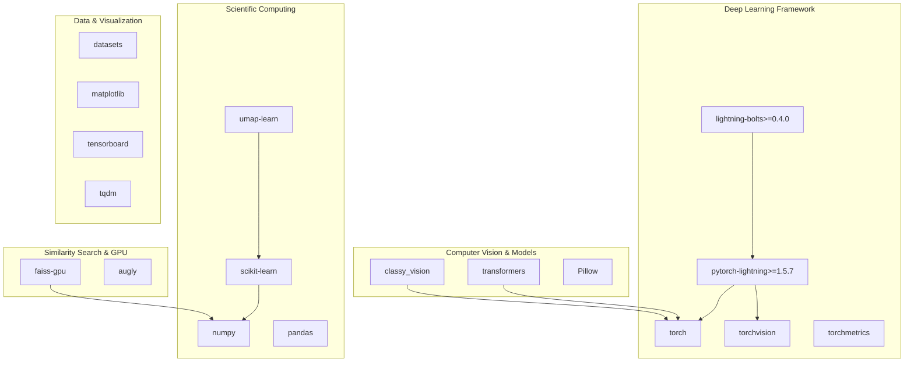
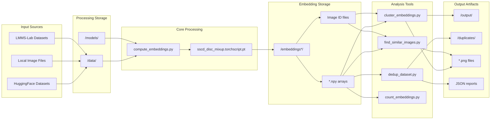
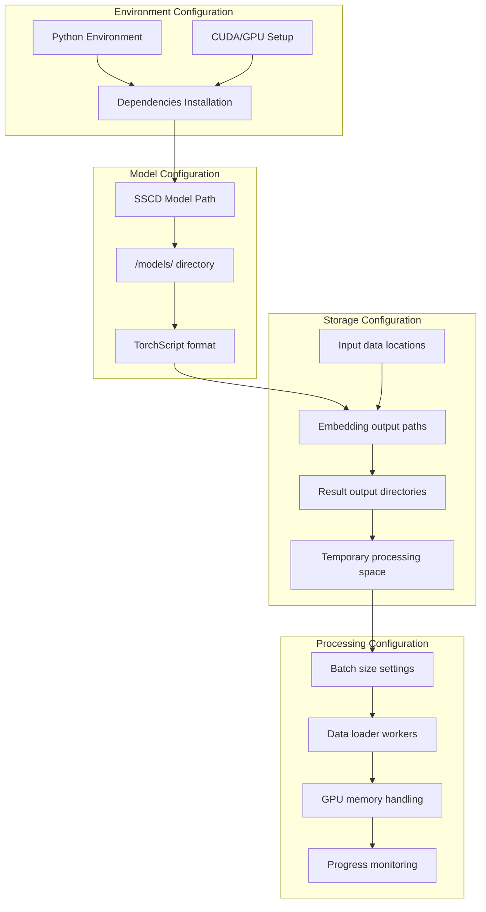

<!-- source: DeepWiki mcp.deepwiki.com · repo huggingface/large-scale-image-deduplication · page 5 Setup & Configuration · fetched 2026-10-26 -->

# Setup & Configuration

Relevant source files

The following files were used as context for generating this wiki page:

- [.gitignore](.gitignore)
- [requirements.txt](requirements.txt)

This document provides guidance for setting up the Large-Scale Image Deduplication Toolkit, including system requirements, dependency installation, project structure, and understanding how data flows through the various components. This covers the foundational setup needed before using any of the analysis tools.

For detailed information about specific processing systems, see [Embedding Generation System](#2). For information about using the analysis tools after setup, see [Analysis & Deduplication Tools](#3).

## System Requirements and Dependencies

The toolkit requires a Python environment with deep learning capabilities, particularly PyTorch and GPU support for efficient processing. The system is designed to work with large-scale datasets and requires substantial computational resources.

### Core Dependencies

The toolkit relies on several key dependency categories that enable its functionality:

*Sources: [requirements.txt:1-19]()*

### Dependency Mapping to System Components

The dependencies directly support specific toolkit functionalities:

| Component | Primary Dependencies | Purpose |
|-----------|---------------------|---------|
| `compute_embeddings.py` | `torch`, `torchvision`, `pytorch-lightning` | SSCD model inference and GPU acceleration |
| `dedup_dataset.py` | `scikit-learn`, `numpy`, `faiss-gpu` | Similarity computation and duplicate detection |
| `cluster_embeddings.py` | `umap-learn`, `scikit-learn`, `transformers` | Dimensionality reduction and semantic labeling |
| `find_similar_images.py` | `faiss-gpu`, `matplotlib`, `Pillow` | Fast similarity search and visualization |
| Data loading | `datasets`, `pandas`, `Pillow` | HuggingFace dataset integration and image processing |
| Visualization | `matplotlib`, `tensorboard` | Result visualization and progress tracking |

*Sources: [requirements.txt:1-19]()*

## Project Structure and Data Organization

The toolkit follows a structured directory layout that separates different types of data and outputs. Understanding this structure is essential for configuring and using the system effectively.

### Directory Structure

```mermaid
graph TD
    ROOT["/"] --> SCRIPTS["Python Scripts"]
    ROOT --> DATA["/data/"]
    ROOT --> MODELS["/models/"]
    ROOT --> EMBEDDINGS["/embeddings*/"]
    ROOT --> OUTPUT["/output/"]
    ROOT --> DUPLICATES["/duplicates/"]
    ROOT --> ASSETS["Generated Assets"]
    
    SCRIPTS --> COMPUTE["compute_embeddings.py"]
    SCRIPTS --> DEDUP["dedup_dataset.py"]
    SCRIPTS --> CLUSTER["cluster_embeddings.py"]
    SCRIPTS --> FIND["find_similar_images.py"]
    SCRIPTS --> RUN["run_lmms_embeddings.py"]
    SCRIPTS --> COUNT["count_embeddings.py"]
    
    DATA --> RAW_DATASETS["Raw Dataset Files"]
    MODELS --> SSCD_MODEL["sscd_disc_mixup.torchscript.pt"]
    EMBEDDINGS --> NPY_FILES["*.npy embedding arrays"]
    EMBEDDINGS --> ID_FILES["Image ID mappings"]
    OUTPUT --> PROCESSING_RESULTS["Processing outputs"]
    DUPLICATES --> DUPLICATE_REPORTS["JSON reports"]
    ASSETS --> VISUALIZATIONS["*.png visualizations"]
```

*Sources: [.gitignore:1-11]()*

### Data Flow Architecture

The system processes data through several stages, with each stage producing artifacts consumed by subsequent stages:

*Sources: [.gitignore:1-15]()*

## Configuration and Setup Workflow

### Initial Setup Steps

The typical setup workflow involves preparing the environment and understanding the data flow:

1. **Environment Preparation**: Install dependencies from `requirements.txt`
2. **Model Acquisition**: Obtain the SSCD model file (`sscd_disc_mixup.torchscript.pt`)
3. **Directory Structure**: Ensure proper directory structure exists
4. **GPU Configuration**: Verify CUDA and GPU acceleration capabilities
5. **Data Preparation**: Organize input datasets appropriately

### Critical Configuration Points

*Sources: [requirements.txt:1-19](), [.gitignore:1-15]()*

### Key Configuration Considerations

| Configuration Area | Requirements | Impact |
|-------------------|-------------|---------|
| **GPU Memory** | Adequate VRAM for batch processing | Affects batch size and processing speed |
| **Storage Space** | Space for embeddings, models, and outputs | Critical for large dataset processing |
| **Python Environment** | Compatible versions of PyTorch ecosystem | Ensures proper model loading and execution |
| **FAISS Setup** | GPU-enabled FAISS installation | Enables fast similarity search capabilities |
| **Data Organization** | Proper directory structure | Prevents path resolution issues |

The setup ensures that all components can interact effectively, from initial data ingestion through embedding generation to final analysis and visualization output.

*Sources: [requirements.txt:1-19](), [.gitignore:1-15]()*

---

