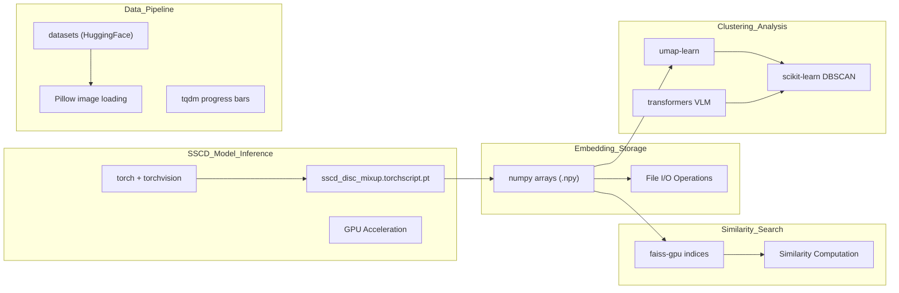

<!-- source: DeepWiki mcp.deepwiki.com · repo huggingface/large-scale-image-deduplication · page 5.1 Installation & Dependencies · fetched 2026-10-26 -->

# Installation & Dependencies

<details>
<summary>Relevant source files</summary>

The following files were used as context for generating this wiki page:

- [requirements.txt](requirements.txt)

</details>


This document covers the Python dependencies and environment setup required to run the Large-Scale Image Deduplication Toolkit. The toolkit requires a deep learning environment with GPU acceleration capabilities for efficient SSCD model inference and embedding computation.

For information about the project structure and data organization, see [Project Structure & Data Flow](#5.2).

## Core Dependency Architecture

The toolkit's dependencies can be organized into several functional categories that support different aspects of the image deduplication pipeline:

### Dependency Overview

```mermaid
graph TB
    subgraph "Deep Learning Framework"
        torch["torch"]
        torchvision["torchvision"]
        pytorch_lightning["pytorch-lightning>=1.5.7,<1.6"]
        lightning_bolts["lightning-bolts>=0.4.0,<0.6"]
        torchmetrics["torchmetrics"]
    end
    
    subgraph "Computer Vision"
        classy_vision["classy_vision"]
        pillow["Pillow"]
        augly["augly"]
    end
    
    subgraph "Machine Learning & Analysis"
        scikit_learn["scikit-learn"]
        umap_learn["umap-learn"]
        faiss_gpu["faiss-gpu"]
    end
    
    subgraph "Data Processing"
        numpy["numpy"]
        pandas["pandas"]
        datasets["datasets"]
        transformers["transformers"]
    end
    
    subgraph "Utilities & Visualization"
        matplotlib["matplotlib"]
        tensorboard["tensorboard"]
        tqdm["tqdm"]
    end
    
    subgraph "Core Systems"
        compute_embeddings["compute_embeddings.py"]
        dedup_dataset["dedup_dataset.py"]
        cluster_embeddings["cluster_embeddings.py"]
    end
    
    torch --> compute_embeddings
    torchvision --> compute_embeddings
    pytorch_lightning --> compute_embeddings
    classy_vision --> compute_embeddings
    
    faiss_gpu --> dedup_dataset
    scikit_learn --> dedup_dataset
    numpy --> dedup_dataset
    
    umap_learn --> cluster_embeddings
    transformers --> cluster_embeddings
    matplotlib --> cluster_embeddings
    
    pillow --> compute_embeddings
    datasets --> compute_embeddings
    pandas --> cluster_embeddings
    tqdm --> compute_embeddings
```



Sources: [requirements.txt:1-19]()

### System Component Dependency Mapping



Sources: [requirements.txt:1-19]()

## Deep Learning Framework Dependencies

The toolkit is built on PyTorch and requires specific versions for compatibility with the SSCD model:

| Dependency | Version Constraint | Purpose |
|------------|-------------------|---------|
| `torch` | Latest stable | Core deep learning framework for SSCD model inference |
| `torchvision` | Compatible with torch | Image transformations and preprocessing |
| `pytorch-lightning` | `>=1.5.7,<1.6` | Training framework (version-locked for stability) |
| `lightning-bolts` | `>=0.4.0,<0.6` | Additional PyTorch Lightning utilities |
| `torchmetrics` | Latest | Performance metrics computation |

The version constraints on `pytorch-lightning` and `lightning-bolts` ensure compatibility with the existing codebase and prevent breaking changes from newer versions.

Sources: [requirements.txt:1-6]()

## Computer Vision and Image Processing

Essential libraries for handling image data and computer vision tasks:

| Dependency | Purpose |
|------------|---------|
| `classy_vision` | Facebook's computer vision framework (required for SSCD) |
| `Pillow` | Image loading, manipulation, and format conversion |
| `augly` | Data augmentation utilities (optional preprocessing) |

The `classy_vision` dependency is specifically required for loading and running the SSCD model checkpoint.

Sources: [requirements.txt:3,17,8]()

## Data Processing and Analysis Libraries

Core data manipulation and machine learning dependencies:

### Numerical Computing
- `numpy` - Array operations and embedding storage
- `pandas` - Data analysis and CSV/JSON processing

### Machine Learning
- `scikit-learn` - Clustering algorithms (DBSCAN), metrics, preprocessing
- `umap-learn` - Dimensionality reduction for visualization
- `faiss-gpu` - Efficient similarity search and nearest neighbor queries

### Natural Language Processing
- `transformers` - Vision-Language Models for semantic labeling
- `datasets` - HuggingFace dataset loading and processing

Sources: [requirements.txt:10-16]()

## Specialized High-Performance Libraries

### FAISS-GPU Acceleration
The `faiss-gpu` library provides GPU-accelerated similarity search capabilities essential for:
- Sub-second duplicate detection across large embedding collections
- Efficient nearest neighbor queries in high-dimensional space
- Scalable similarity computation for clustering analysis

### UMAP Dimensionality Reduction
The `umap-learn` library enables:
- 2D projection of high-dimensional SSCD embeddings
- Visualization of image similarity relationships
- Preprocessing for clustering algorithms

Sources: [requirements.txt:7,13]()

## Visualization and Development Utilities

Supporting libraries for development and result visualization:

| Dependency | Purpose |
|------------|---------|
| `matplotlib` | Plotting and visualization generation |
| `tensorboard` | Training monitoring and logging |
| `tqdm` | Progress bars for long-running operations |

These utilities enhance the development experience and provide visual feedback during processing.

Sources: [requirements.txt:11,14,18]()

## Installation Requirements

### System Prerequisites
- **Python**: 3.8 or higher
- **CUDA**: Compatible GPU with CUDA support for `faiss-gpu` and PyTorch GPU acceleration
- **Memory**: Sufficient RAM for large embedding arrays (recommended 16GB+)
- **Storage**: Space for dataset downloads and embedding storage

### Installation Command
```bash
pip install -r requirements.txt
```

### GPU Setup Considerations
Ensure CUDA drivers are properly installed before installing PyTorch and FAISS-GPU. The toolkit leverages GPU acceleration for:
- SSCD model inference during embedding computation
- FAISS similarity search operations
- Parallel data loading and preprocessing

### Version Compatibility Notes
The locked versions for `pytorch-lightning` and `lightning-bolts` ensure compatibility with the existing codebase. Upgrading these dependencies may require code modifications to handle API changes.

Sources: [requirements.txt:1-19]()

---

