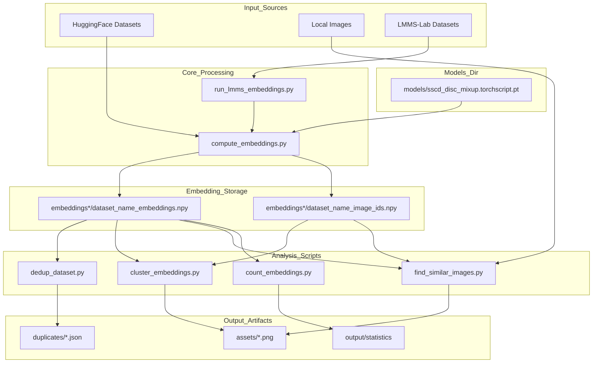
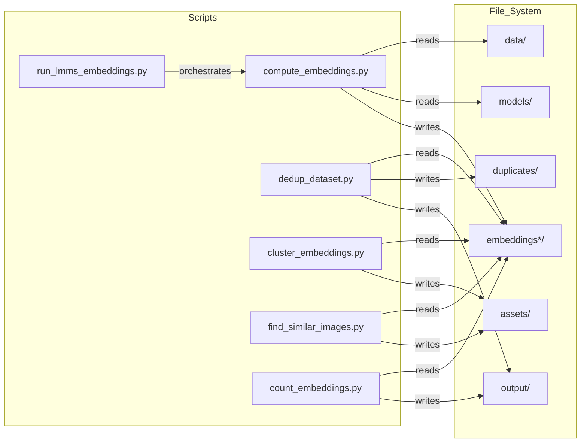
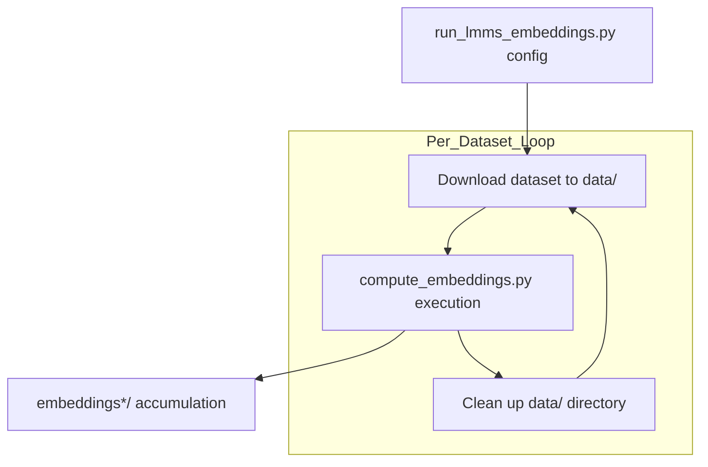

<!-- source: DeepWiki mcp.deepwiki.com · repo huggingface/large-scale-image-deduplication · page 5.2 Project Structure & Data Flow · fetched 2026-10-26 -->

# Project Structure & Data Flow

<details>
<summary>Relevant source files</summary>

The following files were used as context for generating this wiki page:

- [.gitignore](.gitignore)

</details>


This document explains the directory structure and data flow patterns within the Large-Scale Image Deduplication Toolkit. It covers how different components interact with the file system, where data artifacts are stored, and the typical flow of data through the processing pipeline.

For information about installing dependencies and setting up the environment, see [Installation & Dependencies](#5.1). For detailed documentation of individual processing components, see [Embedding Generation System](#2) and [Analysis & Deduplication Tools](#3).

## Directory Structure

The project follows a conventional structure where input data, models, computed embeddings, and analysis outputs are organized into separate directories:

```
large-scale-image-deduplication/
├── data/              # Raw datasets and input images
├── models/            # Pre-trained SSCD model files
├── embeddings*/       # Computed embedding arrays (.npy files)
├── duplicates/        # Deduplication analysis results
├── output/            # General output directory
├── assets/            # Generated visualizations and reports
├── *.py              # Core processing scripts
└── requirements files # Python dependencies
```

### Core Directories

| Directory | Purpose | Generated By | Consumed By |
|-----------|---------|--------------|-------------|
| `data/` | Raw datasets and source images | Manual/external | `compute_embeddings.py` |
| `models/` | SSCD model files (`sscd_disc_mixup.torchscript.pt`) | Manual download | `compute_embeddings.py` |
| `embeddings*/` | Computed embedding arrays (`.npy`) | `compute_embeddings.py` | All analysis scripts |
| `duplicates/` | Deduplication reports and statistics | `dedup_dataset.py` | Manual review |
| `output/` | General output artifacts | Various scripts | Manual review |
| `assets/` | Visualizations (PNG) and cluster analysis | `cluster_embeddings.py`, `find_similar_images.py` | Manual review |

Sources: [.gitignore:1-15]()

## Data Flow Architecture

**Data Flow Through Processing Pipeline**



Sources: [.gitignore:1-11]()

## Component File System Interactions

**Script-to-Directory Mapping**



Sources: [.gitignore:1-11]()

## File Naming Conventions

### Embedding Files
The embedding generation system creates paired files for each processed dataset:

- **Embeddings**: `{dataset_name}_embeddings.npy` - Contains the 512-dimensional SSCD feature vectors
- **Image IDs**: `{dataset_name}_image_ids.npy` - Contains corresponding image identifiers or file paths

### Output Files
Analysis scripts generate outputs following these patterns:

| Script | Output Pattern | Example |
|--------|----------------|---------|
| `dedup_dataset.py` | `duplicates/{dataset}_vs_{reference}_duplicates.json` | `duplicates/new_dataset_vs_laion_duplicates.json` |
| `cluster_embeddings.py` | `assets/{dataset}_clusters_umap.png` | `assets/coco_clusters_umap.png` |
| `find_similar_images.py` | `assets/similar_images_grid.png` | `assets/similar_images_grid.png` |
| `count_embeddings.py` | `output/{dataset}_statistics.txt` | `output/imagenet_statistics.txt` |

Sources: [.gitignore:11]()

## Data Processing Workflow

### Typical Processing Sequence

1. **Model Setup**: Download SSCD model to `models/` directory
2. **Data Preparation**: Place source datasets in `data/` directory  
3. **Embedding Computation**: Run `compute_embeddings.py` to generate `.npy` files in `embeddings*/`
4. **Analysis Execution**: Run analysis scripts that read from `embeddings*/` and write to various output directories
5. **Result Review**: Examine outputs in `duplicates/`, `assets/`, and `output/` directories

### Batch Processing Flow

For large-scale operations using `run_lmms_embeddings.py`:



Sources: [.gitignore:2-4]()

## File System Considerations

### Ignored Directories
The `.gitignore` configuration excludes several directories from version control due to their size and temporary nature:

- `output/` - Analysis results and temporary files
- `data/` - Large dataset files  
- `models/` - Pre-trained model binaries
- `embeddings*/` - Computed embedding arrays
- `duplicates/` - Deduplication analysis outputs

### Storage Requirements
- **Models**: ~100MB for SSCD model files
- **Embeddings**: ~2KB per image (512 float32 values)
- **Visualizations**: Variable PNG file sizes depending on grid layouts
- **Reports**: Small JSON files containing duplicate statistics

Sources: [.gitignore:1-15]()

---

