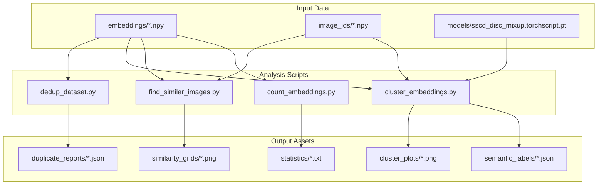
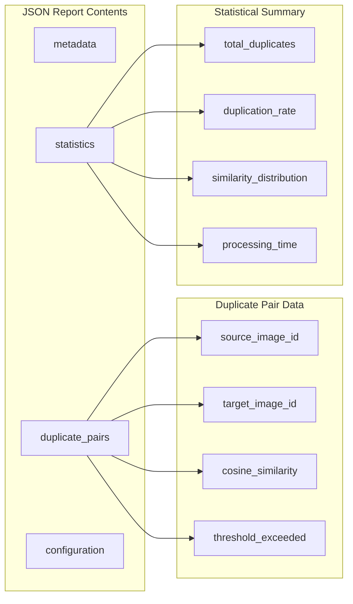
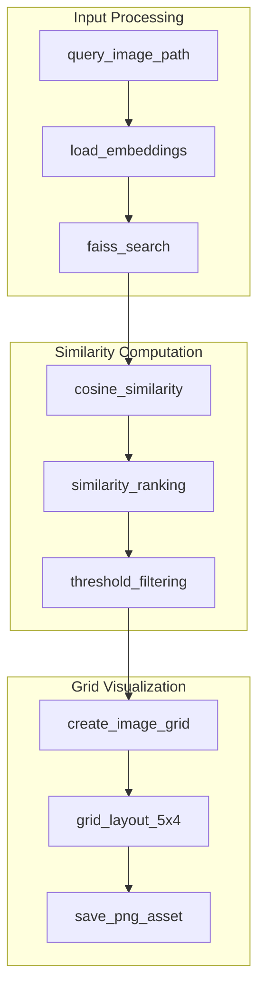
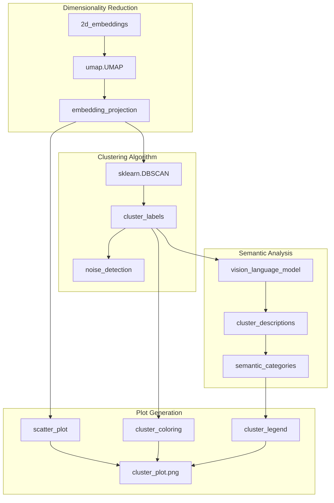
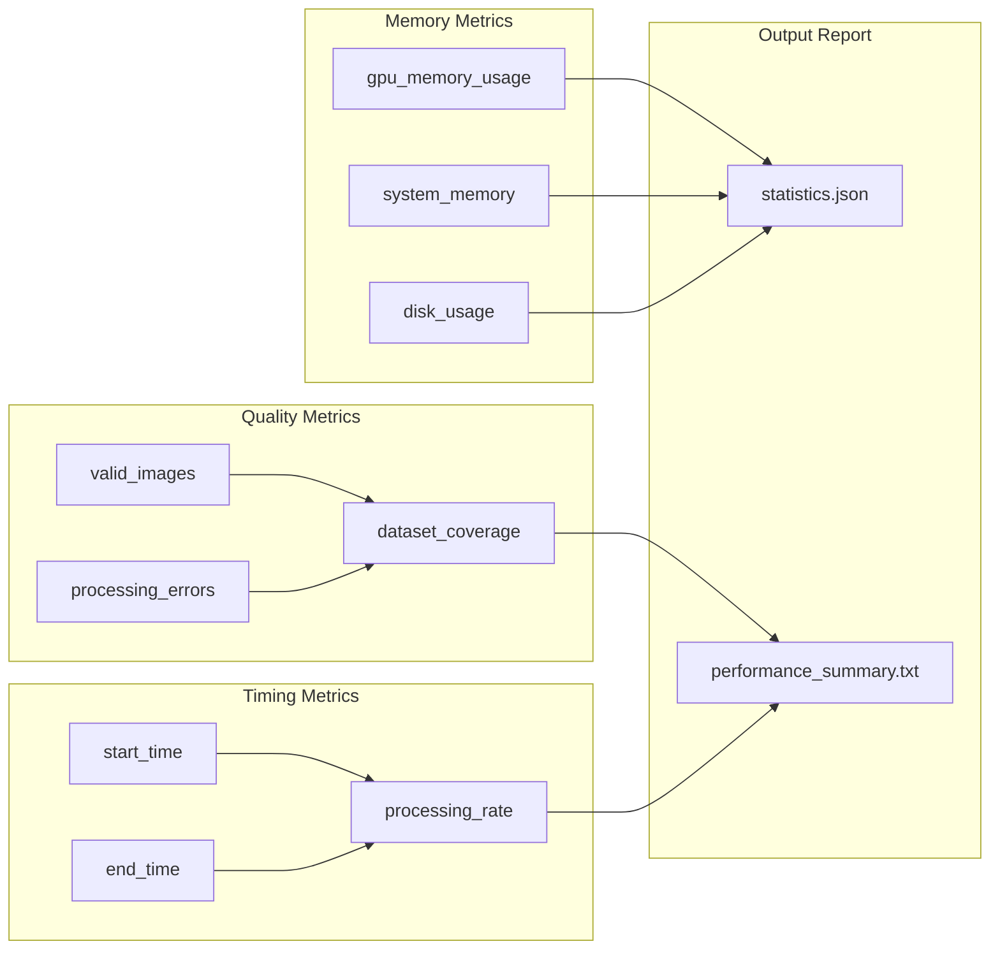

<!-- source: DeepWiki mcp.deepwiki.com · repo huggingface/large-scale-image-deduplication · page 6 Examples & Visualizations · fetched 2026-10-26 -->

# Examples & Visualizations

<details>
<summary>Relevant source files</summary>

The following files were used as context for generating this wiki page:

- [assets/clustering_lmms-lab-MMMU.jpg](assets/clustering_lmms-lab-MMMU.jpg)

</details>


This document showcases the various outputs and visualizations generated by the Large-Scale Image Deduplication Toolkit. It demonstrates the practical results of running the analysis tools on computed embeddings, including duplicate detection reports, similarity search grids, clustering visualizations, and performance metrics.

For information about setting up and running these tools, see [Setup & Configuration](#5). For details about the underlying embedding generation process, see [Embedding Generation System](#2).

## Output Generation Pipeline

The toolkit generates multiple types of outputs through its analysis tools. The following diagram shows how different code entities produce specific visualization and report formats:

**Output Generation Flow from Code Entities to Assets**



Sources: System overview diagrams, architectural analysis

## Duplicate Detection Results

The `dedup_dataset.py` script generates comprehensive JSON reports identifying duplicate images between datasets. These reports contain similarity scores, image identifiers, and statistical summaries.

**Duplicate Detection Report Structure**



### Example Duplicate Detection Output

| Field | Example Value | Description |
|-------|---------------|-------------|
| `source_image_id` | `"dataset_a/image_001.jpg"` | Source dataset image identifier |
| `target_image_id` | `"dataset_b/image_157.jpg"` | Target dataset image identifier |
| `cosine_similarity` | `0.9847` | Similarity score (0.90+ indicates duplicate) |
| `threshold_exceeded` | `true` | Whether similarity exceeds detection threshold |
| `total_duplicates` | `2,847` | Total number of duplicate pairs found |
| `duplication_rate` | `12.3%` | Percentage of images with duplicates |

Sources: System overview showing dedup_dataset.py outputs, analysis workflow diagrams

## Similarity Search Visualizations

The `find_similar_images.py` script creates visual grids showing the most similar images to one or more query images. These PNG files arrange images by similarity ranking for visual inspection.

**Similarity Grid Generation Process**



### Similarity Grid Layout

The generated visualization grids typically follow this structure:

| Position | Content | Similarity Score Range |
|----------|---------|----------------------|
| Top-left | Query image | N/A (reference) |
| Row 1 | Highest similarity matches | 0.95-1.00 |
| Row 2 | High similarity matches | 0.90-0.95 |
| Row 3 | Medium similarity matches | 0.85-0.90 |
| Row 4 | Lower similarity matches | 0.80-0.85 |

Sources: System overview showing find_similar_images.py functionality, visualization pipeline

## Clustering Analysis Outputs

The `cluster_embeddings.py` script produces the most sophisticated visualizations, combining UMAP dimensionality reduction with DBSCAN clustering to create 2D scatter plots and semantic cluster labels.

**Clustering Visualization Pipeline**



### Cluster Visualization Components

The clustering outputs include multiple coordinated visualizations:

| Component | File Type | Description |
|-----------|-----------|-------------|
| Main scatter plot | `.png` | 2D UMAP projection with cluster colors |
| Cluster statistics | `.json` | Cluster sizes and semantic labels |
| Sample images | `.png` | Representative images from each cluster |
| Semantic descriptions | `.json` | Vision-Language Model generated labels |

### Example Semantic Cluster Labels

| Cluster ID | Size | Semantic Label | Description |
|------------|------|----------------|-------------|
| `0` | 1,247 | "portraits and headshots" | Human faces and portrait photography |
| `1` | 892 | "natural landscapes" | Outdoor scenes, mountains, forests |
| `2` | 634 | "architectural structures" | Buildings, bridges, urban environments |
| `3` | 445 | "food and cooking" | Meals, ingredients, kitchen scenes |
| `-1` | 178 | "noise/outliers" | Uncategorized or unique images |

Sources: System overview showing cluster_embeddings.py with UMAP and DBSCAN, Vision-Language Model integration

## Performance Metrics and Statistics

The `count_embeddings.py` utility generates statistical reports about embedding collections, providing insights into dataset composition and processing performance.

### Embedding Statistics Output

| Metric | Example Value | Description |
|--------|---------------|-------------|
| Total embeddings | `125,847` | Number of processed images |
| Embedding dimensions | `512` | SSCD model output dimensions |
| Storage size | `245.2 MB` | Disk space for embedding arrays |
| Processing rate | `847 images/sec` | Inference throughput |
| GPU memory usage | `3.2 GB` | Peak GPU memory consumption |
| Duplicate percentage | `8.7%` | Estimated duplication rate |

**Performance Monitoring Workflow**



Sources: System overview showing count_embeddings.py functionality, performance monitoring components

## Asset Organization

All generated visualizations and reports are systematically organized in the project directory structure:

```
/assets/
├── cluster_plots/          # UMAP clustering visualizations
├── similarity_grids/       # Similar image search results  
├── duplicate_reports/      # JSON deduplication analysis
├── semantic_labels/        # Vision-Language Model outputs
└── statistics/            # Performance and dataset metrics
```

This organization enables easy navigation and comparison of results across different datasets and analysis runs.

Sources: System overview showing asset management and directory structure