# Page: Overview

# Overview

<details>
<summary>Relevant source files</summary>

The following files were used as context for generating this wiki page:

- [.gitignore](.gitignore)
- [README.md](README.md)

</details>


## Purpose and Scope

This document provides a comprehensive overview of the Large-Scale Image Deduplication Toolkit, a specialized system for detecting duplicate images within and across vision datasets using Facebook's SSCD (Self-Supervised Copy Detection) model. The toolkit transforms images into numerical embeddings and provides various analysis tools for duplicate detection, clustering, and similarity search operations.

For detailed information about the core embedding generation system, see [Embedding Generation System](#2). For specific analysis tools and their usage, see [Analysis & Deduplication Tools](#3). For setup instructions and project configuration, see [Setup & Configuration](#5).

Sources: [README.md:1-21]()

## System Architecture

The toolkit is built around a modular architecture where the `compute_embeddings.py` system serves as the central processing engine, transforming input images into SSCD embeddings that feed into multiple specialized analysis tools.

### Core System Components

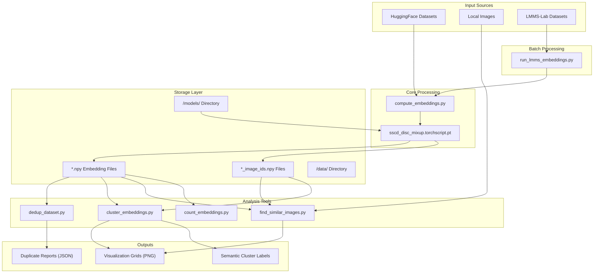

Sources: [README.md:7-21](), System diagrams from context

## Core Components

### Embedding Generation Engine

The `compute_embeddings.py` system serves as the foundation of the toolkit, transforming input images into 512-dimensional SSCD embeddings. This component handles dataset loading, image preprocessing, GPU-accelerated inference, and embedding persistence.

**Key Responsibilities:**
- Loading images from HuggingFace datasets or local sources
- Applying SSCD model transformations and normalization
- Batch processing with configurable sizes for memory efficiency
- Persisting embeddings as `.npy` arrays with corresponding image ID mappings

### Analysis Tools Suite

The toolkit provides four specialized analysis tools that operate on precomputed embeddings:

| Tool | File | Primary Function |
|------|------|------------------|
| **Dataset Deduplication** | `dedup_dataset.py` | Compare new datasets against reference embeddings using cosine similarity |
| **Clustering Analysis** | `cluster_embeddings.py` | Group similar images using UMAP + DBSCAN with semantic labeling |
| **Similarity Search** | `find_similar_images.py` | Query-based retrieval of most similar images |
| **Statistics Analysis** | `count_embeddings.py` | Report statistics on computed embedding collections |

### Batch Processing Infrastructure

The `run_lmms_embeddings.py` script provides automated batch processing capabilities for predefined LMMS-Lab dataset collections, orchestrating multiple `compute_embeddings.py` executions with standardized configurations.

Sources: [README.md:58-155]()

## Data Flow Architecture

The system follows a clear data flow pattern from input sources through embedding generation to analysis outputs:

### Processing Pipeline

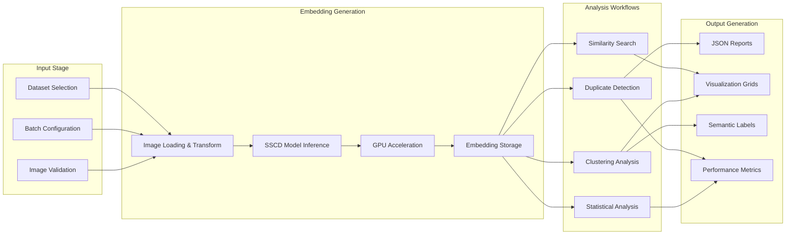

Sources: [README.md:58-104](), System diagrams from context

## Key Features and Capabilities

### High-Performance Computing
- **GPU Acceleration**: CUDA-optimized inference with `torch.cuda.empty_cache()` memory management
- **Batch Processing**: Configurable batch sizes for optimal memory utilization
- **Parallel Data Loading**: Multi-worker data loading with `num_workers=8` configuration

### Precision and Scale
- **High-Precision Detection**: Cosine similarity with default threshold of 0.90 for duplicate detection
- **Sub-second Search**: FAISS-accelerated similarity search for interactive querying
- **Large Dataset Support**: Seamless integration with HuggingFace dataset ecosystem

### Visualization and Analysis
- **Automatic Clustering**: UMAP dimensionality reduction with DBSCAN clustering
- **Semantic Labeling**: Vision-Language Model integration for automatic cluster labeling
- **Interactive Visualizations**: Grid-based image displays with similarity scores

### Robustness and Monitoring
- **Error Handling**: Robust image validation with `_is_valid_image` checks
- **Progress Tracking**: `tqdm` integration for real-time processing updates
- **Performance Metrics**: Comprehensive timing instrumentation and statistics

Sources: [README.md:14-21](), [README.md:83-104]()

## Technical Foundation

### SSCD Model Integration

The toolkit is built around Facebook's SSCD (Self-Supervised Copy Detection) model, specifically the `sscd_disc_mixup.torchscript.pt` variant. This model produces 512-dimensional embeddings optimized for copy detection tasks, enabling high-precision duplicate identification across diverse image content.

**Model Characteristics:**
- Pre-trained TorchScript format for optimized inference
- 512-dimensional embedding output
- Robust to various image transformations and quality variations
- Designed specifically for copy detection and near-duplicate identification

### Storage and File Organization

The toolkit maintains a structured file organization pattern:

```
/models/                    # Pre-trained model weights
/embeddings/               # Computed embedding arrays (.npy)
/data/                     # Raw dataset storage
/assets/                   # Generated visualizations
```

**File Naming Conventions:**
- Embeddings: `{dataset_name}_{split}_embeddings.npy`
- Image IDs: `{dataset_name}_{split}_image_ids.npy`
- Reports: `{dataset_name}_duplicates.json`

Sources: [README.md:39-55](), [.gitignore:1-15]()

---

# Page: Embedding Generation System

# Embedding Generation System

<details>
<summary>Relevant source files</summary>

The following files were used as context for generating this wiki page:

- [compute_embeddings.py](compute_embeddings.py)

</details>


## Purpose and Scope

The Embedding Generation System is the core processing engine of the Large-Scale Image Deduplication Toolkit, responsible for transforming images from various dataset sources into numerical vector representations using Facebook's SSCD (Self-Supervised Copy Detection) model. This system serves as the foundation for all downstream analysis tasks including duplicate detection, clustering, and similarity search.

For information about tools that analyze the generated embeddings, see [Analysis & Deduplication Tools](#3). For batch processing workflows that orchestrate this system, see [Batch Processing & Utilities](#4).

## System Architecture

The embedding generation system centers around the `compute_embeddings.py` script and follows a modular pipeline architecture with clear separation of concerns:

### Core System Components

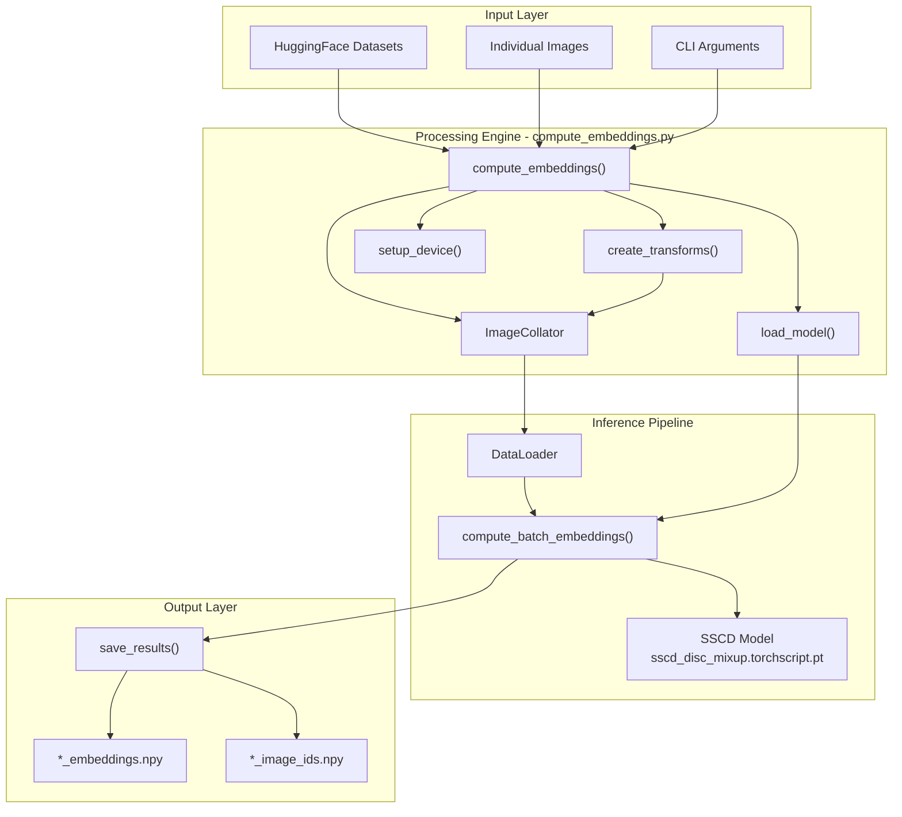

Sources: [compute_embeddings.py:190-234]()

### Data Flow Pipeline

```mermaid
graph LR
    subgraph "Image Loading"
        DATASET["load_dataset()"]
        INDEX["add_column(dataset_idx)"]
        LOADER["DataLoader"]
    end
    
    subgraph "Image Processing"
        COLLATE["ImageCollator.__call__()"]
        VALID["_is_valid_image()"]
        CONVERT["img.convert('RGB')"]
        TRANSFORM["transform(img)"]
    end
    
    subgraph "Model Inference"
        BATCH_TENSOR["batch_tensor.to(device)"]
        MODEL_FORWARD["model(batch_tensor)"]
        CPU_MOVE["embeddings.cpu()"]
    end
    
    subgraph "Output Generation"
        VSTACK["np.vstack()"]
        SAVE_EMB["save_results()"]
        STATS["print_results()"]
    end
    
    DATASET --> INDEX
    INDEX --> LOADER
    LOADER --> COLLATE
    
    COLLATE --> VALID
    VALID --> CONVERT
    CONVERT --> TRANSFORM
    
    TRANSFORM --> BATCH_TENSOR
    BATCH_TENSOR --> MODEL_FORWARD
    MODEL_FORWARD --> CPU_MOVE
    
    CPU_MOVE --> VSTACK
    VSTACK --> SAVE_EMB
    SAVE_EMB --> STATS
```

Sources: [compute_embeddings.py:190-221](), [compute_embeddings.py:140-157](), [compute_embeddings.py:39-109]()

## Core Components

### ImageCollator Class

The `ImageCollator` class handles batch processing and image validation with support for multiple dataset formats and optional deduplication:

| Component | Purpose | Key Methods |
|-----------|---------|-------------|
| `__init__()` | Initialize collator with transforms and deduplication settings | Sets up `transform`, `deduplicate`, `seen_ids` |
| `_is_valid_image()` | Validate image integrity before processing | Tests `img.load()` and `img.convert('RGB')` |
| `__call__()` | Process batches with multiple image key patterns | Handles `image`, `images`, `image_N` patterns |

The collator supports flexible image key patterns including single images (`image`), image lists (`images`), and numbered sequences (`image_0`, `image_1`, etc.).

Sources: [compute_embeddings.py:15-109]()

### Model Management Functions

The system provides dedicated functions for device and model setup:


Sources: [compute_embeddings.py:112-137]()

### Batch Processing Engine

The `compute_batch_embeddings()` function orchestrates the core inference loop:

| Phase | Operations | Timing Tracked |
|-------|------------|----------------|
| Setup | `torch.no_grad()` context, progress tracking with `tqdm` | - |
| Processing | `batch_tensor.to(device)`, `model(batch_tensor)` | `model_inference_time` |
| Collection | `embeddings.cpu().numpy()`, `image_ids.extend()` | - |

The function returns embeddings, image IDs, and detailed timing information for performance analysis.

Sources: [compute_embeddings.py:140-157]()

## Processing Pipeline

### Input Validation and Preprocessing

The system implements robust image validation through the `_is_valid_image()` method:

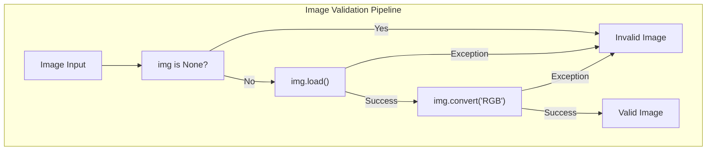

The validation catches `OSError`, `IOError`, `Image.DecompressionBombError`, and other exceptions to ensure only processable images enter the pipeline.

Sources: [compute_embeddings.py:24-37]()

### SSCD Model Configuration

The system uses a standardized transform pipeline optimized for the SSCD model:

| Transform Stage | Configuration | Purpose |
|----------------|---------------|---------|
| Resize | `[320, 320]` | Standardize input dimensions |
| ToTensor | Default | Convert PIL to tensor format |
| Normalize | `mean=[0.485, 0.456, 0.406]`, `std=[0.229, 0.224, 0.225]` | ImageNet normalization |

Sources: [compute_embeddings.py:128-137]()

### Output Management

The `save_results()` function handles file organization and naming:

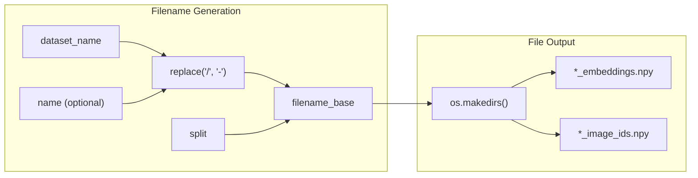

Sources: [compute_embeddings.py:160-173]()

## Configuration and Usage

### Command Line Interface

The system accepts the following parameters through `argparse`:

| Parameter | Type | Default | Purpose |
|-----------|------|---------|---------|
| `--dataset` | string | required | HuggingFace dataset identifier |
| `--split` | string | `"val"` | Dataset split to process |
| `--name` | string | `None` | Dataset subset name |
| `--output_dir` | string | `"embeddings"` | Output directory path |
| `--batch_size` | integer | `32` | Processing batch size |
| `--deduplicate` | flag | `False` | Enable ID-based deduplication |
| `--id_column` | string | `"image_id"` | Column name for image IDs |

Sources: [compute_embeddings.py:223-234]()

### Performance Monitoring

The system provides comprehensive timing instrumentation:

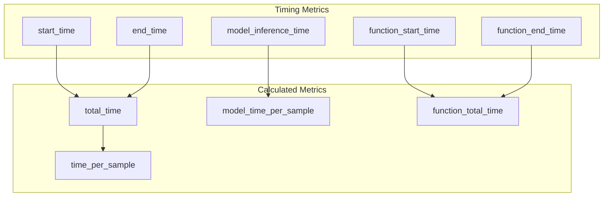

The `print_results()` function outputs detailed performance statistics including per-sample timing and model inference overhead.

Sources: [compute_embeddings.py:176-187](), [compute_embeddings.py:192](), [compute_embeddings.py:218-220]()

---

# Page: Analysis & Deduplication Tools

# Analysis & Deduplication Tools

<details>
<summary>Relevant source files</summary>

The following files were used as context for generating this wiki page:

- [README.md](README.md)
- [dedup_dataset.py](dedup_dataset.py)

</details>


This document covers the analysis and deduplication tools that operate on pre-computed embeddings to detect duplicates, perform clustering analysis, and search for similar images. These tools form the analytical layer of the toolkit, consuming embeddings generated by the core embedding system to provide insights into dataset structure and composition.

For information about generating embeddings from raw images, see [Embedding Generation System](#2). For batch processing workflows, see [Batch Processing & Utilities](#4).

## Purpose and Scope

The analysis tools in this toolkit transform numerical embeddings into actionable insights through three primary operations:

1. **Duplicate Detection** - Comparing new datasets against existing embedding databases to identify duplicate images
2. **Clustering Analysis** - Grouping similar images and generating semantic labels for dataset structure visualization  
3. **Similarity Search** - Finding the most similar images to query inputs using efficient search algorithms

All tools operate on standardized `.npy` embedding files and image ID arrays produced by the embedding generation system.

## Analysis Tools Architecture

The following diagram shows how the core analysis tools interact with embedding data and external systems:

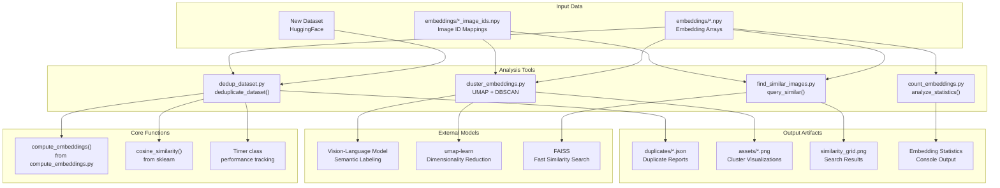

**Sources:** [README.md:72-154](), [dedup_dataset.py:1-152]()

## Analysis Workflow Pipeline

This diagram illustrates the typical workflow for analyzing a new dataset using the analysis tools:

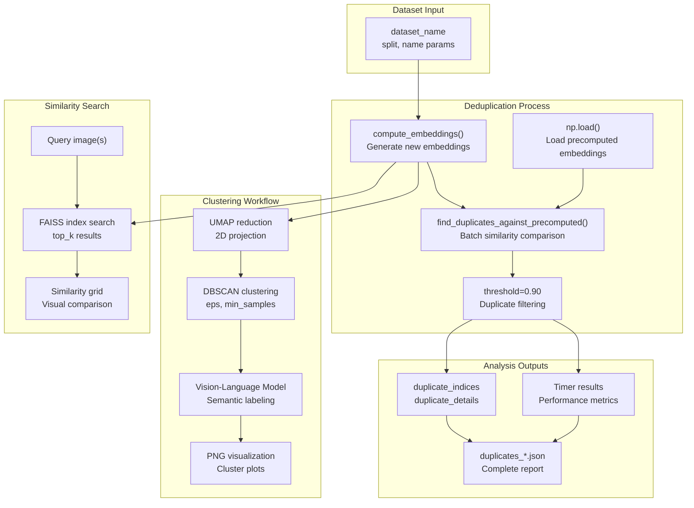

**Sources:** [dedup_dataset.py:77-141](), [README.md:72-142]()

## Dataset Deduplication Tool

The `dedup_dataset.py` script provides the primary duplicate detection functionality by comparing new datasets against precomputed embedding databases. The core function `deduplicate_dataset()` orchestrates the entire process including embedding computation, similarity comparison, and result reporting.

### Key Functions

| Function | Purpose | Performance Features |
|----------|---------|---------------------|
| `deduplicate_dataset()` | Main orchestration function | Integrated timing with `Timer` class |
| `find_duplicates_against_precomputed()` | Batch similarity comparison | Configurable batch sizes, memory management |
| `Timer` class | Performance monitoring | Context manager for operation timing |

The tool uses `cosine_similarity()` from scikit-learn with a default threshold of 0.90 to identify duplicates. Results include detailed timing breakdowns and duplicate indices with similarity scores.

**Sources:** [dedup_dataset.py:24-75](), [dedup_dataset.py:77-141]()

## Clustering Analysis Tool

The `cluster_embeddings.py` system performs unsupervised analysis of embedding spaces using UMAP for dimensionality reduction and DBSCAN for clustering. The tool integrates with Vision-Language Models to automatically generate semantic labels for discovered clusters.

### Analysis Pipeline

1. **Dimensionality Reduction** - UMAP projects high-dimensional embeddings to 2D space
2. **Clustering** - DBSCAN groups similar embeddings with configurable `eps` and `min_samples` parameters  
3. **Semantic Labeling** - Vision-Language Models analyze cluster contents to generate descriptive labels
4. **Visualization** - PNG outputs show cluster structures with semantic annotations

The clustering tool is particularly effective for understanding dataset composition and identifying semantic groupings within large image collections.

**Sources:** [README.md:122-142]()

## Similarity Search Tool

The `find_similar_images.py` utility enables interactive querying of precomputed embedding databases to find the most similar images to one or more input queries. The tool leverages FAISS for efficient similarity search with sub-second response times.

### Search Capabilities

- **Multi-query Support** - Process multiple input images simultaneously
- **Configurable Results** - Specify `top_k` number of similar images to return
- **Visual Output** - Generates similarity grids showing query and result images
- **Embedding Integration** - Works with any precomputed embedding and image ID arrays

The search tool supports both individual image files and HuggingFace dataset integration for streamlined workflows.

**Sources:** [README.md:106-120]()

## Statistics and Monitoring

The `count_embeddings.py` utility provides comprehensive statistics about computed embedding collections, including dataset sizes, embedding dimensions, and storage usage across the embedding directory structure.

### Performance Monitoring

All analysis tools incorporate performance monitoring through the `Timer` class, providing detailed timing breakdowns for:

- **Embedding Computation** - Time spent generating new embeddings
- **Loading Operations** - Precomputed embedding loading performance  
- **Similarity Search** - Core comparison algorithm timing
- **Total Execution** - End-to-end operation duration

This timing information enables optimization of batch sizes and hardware allocation for large-scale analysis workflows.

**Sources:** [dedup_dataset.py:10-23](), [dedup_dataset.py:115-137](), [README.md:149-155]()

---

# Page: Dataset Deduplication

# Dataset Deduplication

<details>
<summary>Relevant source files</summary>

The following files were used as context for generating this wiki page:

- [dedup_dataset.py](dedup_dataset.py)

</details>


This document covers the `dedup_dataset.py` system, which identifies duplicate images between a new dataset and a collection of precomputed embeddings. The system computes embeddings for a target dataset, then performs similarity comparisons against reference embeddings to detect duplicates above a configurable threshold.

For information about computing embeddings from source datasets, see [Embedding Generation System](#2). For interactive similarity search capabilities, see [Similarity Search](#3.3).

## Purpose and Workflow

The dataset deduplication system enables detection of duplicate images across large-scale vision datasets by:

1. Computing SSCD embeddings for a new target dataset
2. Loading precomputed reference embeddings from multiple sources  
3. Performing batched cosine similarity comparisons
4. Identifying duplicates above a similarity threshold (default 0.90)
5. Generating detailed JSON reports with timing metrics

## Core Architecture

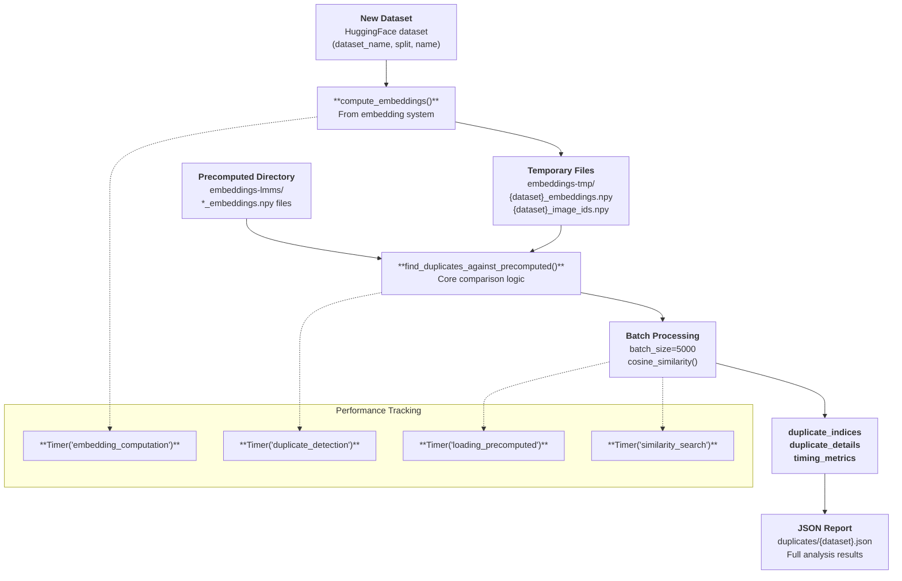

Sources: [dedup_dataset.py:77-141]()

## Core Functions

### `deduplicate_dataset`

The main orchestration function that coordinates the complete deduplication workflow:

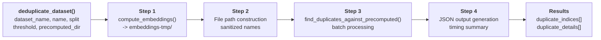

| Parameter | Type | Default | Description |
|-----------|------|---------|-------------|
| `dataset_name` | str | required | HuggingFace dataset identifier |
| `name` | str | None | Dataset subset name |
| `split` | str | 'test' | Dataset split to process |
| `threshold` | float | 0.90 | Cosine similarity threshold |
| `precomputed_dir` | str | 'embeddings-lmms' | Reference embeddings directory |
| `output_dir` | str | 'duplicates' | Output directory for results |

Sources: [dedup_dataset.py:77-141]()

### `find_duplicates_against_precomputed`

The core duplicate detection algorithm that performs similarity comparisons:

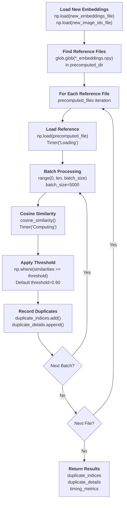

| Parameter | Type | Default | Description |
|-----------|------|---------|-------------|
| `new_embeddings_file` | str | required | Path to new dataset embeddings |
| `new_image_ids_file` | str | required | Path to corresponding image IDs |
| `precomputed_dir` | str | required | Directory with reference embeddings |
| `batch_size` | int | 5000 | Batch size for similarity computation |
| `threshold` | float | 0.90 | Minimum similarity for duplicate detection |

Sources: [dedup_dataset.py:24-75]()

## Performance Optimization

### Timer Class

The system includes comprehensive timing instrumentation using a context manager:

| Timer Category | Measures | Location |
|----------------|----------|----------|
| `total_time` | Complete execution | [dedup_dataset.py:80]() |
| `embedding_computation` | SSCD model inference | [dedup_dataset.py:83]() |
| `duplicate_detection` | Overall comparison process | [dedup_dataset.py:99]() |
| `loading_precomputed` | Reference embedding I/O | [dedup_dataset.py:46]() |
| `similarity_search` | Cosine similarity computation | [dedup_dataset.py:56]() |

### Batch Processing Strategy

The system processes embeddings in configurable batches to manage memory usage:

- Default batch size: 5000 embeddings per batch
- Prevents memory overflow on large datasets
- Maintains performance through vectorized operations
- Progress tracking via batch iteration

Sources: [dedup_dataset.py:10-23](), [dedup_dataset.py:51-60]()

## Output Format

### JSON Report Structure

The system generates detailed JSON reports with the following structure:

```json
{
  "dataset_name": "string",
  "name": "string|null", 
  "split": "string",
  "threshold": 0.90,
  "total_images": 1000,
  "timing": {
    "total_time": 45.67,
    "embedding_computation": 30.12,
    "duplicate_detection": 15.55,
    "loading_precomputed": 8.23,
    "similarity_search": 7.32
  },
  "duplicate_count": 25,
  "duplicate_indices": [12, 45, 78],
  "duplicate_details": [
    {
      "new_idx": 12,
      "new_image_id": 456,
      "source_file": "dataset1_embeddings.npy",
      "source_idx": 789,
      "similarity": 0.95
    }
  ]
}
```

### File Naming Convention

Output files follow a standardized naming pattern:

- Dataset without subset: `duplicates_{dataset-name}_{split}.json`
- Dataset with subset: `duplicates_{dataset-name}_{subset-name}_{split}.json`
- Special characters in names are replaced with hyphens

Sources: [dedup_dataset.py:87-93](), [dedup_dataset.py:105-129]()

## Command Line Interface

The system provides a command-line interface for standalone execution:

| Argument | Required | Default | Description |
|----------|----------|---------|-------------|
| `--dataset` | Yes | - | HuggingFace dataset name |
| `--split` | No | "val" | Dataset split to process |
| `--name` | No | None | Dataset subset name |
| `--precomputed_dir` | No | "embeddings-lmms" | Reference embeddings directory |
| `--threshold` | No | 0.90 | Similarity threshold |
| `--output_dir` | No | "duplicates" | Output directory |

Example usage:
```bash
python dedup_dataset.py --dataset "imagenet-1k" --split "validation" --threshold 0.85
```

Sources: [dedup_dataset.py:142-152]()

---

# Page: Clustering Analysis

# Clustering Analysis

<details>
<summary>Relevant source files</summary>

The following files were used as context for generating this wiki page:

- [cluster_embeddings.py](cluster_embeddings.py)

</details>


This document covers the clustering analysis system implemented in `cluster_embeddings.py`, which groups similar image embeddings using unsupervised machine learning techniques and generates semantic labels for the resulting clusters. The system uses UMAP for dimensionality reduction, DBSCAN for clustering, and vision-language models for automated cluster labeling.

For information about computing the embeddings that feed into this system, see [Embedding Generation System](#2). For dataset-level deduplication without clustering, see [Dataset Deduplication](#3.1).

## System Architecture

The clustering analysis system operates as a multi-stage pipeline that transforms high-dimensional image embeddings into meaningful cluster visualizations with semantic labels.

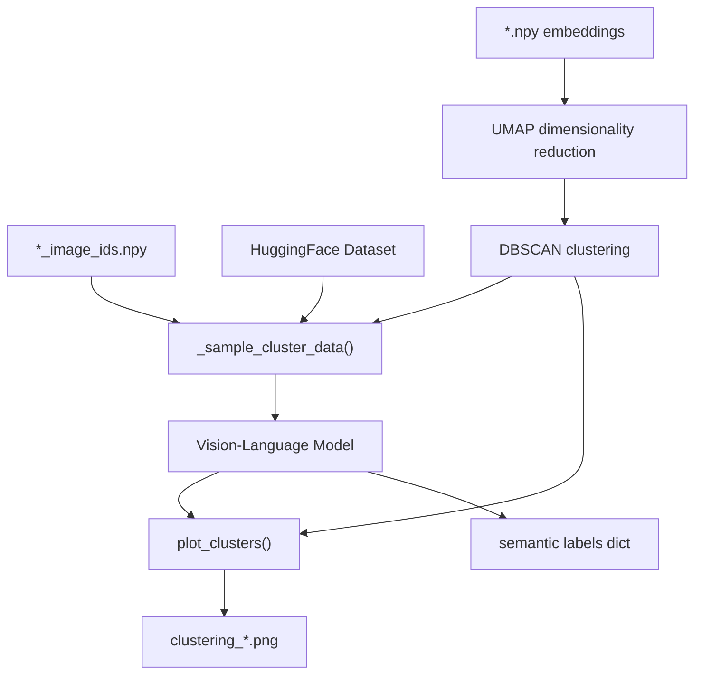

**Core Clustering Pipeline**
Sources: [cluster_embeddings.py:17-72]()

The system accepts pre-computed embeddings from the embedding generation system and applies a two-stage dimensionality reduction and clustering approach. The `cluster_embeddings()` function serves as the main entry point, orchestrating UMAP reduction followed by DBSCAN clustering.

## Dimensionality Reduction and Clustering

### UMAP Dimensionality Reduction

The system uses UMAP (Uniform Manifold Approximation and Projection) to reduce high-dimensional embeddings to 2D space for visualization and improved clustering performance.

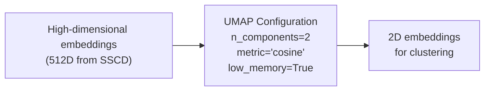

**UMAP Configuration**
Sources: [cluster_embeddings.py:26-33]()

The UMAP reducer is configured with cosine distance metric to preserve semantic relationships between image embeddings. The `low_memory=True` setting optimizes memory usage for large datasets, while `n_jobs` enables parallel processing.

### DBSCAN Clustering

After dimensionality reduction, DBSCAN (Density-Based Spatial Clustering of Applications with Noise) groups similar embeddings into clusters.

| Parameter | Default Value | Purpose |
|-----------|---------------|---------|
| `eps` | 0.3 | Maximum distance between samples in the same neighborhood |
| `min_samples` | 15 | Minimum samples required to form a dense region |
| `n_jobs` | 12 | Number of parallel jobs for computation |

Sources: [cluster_embeddings.py:36-44]()

The algorithm automatically determines the number of clusters and identifies noise points (outliers) that don't belong to any cluster. The system computes silhouette scores for quality assessment when multiple clusters are found.

## Semantic Labeling System

The semantic labeling system automatically generates human-readable labels for clusters by analyzing representative images from each cluster using vision-language models.

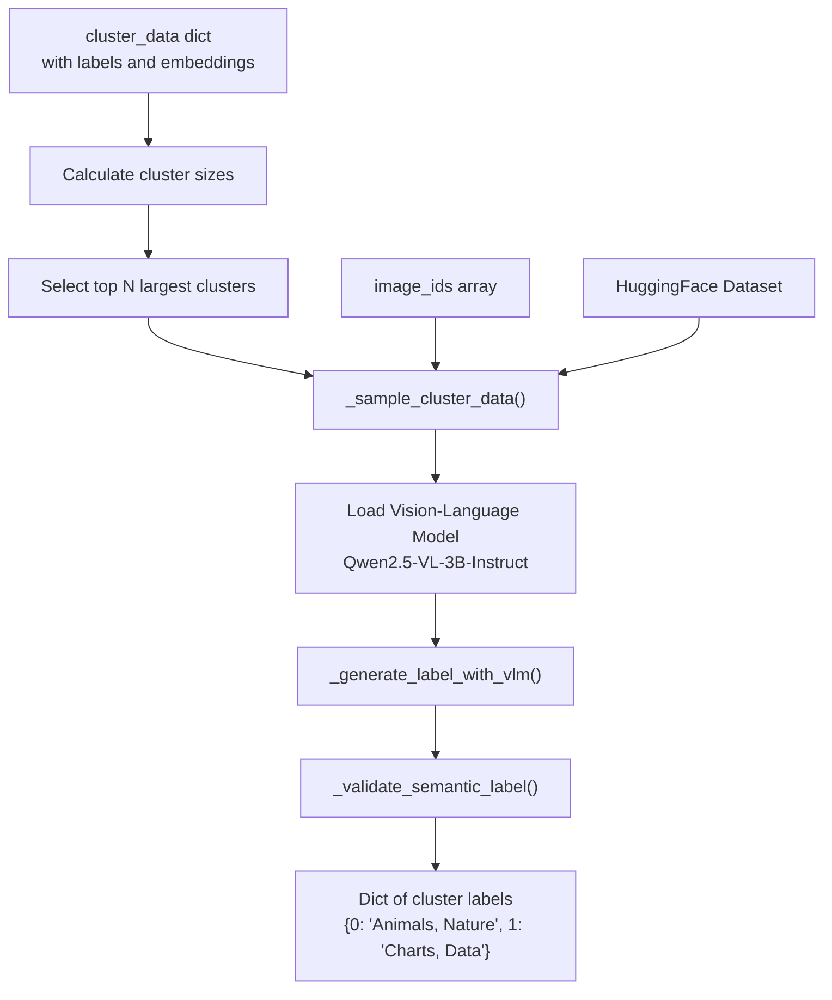

**Cluster Selection and Sampling**
Sources: [cluster_embeddings.py:447-460](), [cluster_embeddings.py:293-333]()

The system prioritizes the largest clusters for semantic labeling to maximize impact, processing only the top `max_clusters` (default 10) by size. For each selected cluster, it samples `n_examples` (default 10) representative images.

### Vision-Language Model Integration

The semantic labeling process uses the Qwen2.5-VL model series to analyze cluster content and generate descriptive labels.

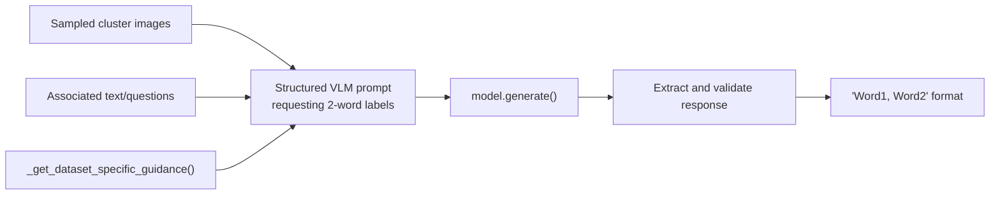

**Dataset-Specific Guidance**
Sources: [cluster_embeddings.py:336-357](), [cluster_embeddings.py:360-438]()

The system provides dataset-specific context to the VLM to generate more relevant labels. For example, MMMU datasets receive guidance about academic subjects, while ChartQA focuses on chart types and data domains.

### Label Validation

The `_validate_semantic_label()` function ensures generated labels meet quality criteria:

- Must be 1-3 comma-separated parts
- Each part should be 1-3 words with reasonable length
- Filters out generic terms and default cluster names
- Rejects hallucinated or invalid responses

Sources: [cluster_embeddings.py:137-165]()

## Visualization System

The plotting system creates dark-themed scatter plots showing cluster distributions with optional semantic labels overlaid.

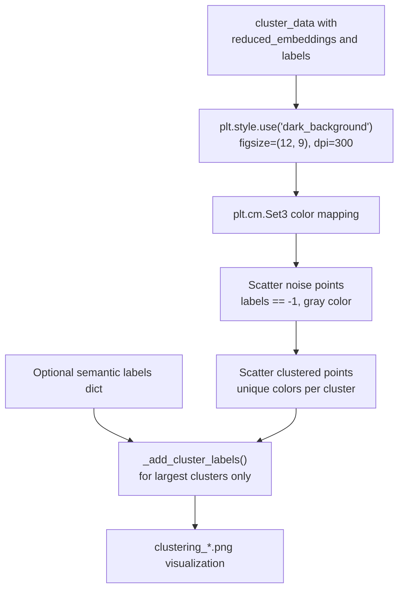

**Label Placement Algorithm**
Sources: [cluster_embeddings.py:168-195]()

The `_add_cluster_labels()` function calculates cluster centroids and places validated semantic labels only for the largest clusters, preventing visual clutter. Labels are displayed with semi-transparent white backgrounds for readability.

## Command Line Interface

The system provides a comprehensive CLI through the `main()` function with the following parameter categories:

### Clustering Parameters

| Argument | Type | Default | Description |
|----------|------|---------|-------------|
| `--embeddings` | str | Required | Path to embeddings .npy file |
| `--n-components` | int | 2 | UMAP dimensions |
| `--metric` | str | cosine | UMAP distance metric |
| `--eps` | float | 0.3 | DBSCAN eps parameter |
| `--min-samples` | int | 15 | DBSCAN min_samples |
| `--n-jobs` | int | 12 | Number of parallel jobs |

### Semantic Labeling Parameters

| Argument | Type | Default | Description |
|----------|------|---------|-------------|
| `--generate-labels` | flag | False | Enable semantic labeling |
| `--dataset` | str | Required for labeling | HuggingFace dataset name |
| `--subset` | str | None | Dataset subset name |
| `--split` | str | test | Dataset split |
| `--n-examples` | int | 10 | Examples per cluster for labeling |
| `--vl-model` | str | Qwen/Qwen2.5-VL-7B-Instruct | Vision-language model |
| `--max-clusters` | int | 12 | Maximum clusters to label |

Sources: [cluster_embeddings.py:507-553]()

### Example Usage

```bash
# Basic clustering without semantic labels
python cluster_embeddings.py --embeddings data/dataset_embeddings.npy

# Clustering with semantic labeling
python cluster_embeddings.py \
    --embeddings data/mmmu_embeddings.npy \
    --generate-labels \
    --dataset lmms-lab/MMMU \
    --eps 0.25 \
    --min-samples 10 \
    --max-clusters 15
```

The system automatically generates output files with sanitized dataset names (e.g., `clustering_lmms-lab-MMMU.png`) and handles GPU memory management for VLM inference.

Sources: [cluster_embeddings.py:125-134](), [cluster_embeddings.py:496-503]()

---

# Page: Similarity Search

# Similarity Search

<details>
<summary>Relevant source files</summary>

The following files were used as context for generating this wiki page:

- [utils/find_similar_images.py](utils/find_similar_images.py)

</details>


## Purpose and Scope

This document covers the similarity search functionality implemented in `find_similar_images.py`, which enables querying for the most similar images to one or more input images using precomputed embeddings. The system computes embeddings for query images using the SSCD model and performs efficient similarity search against large collections of precomputed embeddings.

For information about generating the precomputed embeddings used by this system, see [Embedding Generation System](#2). For dataset-wide duplicate detection, see [Dataset Deduplication](#3.1).

## System Architecture

The similarity search system operates as a standalone query tool that leverages precomputed embeddings to enable sub-second similarity search across large image collections.

### Core Workflow

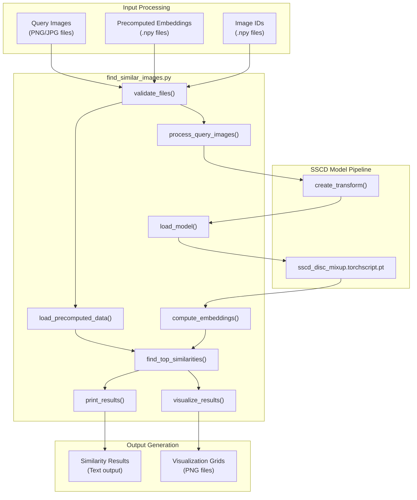

Sources: [utils/find_similar_images.py:1-307]()

### Component Interface Map

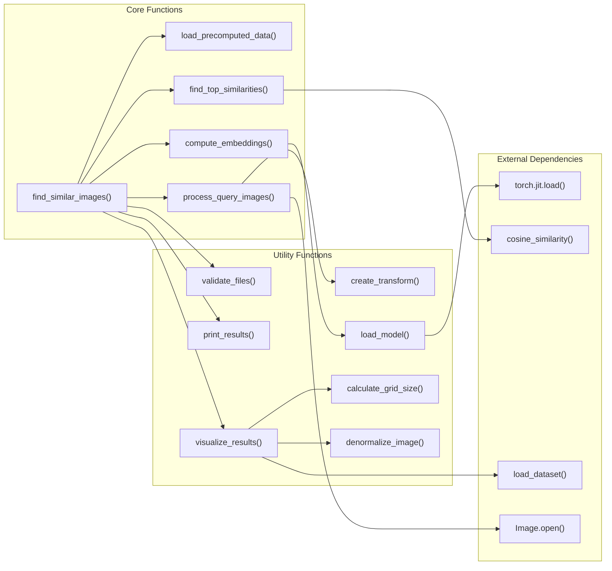

Sources: [utils/find_similar_images.py:33-38](), [utils/find_similar_images.py:52-57](), [utils/find_similar_images.py:59-69](), [utils/find_similar_images.py:71-75](), [utils/find_similar_images.py:77-86]()

## Input Processing and Validation

The system requires three types of input files and validates their existence before processing.

### Input Requirements

| Input Type | File Format | Description | Example Path |
|------------|-------------|-------------|--------------|
| Query Images | PNG/JPG | Images to find similarities for | `query.jpg` |
| Precomputed Embeddings | `.npy` | Numpy array of embeddings | `embeddings/dataset_embeddings.npy` |
| Image IDs | `.npy` | Numpy array of image identifiers | `embeddings/dataset_image_ids.npy` |

### File Validation Process

```mermaid
graph TD
    subgraph "validate_files()"
        INPUT["image_paths[]<br/>embeddings_file<br/>image_ids_file"]
        CHECK1["os.path.exists()<br/>for each image_path"]
        CHECK2["os.path.exists()<br/>embeddings_file"]
        CHECK3["os.path.exists()<br/>image_ids_file"]
        ERROR["FileNotFoundError"]
        SUCCESS["Validation Complete"]
    end
    
    INPUT --> CHECK1
    CHECK1 --> CHECK2
    CHECK2 --> CHECK3
    CHECK1 --> ERROR
    CHECK2 --> ERROR
    CHECK3 --> ERROR
    CHECK3 --> SUCCESS
```

Sources: [utils/find_similar_images.py:264-274]()

## Embedding Computation Pipeline

Query images are processed through the same SSCD model pipeline used for precomputed embeddings to ensure compatibility.

### Image Transformation Pipeline

The `create_transform()` function establishes the preprocessing pipeline that must match the original embedding generation:

```mermaid
graph LR
    subgraph "create_transform() Pipeline"
        INPUT["Raw Image<br/>(PIL.Image)"]
        RESIZE["Resize([320, 320])"]
        TENSOR["ToTensor()"]
        NORM["Normalize<br/>mean=[0.485, 0.456, 0.406]<br/>std=[0.229, 0.224, 0.225]"]
        OUTPUT["Transformed Tensor"]
    end
    
    INPUT --> RESIZE
    RESIZE --> TENSOR
    TENSOR --> NORM
    NORM --> OUTPUT
```

Sources: [utils/find_similar_images.py:40-50](), [utils/find_similar_images.py:14-15]()

### Batch Processing Architecture

```mermaid
graph TD
    subgraph "process_query_images()"
        PATHS["image_paths[]"]
        LOAD["Image.open().convert('RGB')"]
        TRANSFORM["transform(image)"]
        BATCH["torch.cat(tensors, dim=0)"]
        DEVICE["tensor.to(device)"]
    end
    
    subgraph "compute_embeddings()"
        MODEL["model(batch_tensor)"]
        NOGRADX["torch.no_grad()"]
        CPU["embeddings.cpu().numpy()"]
    end
    
    PATHS --> LOAD
    LOAD --> TRANSFORM
    TRANSFORM --> BATCH
    BATCH --> DEVICE
    DEVICE --> NOGRADX
    NOGRADX --> MODEL
    MODEL --> CPU
```

Sources: [utils/find_similar_images.py:59-69](), [utils/find_similar_images.py:71-75]()

## Similarity Search Implementation

The core similarity computation uses scikit-learn's cosine similarity function for efficient comparison against large embedding collections.

### Similarity Computation Process

| Step | Function | Input | Output | Performance Note |
|------|----------|-------|--------|------------------|
| 1 | `cosine_similarity()` | Query embeddings, Precomputed embeddings | Similarity matrix | Vectorized operation |
| 2 | `np.argsort()` | Similarity matrix | Sorted indices | Descending order |
| 3 | `np.take_along_axis()` | Similarities, Top indices | Top-k similarities | Efficient indexing |

### Top-K Retrieval Algorithm

```mermaid
graph LR
    subgraph "find_top_similarities()"
        QE["query_embeddings<br/>[N x D]"]
        PE["precomputed_embeddings<br/>[M x D]"]
        CS["cosine_similarity()<br/>[N x M]"]
        SORT["np.argsort(axis=1)[:,::-1]"]
        TOPK["[:,:top_k]"]
        INDICES["top_indices[N x K]"]
        SIMS["top_similarities[N x K]"]
    end
    
    QE --> CS
    PE --> CS
    CS --> SORT
    SORT --> TOPK
    TOPK --> INDICES
    CS --> SIMS
    INDICES --> SIMS
```

Sources: [utils/find_similar_images.py:77-86]()

## Visualization System

When a dataset name is provided, the system generates visual grids showing query images alongside their most similar matches.

### Grid Layout Calculation

The visualization system calculates optimal grid dimensions for displaying results:

```mermaid
graph TD
    subgraph "calculate_grid_size()"
        TOTAL["total_images = top_k + 1"]
        SQRT["cols = ceil(sqrt(total_images))"]
        ROWS["rows = ceil(total_images / cols)"]
        MIN["cols = max(cols, 2)<br/>rows = max(rows, 2)"]
        OUTPUT["(rows, cols)"]
    end
    
    TOTAL --> SQRT
    SQRT --> ROWS
    ROWS --> MIN
    MIN --> OUTPUT
```

Sources: [utils/find_similar_images.py:121-131]()

### Visualization Pipeline

```mermaid
graph TD
    subgraph "visualize_results()"
        SETUP["Calculate grid size<br/>Create matplotlib figure"]
        QUERY["Display query image<br/>at position (0,0)"]
        DATASET["Load HuggingFace dataset"]
        LOOP["For each similar image"]
        LOAD["dataset[int(img_id)]"]
        HANDLE["Handle 'image'/'images' keys"]
        DISPLAY["axes[row,col].imshow()"]
        SAVE["plt.savefig()"]
    end
    
    SETUP --> QUERY
    QUERY --> DATASET
    DATASET --> LOOP
    LOOP --> LOAD
    LOAD --> HANDLE
    HANDLE --> DISPLAY
    DISPLAY --> SAVE
```

Sources: [utils/find_similar_images.py:133-217]()

## Performance Monitoring

The system includes comprehensive timing instrumentation to monitor performance across different stages.

### Timer Context Manager

```mermaid
graph LR
    subgraph "Timer Class"
        INIT["__init__(operation_name)"]
        ENTER["__enter__()<br/>start_time = time.time()"]
        EXIT["__exit__()<br/>elapsed = time.time() - start_time"]
    end
    
    INIT --> ENTER
    ENTER --> EXIT
```

### Performance Breakdown

| Operation | Timer Name | Typical Duration | Performance Impact |
|-----------|------------|------------------|-------------------|
| Data Loading | `loading_timer` | ~1-5 seconds | I/O bound |
| Model Inference | `model_timer` | ~0.1-1 seconds | GPU/CPU bound |
| Similarity Search | `similarity_timer` | ~0.01-0.5 seconds | Memory bound |
| Total Execution | `total_timer` | Sum of above | End-to-end |

Sources: [utils/find_similar_images.py:18-31](), [utils/find_similar_images.py:105-113]()

## Command Line Interface

The system provides a comprehensive CLI for standalone usage and integration into larger workflows.

### CLI Argument Structure

| Argument | Type | Required | Default | Description |
|----------|------|----------|---------|-------------|
| `--images` | `str` (nargs='+') | Yes | - | Query image path(s) |
| `--embeddings` | `str` | Yes | - | Precomputed embeddings file |
| `--image_ids` | `str` | Yes | - | Image IDs file |
| `--dataset` | `str` | No | None | HuggingFace dataset for visualization |
| `--name` | `str` | No | None | Dataset subset name |
| `--split` | `str` | No | "test" | Dataset split |
| `--top_k` | `int` | No | 5 | Number of similar images |

### Usage Examples

```bash
# Basic similarity search
python utils/find_similar_images.py \
  --images query.jpg \
  --embeddings embeddings/laion_embeddings.npy \
  --image_ids embeddings/laion_image_ids.npy

# Multiple query images with visualization
python utils/find_similar_images.py \
  --images query1.jpg query2.jpg \
  --embeddings embeddings/coco_embeddings.npy \
  --image_ids embeddings/coco_image_ids.npy \
  --dataset "HuggingFaceM4/COCO" \
  --top_k 10
```

Sources: [utils/find_similar_images.py:276-307]()

## Integration with Larger System

The similarity search functionality integrates with the broader deduplication toolkit by consuming precomputed embeddings generated by the embedding generation system.

### Data Dependencies

```mermaid
graph TD
    subgraph "Embedding Generation (Section 2)"
        CES["compute_embeddings.py"]
        EMBOUT["embeddings/*.npy"]
        IDSOUT["image_ids/*.npy"]
    end
    
    subgraph "Similarity Search (Section 3.3)"
        FSI["find_similar_images.py"]
        QUERY["Query Images"]
        RESULTS["Similarity Results"]
    end
    
    CES --> EMBOUT
    CES --> IDSOUT
    EMBOUT --> FSI
    IDSOUT --> FSI
    QUERY --> FSI
    FSI --> RESULTS
```

### File Format Compatibility

The system expects embedding files in the same format produced by `compute_embeddings.py`:

- **Embeddings**: Numpy arrays with shape `[N, embedding_dim]` where N is the number of images
- **Image IDs**: Numpy arrays with shape `[N]` containing dataset indices or identifiers
- **Naming Convention**: Corresponding files should have matching base names (e.g., `dataset_embeddings.npy` and `dataset_image_ids.npy`)

Sources: [utils/find_similar_images.py:52-57](), [utils/find_similar_images.py:219-262]()

---

# Page: Batch Processing & Utilities

# Batch Processing & Utilities

<details>
<summary>Relevant source files</summary>

The following files were used as context for generating this wiki page:

- [run_lmms_embeddings.py](run_lmms_embeddings.py)
- [utils/count_embeddings.py](utils/count_embeddings.py)

</details>


This section documents the batch processing infrastructure and utility tools that automate and analyze large-scale embedding operations. These tools provide orchestration capabilities for processing multiple datasets and analysis utilities for examining computed embeddings.

The batch processing system enables automated computation of embeddings across predefined dataset collections, while the utility tools provide statistical analysis and management capabilities for large embedding collections. For detailed information about the core embedding generation process, see [Embedding Generation System](#2). For specific analysis tools that operate on embeddings, see [Analysis & Deduplication Tools](#3).

## Batch Processing System Overview

The batch processing system centers around automated execution of embedding computation across large collections of datasets. The primary component is the `run_lmms_embeddings.py` script, which orchestrates the processing of 43 predefined LMMS-Lab datasets with their respective subset configurations.

### LMMS Dataset Processing Workflow

```mermaid
graph TB
    subgraph "Dataset Configuration"
        LMMS_NAMES["LMMS_NAMES Dictionary<br/>43 Dataset Entries"]
        CONFIG["Dataset + Subset Mapping"]
    end
    
    subgraph "Batch Processing Loop"
        MAIN["main() Function"]
        ITER["Dataset Iteration"]
        SUBSET_CHECK["subset_names Check"]
        PROCESS_SUBSET["Process with Subset"]
        PROCESS_MAIN["Process Main Dataset"]
    end
    
    subgraph "Core Integration"
        COMPUTE_EMBEDDINGS["compute_embeddings()"]
        SSCD_MODEL["SSCD Model Processing"]
        EMBEDDING_OUTPUT["*.npy Output Files"]
    end
    
    LMMS_NAMES --> CONFIG
    CONFIG --> MAIN
    MAIN --> ITER
    ITER --> SUBSET_CHECK
    SUBSET_CHECK -->|"Has Subsets"| PROCESS_SUBSET
    SUBSET_CHECK -->|"No Subsets"| PROCESS_MAIN
    PROCESS_SUBSET --> COMPUTE_EMBEDDINGS
    PROCESS_MAIN --> COMPUTE_EMBEDDINGS
    COMPUTE_EMBEDDINGS --> SSCD_MODEL
    SSCD_MODEL --> EMBEDDING_OUTPUT
```

Sources: [run_lmms_embeddings.py:1-57]()

The batch processing system operates by iterating through the `LMMS_NAMES` dictionary, which contains dataset names as keys and subset lists as values. For datasets with subsets, each subset is processed individually using the `name` parameter of `compute_embeddings()`. Datasets without subsets are processed directly.

### Dataset Collection Structure

The system processes a comprehensive collection of vision-language datasets:

| Dataset Category | Example Datasets | Subset Configuration |
|------------------|------------------|---------------------|
| Visual QA | VQAv2, GQA, DocVQA | Some with subsets (e.g., GQA: test_all_images) |
| Captioning | COCO-Caption, TextCaps, NoCaps | Mostly single configurations |
| Benchmarks | MMBench_EN, MMMU, LiveBench | Time-based subsets (LiveBench: 2024-05 to 2024-09) |
| Specialized | Egothink, VisualWebBench | Multiple task-specific subsets |

Sources: [run_lmms_embeddings.py:5-44]()

## Utility Tools Overview

The utility infrastructure provides analysis and management capabilities for computed embeddings through specialized tools that operate on the generated `.npy` files and directory structures.

### Embedding Statistics System

```mermaid
graph LR
    subgraph "Input Discovery"
        EMBEDDINGS_DIR["embeddings-lmms/"]
        PATTERN["*_embeddings.npy Pattern"]
        GLOB_SEARCH["glob.glob() Discovery"]
    end
    
    subgraph "Analysis Pipeline"
        COUNT_FUNC["count_embeddings()"]
        NP_LOAD["np.load() Processing"]
        SHAPE_ANALYSIS["Shape Analysis"]
        ERROR_HANDLING["Exception Handling"]
    end
    
    subgraph "Statistics Generation"
        DATASET_COUNTS["dataset_counts List"]
        PRINT_STATISTICS["print_statistics()"]
        SIZE_DISTRIBUTION["Size Distribution Analysis"]
        TOP_DATASETS["Top 15 Ranking"]
    end
    
    subgraph "Output Reports"
        TOTAL_COUNT["Total Embeddings Count"]
        ERROR_SUMMARY["Error Summary"]
        DISTRIBUTION_STATS["Distribution Statistics"]
    end
    
    EMBEDDINGS_DIR --> PATTERN
    PATTERN --> GLOB_SEARCH
    GLOB_SEARCH --> COUNT_FUNC
    COUNT_FUNC --> NP_LOAD
    NP_LOAD --> SHAPE_ANALYSIS
    SHAPE_ANALYSIS --> ERROR_HANDLING
    ERROR_HANDLING --> DATASET_COUNTS
    DATASET_COUNTS --> PRINT_STATISTICS
    PRINT_STATISTICS --> SIZE_DISTRIBUTION
    PRINT_STATISTICS --> TOP_DATASETS
    SIZE_DISTRIBUTION --> DISTRIBUTION_STATS
    TOP_DATASETS --> TOTAL_COUNT
    ERROR_HANDLING --> ERROR_SUMMARY
```

Sources: [utils/count_embeddings.py:17-67](), [utils/count_embeddings.py:70-116]()

The `count_embeddings.py` utility provides comprehensive analysis of embedding collections by scanning the `embeddings-lmms` directory for files matching the `*_embeddings.npy` pattern. The tool extracts embedding counts, dimensions, and generates detailed statistics including size distribution analysis and error reporting.

## Integration with Core Systems

The batch processing and utility tools integrate seamlessly with the core embedding generation system through standardized interfaces and file conventions.

### Data Flow and Dependencies

```mermaid
graph TB
    subgraph "Batch Processing Layer"
        RUN_LMMS["run_lmms_embeddings.py"]
        LMMS_DICT["LMMS_NAMES Configuration"]
    end
    
    subgraph "Core Processing Layer"
        COMPUTE_EMB["compute_embeddings()"]
        SSCD_INFERENCE["SSCD Model Inference"]
    end
    
    subgraph "Storage Layer"
        EMBEDDINGS_DIR["embeddings-lmms/"]
        NPY_FILES["*_embeddings.npy Files"]
        IDS_FILES["*_ids.npy Files"]
    end
    
    subgraph "Analysis Layer"
        COUNT_UTIL["count_embeddings.py"]
        STATISTICS["Statistical Analysis"]
        ERROR_REPORTING["Error Reporting"]
    end
    
    RUN_LMMS --> LMMS_DICT
    LMMS_DICT --> COMPUTE_EMB
    COMPUTE_EMB --> SSCD_INFERENCE
    SSCD_INFERENCE --> EMBEDDINGS_DIR
    EMBEDDINGS_DIR --> NPY_FILES
    EMBEDDINGS_DIR --> IDS_FILES
    NPY_FILES --> COUNT_UTIL
    COUNT_UTIL --> STATISTICS
    COUNT_UTIL --> ERROR_REPORTING
```

Sources: [run_lmms_embeddings.py:3](), [run_lmms_embeddings.py:51](), [run_lmms_embeddings.py:54](), [utils/count_embeddings.py:33-34]()

The batch processing system invokes `compute_embeddings()` imported from the core module, maintaining consistent parameter interfaces and output formats. The utility tools operate on the standardized `.npy` file outputs, enabling seamless analysis of batch-processed results.

## File Naming and Organization Patterns

The system employs consistent naming conventions for managing large collections of embeddings:

### Naming Convention Analysis

| Pattern Component | Purpose | Example |
|------------------|---------|---------|
| `lmms-lab-` prefix | Dataset source identifier | `lmms-lab-ai2d_embeddings.npy` |
| Dataset name | Core dataset identifier | `VQAv2`, `COCO-Caption2017` |
| Subset suffix | Subset differentiation | `test_embeddings.npy` for subsets |
| File extension | Data type indicator | `.npy` for embeddings, `_ids.npy` for identifiers |

Sources: [utils/count_embeddings.py:56-58]()

The `count_embeddings.py` utility includes logic to clean dataset names for display by removing the `lmms-lab-` prefix and `_test_embeddings.npy` suffix, providing readable dataset identification in statistical reports.

## Usage Patterns and Scalability

### Batch Processing Execution Model

The batch processing system is designed for unattended execution across large dataset collections. The main execution pattern involves:

1. **Sequential Processing**: Datasets are processed one at a time to manage memory usage
2. **Subset Handling**: Automatic detection and processing of dataset subsets
3. **Progress Reporting**: Console output for tracking processing status
4. **Error Resilience**: Continuation of processing despite individual dataset failures

Sources: [run_lmms_embeddings.py:46-57]()

### Statistical Analysis Capabilities

The utility tools provide multi-level analysis including:

- **Volume Analysis**: Total embedding counts across all datasets
- **Distribution Analysis**: Size-based categorization (Tiny <1k, Small 1k-10k, Medium 10k-100k, Large >100k)
- **Ranking Systems**: Top 15 datasets by embedding count
- **Error Reporting**: Comprehensive error tracking and display

Sources: [utils/count_embeddings.py:103-115]()

The statistical analysis supports large-scale operations by providing insights into dataset characteristics, processing completeness, and potential issues in the embedding generation pipeline.

---

# Page: Batch Processing

# Batch Processing

<details>
<summary>Relevant source files</summary>

The following files were used as context for generating this wiki page:

- [run_lmms_embeddings.py](run_lmms_embeddings.py)

</details>


This page documents the automated batch processing system for computing embeddings across multiple LMMS-Lab datasets. The batch processing functionality is implemented in `run_lmms_embeddings.py`, which orchestrates the systematic computation of embeddings for a predefined collection of vision-language datasets.

For information about the core embedding computation engine that this batch processor invokes, see [Embedding Generation System](#2). For details about analyzing computed embeddings, see [Analysis & Deduplication Tools](#3).

## Purpose and Architecture

The batch processing system provides automated execution of embedding computation across 43 predefined LMMS-Lab datasets. Rather than manually invoking the embedding computation for each dataset, this system iterates through a configured list of datasets and their subsets, calling the core `compute_embeddings` function for each.

### System Overview

```mermaid
graph TB
    subgraph "Batch Processing Layer"
        BATCH["run_lmms_embeddings.py"]
        CONFIG["LMMS_NAMES Dictionary"]
        MAIN["main() Function"]
    end
    
    subgraph "Core Processing Engine"
        CE["compute_embeddings()"]
        SSCD["SSCD Model Processing"]
    end
    
    subgraph "Dataset Sources"
        LMMS43["43 LMMS-Lab Datasets"]
        SUBSETS["Dataset Subsets"]
    end
    
    subgraph "Output Artifacts"
        EMBEDDINGS["Embedding Files (.npy)"]
        IDS["Image ID Files (.npy)"]
    end
    
    CONFIG --> MAIN
    MAIN --> BATCH
    BATCH --> CE
    CE --> SSCD
    
    LMMS43 --> CE
    SUBSETS --> CE
    
    SSCD --> EMBEDDINGS
    SSCD --> IDS
```

Sources: [run_lmms_embeddings.py:1-57]()

## Dataset Configuration

The batch processing system operates on a predefined collection of LMMS-Lab datasets configured in the `LMMS_NAMES` dictionary. This configuration maps dataset names to their subset specifications.

### Dataset Categories

| Dataset Category | Examples | Subset Handling |
|------------------|----------|----------------|
| Single Dataset | `lmms-lab/ai2d`, `lmms-lab/ChartQA` | No subsets (`[]`) |
| Multi-Subset | `lmms-lab/DocVQA`, `lmms-lab/ScienceQA` | Named subsets |
| Time-Series | `lmms-lab/LiveBench` | Monthly subsets |
| Task-Specific | `lmms-lab/Egothink`, `lmms-lab/VisualWebBench` | Functional subsets |

### Configuration Structure

The `LMMS_NAMES` dictionary follows this pattern:

```mermaid
graph LR
    subgraph "Dictionary Structure"
        KEY["Dataset Name Key"]
        VALUE["Subset List Value"]
    end
    
    subgraph "Processing Logic"
        EMPTY["Empty List []"]
        NAMED["Named Subsets"]
    end
    
    subgraph "Function Calls"
        SIMPLE["compute_embeddings(dataset_name)"]
        SUBSET["compute_embeddings(dataset_name, name=subset)"]
    end
    
    KEY --> VALUE
    VALUE --> EMPTY
    VALUE --> NAMED
    
    EMPTY --> SIMPLE
    NAMED --> SUBSET
```

Sources: [run_lmms_embeddings.py:5-44]()

## Execution Workflow

The batch processing execution follows a systematic iteration pattern through the configured datasets and their subsets.

### Processing Flow

```mermaid
graph TD
    START["main() Function Entry"]
    ITERATE["Iterate LMMS_NAMES.items()"]
    CHECK["Check if subset_names exists"]
    
    subgraph "Subset Processing Branch"
        SUBSET_LOOP["For subset in subset_names"]
        SUBSET_PRINT["Print processing message"]
        SUBSET_CALL["compute_embeddings(dataset_name, name=subset_name)"]
    end
    
    subgraph "Direct Processing Branch"
        DIRECT_PRINT["Print processing message"]
        DIRECT_CALL["compute_embeddings(dataset_name)"]
    end
    
    NEXT["Next dataset"]
    END["Processing Complete"]
    
    START --> ITERATE
    ITERATE --> CHECK
    CHECK -->|"subset_names exists"| SUBSET_LOOP
    CHECK -->|"subset_names empty"| DIRECT_PRINT
    
    SUBSET_LOOP --> SUBSET_PRINT
    SUBSET_PRINT --> SUBSET_CALL
    SUBSET_CALL --> NEXT
    
    DIRECT_PRINT --> DIRECT_CALL
    DIRECT_CALL --> NEXT
    
    NEXT --> ITERATE
    ITERATE --> END
```

Sources: [run_lmms_embeddings.py:46-57]()

### Function Call Patterns

The batch processor uses two distinct calling patterns based on dataset structure:

**Pattern 1: Direct Dataset Processing**
- Used when `subset_names` is empty (`[]`)
- Calls `compute_embeddings(dataset_name)` [run_lmms_embeddings.py:54]()

**Pattern 2: Subset-Based Processing**  
- Used when `subset_names` contains named subsets
- Calls `compute_embeddings(dataset_name, name=subset_name)` [run_lmms_embeddings.py:51]()

## Integration with Core Systems

The batch processing system serves as a high-level orchestrator that delegates the actual embedding computation to the core `compute_embeddings` function from the main embedding generation system.

### System Dependencies

```mermaid
graph TB
    subgraph "Batch Processing Module"
        RUN["run_lmms_embeddings.py"]
        IMPORT["from compute_embeddings import compute_embeddings"]
    end
    
    subgraph "Core Embedding System"
        CE_FUNC["compute_embeddings() Function"]
        SSCD_MODEL["SSCD Model Loading"]
        TORCH_PIPELINE["PyTorch Processing Pipeline"]
    end
    
    subgraph "Dataset Infrastructure"
        HF_LOAD["HuggingFace Dataset Loading"]
        TRANSFORMS["Image Transformations"]
        VALIDATION["Image Validation"]
    end
    
    subgraph "Output Management"
        NPY_SAVE["NumPy Array Saving"]
        DIR_STRUCTURE["Directory Organization"]
        PROGRESS["Progress Tracking"]
    end
    
    IMPORT --> CE_FUNC
    RUN --> CE_FUNC
    CE_FUNC --> SSCD_MODEL
    CE_FUNC --> HF_LOAD
    CE_FUNC --> TRANSFORMS
    CE_FUNC --> VALIDATION
    CE_FUNC --> NPY_SAVE
    CE_FUNC --> DIR_STRUCTURE
    CE_FUNC --> PROGRESS
```

Sources: [run_lmms_embeddings.py:3]()

### Execution Context

The batch processor operates as a standalone script that can be executed directly:

```bash
python run_lmms_embeddings.py
```

Each invocation processes all 43 configured datasets sequentially, with progress messages printed for each dataset and subset combination being processed [run_lmms_embeddings.py:50,53]().

## Dataset Coverage

The current configuration covers 43 distinct LMMS-Lab datasets spanning multiple vision-language domains:

### Domain Distribution

| Domain | Dataset Count | Examples |
|--------|---------------|----------|
| Visual Question Answering | 12 | `MMBench_EN`, `VQAv2`, `GQA` |
| Document Understanding | 6 | `DocVQA`, `OCRBench-v2`, `ST-VQA` |
| Chart/Graph Analysis | 3 | `ChartQA`, `AI2D` variations |
| Caption Generation | 4 | `COCO-Caption`, `TextCaps`, `NoCaps` |
| Specialized Benchmarks | 18 | `LiveBench`, `Egothink`, `VisualWebBench` |

The complete dataset list spans from general-purpose vision-language tasks to specialized evaluation benchmarks, providing comprehensive coverage for large-scale deduplication analysis across the LMMS ecosystem.

Sources: [run_lmms_embeddings.py:5-44]()

---

# Page: Embedding Statistics

# Embedding Statistics

<details>
<summary>Relevant source files</summary>

The following files were used as context for generating this wiki page:

- [utils/count_embeddings.py](utils/count_embeddings.py)

</details>


This document covers the `count_embeddings.py` utility that analyzes and reports comprehensive statistics on computed embedding collections. The system provides visibility into the scale, distribution, and organization of embeddings stored in the toolkit's data directory structure.

For information about generating the embeddings that this tool analyzes, see [Embedding Generation System](#2). For batch processing utilities that work with embeddings, see [Batch Processing](#4.1).

## System Overview

The embedding statistics system is a standalone utility that scans embedding files in the `embeddings-lmms` directory and generates detailed reports about the collection. It provides essential metrics for understanding dataset coverage, size distribution, and potential issues in the embedding storage.

**System Overview - count_embeddings.py Architecture**

```mermaid
graph TB
    subgraph "Input Discovery"
        DIR["embeddings-lmms/"]
        PATTERN["*_embeddings.npy"]
        SEARCH["glob.glob()"]
    end
    
    subgraph "File Processing"
        LOAD["np.load()"]
        VALIDATE["Error Handling"]
        EXTRACT["Dataset Name Extraction"]
    end
    
    subgraph "Statistics Collection"
        COUNT["Embedding Count"]
        DIM["Dimension Analysis"] 
        AGGREGATE["Total Aggregation"]
    end
    
    subgraph "Report Generation"
        TOP15["Top 15 Datasets"]
        DIST["Size Distribution"]
        SUMMARY["Summary Statistics"]
        ERRORS["Error Reporting"]
    end
    
    DIR --> SEARCH
    PATTERN --> SEARCH
    SEARCH --> LOAD
    LOAD --> VALIDATE
    VALIDATE --> EXTRACT
    EXTRACT --> COUNT
    COUNT --> DIM
    DIM --> AGGREGATE
    AGGREGATE --> TOP15
    AGGREGATE --> DIST
    AGGREGATE --> SUMMARY
    VALIDATE --> ERRORS
    
    style COUNT fill:#f9f9f9
    style AGGREGATE fill:#f9f9f9
    style SUMMARY fill:#f9f9f9
```

Sources: [utils/count_embeddings.py:17-67]()

## Analysis Workflow

The statistics system follows a systematic workflow to process embedding files and generate comprehensive reports. The core analysis is performed by the `count_embeddings()` function.

**Embedding Analysis Workflow**

```mermaid
graph TD
    subgraph "Directory Discovery"
        PATHS["possible_paths = ['embeddings-lmms', './embeddings-lmms', '../embeddings-lmms']"]
        EXISTS["os.path.exists()"]
        SELECT["Select First Valid Path"]
    end
    
    subgraph "File Enumeration" 
        GLOB["glob.glob('*_embeddings.npy')"]
        SORT["embedding_files.sort()"]
        CHECK["Validate File List"]
    end
    
    subgraph "Per-File Processing"
        LOADNP["np.load(file)"]
        SHAPE["embeddings.shape[0]"]
        DIMCHECK["embedding_dim = shape[1]"]
        NAMEEXT["dataset_name extraction"]
    end
    
    subgraph "Aggregation & Output"
        ACCUMULATE["total_embeddings += num"]
        COLLECT["dataset_counts.append()"]
        TOPN["sorted(dataset_counts, reverse=True)"]
        RANGES["size_ranges filtering"]
    end
    
    PATHS --> EXISTS
    EXISTS --> SELECT
    SELECT --> GLOB
    GLOB --> SORT
    SORT --> CHECK
    CHECK --> LOADNP
    LOADNP --> SHAPE
    SHAPE --> DIMCHECK
    DIMCHECK --> NAMEEXT
    NAMEEXT --> ACCUMULATE
    ACCUMULATE --> COLLECT
    COLLECT --> TOPN
    COLLECT --> RANGES
```

Sources: [utils/count_embeddings.py:123-155](), [utils/count_embeddings.py:48-67]()

### Processing Logic

The system processes each embedding file through several stages:

| Stage | Function | Purpose |
|-------|----------|---------|
| **File Discovery** | `glob.glob()` | Locate all `*_embeddings.npy` files |
| **Dataset Name Extraction** | String manipulation | Clean dataset names for display |
| **Shape Analysis** | `embeddings.shape` | Count embeddings and dimensions |
| **Error Handling** | Exception catching | Track problematic files |
| **Aggregation** | List accumulation | Collect statistics for reporting |

The dataset name extraction logic removes common prefixes and suffixes: [utils/count_embeddings.py:57-58]()

```python
dataset_name = basename.replace('lmms-lab-', '').replace('_test_embeddings.npy', '')
```

Sources: [utils/count_embeddings.py:48-67]()

## Statistical Reports

The `print_statistics()` function generates comprehensive reports with multiple analysis dimensions. The reporting system provides both aggregate statistics and detailed breakdowns.

**Statistical Report Structure**

```mermaid
graph LR
    subgraph "Summary Metrics"
        TOTAL["Total Embeddings"]
        DATASETS["Number of Datasets"] 
        FILES["Files Processed"]
        ERRCNT["Error Count"]
    end
    
    subgraph "Ranking Analysis"
        TOP15["Top 15 Datasets by Count"]
        SORTED["sorted(dataset_counts, reverse=True)"]
        REMAINING["Remaining Datasets Summary"]
    end
    
    subgraph "Size Distribution"
        LARGE["Large (>100k)"]
        MEDIUM["Medium (10k-100k)"]
        SMALL["Small (1k-10k)"]
        TINY["Tiny (<1k)"]
    end
    
    subgraph "Error Reporting"
        ERRLIST["Error Messages"]
        WARNINGS["Warning Icons"]
    end
    
    TOTAL --> TOP15
    DATASETS --> SORTED
    FILES --> REMAINING
    ERRCNT --> ERRLIST
    
    SORTED --> LARGE
    SORTED --> MEDIUM  
    SORTED --> SMALL
    SORTED --> TINY
    
    ERRLIST --> WARNINGS
```

Sources: [utils/count_embeddings.py:70-116]()

### Size Distribution Categories

The system categorizes datasets into four size ranges with lambda-based filtering:

| Category | Range | Filter Logic |
|----------|-------|--------------|
| **Large** | >100,000 embeddings | `lambda x: x > 100_000` |
| **Medium** | 10,000-100,000 embeddings | `lambda x: 10_000 <= x <= 100_000` |
| **Small** | 1,000-10,000 embeddings | `lambda x: 1_000 <= x < 10_000` |
| **Tiny** | <1,000 embeddings | `lambda x: x < 1_000` |

Sources: [utils/count_embeddings.py:103-108]()

### Report Output Format

The statistics output follows a structured format with clear visual separators:

- Dataset listing with right-aligned counts and dimension information
- Separator lines using `'=' * 80` and `'-' * 60` 
- Formatted numbers with thousand separators using `:>10,` format
- Unicode warning symbols (`⚠️`) for error reporting

Sources: [utils/count_embeddings.py:73-98]()

## File Structure and Patterns

The system operates on a specific file naming convention and directory structure within the embedding storage system.

**File Pattern Recognition System**

```mermaid
graph TB
    subgraph "Directory Structure"
        ROOT["Project Root"]
        EMBDIR["embeddings-lmms/"]
        FILES["*_embeddings.npy files"]
    end
    
    subgraph "File Naming Convention"
        PREFIX["lmms-lab-"]
        DATASET["dataset_name"]
        SUFFIX["_test_embeddings.npy"]
        FULL["lmms-lab-{dataset}_test_embeddings.npy"]
    end
    
    subgraph "Processing Pattern"
        PATTERN["embedding_pattern = '*_embeddings.npy'"]
        GLOBMATCH["glob.glob(pattern)"]
        BASENAME["os.path.basename(file)"]
        CLEANUP["String replacement operations"]
    end
    
    ROOT --> EMBDIR
    EMBDIR --> FILES
    FILES --> FULL
    
    PREFIX --> FULL
    DATASET --> FULL
    SUFFIX --> FULL
    
    FULL --> PATTERN
    PATTERN --> GLOBMATCH
    GLOBMATCH --> BASENAME
    BASENAME --> CLEANUP
```

Sources: [utils/count_embeddings.py:33-34](), [utils/count_embeddings.py:56-58]()

### Expected Directory Locations

The system searches for the embeddings directory in multiple locations with fallback logic:

1. `"embeddings-lmms"` (current directory)
2. `"./embeddings-lmms"` (explicit current directory)  
3. `"../embeddings-lmms"` (parent directory)

This flexible path resolution accommodates different execution contexts and project structures.

Sources: [utils/count_embeddings.py:124-134]()

## Integration with Embedding Ecosystem

The statistics utility integrates with the broader embedding generation and analysis pipeline by providing visibility into the outputs of other systems.

**Integration Points with Embedding Pipeline**

```mermaid
graph LR
    subgraph "Input Sources"
        COMPUTEEMB["compute_embeddings.py"]
        RUNLMMS["run_lmms_embeddings.py"] 
        MANUAL["Manual Embedding Files"]
    end
    
    subgraph "count_embeddings.py"
        DISCOVERY["File Discovery"]
        ANALYSIS["Statistical Analysis"]
        REPORTING["Report Generation"]
    end
    
    subgraph "Output Consumers"
        USERS["Data Scientists"]
        MONITORING["Pipeline Monitoring"]
        VALIDATION["Data Validation"]
    end
    
    COMPUTEEMB --> DISCOVERY
    RUNLMMS --> DISCOVERY
    MANUAL --> DISCOVERY
    
    DISCOVERY --> ANALYSIS
    ANALYSIS --> REPORTING
    
    REPORTING --> USERS
    REPORTING --> MONITORING  
    REPORTING --> VALIDATION
```

Sources: [utils/count_embeddings.py:1-158]()

### Usage in Workflow Monitoring

The statistics system serves as a monitoring tool for understanding:

- **Coverage**: Which datasets have computed embeddings
- **Scale**: Total number of embeddings across all datasets  
- **Quality**: Detection of corrupted or problematic embedding files
- **Progress**: Tracking of batch processing completion

The error reporting mechanism captures and displays issues with specific embedding files, enabling debugging of the embedding generation pipeline.

Sources: [utils/count_embeddings.py:62-66](), [utils/count_embeddings.py:81-85]()

---

# Page: Setup & Configuration

# Setup & Configuration

<details>
<summary>Relevant source files</summary>

The following files were used as context for generating this wiki page:

- [.gitignore](.gitignore)
- [requirements.txt](requirements.txt)

</details>


This document provides guidance for setting up the Large-Scale Image Deduplication Toolkit, including system requirements, dependency installation, project structure, and understanding how data flows through the various components. This covers the foundational setup needed before using any of the analysis tools.

For detailed information about specific processing systems, see [Embedding Generation System](#2). For information about using the analysis tools after setup, see [Analysis & Deduplication Tools](#3).

## System Requirements and Dependencies

The toolkit requires a Python environment with deep learning capabilities, particularly PyTorch and GPU support for efficient processing. The system is designed to work with large-scale datasets and requires substantial computational resources.

### Core Dependencies

The toolkit relies on several key dependency categories that enable its functionality:

```mermaid
graph TB
    subgraph "Deep Learning Framework"
        PYTORCH["pytorch-lightning>=1.5.7"]
        LIGHTNING_BOLTS["lightning-bolts>=0.4.0"]
        TORCH["torch"]
        TORCHVISION["torchvision"]
        TORCHMETRICS["torchmetrics"]
    end
    
    subgraph "Computer Vision & Models"
        CLASSY["classy_vision"]
        TRANSFORMERS["transformers"]
        PILLOW["Pillow"]
    end
    
    subgraph "Scientific Computing"
        NUMPY["numpy"]
        PANDAS["pandas"]
        SKLEARN["scikit-learn"]
        UMAP["umap-learn"]
    end
    
    subgraph "Similarity Search & GPU"
        FAISS["faiss-gpu"]
        AUGLY["augly"]
    end
    
    subgraph "Data & Visualization"
        DATASETS["datasets"]
        MATPLOTLIB["matplotlib"]
        TENSORBOARD["tensorboard"]
        TQDM["tqdm"]
    end
    
    PYTORCH --> TORCH
    PYTORCH --> TORCHVISION
    LIGHTNING_BOLTS --> PYTORCH
    CLASSY --> TORCH
    TRANSFORMERS --> TORCH
    SKLEARN --> NUMPY
    UMAP --> SKLEARN
    FAISS --> NUMPY
```

*Sources: [requirements.txt:1-19]()*

### Dependency Mapping to System Components

The dependencies directly support specific toolkit functionalities:

| Component | Primary Dependencies | Purpose |
|-----------|---------------------|---------|
| `compute_embeddings.py` | `torch`, `torchvision`, `pytorch-lightning` | SSCD model inference and GPU acceleration |
| `dedup_dataset.py` | `scikit-learn`, `numpy`, `faiss-gpu` | Similarity computation and duplicate detection |
| `cluster_embeddings.py` | `umap-learn`, `scikit-learn`, `transformers` | Dimensionality reduction and semantic labeling |
| `find_similar_images.py` | `faiss-gpu`, `matplotlib`, `Pillow` | Fast similarity search and visualization |
| Data loading | `datasets`, `pandas`, `Pillow` | HuggingFace dataset integration and image processing |
| Visualization | `matplotlib`, `tensorboard` | Result visualization and progress tracking |

*Sources: [requirements.txt:1-19]()*

## Project Structure and Data Organization

The toolkit follows a structured directory layout that separates different types of data and outputs. Understanding this structure is essential for configuring and using the system effectively.

### Directory Structure

```mermaid
graph TD
    ROOT["/"] --> SCRIPTS["Python Scripts"]
    ROOT --> DATA["/data/"]
    ROOT --> MODELS["/models/"]
    ROOT --> EMBEDDINGS["/embeddings*/"]
    ROOT --> OUTPUT["/output/"]
    ROOT --> DUPLICATES["/duplicates/"]
    ROOT --> ASSETS["Generated Assets"]
    
    SCRIPTS --> COMPUTE["compute_embeddings.py"]
    SCRIPTS --> DEDUP["dedup_dataset.py"]
    SCRIPTS --> CLUSTER["cluster_embeddings.py"]
    SCRIPTS --> FIND["find_similar_images.py"]
    SCRIPTS --> RUN["run_lmms_embeddings.py"]
    SCRIPTS --> COUNT["count_embeddings.py"]
    
    DATA --> RAW_DATASETS["Raw Dataset Files"]
    MODELS --> SSCD_MODEL["sscd_disc_mixup.torchscript.pt"]
    EMBEDDINGS --> NPY_FILES["*.npy embedding arrays"]
    EMBEDDINGS --> ID_FILES["Image ID mappings"]
    OUTPUT --> PROCESSING_RESULTS["Processing outputs"]
    DUPLICATES --> DUPLICATE_REPORTS["JSON reports"]
    ASSETS --> VISUALIZATIONS["*.png visualizations"]
```

*Sources: [.gitignore:1-11]()*

### Data Flow Architecture

The system processes data through several stages, with each stage producing artifacts consumed by subsequent stages:

```mermaid
graph LR
    subgraph "Input Sources"
        HF_DATASETS["HuggingFace Datasets"]
        LOCAL_IMAGES["Local Image Files"]
        LMMS_DATASETS["LMMS-Lab Datasets"]
    end
    
    subgraph "Processing Storage"
        DATA_DIR["/data/"]
        MODELS_DIR["/models/"]
    end
    
    subgraph "Core Processing"
        COMPUTE["compute_embeddings.py"]
        SSCD["sscd_disc_mixup.torchscript.pt"]
    end
    
    subgraph "Embedding Storage"
        EMBEDDINGS_DIR["/embeddings*/"]
        NPY_ARRAYS["*.npy arrays"]
        ID_MAPPINGS["Image ID files"]
    end
    
    subgraph "Analysis Tools"
        DEDUP["dedup_dataset.py"]
        CLUSTER["cluster_embeddings.py"] 
        FIND["find_similar_images.py"]
        COUNT["count_embeddings.py"]
    end
    
    subgraph "Output Artifacts"
        OUTPUT_DIR["/output/"]
        DUPLICATES_DIR["/duplicates/"]
        VISUALIZATIONS["*.png files"]
        REPORTS["JSON reports"]
    end
    
    HF_DATASETS --> DATA_DIR
    LOCAL_IMAGES --> DATA_DIR
    LMMS_DATASETS --> DATA_DIR
    
    DATA_DIR --> COMPUTE
    MODELS_DIR --> COMPUTE
    COMPUTE --> SSCD
    SSCD --> EMBEDDINGS_DIR
    EMBEDDINGS_DIR --> NPY_ARRAYS
    EMBEDDINGS_DIR --> ID_MAPPINGS
    
    NPY_ARRAYS --> DEDUP
    NPY_ARRAYS --> CLUSTER
    NPY_ARRAYS --> FIND
    NPY_ARRAYS --> COUNT
    ID_MAPPINGS --> FIND
    ID_MAPPINGS --> CLUSTER
    
    DEDUP --> DUPLICATES_DIR
    CLUSTER --> VISUALIZATIONS
    FIND --> VISUALIZATIONS
    DEDUP --> REPORTS
    CLUSTER --> OUTPUT_DIR
```

*Sources: [.gitignore:1-15]()*

## Configuration and Setup Workflow

### Initial Setup Steps

The typical setup workflow involves preparing the environment and understanding the data flow:

1. **Environment Preparation**: Install dependencies from `requirements.txt`
2. **Model Acquisition**: Obtain the SSCD model file (`sscd_disc_mixup.torchscript.pt`)
3. **Directory Structure**: Ensure proper directory structure exists
4. **GPU Configuration**: Verify CUDA and GPU acceleration capabilities
5. **Data Preparation**: Organize input datasets appropriately

### Critical Configuration Points

```mermaid
graph TB
    subgraph "Environment Configuration"
        PYTHON_ENV["Python Environment"]
        GPU_SETUP["CUDA/GPU Setup"]
        DEPS["Dependencies Installation"]
    end
    
    subgraph "Model Configuration"
        SSCD_PATH["SSCD Model Path"]
        MODEL_LOCATION["/models/ directory"]
        TORCH_SCRIPT["TorchScript format"]
    end
    
    subgraph "Storage Configuration"
        EMBEDDINGS_PATH["Embedding output paths"]
        DATA_PATHS["Input data locations"]
        OUTPUT_PATHS["Result output directories"]
        TEMP_STORAGE["Temporary processing space"]
    end
    
    subgraph "Processing Configuration"
        BATCH_SIZE["Batch size settings"]
        NUM_WORKERS["Data loader workers"]
        MEMORY_MANAGEMENT["GPU memory handling"]
        PROGRESS_TRACKING["Progress monitoring"]
    end
    
    PYTHON_ENV --> DEPS
    GPU_SETUP --> DEPS
    DEPS --> SSCD_PATH
    SSCD_PATH --> MODEL_LOCATION
    MODEL_LOCATION --> TORCH_SCRIPT
    
    TORCH_SCRIPT --> EMBEDDINGS_PATH
    DATA_PATHS --> EMBEDDINGS_PATH
    EMBEDDINGS_PATH --> OUTPUT_PATHS
    OUTPUT_PATHS --> TEMP_STORAGE
    
    TEMP_STORAGE --> BATCH_SIZE
    BATCH_SIZE --> NUM_WORKERS
    NUM_WORKERS --> MEMORY_MANAGEMENT
    MEMORY_MANAGEMENT --> PROGRESS_TRACKING
```

*Sources: [requirements.txt:1-19](), [.gitignore:1-15]()*

### Key Configuration Considerations

| Configuration Area | Requirements | Impact |
|-------------------|-------------|---------|
| **GPU Memory** | Adequate VRAM for batch processing | Affects batch size and processing speed |
| **Storage Space** | Space for embeddings, models, and outputs | Critical for large dataset processing |
| **Python Environment** | Compatible versions of PyTorch ecosystem | Ensures proper model loading and execution |
| **FAISS Setup** | GPU-enabled FAISS installation | Enables fast similarity search capabilities |
| **Data Organization** | Proper directory structure | Prevents path resolution issues |

The setup ensures that all components can interact effectively, from initial data ingestion through embedding generation to final analysis and visualization output.

*Sources: [requirements.txt:1-19](), [.gitignore:1-15]()*

---

# Page: Installation & Dependencies

# Installation & Dependencies

<details>
<summary>Relevant source files</summary>

The following files were used as context for generating this wiki page:

- [requirements.txt](requirements.txt)

</details>


This document covers the Python dependencies and environment setup required to run the Large-Scale Image Deduplication Toolkit. The toolkit requires a deep learning environment with GPU acceleration capabilities for efficient SSCD model inference and embedding computation.

For information about the project structure and data organization, see [Project Structure & Data Flow](#5.2).

## Core Dependency Architecture

The toolkit's dependencies can be organized into several functional categories that support different aspects of the image deduplication pipeline:

### Dependency Overview

```mermaid
graph TB
    subgraph "Deep Learning Framework"
        torch["torch"]
        torchvision["torchvision"]
        pytorch_lightning["pytorch-lightning>=1.5.7,<1.6"]
        lightning_bolts["lightning-bolts>=0.4.0,<0.6"]
        torchmetrics["torchmetrics"]
    end
    
    subgraph "Computer Vision"
        classy_vision["classy_vision"]
        pillow["Pillow"]
        augly["augly"]
    end
    
    subgraph "Machine Learning & Analysis"
        scikit_learn["scikit-learn"]
        umap_learn["umap-learn"]
        faiss_gpu["faiss-gpu"]
    end
    
    subgraph "Data Processing"
        numpy["numpy"]
        pandas["pandas"]
        datasets["datasets"]
        transformers["transformers"]
    end
    
    subgraph "Utilities & Visualization"
        matplotlib["matplotlib"]
        tensorboard["tensorboard"]
        tqdm["tqdm"]
    end
    
    subgraph "Core Systems"
        compute_embeddings["compute_embeddings.py"]
        dedup_dataset["dedup_dataset.py"]
        cluster_embeddings["cluster_embeddings.py"]
    end
    
    torch --> compute_embeddings
    torchvision --> compute_embeddings
    pytorch_lightning --> compute_embeddings
    classy_vision --> compute_embeddings
    
    faiss_gpu --> dedup_dataset
    scikit_learn --> dedup_dataset
    numpy --> dedup_dataset
    
    umap_learn --> cluster_embeddings
    transformers --> cluster_embeddings
    matplotlib --> cluster_embeddings
    
    pillow --> compute_embeddings
    datasets --> compute_embeddings
    pandas --> cluster_embeddings
    tqdm --> compute_embeddings
```

Sources: [requirements.txt:1-19]()

### System Component Dependency Mapping

```mermaid
graph LR
    subgraph "SSCD_Model_Inference"
        sscd_model["sscd_disc_mixup.torchscript.pt"]
        torch_inference["torch + torchvision"]
        gpu_accel["GPU Acceleration"]
    end
    
    subgraph "Embedding_Storage"
        numpy_arrays["numpy arrays (.npy)"]
        file_io["File I/O Operations"]
    end
    
    subgraph "Similarity_Search"
        faiss_index["faiss-gpu indices"]
        cosine_similarity["Similarity Computation"]
    end
    
    subgraph "Clustering_Analysis"
        umap_projection["umap-learn"]
        dbscan_clustering["scikit-learn DBSCAN"]
        semantic_labels["transformers VLM"]
    end
    
    subgraph "Data_Pipeline"
        hf_datasets["datasets (HuggingFace)"]
        image_loading["Pillow image loading"]
        progress_tracking["tqdm progress bars"]
    end
    
    torch_inference --> sscd_model
    numpy_arrays --> file_io
    faiss_index --> cosine_similarity
    umap_projection --> dbscan_clustering
    hf_datasets --> image_loading
    
    sscd_model --> numpy_arrays
    numpy_arrays --> faiss_index
    numpy_arrays --> umap_projection
    semantic_labels --> dbscan_clustering
```

Sources: [requirements.txt:1-19]()

## Deep Learning Framework Dependencies

The toolkit is built on PyTorch and requires specific versions for compatibility with the SSCD model:

| Dependency | Version Constraint | Purpose |
|------------|-------------------|---------|
| `torch` | Latest stable | Core deep learning framework for SSCD model inference |
| `torchvision` | Compatible with torch | Image transformations and preprocessing |
| `pytorch-lightning` | `>=1.5.7,<1.6` | Training framework (version-locked for stability) |
| `lightning-bolts` | `>=0.4.0,<0.6` | Additional PyTorch Lightning utilities |
| `torchmetrics` | Latest | Performance metrics computation |

The version constraints on `pytorch-lightning` and `lightning-bolts` ensure compatibility with the existing codebase and prevent breaking changes from newer versions.

Sources: [requirements.txt:1-6]()

## Computer Vision and Image Processing

Essential libraries for handling image data and computer vision tasks:

| Dependency | Purpose |
|------------|---------|
| `classy_vision` | Facebook's computer vision framework (required for SSCD) |
| `Pillow` | Image loading, manipulation, and format conversion |
| `augly` | Data augmentation utilities (optional preprocessing) |

The `classy_vision` dependency is specifically required for loading and running the SSCD model checkpoint.

Sources: [requirements.txt:3,17,8]()

## Data Processing and Analysis Libraries

Core data manipulation and machine learning dependencies:

### Numerical Computing
- `numpy` - Array operations and embedding storage
- `pandas` - Data analysis and CSV/JSON processing

### Machine Learning
- `scikit-learn` - Clustering algorithms (DBSCAN), metrics, preprocessing
- `umap-learn` - Dimensionality reduction for visualization
- `faiss-gpu` - Efficient similarity search and nearest neighbor queries

### Natural Language Processing
- `transformers` - Vision-Language Models for semantic labeling
- `datasets` - HuggingFace dataset loading and processing

Sources: [requirements.txt:10-16]()

## Specialized High-Performance Libraries

### FAISS-GPU Acceleration
The `faiss-gpu` library provides GPU-accelerated similarity search capabilities essential for:
- Sub-second duplicate detection across large embedding collections
- Efficient nearest neighbor queries in high-dimensional space
- Scalable similarity computation for clustering analysis

### UMAP Dimensionality Reduction
The `umap-learn` library enables:
- 2D projection of high-dimensional SSCD embeddings
- Visualization of image similarity relationships
- Preprocessing for clustering algorithms

Sources: [requirements.txt:7,13]()

## Visualization and Development Utilities

Supporting libraries for development and result visualization:

| Dependency | Purpose |
|------------|---------|
| `matplotlib` | Plotting and visualization generation |
| `tensorboard` | Training monitoring and logging |
| `tqdm` | Progress bars for long-running operations |

These utilities enhance the development experience and provide visual feedback during processing.

Sources: [requirements.txt:11,14,18]()

## Installation Requirements

### System Prerequisites
- **Python**: 3.8 or higher
- **CUDA**: Compatible GPU with CUDA support for `faiss-gpu` and PyTorch GPU acceleration
- **Memory**: Sufficient RAM for large embedding arrays (recommended 16GB+)
- **Storage**: Space for dataset downloads and embedding storage

### Installation Command
```bash
pip install -r requirements.txt
```

### GPU Setup Considerations
Ensure CUDA drivers are properly installed before installing PyTorch and FAISS-GPU. The toolkit leverages GPU acceleration for:
- SSCD model inference during embedding computation
- FAISS similarity search operations
- Parallel data loading and preprocessing

### Version Compatibility Notes
The locked versions for `pytorch-lightning` and `lightning-bolts` ensure compatibility with the existing codebase. Upgrading these dependencies may require code modifications to handle API changes.

Sources: [requirements.txt:1-19]()

---

# Page: Project Structure & Data Flow

# Project Structure & Data Flow

<details>
<summary>Relevant source files</summary>

The following files were used as context for generating this wiki page:

- [.gitignore](.gitignore)

</details>


This document explains the directory structure and data flow patterns within the Large-Scale Image Deduplication Toolkit. It covers how different components interact with the file system, where data artifacts are stored, and the typical flow of data through the processing pipeline.

For information about installing dependencies and setting up the environment, see [Installation & Dependencies](#5.1). For detailed documentation of individual processing components, see [Embedding Generation System](#2) and [Analysis & Deduplication Tools](#3).

## Directory Structure

The project follows a conventional structure where input data, models, computed embeddings, and analysis outputs are organized into separate directories:

```
large-scale-image-deduplication/
├── data/              # Raw datasets and input images
├── models/            # Pre-trained SSCD model files
├── embeddings*/       # Computed embedding arrays (.npy files)
├── duplicates/        # Deduplication analysis results
├── output/            # General output directory
├── assets/            # Generated visualizations and reports
├── *.py              # Core processing scripts
└── requirements files # Python dependencies
```

### Core Directories

| Directory | Purpose | Generated By | Consumed By |
|-----------|---------|--------------|-------------|
| `data/` | Raw datasets and source images | Manual/external | `compute_embeddings.py` |
| `models/` | SSCD model files (`sscd_disc_mixup.torchscript.pt`) | Manual download | `compute_embeddings.py` |
| `embeddings*/` | Computed embedding arrays (`.npy`) | `compute_embeddings.py` | All analysis scripts |
| `duplicates/` | Deduplication reports and statistics | `dedup_dataset.py` | Manual review |
| `output/` | General output artifacts | Various scripts | Manual review |
| `assets/` | Visualizations (PNG) and cluster analysis | `cluster_embeddings.py`, `find_similar_images.py` | Manual review |

Sources: [.gitignore:1-15]()

## Data Flow Architecture

**Data Flow Through Processing Pipeline**

```mermaid
graph TD
    subgraph "Input_Sources"
        HF_DS["HuggingFace Datasets"]
        LOCAL_IMG["Local Images"]
        LMMS_DS["LMMS-Lab Datasets"]
    end
    
    subgraph "Models_Dir"
        SSCD_MODEL["models/sscd_disc_mixup.torchscript.pt"]
    end
    
    subgraph "Core_Processing"
        COMPUTE_EMB["compute_embeddings.py"]
        RUN_LMMS["run_lmms_embeddings.py"]
    end
    
    subgraph "Embedding_Storage"
        EMB_FILES["embeddings*/dataset_name_embeddings.npy"]
        ID_FILES["embeddings*/dataset_name_image_ids.npy"]
    end
    
    subgraph "Analysis_Scripts"
        DEDUP["dedup_dataset.py"]
        CLUSTER["cluster_embeddings.py"]
        FIND_SIM["find_similar_images.py"]
        COUNT_EMB["count_embeddings.py"]
    end
    
    subgraph "Output_Artifacts"
        JSON_REPORTS["duplicates/*.json"]
        PNG_VIS["assets/*.png"]
        STATS["output/statistics"]
    end
    
    HF_DS --> COMPUTE_EMB
    LOCAL_IMG --> FIND_SIM
    LMMS_DS --> RUN_LMMS
    SSCD_MODEL --> COMPUTE_EMB
    
    RUN_LMMS --> COMPUTE_EMB
    COMPUTE_EMB --> EMB_FILES
    COMPUTE_EMB --> ID_FILES
    
    EMB_FILES --> DEDUP
    EMB_FILES --> CLUSTER
    EMB_FILES --> FIND_SIM
    EMB_FILES --> COUNT_EMB
    ID_FILES --> CLUSTER
    ID_FILES --> FIND_SIM
    
    DEDUP --> JSON_REPORTS
    CLUSTER --> PNG_VIS
    FIND_SIM --> PNG_VIS
    COUNT_EMB --> STATS
```

Sources: [.gitignore:1-11]()

## Component File System Interactions

**Script-to-Directory Mapping**

```mermaid
graph LR
    subgraph "Scripts"
        COMPUTE["compute_embeddings.py"]
        DEDUP["dedup_dataset.py"]
        CLUSTER["cluster_embeddings.py"]
        FIND["find_similar_images.py"]
        COUNT["count_embeddings.py"]
        RUN_LMMS["run_lmms_embeddings.py"]
    end
    
    subgraph "File_System"
        DATA_DIR["data/"]
        MODELS_DIR["models/"]
        EMB_DIR["embeddings*/"]
        DUP_DIR["duplicates/"]
        ASSETS_DIR["assets/"]
        OUTPUT_DIR["output/"]
    end
    
    COMPUTE -->|"reads"| DATA_DIR
    COMPUTE -->|"reads"| MODELS_DIR
    COMPUTE -->|"writes"| EMB_DIR
    
    DEDUP -->|"reads"| EMB_DIR
    DEDUP -->|"writes"| DUP_DIR
    DEDUP -->|"writes"| OUTPUT_DIR
    
    CLUSTER -->|"reads"| EMB_DIR
    CLUSTER -->|"writes"| ASSETS_DIR
    
    FIND -->|"reads"| EMB_DIR
    FIND -->|"writes"| ASSETS_DIR
    
    COUNT -->|"reads"| EMB_DIR
    COUNT -->|"writes"| OUTPUT_DIR
    
    RUN_LMMS -->|"orchestrates"| COMPUTE
```

Sources: [.gitignore:1-11]()

## File Naming Conventions

### Embedding Files
The embedding generation system creates paired files for each processed dataset:

- **Embeddings**: `{dataset_name}_embeddings.npy` - Contains the 512-dimensional SSCD feature vectors
- **Image IDs**: `{dataset_name}_image_ids.npy` - Contains corresponding image identifiers or file paths

### Output Files
Analysis scripts generate outputs following these patterns:

| Script | Output Pattern | Example |
|--------|----------------|---------|
| `dedup_dataset.py` | `duplicates/{dataset}_vs_{reference}_duplicates.json` | `duplicates/new_dataset_vs_laion_duplicates.json` |
| `cluster_embeddings.py` | `assets/{dataset}_clusters_umap.png` | `assets/coco_clusters_umap.png` |
| `find_similar_images.py` | `assets/similar_images_grid.png` | `assets/similar_images_grid.png` |
| `count_embeddings.py` | `output/{dataset}_statistics.txt` | `output/imagenet_statistics.txt` |

Sources: [.gitignore:11]()

## Data Processing Workflow

### Typical Processing Sequence

1. **Model Setup**: Download SSCD model to `models/` directory
2. **Data Preparation**: Place source datasets in `data/` directory  
3. **Embedding Computation**: Run `compute_embeddings.py` to generate `.npy` files in `embeddings*/`
4. **Analysis Execution**: Run analysis scripts that read from `embeddings*/` and write to various output directories
5. **Result Review**: Examine outputs in `duplicates/`, `assets/`, and `output/` directories

### Batch Processing Flow

For large-scale operations using `run_lmms_embeddings.py`:

```mermaid
graph TD
    BATCH_CONFIG["run_lmms_embeddings.py config"]
    
    subgraph "Per_Dataset_Loop"
        DOWNLOAD["Download dataset to data/"]
        COMPUTE["compute_embeddings.py execution"]
        CLEANUP["Clean up data/ directory"]
    end
    
    EMBED_OUTPUT["embeddings*/ accumulation"]
    
    BATCH_CONFIG --> DOWNLOAD
    DOWNLOAD --> COMPUTE
    COMPUTE --> EMBED_OUTPUT
    COMPUTE --> CLEANUP
    CLEANUP --> DOWNLOAD
```

Sources: [.gitignore:2-4]()

## File System Considerations

### Ignored Directories
The `.gitignore` configuration excludes several directories from version control due to their size and temporary nature:

- `output/` - Analysis results and temporary files
- `data/` - Large dataset files  
- `models/` - Pre-trained model binaries
- `embeddings*/` - Computed embedding arrays
- `duplicates/` - Deduplication analysis outputs

### Storage Requirements
- **Models**: ~100MB for SSCD model files
- **Embeddings**: ~2KB per image (512 float32 values)
- **Visualizations**: Variable PNG file sizes depending on grid layouts
- **Reports**: Small JSON files containing duplicate statistics

Sources: [.gitignore:1-15]()

---

# Page: Examples & Visualizations

# Examples & Visualizations

<details>
<summary>Relevant source files</summary>

The following files were used as context for generating this wiki page:

- [assets/clustering_lmms-lab-MMMU.jpg](assets/clustering_lmms-lab-MMMU.jpg)

</details>


This document showcases the various outputs and visualizations generated by the Large-Scale Image Deduplication Toolkit. It demonstrates the practical results of running the analysis tools on computed embeddings, including duplicate detection reports, similarity search grids, clustering visualizations, and performance metrics.

For information about setting up and running these tools, see [Setup & Configuration](#5). For details about the underlying embedding generation process, see [Embedding Generation System](#2).

## Output Generation Pipeline

The toolkit generates multiple types of outputs through its analysis tools. The following diagram shows how different code entities produce specific visualization and report formats:

**Output Generation Flow from Code Entities to Assets**

```mermaid
graph TB
    subgraph "Analysis Scripts"
        DEDUP["dedup_dataset.py"]
        CLUSTER["cluster_embeddings.py"] 
        FIND["find_similar_images.py"]
        COUNT["count_embeddings.py"]
    end
    
    subgraph "Input Data"
        EMBED["embeddings/*.npy"]
        IDS["image_ids/*.npy"]
        MODELS["models/sscd_disc_mixup.torchscript.pt"]
    end
    
    subgraph "Output Assets"
        JSON["duplicate_reports/*.json"]
        CLUSTER_PNG["cluster_plots/*.png"]
        GRID_PNG["similarity_grids/*.png"]
        STATS["statistics/*.txt"]
        LABELS["semantic_labels/*.json"]
    end
    
    EMBED --> DEDUP
    EMBED --> CLUSTER
    EMBED --> FIND
    EMBED --> COUNT
    
    IDS --> FIND
    IDS --> CLUSTER
    
    DEDUP --> JSON
    CLUSTER --> CLUSTER_PNG
    CLUSTER --> LABELS
    FIND --> GRID_PNG
    COUNT --> STATS
    
    MODELS --> CLUSTER
```

Sources: System overview diagrams, architectural analysis

## Duplicate Detection Results

The `dedup_dataset.py` script generates comprehensive JSON reports identifying duplicate images between datasets. These reports contain similarity scores, image identifiers, and statistical summaries.

**Duplicate Detection Report Structure**

```mermaid
graph LR
    subgraph "JSON Report Contents"
        META["metadata"]
        PAIRS["duplicate_pairs"]
        STATS["statistics"] 
        CONFIG["configuration"]
    end
    
    subgraph "Duplicate Pair Data"
        SRC["source_image_id"]
        TGT["target_image_id"]
        SIM["cosine_similarity"]
        THRESH["threshold_exceeded"]
    end
    
    subgraph "Statistical Summary"
        TOTAL["total_duplicates"]
        PERCENT["duplication_rate"]
        DIST["similarity_distribution"]
        TIME["processing_time"]
    end
    
    PAIRS --> SRC
    PAIRS --> TGT 
    PAIRS --> SIM
    PAIRS --> THRESH
    
    STATS --> TOTAL
    STATS --> PERCENT
    STATS --> DIST
    STATS --> TIME
```

### Example Duplicate Detection Output

| Field | Example Value | Description |
|-------|---------------|-------------|
| `source_image_id` | `"dataset_a/image_001.jpg"` | Source dataset image identifier |
| `target_image_id` | `"dataset_b/image_157.jpg"` | Target dataset image identifier |
| `cosine_similarity` | `0.9847` | Similarity score (0.90+ indicates duplicate) |
| `threshold_exceeded` | `true` | Whether similarity exceeds detection threshold |
| `total_duplicates` | `2,847` | Total number of duplicate pairs found |
| `duplication_rate` | `12.3%` | Percentage of images with duplicates |

Sources: System overview showing dedup_dataset.py outputs, analysis workflow diagrams

## Similarity Search Visualizations

The `find_similar_images.py` script creates visual grids showing the most similar images to one or more query images. These PNG files arrange images by similarity ranking for visual inspection.

**Similarity Grid Generation Process**

```mermaid
graph TD
    subgraph "Input Processing" 
        QUERY["query_image_path"]
        LOAD["load_embeddings"]
        SEARCH["faiss_search"]
    end
    
    subgraph "Similarity Computation"
        COSINE["cosine_similarity"]
        RANK["similarity_ranking"]
        FILTER["threshold_filtering"]
    end
    
    subgraph "Grid Visualization"
        GRID["create_image_grid"]
        LAYOUT["grid_layout_5x4"]
        SAVE["save_png_asset"]
    end
    
    QUERY --> LOAD
    LOAD --> SEARCH
    SEARCH --> COSINE
    COSINE --> RANK
    RANK --> FILTER
    FILTER --> GRID
    GRID --> LAYOUT
    LAYOUT --> SAVE
```

### Similarity Grid Layout

The generated visualization grids typically follow this structure:

| Position | Content | Similarity Score Range |
|----------|---------|----------------------|
| Top-left | Query image | N/A (reference) |
| Row 1 | Highest similarity matches | 0.95-1.00 |
| Row 2 | High similarity matches | 0.90-0.95 |
| Row 3 | Medium similarity matches | 0.85-0.90 |
| Row 4 | Lower similarity matches | 0.80-0.85 |

Sources: System overview showing find_similar_images.py functionality, visualization pipeline

## Clustering Analysis Outputs

The `cluster_embeddings.py` script produces the most sophisticated visualizations, combining UMAP dimensionality reduction with DBSCAN clustering to create 2D scatter plots and semantic cluster labels.

**Clustering Visualization Pipeline**

```mermaid
graph TB
    subgraph "Dimensionality Reduction"
        UMAP["umap.UMAP"]
        EMBED_2D["2d_embeddings"] 
        PROJECTION["embedding_projection"]
    end
    
    subgraph "Clustering Algorithm"
        DBSCAN["sklearn.DBSCAN"]
        LABELS["cluster_labels"]
        NOISE["noise_detection"]
    end
    
    subgraph "Semantic Analysis"
        VLM["vision_language_model"]
        DESC["cluster_descriptions"]
        CATS["semantic_categories"]
    end
    
    subgraph "Plot Generation"
        SCATTER["scatter_plot"]
        COLOR["cluster_coloring"]
        LEGEND["cluster_legend"]
        PNG["cluster_plot.png"]
    end
    
    EMBED_2D --> UMAP
    UMAP --> PROJECTION
    PROJECTION --> DBSCAN
    DBSCAN --> LABELS
    LABELS --> NOISE
    
    LABELS --> VLM
    VLM --> DESC
    DESC --> CATS
    
    PROJECTION --> SCATTER
    LABELS --> COLOR
    CATS --> LEGEND
    SCATTER --> PNG
    COLOR --> PNG
    LEGEND --> PNG
```

### Cluster Visualization Components

The clustering outputs include multiple coordinated visualizations:

| Component | File Type | Description |
|-----------|-----------|-------------|
| Main scatter plot | `.png` | 2D UMAP projection with cluster colors |
| Cluster statistics | `.json` | Cluster sizes and semantic labels |
| Sample images | `.png` | Representative images from each cluster |
| Semantic descriptions | `.json` | Vision-Language Model generated labels |

### Example Semantic Cluster Labels

| Cluster ID | Size | Semantic Label | Description |
|------------|------|----------------|-------------|
| `0` | 1,247 | "portraits and headshots" | Human faces and portrait photography |
| `1` | 892 | "natural landscapes" | Outdoor scenes, mountains, forests |
| `2` | 634 | "architectural structures" | Buildings, bridges, urban environments |
| `3` | 445 | "food and cooking" | Meals, ingredients, kitchen scenes |
| `-1` | 178 | "noise/outliers" | Uncategorized or unique images |

Sources: System overview showing cluster_embeddings.py with UMAP and DBSCAN, Vision-Language Model integration

## Performance Metrics and Statistics

The `count_embeddings.py` utility generates statistical reports about embedding collections, providing insights into dataset composition and processing performance.

### Embedding Statistics Output

| Metric | Example Value | Description |
|--------|---------------|-------------|
| Total embeddings | `125,847` | Number of processed images |
| Embedding dimensions | `512` | SSCD model output dimensions |
| Storage size | `245.2 MB` | Disk space for embedding arrays |
| Processing rate | `847 images/sec` | Inference throughput |
| GPU memory usage | `3.2 GB` | Peak GPU memory consumption |
| Duplicate percentage | `8.7%` | Estimated duplication rate |

**Performance Monitoring Workflow**

```mermaid
graph LR
    subgraph "Timing Metrics"
        START["start_time"]
        END["end_time"] 
        RATE["processing_rate"]
    end
    
    subgraph "Memory Metrics"
        GPU["gpu_memory_usage"]
        RAM["system_memory"]
        STORAGE["disk_usage"]
    end
    
    subgraph "Quality Metrics"
        VALID["valid_images"]
        ERRORS["processing_errors"]
        COVERAGE["dataset_coverage"]
    end
    
    subgraph "Output Report"
        JSON_STATS["statistics.json"]
        SUMMARY["performance_summary.txt"]
    end
    
    START --> RATE
    END --> RATE
    GPU --> JSON_STATS
    RAM --> JSON_STATS
    STORAGE --> JSON_STATS
    VALID --> COVERAGE
    ERRORS --> COVERAGE
    COVERAGE --> SUMMARY
    RATE --> SUMMARY
```

Sources: System overview showing count_embeddings.py functionality, performance monitoring components

## Asset Organization

All generated visualizations and reports are systematically organized in the project directory structure:

```
/assets/
├── cluster_plots/          # UMAP clustering visualizations
├── similarity_grids/       # Similar image search results  
├── duplicate_reports/      # JSON deduplication analysis
├── semantic_labels/        # Vision-Language Model outputs
└── statistics/            # Performance and dataset metrics
```

This organization enables easy navigation and comparison of results across different datasets and analysis runs.

Sources: System overview showing asset management and directory structure