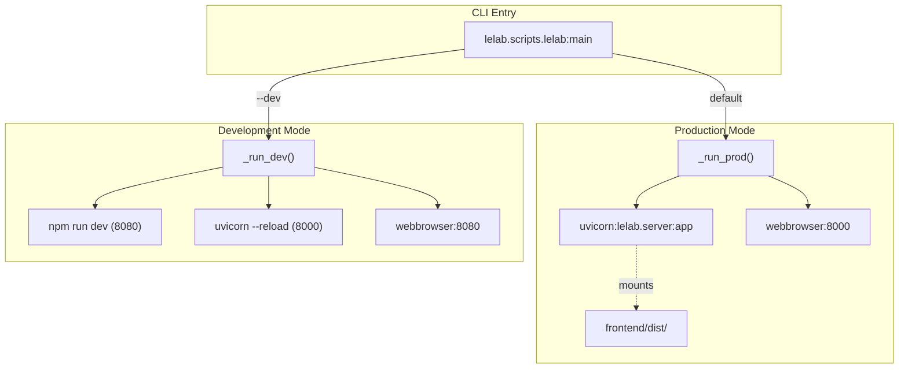
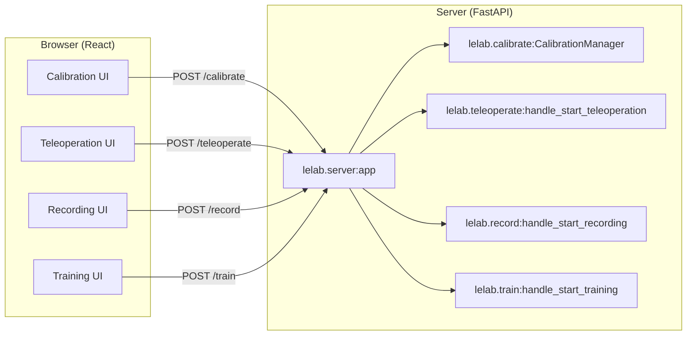

<!-- source: DeepWiki mcp.deepwiki.com · repo huggingface/leLab · page 1.1 Getting Started · fetched 2026-10-26 -->

# Getting Started

<details>
<summary>Relevant source files</summary>

The following files were used as context for generating this wiki page:

- [CLAUDE.md](CLAUDE.md)
- [README.md](README.md)
- [lelab/scripts/__init__.py](lelab/scripts/__init__.py)
- [lelab/scripts/lelab.py](lelab/scripts/lelab.py)
- [lelab/utils/__init__.py](lelab/utils/__init__.py)
- [pyproject.toml](pyproject.toml)
- [tests/test_rollout.py](tests/test_rollout.py)
- [tests/test_runners_hf_cloud.py](tests/test_runners_hf_cloud.py)
- [tests/test_scripts_lelab.py](tests/test_scripts_lelab.py)

</details>


LeLab is designed for rapid deployment, allowing users to transition from unboxing hardware to training robotics policies within minutes [README.md:15-18](). It provides a unified graphical interface for the LeRobot workflow, encompassing calibration, teleoperation, recording, training, and inference [README.md:27-60]().

## Installation and Environment

LeLab requires Python ≥3.12 and depends on several key packages, including FastAPI, Uvicorn, and a specific development version of `lerobot` [pyproject.toml:12-19]().

### Pip Installation
The package can be installed in editable mode for development:
```bash
pip install -e .
```
This command installs the core dependencies and registers the `lelab` CLI entry point [CLAUDE.md:13-16](). Optional dependencies for development and testing are available via `pip install -e ".[dev,test]"` [pyproject.toml:21-31]().

### Frontend Assets
The frontend is built using React and Vite, located in the `frontend/` directory [CLAUDE.md:9-9]().
- **Production:** The built bundle in `frontend/dist/` is shipped as package data within the Python wheel [CLAUDE.md:9-9]().
- **Development:** Requires Node.js to run the Vite dev server with Hot Module Replacement (HMR) [lelab/scripts/lelab.py:187-190]().

## Running LeLab

The `lelab` CLI command is the primary entry point, defined in `lelab.scripts.lelab:main` [pyproject.toml:33-34]().

### Production Mode
By default, running `lelab` starts a single process that serves both the API and the UI [CLAUDE.md:9-9]().
1. **Backend:** Starts a Uvicorn server on port `8000` [lelab/scripts/lelab.py:45-45]().
2. **Frontend:** The server mounts the pre-built `frontend/dist/` as `StaticFiles` at the root path `/` [CLAUDE.md:9-9]().
3. **Automation:** A background thread polls the port and automatically opens the system's web browser once the service is ready [lelab/scripts/lelab.py:61-73]().

### Development Mode
Running `lelab --dev` initiates a dual-server environment [lelab/scripts/lelab.py:98-182]():
- **Vite Dev Server:** Runs on port `8080`, providing HMR for frontend development [lelab/scripts/lelab.py:46-46]().
- **Uvicorn Backend:** Runs on port `8000` with `--reload` enabled to pick up Python code changes [lelab/scripts/lelab.py:121-137]().
- **Orchestration:** The script handles dependency installation (`npm install`) and ensures both processes are terminated gracefully on `SIGINT` [lelab/scripts/lelab.py:104-114, 155-172]().

### Process Lifecycle and Port Assignment
| Mode | Frontend Port | Backend Port | Serving Mechanism |
| :--- | :--- | :--- | :--- |
| **Production** | N/A (Served by Backend) | 8000 | FastAPI `StaticFiles` |
| **Development** | 8080 | 8000 | Vite + Uvicorn `--reload` |

**Sources:** [lelab/scripts/lelab.py:42-46](), [lelab/scripts/lelab.py:75-96](), [lelab/scripts/lelab.py:98-182](), [CLAUDE.md:9-9](), [CLAUDE.md:21-28]().

## System Architecture Overview

LeLab uses a FastAPI backend to orchestrate hardware interactions and serve the React frontend.

### Execution Flow: Production vs Development
The following diagram illustrates how the `lelab` script branches based on the `--dev` flag and manages the underlying server entities.

**Title: LeLab Launcher Data Flow**

**Sources:** [lelab/scripts/lelab.py:184-200](), [lelab/scripts/lelab.py:75-96](), [lelab/scripts/lelab.py:98-182](), [CLAUDE.md:9-9]().

### Component Mapping: Frontend to Backend
This diagram maps high-level user actions in the browser to specific backend modules and files.

**Title: UI-to-Backend Entity Mapping**

**Sources:** [CLAUDE.md:34-43](), [lelab/scripts/lelab.py:89-89]().

## Hardware and Security Notes

### SO-101 Arms
The system is specifically optimized for SO-101 leader/follower arms. Logic for config construction and hardware discovery frequently references `SO101LeaderConfig` and `SO101FollowerConfig` [CLAUDE.md:68-70]().

### Phone-Camera and HTTPS
Using a mobile device as a camera source requires the browser to operate over a secure context (HTTPS) [CLAUDE.md:71-72]().
- **Default:** `lelab` starts with standard HTTP [CLAUDE.md:73-73]().
- **HTTPS Setup:** For mobile camera support, Uvicorn must be launched manually with SSL certificates (e.g., `certs/key.pem` and `certs/cert.pem`) [CLAUDE.md:73-74]().

**Sources:** [CLAUDE.md:68-74]().

---

