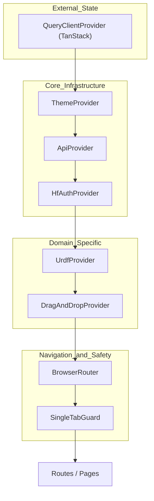
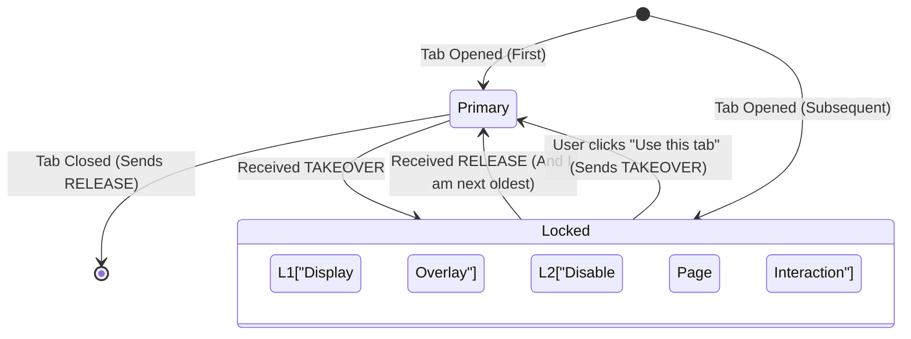

<!-- source: DeepWiki mcp.deepwiki.com · repo huggingface/leLab · page 1.2 Application Routing and Global Contexts · fetched 2026-10-26 -->

# Application Routing and Global Contexts

Relevant source files

The following files were used as context for generating this wiki page:

- [frontend/src/App.tsx](frontend/src/App.tsx)
- [frontend/src/components/SingleTabGuard.tsx](frontend/src/components/SingleTabGuard.tsx)
- [frontend/src/components/landing/UsageInstructionsModal.tsx](frontend/src/components/landing/UsageInstructionsModal.tsx)
- [frontend/src/components/replay/DatasetCombobox.tsx](frontend/src/components/replay/DatasetCombobox.tsx)
- [frontend/src/components/ui/dialog.tsx](frontend/src/components/ui/dialog.tsx)
- [frontend/src/contexts/ApiContext.tsx](frontend/src/contexts/ApiContext.tsx)
- [frontend/src/contexts/HfAuthContext.tsx](frontend/src/contexts/HfAuthContext.tsx)
- [frontend/src/hooks/useRobots.ts](frontend/src/hooks/useRobots.ts)
- [frontend/src/lib/isHostedSpace.ts](frontend/src/lib/isHostedSpace.ts)

This section describes the React application's structure, the global state management via a nested provider hierarchy, and the safety mechanisms ensuring exclusive control of robot hardware.

## Application Route Structure

The frontend application uses `react-router-dom` to manage navigation between different functional modules of the robot workflow [frontend/src/App.tsx:1](). The routes are organized to support the end-to-end lifecycle of robot interaction, from hardware setup to policy inference.

| Path | Element | Purpose |
| :--- | :--- | :--- |
| `/` | `Landing` | Dashboard for robot management, dataset selection, and job monitoring [frontend/src/App.tsx:36](). |
| `/calibration` | `Calibration` | Guided workflow for motor range-of-motion and homing offset configuration [frontend/src/App.tsx:43](). |
| `/teleoperation` | `Teleoperation` | Real-time remote control and 3D visualization of the robot [frontend/src/App.tsx:37](). |
| `/recording` | `Recording` | Episode collection interface with multi-camera preview and metadata tagging [frontend/src/App.tsx:38](). |
| `/upload` | `Upload` | Interface for pushing local datasets to the Hugging Face Hub [frontend/src/App.tsx:39](). |
| `/training` | `Training` | Configuration and monitoring for local or HF Cloud training jobs [frontend/src/App.tsx:40-41](). |
| `/inference` | `Inference` | Deployment and evaluation of trained policies on physical hardware [frontend/src/App.tsx:42](). |
| `/edit-dataset` | `EditDataset` | Tooling for modifying dataset metadata or cleaning recorded episodes [frontend/src/App.tsx:44](). |

**Sources:** [frontend/src/App.tsx:35-48]()

## Provider Hierarchy and Global Contexts

The application state is managed through a series of nested React Context providers. This hierarchy ensures that foundational services (like API connectivity) are available to specialized services (like Hugging Face authentication).

### Hierarchy Diagram: Context Dependency Flow
The following diagram illustrates how global contexts are wrapped and the dependencies between them.

**Sources:** [frontend/src/App.tsx:25-58]()

### Key Providers

*   **`ApiProvider`**: Resolves the backend URL. It prioritizes the `api` query parameter, falling back to `localStorage` or `localhost:8000` [frontend/src/contexts/ApiContext.tsx:16-32](). It provides `baseUrl`, `wsBaseUrl`, and a `fetchWithHeaders` wrapper [frontend/src/contexts/ApiContext.tsx:50-53]().
*   **`HfAuthProvider`**: Monitors the authentication status of the user on the Hugging Face Hub by polling the `/hf-auth-status` endpoint [frontend/src/contexts/HfAuthContext.tsx:30-46](). It provides the `username`, `orgs`, and the `loginCommand` required for CLI authentication [frontend/src/contexts/HfAuthContext.tsx:12-15]().
*   **`UrdfProvider`**: Manages the loading and parsing of Robot URDF files for 3D visualization in the `UrdfViewer` [frontend/src/App.tsx:4]().
*   **`DragAndDropProvider`**: Provides a global context for handling file uploads and UI element reordering [frontend/src/App.tsx:5]().

**Sources:** [frontend/src/contexts/ApiContext.tsx:9-64](), [frontend/src/contexts/HfAuthContext.tsx:24-80](), [frontend/src/App.tsx:1-21]()

## SingleTabGuard Concurrency Mechanism

Because the backend communicates with physical hardware via serial ports and camera drivers, multiple browser tabs attempting to control the same robot would lead to resource contention and state corruption. The `SingleTabGuard` component implements a distributed mutex using the `BroadcastChannel` API.

### Implementation Logic
1.  **Identity**: Each tab generates a unique `myId` and a `myOpenedAt` timestamp [frontend/src/components/SingleTabGuard.tsx:42-43]().
2.  **Heartbeat**: Tabs broadcast a `HEARTBEAT` message every 1000ms [frontend/src/components/SingleTabGuard.tsx:84-87]().
3.  **Election**: The "Primary" tab is the one with the earliest `openedAt` timestamp [frontend/src/components/SingleTabGuard.tsx:26-34]().
4.  **Takeover**: If a user clicks "Use this tab" on a non-primary tab, it sends a `TAKEOVER` message with an `openedAt` of 0, forcing all other tabs to yield [frontend/src/components/SingleTabGuard.tsx:101-109]().

### Tab State Transition Diagram

**Sources:** [frontend/src/components/SingleTabGuard.tsx:17-109]()

## Robot and Dataset Integration

Global hooks facilitate data flow between the UI and the persistent backend storage.

### `useRobots` Hook
This hook manages the lifecycle of robot configurations (`RobotRecord`). It handles fetching the list of robots from the `/robots` endpoint and persisting the user's active selection in `localStorage` [frontend/src/hooks/useRobots.ts:48-78]().

*   **`RobotRecord`**: Contains ports (leader/follower), motor configurations, and camera mappings [frontend/src/hooks/useRobots.ts:7-15]().
*   **Selection Persistence**: The selected robot name is stored under the key `lelab.selectedRobot` [frontend/src/hooks/useRobots.ts:17]().

### `DatasetCombobox`
A specialized component used across `Training` and `EditDataset` pages to select data sources. It categorizes datasets into "Local" (stored on the machine) and "Hugging Face" (remote datasets) [frontend/src/components/replay/DatasetCombobox.tsx:32-33](). It supports a "Custom Mode" for manually entering repository IDs [frontend/src/components/replay/DatasetCombobox.tsx:49-68]().

**Sources:** [frontend/src/hooks/useRobots.ts:7-178](), [frontend/src/components/replay/DatasetCombobox.tsx:19-112]()

---

