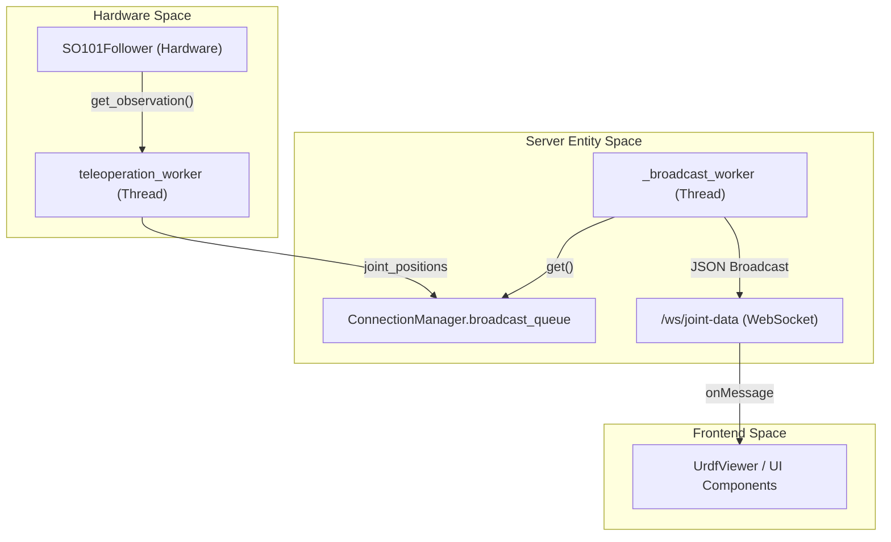
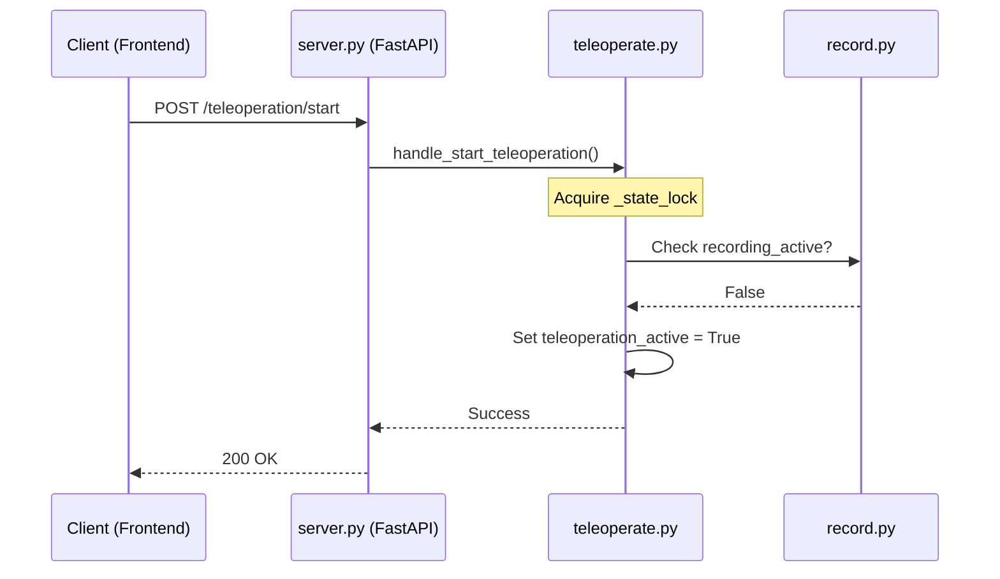

<!-- source: DeepWiki mcp.deepwiki.com · repo huggingface/leLab · page 2.1 FastAPI Server and WebSocket Broadcast · fetched 2026-10-26 -->

# FastAPI Server and WebSocket Broadcast

Relevant source files

The following files were used as context for generating this wiki page:

- [lelab/server.py](lelab/server.py)
- [lelab/teleoperate.py](lelab/teleoperate.py)

This page provides a deep dive into `lelab/server.py`, the central entry point for the LeLab backend. It explores how the FastAPI server manages real-time telemetry via WebSockets, handles hardware discovery, and orchestrates mutual exclusion between different robot operation modes.

## Server Architecture and Initialization

The LeLab server uses **FastAPI** to provide both a REST API and WebSocket endpoints. It serves the pre-built React frontend as static files and configures Cross-Origin Resource Sharing (CORS) to allow communication during development when the frontend and backend run on different ports (typically 8080 and 8000).

### CORS and Static Files
The server is configured with `CORSMiddleware` to allow all origins, methods, and headers, which is essential for development workflows [lelab/server.py:138-144](). In production, the server mounts the React build directory located at `frontend/dist` to the root path `/` [lelab/server.py:146-146](), [lelab/server.py:438-444]().

### Hardware Discovery Endpoints
To facilitate robot setup, the server provides endpoints for discovering connected hardware:
*   **/available-ports**: Scans the system for serial ports, filtering for those likely to be robot controllers (e.g., `/dev/tty.usbmodem*` or `COM*`) [lelab/server.py:284-288]().
*   **/available-cameras**: Lists available camera indices. On macOS, it utilizes a specific workaround for the AVFoundation backend [lelab/server.py:291-314]().

**Sources:** [lelab/server.py:133-150](), [lelab/server.py:284-314](), [lelab/server.py:438-444]()

---

## WebSocket Telemetry and Broadcast

Real-time joint data and robot state are delivered to the frontend via a WebSocket endpoint at `/ws/joint-data`. To ensure high-frequency updates (approx. 20Hz) without blocking the main FastAPI event loop, the server employs a dedicated broadcast worker thread.

### ConnectionManager
The `ConnectionManager` class handles the lifecycle of WebSocket connections and the background broadcasting logic.

| Component | Role |
| :--- | :--- |
| `active_connections` | A list of currently connected `WebSocket` objects [lelab/server.py:155-155](). |
| `broadcast_queue` | A `queue.Queue` used to pass telemetry data from hardware threads to the broadcast worker [lelab/server.py:156-156](). |
| `_broadcast_worker` | A background thread that pulls data from the queue and sends it to all active clients [lelab/server.py:202-239](). |
| `_connections_lock` | A `threading.Lock` that prevents race conditions when adding/removing connections [lelab/server.py:161-161](). |

### The Broadcast Loop
The `_broadcast_worker` runs a private `asyncio` event loop [lelab/server.py:207-208](). It continuously monitors the `broadcast_queue`. When data (such as joint positions or recording status) is placed in the queue by modules like `teleoperate.py` or `record.py`, the worker iterates through `active_connections` and sends the JSON payload [lelab/server.py:211-230](). If a send fails, the connection is automatically removed from the active list [lelab/server.py:226-228]().

### Data Flow: Telemetry Broadcast
The following diagram illustrates how joint data travels from the hardware to the browser.

Title: Telemetry Data Flow

**Sources:** [lelab/server.py:153-239](), [lelab/teleoperate.py:65-118](), [lelab/teleoperate.py:193-197]()

---

## Hardware Discovery and macOS Workaround

Camera enumeration via OpenCV (`cv2.VideoCapture`) can be unstable on macOS, where indices may not correspond directly to physical devices or may trigger permission prompts.

### macOS AVFoundation Workaround
To solve this, `server.py` implements `_avfoundation_cameras_in_cv2_order`. This function runs a short-lived subprocess that attempts to open camera indices 0 through 7 using the `cv2.CAP_AVFOUNDATION` backend [lelab/server.py:255-274](). It returns a list of indices that successfully returned a frame, ensuring the frontend only displays valid camera options [lelab/server.py:276-281]().

**Sources:** [lelab/server.py:242-281](), [lelab/server.py:302-308]()

---

## Mutual Exclusion and State Management

LeLab enforces a strict mutual exclusion policy: only one hardware-intensive operation (Calibration, Teleoperation, Recording, or Inference) can be active at a time. This is managed via module-level global flags and a `_state_lock`.

### Lock Implementation
Each hardware module (e.g., `lelab/teleoperate.py`) defines a `_state_lock` and an `active` boolean [lelab/teleoperate.py:50-55](). Before starting a new operation, the server-side handlers check the status of all other modules.

Title: Mutual Exclusion Logic in server.py

### Key Request Handlers
The server acts as a router for these specialized modules:
*   **Teleoperation**: `handle_start_teleoperation` initializes the `SO101Follower` and `SO101Leader` and starts the 20Hz broadcast loop [lelab/teleoperate.py:125-202]().
*   **Recording**: `handle_start_recording` manages the transition from teleoperation to dataset storage [lelab/record.py:159-218]().
*   **Calibration**: `calibration_manager` handles the state machine for motor homing and range discovery [lelab/calibrate.py:140-165]().

**Sources:** [lelab/server.py:330-345](), [lelab/teleoperate.py:131-138](), [lelab/record.py:159-175]()

---

