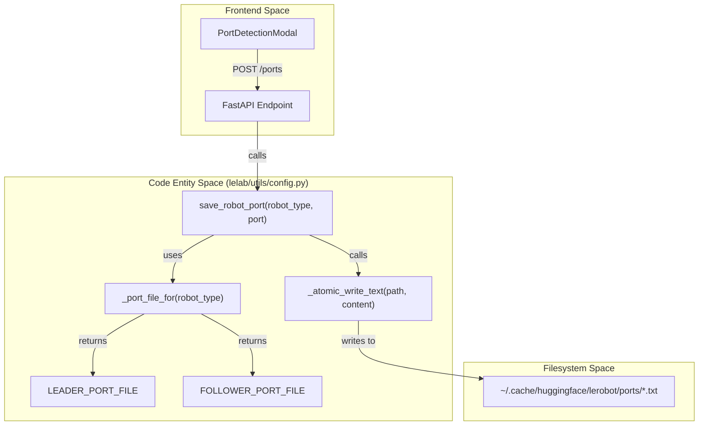
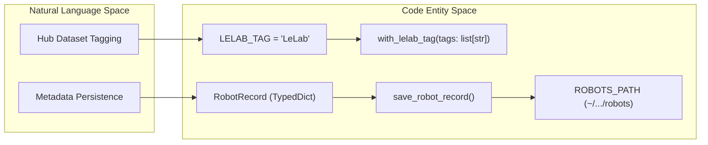

<!-- source: DeepWiki mcp.deepwiki.com · repo huggingface/leLab · page 2.2 Configuration and Persistence Utilities · fetched 2026-10-26 -->

# Configuration and Persistence Utilities

Relevant source files

The following files were used as context for generating this wiki page:

- [CLAUDE.md](CLAUDE.md)
- [lelab/utils/config.py](lelab/utils/config.py)
- [tests/test_rollout.py](tests/test_rollout.py)
- [tests/test_runners_hf_cloud.py](tests/test_runners_hf_cloud.py)
- [tests/test_scripts_lelab.py](tests/test_scripts_lelab.py)
- [tests/test_utils_config.py](tests/test_utils_config.py)

This page covers the utilities and filesystem conventions used by LeLab for managing robot configurations, calibration data, serial port persistence, and Hub-integrated tagging. These utilities ensure that the application state remains consistent across restarts and that hardware settings are correctly propagated to the underlying LeRobot framework.

## Filesystem Layout

LeLab follows the LeRobot convention of storing all configuration and data under the `~/.cache/huggingface/lerobot/` directory [lelab/utils/config.py:29-45]().

| Path | Purpose |
| :--- | :--- |
| `calibration/teleoperators/so_leader/` | Storage for leader arm calibration JSON files [lelab/utils/config.py:31](). |
| `calibration/robots/so_follower/` | Storage for follower arm calibration JSON files [lelab/utils/config.py:32](). |
| `ports/` | Persistence for last-used serial ports (`leader_port.txt`, `follower_port.txt`) [lelab/utils/config.py:35-37](). |
| `saved_configs/` | Persistence for last-selected calibration profile names [lelab/utils/config.py:40-42](). |
| `robots/` | JSON metadata records for "Robot" entities (logical pairings of arms and cameras) [lelab/utils/config.py:45](). |

### Atomic Writes
To prevent file corruption during system crashes or power loss, LeLab uses an atomic write pattern via `_atomic_write_text`. It writes content to a `.tmp` file first, then performs an `os.replace` to the final destination [lelab/utils/config.py:60-68]().

## Robot Record CRUD

LeLab introduces a higher-level abstraction called a **Robot Record**. While LeRobot tracks individual arms, LeLab's Robot Records group a leader arm, a follower arm, and a set of camera configurations into a single named entity [lelab/utils/config.py:44-45]().

### Implementation Details
- **List**: `list_robot_records()` scans the `ROBOTS_PATH` for `.json` files and returns a list of dictionaries [lelab/utils/config.py:45]().
- **Get**: `get_robot_record(name)` retrieves and parses a specific JSON record [tests/test_utils_config.py:108-111]().
- **Save**: `save_robot_record(name, record, allow_create)` performs a merge-and-save. If `allow_create` is false, it only updates existing records [lelab/utils/config.py:44](), [tests/test_utils_config.py:136-146]().
- **Delete**: `delete_robot_record(name)` removes the JSON file from disk [tests/test_utils_config.py:116-117]().

**Sources:** [lelab/utils/config.py:44-70](), [tests/test_utils_config.py:102-147]()

## Calibration File Management

LeLab utilizes a "dual-location" pattern for calibration. While user-created calibration files are stored in `LEADER_CONFIG_PATH` and `FOLLOWER_CONFIG_PATH`, the underlying LeRobot scripts often expect specific file naming or locations during execution.

### `setup_calibration_files`
This function is called by recording, teleoperation, and rollout modules before hardware initialization [CLAUDE.md:63-66](). It ensures that the selected `.json` configuration exists and is accessible to the backend processes.

1.  **Extraction**: It strips the `.json` extension to get the config name [lelab/utils/config.py:91-92]().
2.  **Validation**: It verifies the existence of the source files in the calibration directories [lelab/utils/config.py:95-102]().
3.  **Sync**: It copies the files to the target directories if they are missing [lelab/utils/config.py:111-130]().

**Sources:** [lelab/utils/config.py:88-132](), [CLAUDE.md:63-66]()

## Port Discovery and Persistence

To provide a seamless "plug-and-play" experience, LeLab persists the serial port paths (e.g., `/dev/ttyUSB0`) for both leader and follower arms.

### Data Flow: Port Persistence
The following diagram illustrates how serial port strings move between the UI and the filesystem.

**Serial Port Persistence Flow**

**Sources:** [lelab/utils/config.py:34-37](), [lelab/utils/config.py:60-77](), [tests/test_utils_config.py:34-42]()

## Hub Integration: LELAB_TAG

LeLab ensures that datasets created through its interface are easily discoverable on the Hugging Face Hub. This is achieved through the `LELAB_TAG` constant.

- **Tag Value**: `"LeLab"` [lelab/utils/config.py:49]().
- **Injection**: The `with_lelab_tag(tags)` function takes an existing list of tags and appends the `LELAB_TAG`, ensuring it is deduplicated [lelab/utils/config.py:52-57]().
- **Purpose**: This allows the LeLab UI to filter for datasets produced specifically by the web interface when querying the Hub [lelab/utils/config.py:47-49]().

### Entity Association
The following diagram bridges the natural language concept of "Tagging" to the specific code implementation.

**Dataset Tagging Implementation**

**Sources:** [lelab/utils/config.py:45-57](), [tests/test_utils_config.py:179-193]()

---

