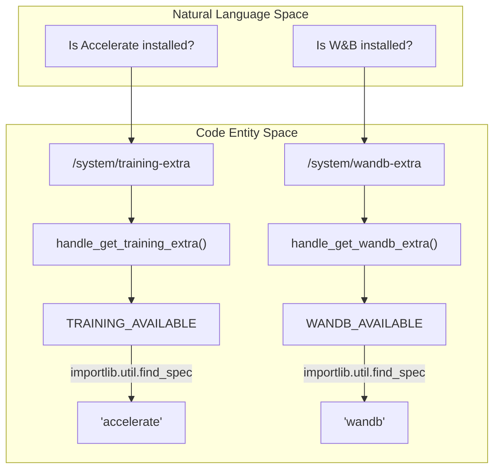
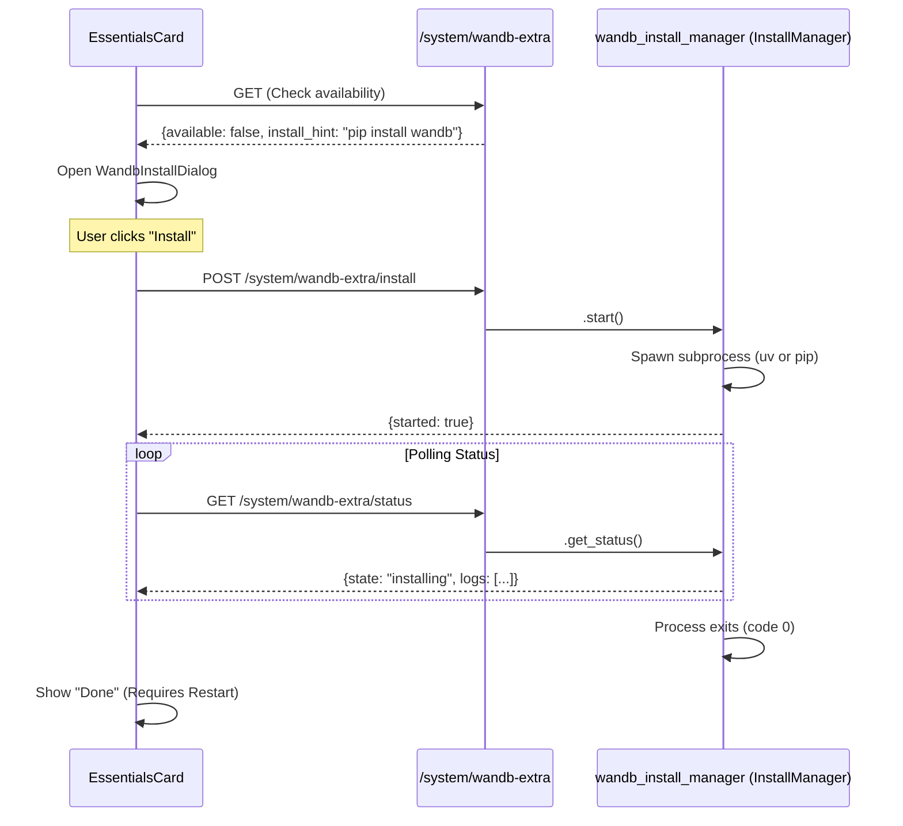

<!-- source: DeepWiki mcp.deepwiki.com · repo huggingface/leLab · page 2.3 System Utilities and Package Management · fetched 2026-10-26 -->

# System Utilities and Package Management

Relevant source files

The following files were used as context for generating this wiki page:

- [frontend/src/components/training/config/AdvancedCard.tsx](frontend/src/components/training/config/AdvancedCard.tsx)
- [frontend/src/components/training/config/EssentialsCard.tsx](frontend/src/components/training/config/EssentialsCard.tsx)
- [frontend/src/components/training/config/TargetCard.tsx](frontend/src/components/training/config/TargetCard.tsx)
- [frontend/src/components/ui/command.tsx](frontend/src/components/ui/command.tsx)
- [lelab/utils/system.py](lelab/utils/system.py)

The system utilities module provides the infrastructure for managing optional dependencies and detecting the runtime environment. Since LeLab aims to be lightweight, heavy dependencies like `accelerate` (required for local training) and `wandb` (for experiment tracking) are treated as optional extras that can be installed on-demand via the web UI.

## Dependency Detection and Availability

LeLab checks for the presence of optional packages at module load time using `importlib.util.find_spec`. These checks are cached; if a package is installed while the server is running, the server must be restarted to recognize the new dependency [lelab/utils/system.py:31-32]().

| Flag | Package | Purpose |
| :--- | :--- | :--- |
| `TRAINING_AVAILABLE` | `accelerate` | Enables local training runners [lelab/utils/system.py:33]() |
| `WANDB_AVAILABLE` | `wandb` | Enables Weights & Biases logging [lelab/utils/system.py:36]() |

### Code Entity Space: Availability Logic
The following diagram illustrates how the frontend queries package availability through the backend endpoints.

Sources: [lelab/utils/system.py:31-38](), [lelab/utils/system.py:156-177]()

## The InstallManager Class

The `InstallManager` class manages the lifecycle of a background `pip` or `uv` installation process. It ensures that only one installation for a specific package happens at a time and provides a thread-safe way to stream logs back to the frontend [lelab/utils/system.py:69-78]().

### Key Components
- **State Management**: Tracks the installation status across four states: `idle`, `installing`, `done`, or `error` [lelab/utils/system.py:64]().
- **Process Orchestration**: Uses `subprocess.Popen` to execute the installation command with `stdout` and `stderr` merged [lelab/utils/system.py:89-95]().
- **Log Buffering**: Implements a `queue.Queue` to store process output. The queue is capped at 1000 lines to prevent unbounded memory growth from chatty installers [lelab/utils/system.py:138-142]().
- **Monitor Thread**: A daemon thread reads the subprocess output line-by-line and updates the final state based on the return code [lelab/utils/system.py:116-136]().

### UV vs PIP Detection
The function `_build_install_cmd` determines the best installation tool. If `uv` is found on the system `PATH`, it is preferred for its speed. It uses the `--python` flag pinned to `sys.executable` to ensure the package is installed into the same environment running LeLab [lelab/utils/system.py:40-50]().

Sources: [lelab/utils/system.py:40-150]()

## Package Management Flow

The installation flow is triggered by the frontend when a user attempts to use a feature (like W&B) that is not currently available.

### Sequence: W&B Installation Check
When a user toggles "Enable Weights & Biases" in the `EssentialsCard`, the frontend performs a pre-flight check [frontend/src/components/training/config/EssentialsCard.tsx:30-53]().

Sources: [frontend/src/components/training/config/EssentialsCard.tsx:30-53](), [lelab/utils/system.py:79-114]()

## System Endpoints

The backend exposes two sets of identical endpoints for the two supported optional packages.

| Package | Info Endpoint | Install Endpoint | Status Endpoint |
| :--- | :--- | :--- | :--- |
| **Accelerate** | `/system/training-extra` | `/system/training-extra/install` | `/system/training-extra/status` |
| **W&B** | `/system/wandb-extra` | `/system/wandb-extra/install` | `/system/wandb-extra/status` |

### Endpoint Handlers
The handlers wrap global instances of `InstallManager`: `training_install_manager` and `wandb_install_manager` [lelab/utils/system.py:152-153]().

- `handle_get_...`: Returns the cached boolean and the string hint [lelab/utils/system.py:156-158]().
- `handle_install_...`: Invokes the `start()` method to begin the background process [lelab/utils/system.py:160-161]().
- `handle_install_..._status`: Invokes `get_status()` which drains the log queue and returns the current state [lelab/utils/system.py:164-165]().

Sources: [lelab/utils/system.py:152-177]()

---

