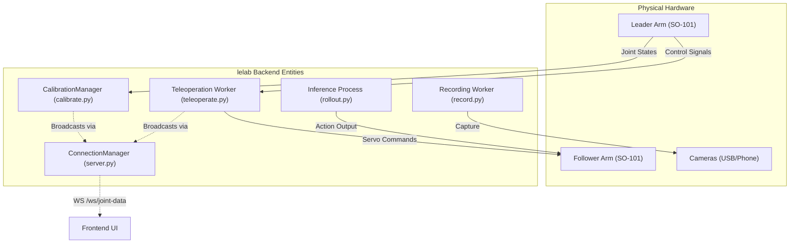
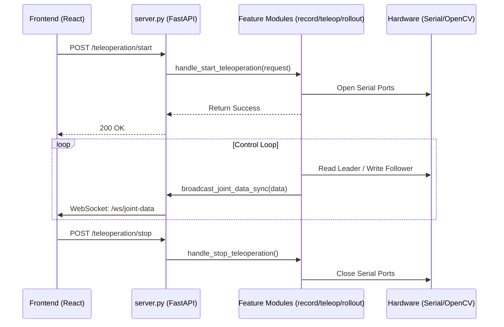

<!-- source: DeepWiki mcp.deepwiki.com · repo huggingface/leLab · page 3 Robot Hardware Workflows · fetched 2026-10-26 -->

# Robot Hardware Workflows

Relevant source files

The following files were used as context for generating this wiki page:

- [CLAUDE.md](CLAUDE.md)
- [lelab/server.py](lelab/server.py)
- [tests/test_rollout.py](tests/test_rollout.py)
- [tests/test_runners_hf_cloud.py](tests/test_runners_hf_cloud.py)
- [tests/test_scripts_lelab.py](tests/test_scripts_lelab.py)

This page provides a high-level overview of the four primary hardware-facing workflows in LeLab. These workflows allow users to calibrate physical arms, control them via teleoperation, record datasets for imitation learning, and run inference using trained policies.

LeLab is specifically architected for the **SO-101 leader/follower arm** setup [CLAUDE.md:67-69](). It utilizes a leader/follower architecture where a human manipulates a "leader" arm to control a "follower" arm.

## Mutual Exclusion and State Management

Hardware access in LeLab is governed by a mutual exclusion model. Because the robot serial ports and cameras are shared resources, only one hardware-intensive workflow can be active at a time.

*   **Module-level Globals**: Each feature module (e.g., `lelab/record.py`, `lelab/teleoperate.py`) maintains its own state (e.g., `recording_active`, `teleoperation_active`) [CLAUDE.md:36-46]().
*   **Concurrency**: While the backend does not strictly enforce a global lock across all modules in code, the frontend and API handlers use these status flags to prevent overlapping operations [CLAUDE.md:45-47]().
*   **State Machine Logic**: Complex workflows like calibration use a `CalibrationManager` singleton to track transitions through various states (e.g., `connecting`, `recording`, `completed`) [lelab/server.py:38-38]().

### Hardware-to-Code Mapping

The following diagram illustrates how physical hardware components relate to the software entities and state managers within the codebase.

**Hardware Entity Space Mapping**

Sources: [lelab/server.py:153-162](), [CLAUDE.md:36-41](), [CLAUDE.md:67-69]()

---

## Workflow Overview

### 1. Calibration
Calibration is the prerequisite for all other workflows. It maps the raw potentiometer readings of the SO-101 motors to a normalized joint space. The `CalibrationManager` in `lelab/calibrate.py` handles the state machine for homing offsets and range-of-motion recording.

For details, see [Calibration](#3.1).

### 2. Teleoperation
Teleoperation enables real-time control of the follower arm using the leader arm. It involves a high-frequency control loop (typically 20 FPS) that reads joint positions from the leader and sends them to the follower while broadcasting telemetry to the frontend via WebSockets.

For details, see [Teleoperation](#3.2).

### 3. Dataset Recording
Recording captures synchronized streams of joint data and camera frames into a LeRobot-compatible dataset format. It patches the standard `lerobot` keyboard listeners to allow the LeLab UI to trigger episodes, handle "exit early" signals, and trigger re-recordings of failed episodes.

For details, see [Dataset Recording](#3.3).

### 4. Inference (Policy Rollout)
Inference involves loading a trained model (policy) from the Hugging Face Hub or a local path and executing it on the follower arm. The `lelab/rollout.py` module manages the lifecycle of the inference subprocess, handles device detection (CUDA/MPS/CPU), and monitors the rollout for safety.

For details, see [Inference (Policy Rollout)](#3.4).

---

## System Integration Diagram

This diagram shows how the `FastAPI` router in `server.py` orchestrates the different hardware modules.

**Workflow Orchestration**

Sources: [lelab/server.py:68-75](), [lelab/server.py:202-220](), [CLAUDE.md:48-51]()

### Key Data Structures
| Workflow | Request Model | Primary Handler |
| :--- | :--- | :--- |
| **Calibration** | `CalibrationRequest` | `calibration_manager` |
| **Teleoperation** | `TeleoperateRequest` | `handle_start_teleoperation` |
| **Recording** | `RecordingRequest` | `handle_start_recording` |
| **Inference** | `InferenceRequest` | `handle_start_inference` |

Sources: [lelab/server.py:38-75](), [lelab/rollout.py:52-60]()

---

