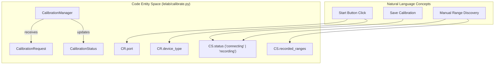
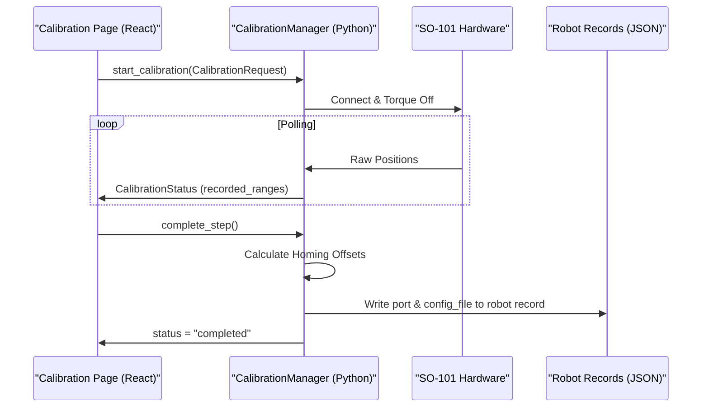

<!-- source: DeepWiki mcp.deepwiki.com · repo huggingface/leLab · page 3.1 Calibration · fetched 2026-10-26 -->

# Calibration

Relevant source files

The following files were used as context for generating this wiki page:

- [frontend/src/lib/calibrationTargets.ts](frontend/src/lib/calibrationTargets.ts)
- [frontend/src/pages/Calibration.tsx](frontend/src/pages/Calibration.tsx)
- [lelab/calibrate.py](lelab/calibrate.py)
- [tests/test_calibrate.py](tests/test_calibrate.py)

The calibration system in LeLab provides a guided, web-based workflow for determining the hardware limits and homing offsets of SO-101 robot arms. It transitions the robot through a state machine that manages hardware connection, range-of-motion recording, and the final generation of `lerobot` compatible calibration files.

## Calibration Lifecycle

The calibration process is managed by the `CalibrationManager` class in the backend. It handles the transition between different states while ensuring thread-safe access to the hardware.

### State Machine Transitions
The manager follows a strict state progression:
1.  **Idle**: The initial state where no hardware is engaged `[lelab/calibrate.py:59]()`.
2.  **Connecting**: The manager attempts to instantiate a `Robot` or `Teleoperator` object using the provided serial port `[lelab/calibrate.py:168]()`.
3.  **Recording**: The hardware is in torque-off mode, allowing the user to manually move the joints to their limits `[lelab/calibrate.py:103]()`.
4.  **Stopping**: The manager is cleaning up resources and closing the serial bus `[lelab/calibrate.py:59]()`.
5.  **Completed/Error**: Terminal states where the process finishes successfully or encounters a failure `[lelab/calibrate.py:59]()`.

### System Entity Mapping: Backend State Management

The following diagram maps the logical calibration steps to the internal code entities and state variables within `CalibrationManager`.

**Calibration State Entity Map**

Sources: `[lelab/calibrate.py:55-77]()`, `[lelab/calibrate.py:79-145]()`.

## Range-of-Motion Recording

During the `recording` phase, the backend enters a loop that polls the motor positions at high frequency.

### Discontinuity Detection
Feetech encoders are 12-bit (0-4095). If a joint is moved across the wrap-around boundary (e.g., from 4095 to 0), it produces a massive delta in a single frame. The `CalibrationManager` detects this jump and raises a `CalibrationDiscontinuityError` `[lelab/calibrate.py:44-51]()`. Users are instructed to start calibration with joints centered in their physical range to avoid this `[frontend/src/pages/Calibration.tsx:39]()`.

### Range Calculation
As the user moves the arm, the system tracks the `min` and `max` raw values for each motor:
*   **Current Position**: Read via `device.bus.sync_read("Present_Position")` `[lelab/calibrate.py:109]()`.
*   **Min/Max Tracking**: The `recorded_ranges` dictionary is updated continuously `[lelab/calibrate.py:132-137]()`.
*   **Homing Offset**: Calculated as the difference between the starting position and the target center point of the discovered range.

## Frontend Calibration Interface

The frontend provides a real-time visualization of the calibration progress, including a checklist of motors and their current discovered ranges.

### Completion Logic
The UI determines if a motor has been sufficiently exercised by comparing the current range against hardcoded targets in `frontend/src/lib/calibrationTargets.ts`.

| Parameter | Value | Description |
| :--- | :--- | :--- |
| `RANGE_TOLERANCE` | `0.98` | Motors must reach 98% of target range to be marked complete `[frontend/src/lib/calibrationTargets.ts:27]()`. |
| `SO101_LEADER_TARGETS` | e.g., `shoulder_pan: 2400` | Target raw step ranges for leader (teleop) arms `[frontend/src/lib/calibrationTargets.ts:4-11]()`. |
| `SO101_FOLLOWER_TARGETS` | e.g., `gripper: 1400` | Target raw step ranges for follower (robot) arms `[frontend/src/lib/calibrationTargets.ts:13-20]()`. |

### Motor Progress Tracking
The function `isMotorRangeComplete` takes the `deviceType`, `motor` name, and `rangeAchieved` to return a boolean status used to render the checklist `[frontend/src/lib/calibrationTargets.ts:29-38]()`.

## Data Flow: From Hardware to Record

When calibration is finalized, the results are written back to the robot configuration records to ensure persistence across sessions.

**Calibration Data Flow**

Sources: `[lelab/calibrate.py:154-180]()`, `[frontend/src/pages/Calibration.tsx:205-224]()`, `[lelab/calibrate.py:76-77]()`.

## Key Functions and Classes

### `CalibrationManager` (lelab/calibrate.py)
*   `get_status()`: Returns the current state, including thread-safe position readings from the hardware bus `[lelab/calibrate.py:99-145]()`.
*   `start_calibration(request)`: Spawns the calibration thread and initializes the state machine `[lelab/calibrate.py:154-185]()`.
*   `_update_status(**kwargs)`: Internal helper for thread-safe updates to the `CalibrationStatus` dataclass `[lelab/calibrate.py:147-152]()`.

### `Calibration` Page (frontend/src/pages/Calibration.tsx)
*   `pollStatus()`: An interval-based function that fetches the latest `CalibrationStatus` from the backend `[frontend/src/pages/Calibration.tsx:205-224]()`.
*   `handleCamerasChange()`: Persists camera configuration changes to the robot record using a debounced fetch call `[frontend/src/pages/Calibration.tsx:134-154]()`.
*   `unmount cleanup`: Automatically sends a `/stop-calibration` request if the user navigates away while calibration is active `[frontend/src/pages/Calibration.tsx:195-203]()`.

Sources: `[lelab/calibrate.py:79-152]()`, `[frontend/src/pages/Calibration.tsx:73-224]()`.

---

