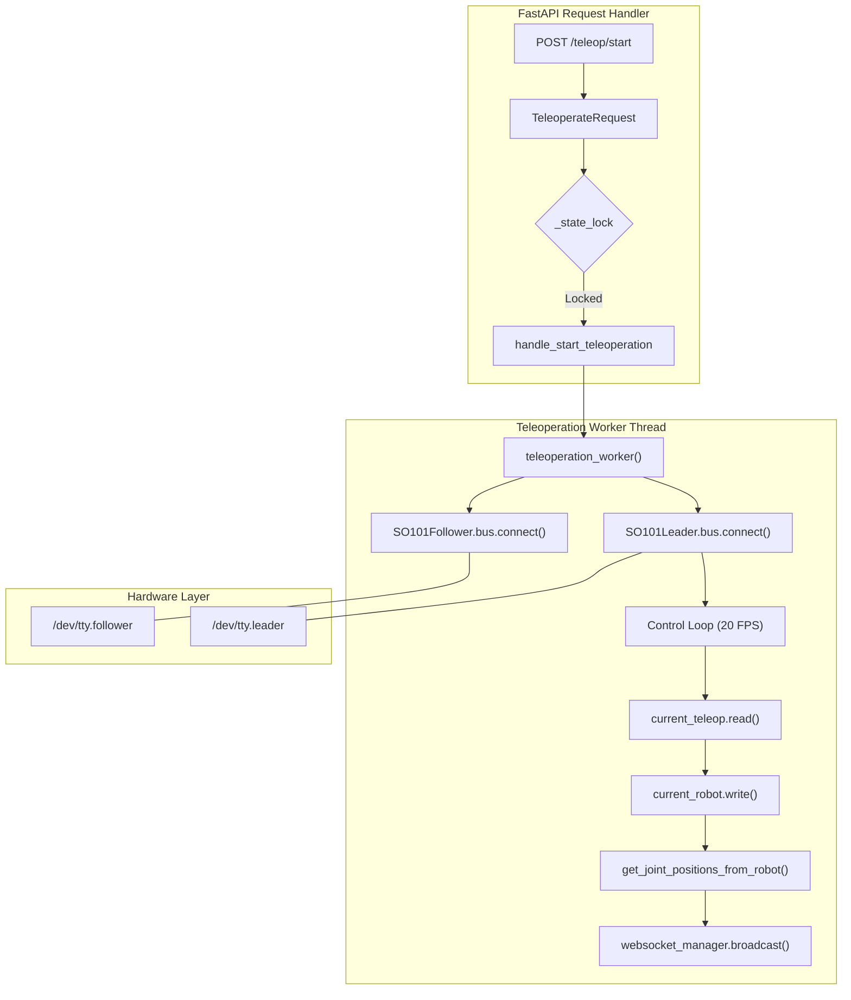
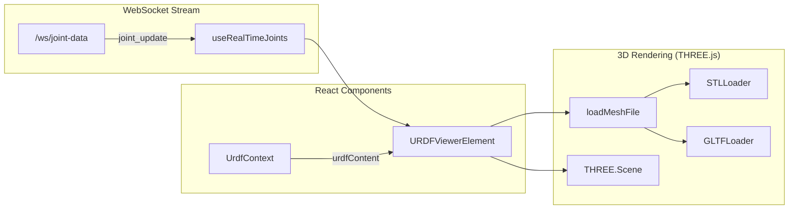

<!-- source: DeepWiki mcp.deepwiki.com · repo huggingface/leLab · page 3.2 Teleoperation · fetched 2026-10-26 -->

# Teleoperation

Relevant source files

The following files were used as context for generating this wiki page:

- [frontend/.gitignore](frontend/.gitignore)
- [frontend/src/contexts/UrdfContext.tsx](frontend/src/contexts/UrdfContext.tsx)
- [frontend/src/hooks/useRealTimeJoints.ts](frontend/src/hooks/useRealTimeJoints.ts)
- [frontend/src/lib/UrdfDragAndDrop.ts](frontend/src/lib/UrdfDragAndDrop.ts)
- [frontend/src/lib/meshLoaders.ts](frontend/src/lib/meshLoaders.ts)
- [frontend/src/lib/types.ts](frontend/src/lib/types.ts)
- [frontend/src/lib/urdfViewerHelpers.ts](frontend/src/lib/urdfViewerHelpers.ts)
- [frontend/src/lib/utils.ts](frontend/src/lib/utils.ts)
- [lelab/teleoperate.py](lelab/teleoperate.py)

Teleoperation is the core real-time control workflow in LeLab, enabling a leader robot (typically a SO-101 arm) to control a follower robot. This module manages the low-level serial communication via LeRobot, performs coordinate transformations for 3D visualization, and broadcasts real-time joint states to the frontend at 20 FPS via WebSockets.

## Teleoperation Backend

The teleoperation logic is encapsulated in `lelab/teleoperate.py`. It uses a threaded worker model to maintain a high-frequency control loop without blocking the FastAPI event loop.

### TeleoperateRequest and Lifecycle
The lifecycle of a teleoperation session is managed by the `handle_start_teleoperation` function. It enforces mutual exclusion with other hardware-intensive tasks like recording or inference using a global `_state_lock` [lelab/teleoperate.py:55-55]().

1.  **Request Validation**: Checks if teleoperation, recording, or inference is already active [lelab/teleoperate.py:131-138]().
2.  **Configuration**: Invokes `setup_calibration_files` to ensure the correct `.json` calibration files exist in the LeRobot cache [lelab/teleoperate.py:146-148]().
3.  **Worker Initialization**: Spawns a `teleoperation_worker` thread [lelab/teleoperate.py:162-162]().
4.  **Connection**: Initializes `SO101Follower` and `SO101Leader` instances and connects to their respective serial buses [lelab/teleoperate.py:167-175]().
5.  **Calibration Sync**: Writes calibration data directly to the motor memory [lelab/teleoperate.py:178-180]().
6.  **Control Loop**: Enters a `while teleoperation_active` loop that reads from the leader and writes to the follower [lelab/teleoperate.py:192-205]().

### Joint Coordinate Transformation
To support 3D visualization, LeLab converts raw motor positions into URDF-compatible joint angles. The `get_joint_positions_from_robot` function handles this mapping [lelab/teleoperate.py:65-65]().

While most joints follow a direct mapping, the SO-101 `shoulder_lift` and `elbow_flex` require corrections because the URDF zero-pose (sleep position) differs from the calibration's mid-range pose [lelab/teleoperate.py:33-41]().

**Correction Formula:**
`URDF_value = sign * (motor_normalized_deg - motor_at_urdf_zero_deg)`
where `motor_at_urdf_zero_deg` is derived from constant `urdf_zero_ticks` [lelab/teleoperate.py:36-47]().

### Data Flow: Robot to WebSocket
Teleoperation telemetry is broadcasted at approximately 20 FPS (0.05s sleep interval) [lelab/teleoperate.py:202-205](). The joint data is formatted into a `joint_update` message and sent via the `websocket_manager` [lelab/teleoperate.py:199-201]().

**Sources:** [lelab/teleoperate.py:1-210]()

## Teleoperation Frontend Visualization

The frontend uses a custom `<urdf-viewer>` Web Component to render the robot's state in 3D.

### URDF Viewer and Mesh Loading
The `UrdfProvider` manages the URDF state, including the default SO-101 model and any custom models uploaded via drag-and-drop [frontend/src/contexts/UrdfContext.tsx:58-62]().

*   **Mesh Loading**: The `loadMeshFile` utility supports STL, GLTF, GLB, Collada (DAE), and OBJ formats using THREE.js loaders [frontend/src/lib/meshLoaders.ts:43-97]().
*   **Fallback Geometry**: If an STL fails to load, the system generates a 5cm orange cube as a placeholder to prevent the visualization from breaking [frontend/src/lib/meshLoaders.ts:85-94]().

### Real-Time Updates
The `useRealTimeJoints` hook establishes a WebSocket connection to `/ws/joint-data` [frontend/src/hooks/useRealTimeJoints.ts:26-26](). When a `joint_update` message is received, it calls `viewer.setJointValue(jointName, value)` on the `URDFViewerElement` to update the 3D model [frontend/src/hooks/useRealTimeJoints.ts:34-45]().

### Drag and Drop Support
Users can drop URDF folders into the application. The `dataTransferToFiles` utility recursively processes the `DataTransfer` object, converting files into Blobs and generating temporary URLs for the viewer [frontend/src/lib/UrdfDragAndDrop.ts:13-20]().

**Sources:** [frontend/src/contexts/UrdfContext.tsx:1-102](), [frontend/src/hooks/useRealTimeJoints.ts:1-130](), [frontend/src/lib/meshLoaders.ts:1-101](), [frontend/src/lib/UrdfDragAndDrop.ts:1-120](), [frontend/src/lib/urdfViewerHelpers.ts:15-33]()

## System Architecture Diagrams

### Teleoperation Lifecycle and Threading
This diagram bridges the `TeleoperateRequest` model to the backend worker thread and the hardware communication.

**Sources:** [lelab/teleoperate.py:55-55](), [lelab/teleoperate.py:125-138](), [lelab/teleoperate.py:162-205]()

### Frontend Visualization Data Flow
This diagram shows how joint data travels from the WebSocket to the `UrdfViewer` component.

**Sources:** [frontend/src/hooks/useRealTimeJoints.ts:26-45](), [frontend/src/lib/urdfViewerHelpers.ts:15-33](), [frontend/src/lib/meshLoaders.ts:43-73]()

## Teleoperation State Summary

| Entity | Type | Responsibility |
| :--- | :--- | :--- |
| `teleoperation_active` | `bool` | Global flag controlling the worker loop [lelab/teleoperate.py:50](). |
| `_state_lock` | `threading.Lock` | Prevents concurrent hardware access [lelab/teleoperate.py:55](). |
| `_SO101_URDF_CORRECTIONS` | `dict` | Constants for aligning motor ticks to URDF radians [lelab/teleoperate.py:43](). |
| `URDFViewerElement` | `interface` | Web Component interface for 3D visualization [frontend/src/lib/urdfViewerHelpers.ts:15](). |
| `useRealTimeJoints` | `hook` | Manages WebSocket lifecycle and viewer updates [frontend/src/hooks/useRealTimeJoints.ts:20](). |

**Sources:** [lelab/teleoperate.py:43-55](), [frontend/src/lib/urdfViewerHelpers.ts:15-33](), [frontend/src/hooks/useRealTimeJoints.ts:20-33]()

---

