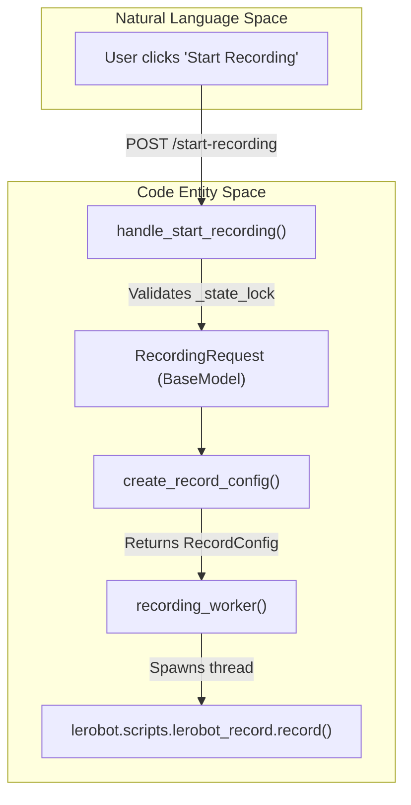
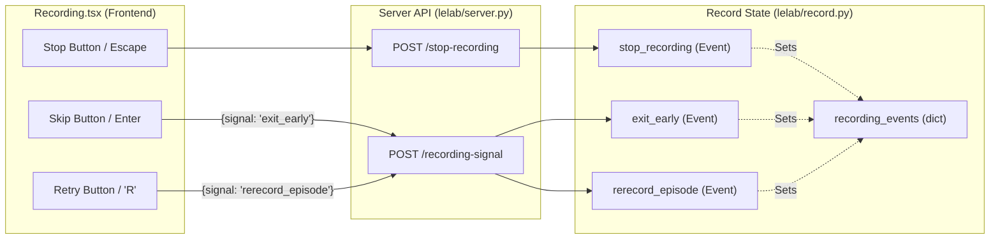

<!-- source: DeepWiki mcp.deepwiki.com · repo huggingface/leLab · page 3.3 Dataset Recording · fetched 2026-10-26 -->

# Dataset Recording

Relevant source files

The following files were used as context for generating this wiki page:

- [frontend/src/lib/recordingAudio.ts](frontend/src/lib/recordingAudio.ts)
- [frontend/src/pages/Recording.tsx](frontend/src/pages/Recording.tsx)
- [frontend/vite.config.ts](frontend/vite.config.ts)
- [lelab/record.py](lelab/record.py)

The Dataset Recording system provides a managed interface for capturing teleoperated robot episodes into a LeRobot-compatible dataset. It orchestrates the lifecycle of hardware connection, phase transitions (recording vs. resetting), and automated dataset uploading to the Hugging Face Hub.

## Recording Lifecycle and State Machine

The recording process is governed by a background worker thread in the backend and a polling-based state machine in the frontend. This architecture ensures that hardware control remains stable even if the browser tab is refreshed or the network fluctuates.

### Backend State Machine
The recording session moves through four distinct phases defined in `lelab/record.py`:
1.  **`preparing`**: Initializing hardware, cameras, and the `LeRobotDataset` object [lelab/record.py:46]().
2.  **`recording`**: Active data collection where leader/follower joint states and camera frames are written to disk [lelab/record.py:46]().
3.  **`resetting`**: A timed interval between episodes allowing the operator to reset the environment [lelab/record.py:46]().
4.  **`completed`**: The session has reached the target number of episodes or was manually terminated [lelab/record.py:46]().

### Hardware Control and Signals
The `recording_worker` thread manages the session using a `threading.Event` dictionary (`recording_events`) to respond to asynchronous signals from the API [lelab/record.py:206-208]():
-   **`stop_recording`**: Gracefully shuts down the loop and saves the dataset.
-   **`exit_early`**: Stops the current episode and transitions immediately to the next phase.
-   **`rerecord_episode`**: Discards the current episode's data and restarts the same episode index.

### System Data Flow: API to Worker
The following diagram illustrates how a `RecordingRequest` is transformed into a running hardware session.

**Recording Orchestration Flow**

Sources: [lelab/record.py:56-75](), [lelab/record.py:87-170](), [lelab/record.py:173-203](), [lelab/record.py:206-258]()

## Backend Implementation Details

### Camera Backend Selection
To ensure consistency between the browser preview and the OpenCV capture, `lelab/record.py` pins the backend based on the operating system. This prevents macOS `AVFoundation` index shifting [lelab/record.py:98-103]().

| OS | Backend | Rationale |
| :--- | :--- | :--- |
| **Darwin (macOS)** | `Cv2Backends.AVFOUNDATION` | Avoids index reordering between `cv2.CAP_ANY` calls [lelab/record.py:98-99](). |
| **Linux** | `Cv2Backends.V4L2` | Standard for Video4Linux2 devices [lelab/record.py:100-101](). |
| **Other** | `Cv2Backends.ANY` | Default fallback [lelab/record.py:103](). |

### The Recording Worker
The `recording_worker` function acts as a wrapper around `lerobot.scripts.lerobot_record.record`. It initializes global state variables like `recording_active`, `current_episode`, and `saved_episodes` before invoking the core LeRobot recording logic [lelab/record.py:206-258](). It also handles post-recording cleanup, such as setting `session_end_elapsed_seconds` for the summary UI [lelab/record.py:245]().

Sources: [lelab/record.py:38-53](), [lelab/record.py:87-104](), [lelab/record.py:206-258]()

## Frontend Recording Page

The `Recording.tsx` component provides a high-stakes UI designed for hands-free or keyboard-centric operation.

### Optimistic UI and Polling
The frontend uses a polling loop (`pollStatus`) every 1000ms to fetch `backendStatus` from `/recording-status` [frontend/src/pages/Recording.tsx:146-207](). To provide immediate feedback, it employs `optimisticPhase` state, which is cleared once the backend status confirms the transition [frontend/src/pages/Recording.tsx:155-159]().

### Audio Cues and Keyboard Shortcuts
Since operators are often looking at the robot rather than the screen, the system provides synthesized audio feedback using the Web Audio API in `recordingAudio.ts`.

-   **Start Cue**: Two rising tones when `current_phase` becomes `recording` [frontend/src/lib/recordingAudio.ts:38-41]().
-   **Reset Cue**: Two falling tones when entering `resetting` phase [frontend/src/lib/recordingAudio.ts:43-46]().
-   **Auto-Advance Warning**: Three beeps in the final 3 seconds of a phase [frontend/src/lib/recordingAudio.ts:48-52]().

**Keyboard Mapping**
| Key | Action | Backend Signal |
| :--- | :--- | :--- |
| `Escape` | Stop Recording | `stop_recording` [frontend/src/pages/Recording.tsx:238]() |
| `Enter` | Skip/Exit Early | `exit_early` [frontend/src/pages/Recording.tsx:244]() |
| `R` | Re-record Episode | `rerecord_episode` [frontend/src/pages/Recording.tsx:250]() |

### Data Flow: Frontend to Backend
The following diagram maps UI interactions to the specific API endpoints and backend events they trigger.

**Frontend Control Flow**

Sources: [frontend/src/pages/Recording.tsx:236-253](), [lelab/record.py:261-294](), [lelab/record.py:313-333]()

## Dataset Upload and Finalization

Once the session is complete (either by reaching `num_episodes` or manual stop), the frontend detects `session_ended` and navigates to the `/upload` page [frontend/src/pages/Recording.tsx:189-199]().

### Hub Integration
The backend provides `handle_push_to_hub` which uses `LeRobotDataset.push_to_hub`. This function ensures that datasets are tagged with the `LELAB_TAG` to facilitate discovery within the LeLab ecosystem [lelab/record.py:348-369]().

-   **`tags`**: Automatically includes `lelab` via `with_lelab_tag` [lelab/utils/config.py]().
-   **`private`**: Respects the user's privacy settings during the Hub push [lelab/record.py:365]().

Sources: [lelab/record.py:348-369](), [frontend/src/pages/Recording.tsx:189-199]()

---

