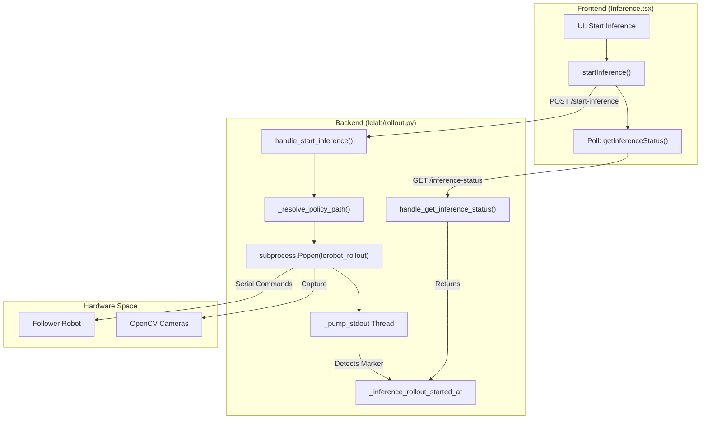
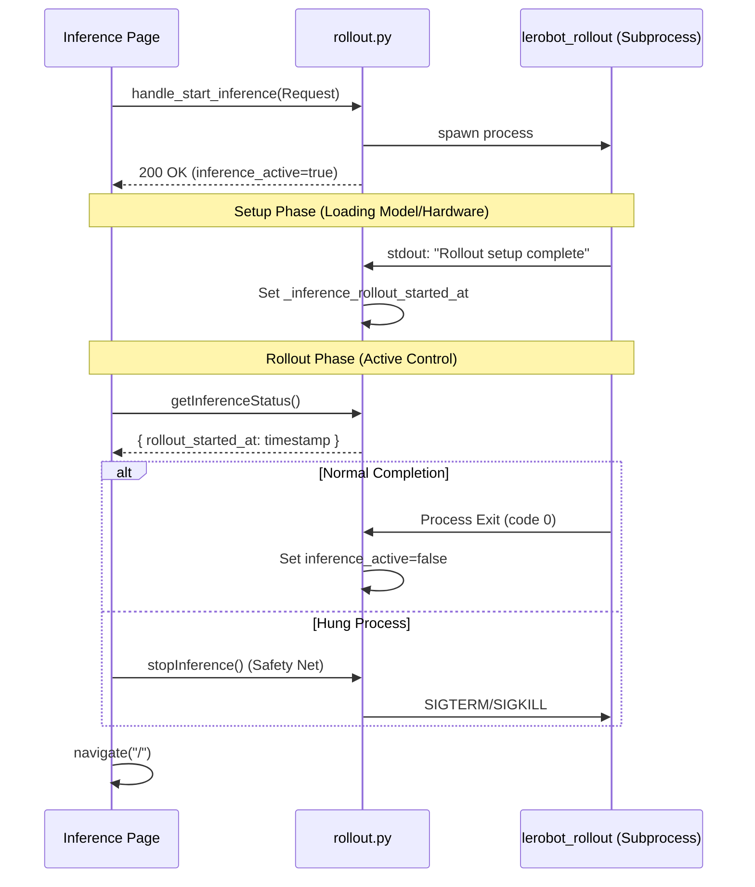

<!-- source: DeepWiki mcp.deepwiki.com · repo huggingface/leLab · page 3.4 Inference (Policy Rollout) · fetched 2026-10-26 -->

# Inference (Policy Rollout)

Relevant source files

The following files were used as context for generating this wiki page:

- [frontend/src/components/training/WandbInstallDialog.tsx](frontend/src/components/training/WandbInstallDialog.tsx)
- [frontend/src/lib/checkpointsApi.ts](frontend/src/lib/checkpointsApi.ts)
- [frontend/src/lib/inferenceApi.ts](frontend/src/lib/inferenceApi.ts)
- [frontend/src/lib/jobsApi.ts](frontend/src/lib/jobsApi.ts)
- [frontend/src/pages/Inference.tsx](frontend/src/pages/Inference.tsx)
- [lelab/rollout.py](lelab/rollout.py)

The Inference module is responsible for executing trained policies on the SO-101 robot hardware. It orchestrates a one-shot "rollout" session where a model (either local or from the Hugging Face Hub) drives the follower robot's motors based on real-time camera feedback. This module mirrors the architecture of teleoperation and recording but executes `lerobot.scripts.lerobot_rollout` as a managed subprocess.

## Core Implementation

Inference is managed as a single global session in the backend to ensure mutual exclusion with other hardware-access modules.

### InferenceRequest Model
The `InferenceRequest` Pydantic model defines the parameters required to start a rollout:
*   `follower_port`: Serial port for the follower robot.
*   `follower_config`: The robot configuration ID used to locate calibration files.
*   `policy_ref`: An opaque reference to the policy checkpoint (local path or Hub string).
*   `cameras`: A mapping of camera names to their hardware configurations (index, resolution, fps).
*   `duration_s`: The maximum length of the rollout in seconds.

Sources: `[lelab/rollout.py:44-50]()`

### Policy Resolution and Device Detection
Before spawning the inference subprocess, the system resolves the `policy_ref` into a local directory path. If the reference matches a Hugging Face Hub pattern (`repo@checkpoints/step`), it uses `snapshot_download` to fetch only the required `pretrained_model` files `[lelab/rollout.py:111-132]()`.

The system also automatically detects the best available compute device (CUDA > MPS > CPU) to pass to the policy `[lelab/rollout.py:97-108]()`.

### Subprocess Orchestration
The rollout is executed via `subprocess.Popen` calling `lerobot.scripts.lerobot_rollout` `[lelab/rollout.py:188-232]()`.
*   **Stdin Seeding**: The process is seeded with `\n` to bypass any "Press Enter to start" prompts in the underlying script `[lelab/rollout.py:234-235]()`.
*   **Stdout Pump**: A dedicated thread `_pump_stdout` reads the subprocess output, tees it to a log file, and watches for the `_ROLLOUT_START_MARKER` ("Rollout setup complete") `[lelab/rollout.py:69-95]()`.
*   **Shutdown**: The `handle_stop_inference` function attempts a `SIGTERM` followed by a `SIGKILL` if the process does not exit within 2 seconds, ensuring the serial bus is released `[lelab/rollout.py:284-315]()`.

Sources: `[lelab/rollout.py:66-66]()`, `[lelab/rollout.py:69-95]()`, `[lelab/rollout.py:284-315]()`

## Inference Data Flow

The following diagram illustrates the transition from the frontend request to the backend subprocess management.

### System Entity Mapping: Frontend to Backend
| Frontend Concept | Code Entity | Role |
| :--- | :--- | :--- |
| **Start Button** | `startInference` | API call to `/start-inference` `[frontend/src/lib/inferenceApi.ts:31-42]()` |
| **Inference Page** | `Inference.tsx` | UI state machine (Setup vs. Running) `[frontend/src/pages/Inference.tsx:33-33]()` |
| **Policy Selector** | `JobCheckpoint` | Metadata for selecting model steps `[frontend/src/lib/checkpointsApi.ts:3-7]()` |
| **Backend Controller** | `handle_start_inference` | Logic for mutex checks and process spawning `[lelab/rollout.py:149-149]()` |
| **Hardware Driver** | `lerobot_rollout` | The LeRobot script running in a subprocess `[lelab/rollout.py:20-21]()` |

Sources: `[lelab/rollout.py:149-180]()`, `[frontend/src/pages/Inference.tsx:54-74]()`, `[frontend/src/lib/inferenceApi.ts:31-63]()`

## Inference Frontend Lifecycle

The Inference page (`frontend/src/pages/Inference.tsx`) manages two distinct phases: **Setup** and **Rollout**.

### Phase Management
1.  **Setup Phase**: The backend is loading the policy, downloading weights, and connecting to hardware. The UI displays "SETTING UP" with an amber pulsing timer `[frontend/src/pages/Inference.tsx:148-154]()`.
2.  **Rollout Phase**: Once the `_ROLLOUT_START_MARKER` is detected in the logs, the backend sets `rollout_started_at`. The UI switches to "RUNNING" with a green timer and progress bar `[frontend/src/pages/Inference.tsx:140-154]()`.

### Safety Mechanisms
*   **Hung Inference Protection**: The frontend monitors `rollout_elapsed_s`. If the rollout exceeds the user-defined `duration_s` by more than 10 seconds without the subprocess exiting, the frontend automatically triggers `stopInference` as a safety net `[frontend/src/pages/Inference.tsx:79-96]()`.
*   **Auto-Bounce**: Upon successful completion (or failure), the page displays a toast with the exit status and automatically navigates the user back to the Landing page `[frontend/src/pages/Inference.tsx:59-74]()`.

### Process Orchestration Diagram

Sources: `[lelab/rollout.py:69-89]()`, `[frontend/src/pages/Inference.tsx:59-96]()`, `[lelab/rollout.py:284-315]()`

## API Endpoints

| Endpoint | Method | Function | Description |
| :--- | :--- | :--- | :--- |
| `/start-inference` | POST | `handle_start_inference` | Spawns the rollout subprocess if mutex is clear. |
| `/stop-inference` | POST | `handle_stop_inference` | Signals the subprocess to terminate. |
| `/inference-status` | GET | `handle_get_inference_status` | Returns timing, logs, and process state. |

Sources: `[lelab/rollout.py:149-149]()`, `[lelab/rollout.py:284-284]()`, `[lelab/rollout.py:257-257]()`

---

