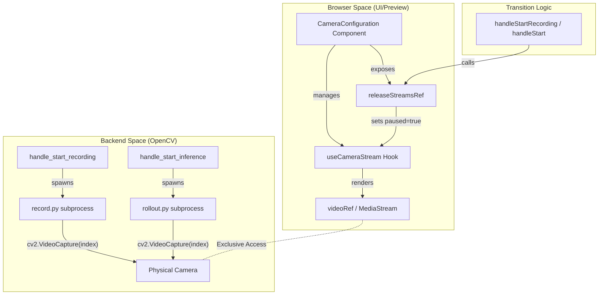

<!-- source: DeepWiki mcp.deepwiki.com · repo huggingface/leLab · page 4 Camera Management · fetched 2026-10-26 -->

# Camera Management

Relevant source files

The following files were used as context for generating this wiki page:

- [frontend/dist/index.html](frontend/dist/index.html)
- [frontend/src/components/landing/InferenceModal.tsx](frontend/src/components/landing/InferenceModal.tsx)
- [frontend/src/components/recording/CameraConfiguration.tsx](frontend/src/components/recording/CameraConfiguration.tsx)
- [lelab/server.py](lelab/server.py)

LeLab provides a unified system for managing camera hardware across the browser (for real-time user previews) and the Python backend (for dataset recording and policy inference). Because physical camera devices are often exclusive-access resources, LeLab implements a specific **Hardware Contention Lifecycle** to ensure that browser-side previews are released before backend OpenCV processes attempt to capture the stream.

## Hardware Contention Lifecycle

The primary challenge in LeLab's camera management is the handoff between the browser's `MediaDevices` API and the backend's `cv2.VideoCapture`. On most operating systems, a camera opened by the browser cannot be simultaneously opened by a backend subprocess.

LeLab manages this through a coordinated release protocol:
1.  **Preview Phase**: The frontend uses `useCameraStream` to display live feeds in the `CameraConfiguration` or `InferenceModal` components [frontend/src/components/recording/CameraConfiguration.tsx:155-164]().
2.  **Release Signal**: When a user clicks "Start Recording" or "Start Inference", the application invokes a `releaseStreamsRef` callback [frontend/src/components/recording/CameraConfiguration.tsx:32-38]().
3.  **Handoff**: The browser stops all active `MediaStreamTrack` objects. Once the tracks are stopped, the frontend triggers the backend API call [frontend/src/components/landing/InferenceModal.tsx:207-213]().
4.  **Backend Capture**: The backend subprocess (OpenCV) initializes its own capture session using the synchronized camera indices [lelab/record.py:165-175]().

### Entity Mapping: Lifecycle & Hardware

The following diagram bridges the natural language concepts of "Preview" and "Handoff" to the specific code entities that implement them.

Title: Camera Lifecycle Entity Mapping

Sources: [frontend/src/components/recording/CameraConfiguration.tsx:32-38](), [frontend/src/components/recording/CameraConfiguration.tsx:155-164](), [frontend/src/components/landing/InferenceModal.tsx:207-213](), [lelab/record.py:165-175]()

## Camera Index Synchronization

LeLab must reconcile two different ways of identifying cameras:
*   **Browser `deviceId`**: A stable, origin-specific UUID used by the browser to remember a specific physical device.
*   **OpenCV `camera_index`**: An integer (0, 1, 2...) used by the backend. On macOS, these indices are notoriously unstable and can shift if devices are plugged/unplugged.

The `CameraConfiguration` component solves this by storing both. On initialization, it uses the `useAvailableCameras` hook to refresh the `camera_index` by matching the stable `deviceId` against the current hardware list [frontend/src/components/recording/CameraConfiguration.tsx:54-71]().

### Backend Enumeration Workaround
On macOS, standard OpenCV enumeration often fails to match the order expected by the system. LeLab uses a specialized subprocess `_avfoundation_cameras_in_cv2_order` in the backend to ensure the indices provided to the frontend match what OpenCV will actually open [lelab/server.py:273-305]().

Sources: [frontend/src/components/recording/CameraConfiguration.tsx:18-27](), [lelab/server.py:273-305]()

## Key Components

### CameraConfiguration
The primary interface for binding physical cameras to logical names (e.g., "laptop", "base", "hand"). It allows users to set resolution and FPS targets which are then persisted in the `RobotRecord` [frontend/src/components/recording/CameraConfiguration.tsx:114-124]().

### useAvailableCameras
A hook that polls the `/available-cameras` backend endpoint. It returns a list of cameras including their OpenCV index and their browser-compatible `deviceId` [frontend/src/hooks/useAvailableCameras.ts:1-20]().

### CameraPreview & CameraThumbnail
Lightweight components used to render the stream. They listen to the `paused` prop to automatically drop the `MediaStream` when the hardware handoff begins [frontend/src/components/landing/InferenceModal.tsx:37-61]().

| Component/Hook | Responsibility | File |
| :--- | :--- | :--- |
| `CameraConfiguration` | UI for adding/removing cameras and syncing indices. | [frontend/src/components/recording/CameraConfiguration.tsx:35-39]() |
| `useCameraStream` | Manages `MediaStream` lifecycle and `video` element refs. | [frontend/src/hooks/useCameraStream.ts:1-15]() |
| `OpenCVCameraConfig` | Backend Pydantic model for camera parameters. | [lelab/record.py:75-84]() |

## Child Pages

For detailed implementation specifics, refer to the following sub-pages:

*   **[Browser Camera Streams](#4.1)**: Deep dive into the React hooks, the `MediaStream` lifecycle, and the frontend release protocol.
*   **[Backend Camera Enumeration](#4.2)**: Details on the macOS AVFoundation workaround, OpenCV backend selection (V4L2 vs AVFoundation), and index discovery.

---

