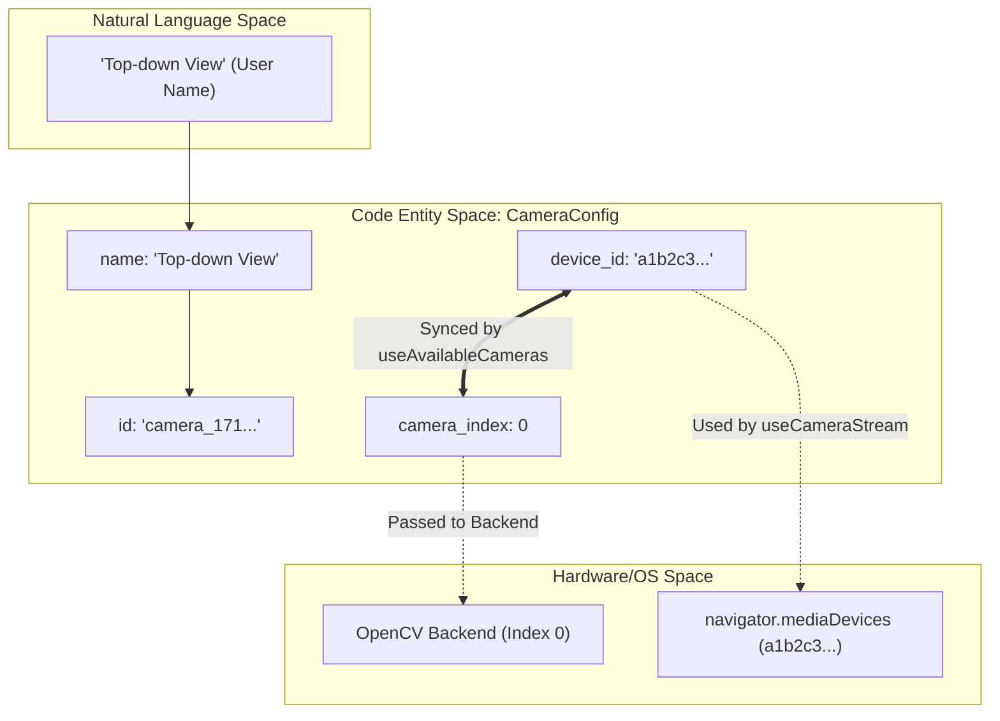
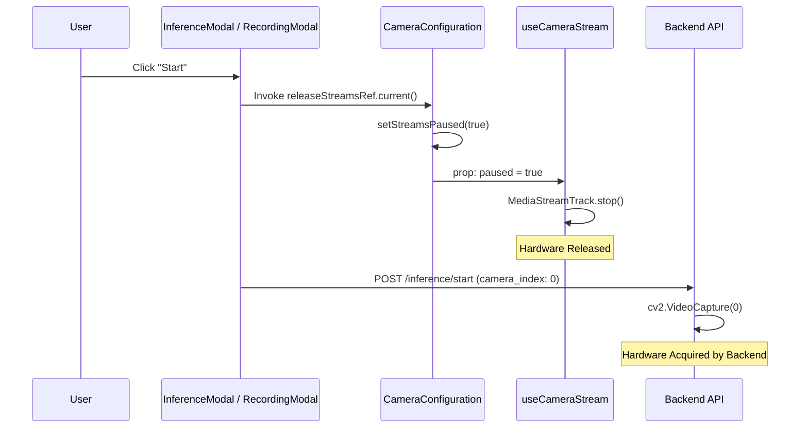

<!-- source: DeepWiki mcp.deepwiki.com · repo huggingface/leLab · page 4.1 Browser Camera Streams · fetched 2026-10-26 -->

# Browser Camera Streams

Relevant source files

The following files were used as context for generating this wiki page:

- [frontend/dist/index.html](frontend/dist/index.html)
- [frontend/src/components/landing/InferenceModal.tsx](frontend/src/components/landing/InferenceModal.tsx)
- [frontend/src/components/recording/CameraConfiguration.tsx](frontend/src/components/recording/CameraConfiguration.tsx)
- [frontend/src/hooks/useAvailableCameras.ts](frontend/src/hooks/useAvailableCameras.ts)
- [frontend/src/hooks/useCameraStream.ts](frontend/src/hooks/useCameraStream.ts)

The frontend camera subsystem manages the lifecycle of browser-side camera previews and ensures a clean handoff to the backend's OpenCV-based recording and inference engines. Because many operating systems and hardware drivers allow only a single process to access a camera device at once, LeLab implements a strict "release-before-handoff" protocol.

## Camera Configuration and Synchronization

The `CameraConfiguration` component manages the list of cameras associated with a robot record. It bridges the gap between the browser's stable `deviceId` and the backend's volatile `camera_index`.

### Data Structures and Interfaces
The `CameraConfig` interface defines how a camera is persisted and used:
*   **`camera_index`**: The integer index used by OpenCV (`cv2.VideoCapture(index)`) on the backend [[frontend/src/components/recording/CameraConfiguration.tsx:22-22]]().
*   **`device_id`**: The browser-specific unique identifier. This is used to maintain a stable link to a physical device even if indices shift [[frontend/src/components/recording/CameraConfiguration.tsx:23-23]]().

### Index Re-sync Logic
On macOS (AVFoundation), plugging or unplugging USB devices can shift the indices assigned to cameras [[frontend/src/components/recording/CameraConfiguration.tsx:49-53]](). To prevent the backend from opening the wrong physical device, `CameraConfiguration` uses a `useEffect` hook to automatically refresh the `camera_index` of all configured cameras whenever the list of available cameras changes, matching them by their stable browser `device_id` [[frontend/src/components/recording/CameraConfiguration.tsx:54-71]]().

### The `useAvailableCameras` Hook
This hook enumerates system cameras by combining two data sources:
1.  **Browser Enumeration**: Calls `navigator.mediaDevices.enumerateDevices()` to get `deviceId` and `label` [[frontend/src/hooks/useAvailableCameras.ts:42-44]]().
2.  **Backend Enumeration**: Fetches the ordered list of indices from the `/available-cameras` endpoint [[frontend/src/hooks/useAvailableCameras.ts:46-51]]().

The hook performs a fuzzy string match between the browser's `label` (often modified by the OS/Browser) and the backend's reported device name to create a unified `AvailableCamera` object [[frontend/src/hooks/useAvailableCameras.ts:62-81]]().

**Sources:**
*   [frontend/src/components/recording/CameraConfiguration.tsx:18-27]()
*   [frontend/src/components/recording/CameraConfiguration.tsx:49-71]()
*   [frontend/src/hooks/useAvailableCameras.ts:24-102]()

## Stream Lifecycle and Management

Live previews are managed via the `useCameraStream` hook, which handles the `MediaStream` lifecycle.

### The `useCameraStream` Hook
This hook attaches a camera feed to a `<video>` element. It handles:
*   **Initialization**: Requesting access via `getUserMedia` using a specific `deviceId` [[frontend/src/hooks/useCameraStream.ts:23-25]]().
*   **Cleanup**: Automatically stopping all tracks when the component unmounts to free the hardware [[frontend/src/hooks/useCameraStream.ts:39-42]]().
*   **Pausing**: If the `paused` prop is true, the hook stops the stream, allowing other processes (like the backend recorder) to claim the device [[frontend/src/hooks/useCameraStream.ts:13-16]]().

### Camera Preview Components
*   **`CameraPreview`**: (Internal to `CameraConfiguration`) Used during setup to verify the camera feed.
*   **`CameraThumbnail`**: Used in the `InferenceModal` to show the currently bound cameras for a specific policy [[frontend/src/components/landing/InferenceModal.tsx:37-61]]().

### Stream Release Protocol
Before a recording or inference session begins, the frontend must release all browser-side camera streams. This is orchestrated through a `releaseStreamsRef` [[frontend/src/components/recording/CameraConfiguration.tsx:32-32]]().

1.  The `CameraConfiguration` component populates the ref with a `releaseAllCameraStreams` callback [[frontend/src/components/recording/CameraConfiguration.tsx:160-164]]().
2.  When the user clicks "Start Recording" or "Start Inference", the parent component calls this function [[frontend/src/components/recording/CameraConfiguration.tsx:156-158]]().
3.  This sets a `paused` state which propagates to all `useCameraStream` hooks, calling `track.stop()` on every active stream [[frontend/src/hooks/useCameraStream.ts:39-42]]().
4.  Only after the streams are released does the frontend send the API request to the backend to start the hardware-intensive process [[frontend/src/components/landing/InferenceModal.tsx:212-213]]().

**Sources:**
*   [frontend/src/hooks/useCameraStream.ts:8-46]()
*   [frontend/src/components/recording/CameraConfiguration.tsx:155-164]()
*   [frontend/src/components/landing/InferenceModal.tsx:37-61]()

## System Integration Diagrams

### Camera Entity Mapping
This diagram shows how different identifiers for the same physical camera are associated across the system.

**Sources:**
*   [frontend/src/components/recording/CameraConfiguration.tsx:18-27]()
*   [frontend/src/hooks/useAvailableCameras.ts:62-81]()

### Stream Release Sequence
The following sequence ensures that the backend does not encounter "Device Busy" errors when attempting to start a session.

**Sources:**
*   [frontend/src/components/recording/CameraConfiguration.tsx:155-164]()
*   [frontend/src/hooks/useCameraStream.ts:39-42]()
*   [frontend/src/components/landing/InferenceModal.tsx:212-213]()

---

