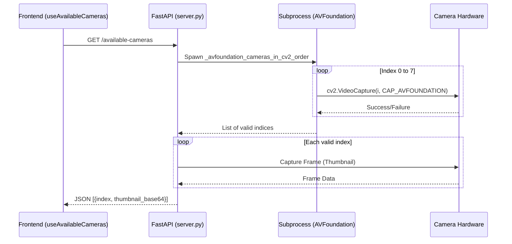
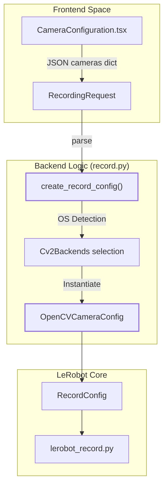

<!-- source: DeepWiki mcp.deepwiki.com · repo huggingface/leLab · page 4.2 Backend Camera Enumeration · fetched 2026-10-26 -->

# Backend Camera Enumeration

Relevant source files

The following files were used as context for generating this wiki page:

- [lelab/record.py](lelab/record.py)
- [lelab/rollout.py](lelab/rollout.py)
- [lelab/server.py](lelab/server.py)

The LeLab backend provides a robust mechanism for discovering and configuring cameras across different operating systems. This system addresses specific hardware instabilities on macOS and ensures that camera indices selected in the frontend GUI are accurately mapped to the underlying OpenCV backends used during dataset recording and policy rollout.

## The macOS AVFoundation Challenge

On macOS, OpenCV's default camera enumeration (using `cv2.CAP_ANY`) is notoriously unstable. Camera indices can shift between process restarts or even between different calls within the same process. To solve this, LeLab implements a specialized discovery routine that forces the use of the `AVFOUNDATION` backend.

### Subprocess Enumeration Workaround
In `lelab/server.py`, the `_avfoundation_cameras_in_cv2_order` function executes a short-lived Python subprocess. This subprocess explicitly iterates through indices using `cv2.VideoCapture(i, cv2.CAP_AVFOUNDATION)` to build a stable map of available hardware devices [lelab/server.py:284-314]().

### Data Flow: Discovery to Frontend
The `/available-cameras` endpoint orchestrates this discovery. It captures a thumbnail from every detected camera to allow users to visually identify which index corresponds to which physical device (e.g., "Top" vs. "Wrist") [lelab/server.py:330-385]().

**Camera Discovery Sequence**

Sources: [lelab/server.py:284-314](), [lelab/server.py:330-385]()

## Backend Selection Logic

To maintain consistency between the visual preview in the browser and the actual recording/inference processes, LeLab pins the OpenCV backend based on the host operating system. This prevents the "silent reordering" bug where a camera assigned to index `0` in the UI might be opened as index `1` by a different backend driver.

| Operating System | OpenCV Backend (`Cv2Backends`) | Rationale |
| :--- | :--- | :--- |
| **macOS (Darwin)** | `AVFOUNDATION` | Overcomes index instability of `CAP_ANY`. |
| **Linux** | `V4L2` | Standard Video4Linux2 interface for robotics. |
| **Other** | `ANY` | Default fallback. |

This logic is encapsulated in `create_record_config` [lelab/record.py:98-103]() and used to instantiate `OpenCVCameraConfig` objects [lelab/record.py:115-121]().

Sources: [lelab/record.py:87-124](), [lelab/rollout.py:135-146]()

## Implementation Details

### Camera Configuration Mapping
The system bridges the gap between the frontend's simplified `camera_index` and the backend's requirement for structured configuration.

1.  **Recording**: The `RecordingRequest` contains a `cameras` dictionary [lelab/record.py:56-74](). The `create_record_config` function iterates through this, converting each entry into an `OpenCVCameraConfig` with the pinned backend [lelab/record.py:110-124]().
2.  **Inference**: The `InferenceRequest` also passes a camera dictionary [lelab/rollout.py:44-50](). The `_format_cameras_arg` function converts this into a CLI-compatible string format (e.g., `{laptop: {index_or_path: 0, ...}}`) to be passed to the `lerobot_rollout` subprocess [lelab/rollout.py:135-146]().

### Code Entity Association

The following diagram illustrates how frontend camera requests are transformed into `LeRobot` configuration entities.

Sources: [lelab/record.py:56-74](), [lelab/record.py:87-170](), [lelab/rollout.py:44-50]()

## Integration with Hardware Workflows

When a recording or rollout session starts, the backend ensures that the cameras are initialized with the exact parameters (width, height, FPS) specified during the enumeration phase.

-   **Mutual Exclusion**: Both `handle_start_recording` and `handle_start_inference` check a global `_state_lock` to ensure that camera hardware is not accessed by multiple processes simultaneously [lelab/record.py:192-205](), [lelab/rollout.py:158-179]().
-   **CLI Argument Passing**: For policy rollouts, the camera configuration is serialized into a string and passed via the `--robot.cameras` argument to the `lerobot` script [lelab/rollout.py:210-220]().

### Summary of Key Functions

| Function | Location | Role |
| :--- | :--- | :--- |
| `_avfoundation_cameras_in_cv2_order` | `lelab/server.py` | macOS-specific subprocess for stable indexing. |
| `create_record_config` | `lelab/record.py` | Converts API requests into `LeRobot` config objects. |
| `_format_cameras_arg` | `lelab/rollout.py` | Formats camera dicts for CLI subprocess execution. |
| `/available-cameras` | `lelab/server.py` | API endpoint for hardware discovery and thumbnails. |

Sources: [lelab/server.py:284-314](), [lelab/record.py:87-170](), [lelab/rollout.py:135-146](), [lelab/server.py:330-385]()

---

