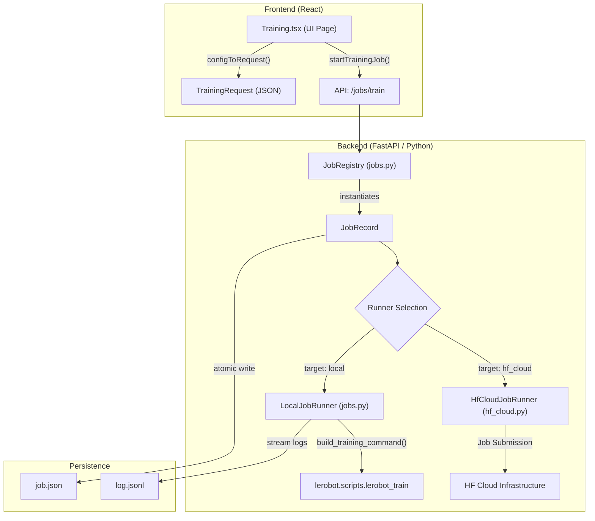
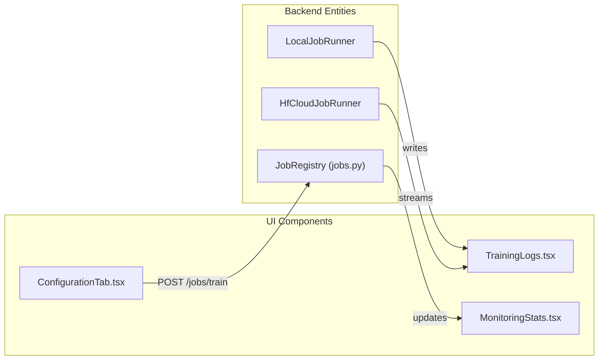

<!-- source: DeepWiki mcp.deepwiki.com · repo huggingface/leLab · page 5 Training System · fetched 2026-10-26 -->

# Training System

Relevant source files

The following files were used as context for generating this wiki page:

- [frontend/src/components/landing/HfAuthBanner.tsx](frontend/src/components/landing/HfAuthBanner.tsx)
- [frontend/src/components/training/ConfigurationTab.tsx](frontend/src/components/training/ConfigurationTab.tsx)
- [frontend/src/components/training/TrainingExtraGate.tsx](frontend/src/components/training/TrainingExtraGate.tsx)
- [frontend/src/components/training/types.ts](frontend/src/components/training/types.ts)
- [frontend/src/pages/Training.tsx](frontend/src/pages/Training.tsx)
- [lelab/datasets.py](lelab/datasets.py)
- [lelab/runners/__init__.py](lelab/runners/__init__.py)
- [lelab/train.py](lelab/train.py)

The Training System in LeLab provides a unified interface for fine-tuning LeRobot policies. It abstracts the complexity of `lerobot-train` CLI arguments into a structured configuration UI and manages the execution of training jobs either on the user's local machine or on Hugging Face Cloud infrastructure.

## System Architecture

The training pipeline is built around a centralized `JobRegistry` that manages the lifecycle of training tasks. Users configure a `TrainingRequest` through the frontend, which is then dispatched to a specific `JobRunner` implementation based on the selected target.

### Training Flow Diagram
This diagram illustrates how a user's configuration in the "Natural Language Space" (UI) translates into "Code Entity Space" objects and execution.

**Sources:** [frontend/src/pages/Training.tsx:67-96](), [lelab/train.py:28-87](), [lelab/train.py:89-104]()

## Training Request Schema

All training jobs are defined by the `TrainingRequest` Pydantic model. This schema ensures that parameters like batch size, learning rate, and dataset repository IDs are validated before execution.

| Category | Key Parameters |
| :--- | :--- |
| **Dataset** | `dataset_repo_id`, `dataset_episodes` |
| **Policy** | `policy_type` (e.g., ACT, Diffusion), `policy_device`, `policy_use_amp` |
| **Hyperparameters** | `steps`, `batch_size`, `optimizer_lr`, `optimizer_type` |
| **Logging** | `wandb_enable`, `wandb_project`, `log_freq`, `save_freq` |

**Sources:** [lelab/train.py:28-87](), [frontend/src/components/training/types.ts:1-44]()

## Execution Targets

LeLab supports two primary execution environments, managed by distinct runner implementations.

### Local Runner
The `LocalJobRunner` executes training as a background subprocess on the host machine. It uses the same Python interpreter as the LeLab server to ensure all dependencies are available. It handles real-time metric parsing from `tqdm` output and manages local log persistence.
For details, see [Job Registry and Local Runner](#5.2).

### Hugging Face Cloud Runner
The `HfCloudJobRunner` offloads computation to Hugging Face's managed infrastructure. It handles dataset synchronization to the Hub, secret injection (tokens), and provides a dual-thread monitoring system to poll job status and tail logs via SSE.
For details, see [Hugging Face Cloud Runner](#5.3).

**Sources:** [lelab/runners/__init__.py:15-20](), [frontend/src/pages/Training.tsx:107-126]()

## Job Lifecycle and Monitoring

Training jobs progress through a defined state machine: `pending` → `running` → `completed` (or `failed`/`stopped`).

1.  **Configuration**: Users define parameters in the [Training Configuration UI](#5.1).
2.  **Submission**: The `JobRegistry` creates a `JobRecord` and starts the runner.
3.  **Real-time Monitoring**: The [Training Monitoring UI](#5.4) connects to the backend to stream logs and visualize metrics like loss and learning rate.
4.  **Checkpointing**: As the job runs, checkpoints are discovered and indexed, allowing users to select them later for inference.

### Component Relationship Diagram
This diagram shows how UI components interact with backend logic to manage job state.

**Sources:** [frontend/src/pages/Training.tsx:41-65](), [frontend/src/components/training/ConfigurationTab.tsx:17-44](), [lelab/train.py:15-19]()

## Environment Requirements

Training requires specific dependencies (e.g., `accelerate`). LeLab includes a "Training Extra Gate" that detects if these packages are missing and provides an in-app installation workflow.

**Sources:** [frontend/src/components/training/TrainingExtraGate.tsx:15-54](), [frontend/src/pages/Training.tsx:146-154]()

---

## Sub-pages
*   [Training Configuration UI](#5.1) — Details on the form cards and dataset picker.
*   [Job Registry and Local Runner](#5.2) — Deep dive into subprocess management and metric parsing.
*   [Hugging Face Cloud Runner](#5.3) — Technical details on cloud job submission and remote monitoring.
*   [Training Monitoring UI](#5.4) — Overview of the real-time log viewer and metric charts.

---

