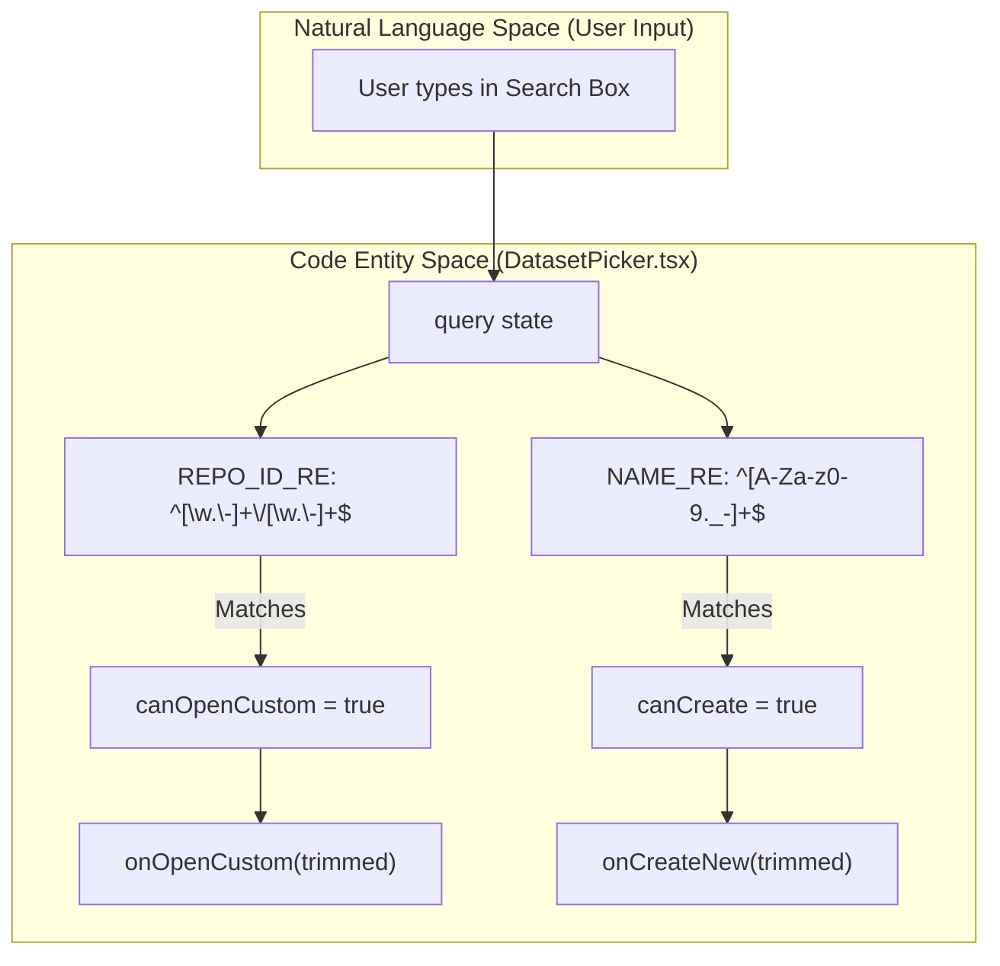
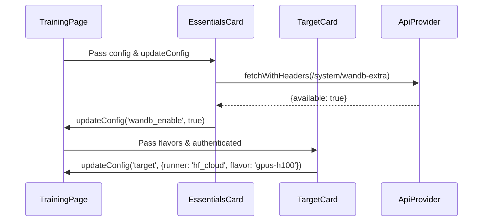

<!-- source: DeepWiki mcp.deepwiki.com · repo huggingface/leLab · page 5.1 Training Configuration UI · fetched 2026-10-26 -->

# Training Configuration UI

Relevant source files

The following files were used as context for generating this wiki page:

- [frontend/src/components/landing/DatasetPicker.tsx](frontend/src/components/landing/DatasetPicker.tsx)
- [frontend/src/components/training/TrainingHeader.tsx](frontend/src/components/training/TrainingHeader.tsx)
- [frontend/src/components/training/config/AdvancedCard.tsx](frontend/src/components/training/config/AdvancedCard.tsx)
- [frontend/src/components/training/config/EssentialsCard.tsx](frontend/src/components/training/config/EssentialsCard.tsx)
- [frontend/src/components/training/config/TargetCard.tsx](frontend/src/components/training/config/TargetCard.tsx)
- [frontend/src/components/ui/command.tsx](frontend/src/components/ui/command.tsx)

The Training Configuration UI provides a structured interface for defining the parameters of a machine learning training job. It is composed of modular cards that manage different aspects of the `TrainingRequest` schema, including dataset selection, policy architecture, hardware target allocation, and advanced optimization parameters.

## Essentials Configuration

The `EssentialsCard` component handles the primary parameters required for any training run. It integrates the `DatasetCombobox` for repository selection and manages the integration with Weights & Biases (W&B).

### W&B Pre-flight Check
Before enabling W&B, the UI performs a pre-flight check by calling the `/system/wandb-extra` endpoint [frontend/src/components/training/config/EssentialsCard.tsx:40-42](). This ensures that the `wandb` package is installed in the backend environment. If missing, it triggers the `WandbInstallDialog` [frontend/src/components/training/config/EssentialsCard.tsx:145-149]().

### Data Flow: Essentials
| Field | Component | Description |
| :--- | :--- | :--- |
| `dataset_repo_id` | `DatasetCombobox` | Searchable picker for Hub/local datasets [frontend/src/components/training/config/EssentialsCard.tsx:64-71](). |
| `policy_type` | `Select` | Choice of architecture (e.g., `act`, `diffusion`, `pi0`) [frontend/src/components/training/config/EssentialsCard.tsx:83-101](). |
| `steps` | `NumberInput` | Total training iterations [frontend/src/components/training/config/EssentialsCard.tsx:108-116](). |
| `batch_size` | `NumberInput` | Samples per gradient update [frontend/src/components/training/config/EssentialsCard.tsx:122-130](). |
| `wandb_enable` | `Switch` | Toggle for experiment tracking [frontend/src/components/training/config/EssentialsCard.tsx:133-142](). |

**Sources:**
- [frontend/src/components/training/config/EssentialsCard.tsx:25-170]()
- [frontend/src/components/training/config/EssentialsCard.tsx:40-52]() for pre-flight logic.

## Advanced Parameters

The `AdvancedCard` is a collapsible section [frontend/src/components/training/config/AdvancedCard.tsx:25-51]() containing lower-level configurations for the training engine.

### Implementation Details
- **Policy Settings**: Configures the compute device (`cuda`, `cpu`, `mps`) and Automatic Mixed Precision (AMP) [frontend/src/components/training/config/AdvancedCard.tsx:56-87]().
- **Optimizer**: Supports `Adam`, `AdamW`, `SGD`, and `Multi Adam` [frontend/src/components/training/config/AdvancedCard.tsx:132-145](). It allows fine-grained control over Learning Rate, Weight Decay, and Gradient Clipping [frontend/src/components/training/config/AdvancedCard.tsx:147-180]().
- **Reproducibility**: Includes fields for the random `seed` and the number of data loading `workers` [frontend/src/components/training/config/AdvancedCard.tsx:93-121]().

**Sources:**
- [frontend/src/components/training/config/AdvancedCard.tsx:24-180]()

## Compute Target and Costing

The `TargetCard` component allows users to switch between local execution and Hugging Face Cloud runners.

### Runner Selection Logic
The component maps the UI selection to the `target` object in the training configuration [frontend/src/components/training/config/TargetCard.tsx:37-48]().
- **Local**: Runs on the user's machine (free).
- **HF Cloud**: Requires `authenticated` state. It iterates through available `flavors` (GPU types) and displays their hourly cost [frontend/src/components/training/config/TargetCard.tsx:64-79]().

### Cost Display
Hourly costs are calculated based on `unit_cost_usd` and `unit_label` (e.g., converting per-minute rates to per-hour) [frontend/src/components/training/config/TargetCard.tsx:20-23]().

**Sources:**
- [frontend/src/components/training/config/TargetCard.tsx:30-90]()

## Dataset Selection Component

The `DatasetPicker` (and its specialized training wrapper `DatasetCombobox`) provides a unified interface for finding datasets across local storage and the Hugging Face Hub.

### Search and Filtering Logic
The picker uses a regex-based validation system to determine if a user input is a simple name or a full Repository ID [frontend/src/components/landing/DatasetPicker.tsx:27-28]().

### UI Entity Mapping: Dataset Selection
The following diagram maps the UI interaction states to the internal validation logic.

**Sources:**
- [frontend/src/components/landing/DatasetPicker.tsx:27-57]()
- [frontend/src/components/landing/DatasetPicker.tsx:115-130]()

## Configuration State Management

Training configuration is managed as a unified object passed through `ConfigComponentProps`.

### Data Flow Architecture
The configuration flows from the parent `Training` page down to individual cards. Each card uses an `updateConfig` callback to modify specific keys within the global state.

### Component Hierarchy
1.  **EssentialsCard**: [frontend/src/components/training/config/EssentialsCard.tsx]()
    *   `DatasetCombobox` [frontend/src/components/landing/DatasetPicker.tsx]()
    *   `WandbInstallDialog`
2.  **AdvancedCard**: [frontend/src/components/training/config/AdvancedCard.tsx]()
3.  **TargetCard**: [frontend/src/components/training/config/TargetCard.tsx]()

**Sources:**
- [frontend/src/components/training/config/EssentialsCard.tsx:25-53]()
- [frontend/src/components/training/config/TargetCard.tsx:30-49]()

---

