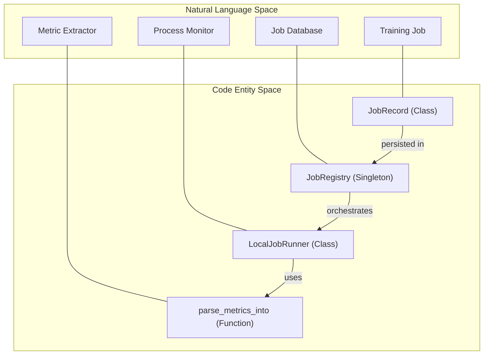
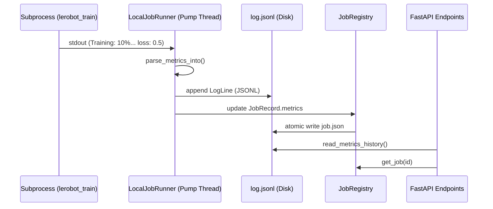

<!-- source: DeepWiki mcp.deepwiki.com · repo huggingface/leLab · page 5.2 Job Registry and Local Runner · fetched 2026-10-26 -->

# Job Registry and Local Runner

Relevant source files

The following files were used as context for generating this wiki page:

- [lelab/datasets.py](lelab/datasets.py)
- [lelab/jobs.py](lelab/jobs.py)
- [lelab/runners/__init__.py](lelab/runners/__init__.py)
- [lelab/train.py](lelab/train.py)
- [tests/test_jobs.py](tests/test_jobs.py)

The Job Registry and Local Runner system manages the lifecycle of training tasks within LeLab. It provides a unified interface for launching training jobs, persisting their state to disk, monitoring real-time metrics through log parsing, and managing subprocesses in a way that survives application reloads.

## System Architecture

The system is built around the `JobRegistry` singleton, which manages a collection of `JobRecord` objects. These records are persisted as `job.json` files within individual job directories. Execution is delegated to a `JobRunner`, with `LocalJobRunner` being the primary implementation for on-machine training.

### Entity Relationship Diagram

The following diagram illustrates how natural language concepts map to specific code entities in the `lelab/jobs.py` module.

Sources: [lelab/jobs.py:49-130](), [lelab/jobs.py:173-206]()

## Job Registry and Persistence

The `JobRegistry` serves as the central authority for all training jobs. It handles discovery of existing jobs on disk and provides thread-safe access to job metadata.

- **Persistence**: Every job has a dedicated directory under `outputs/train/`. Inside, a `job.json` file contains the serialized `JobRecord` [lelab/jobs.py:71-96]().
- **Atomic Writes**: To prevent data corruption, `JobRegistry` writes to a temporary file and uses `os.replace` to update the actual `job.json` [lelab/jobs.py:612-615]().
- **State Recovery**: Upon initialization, the registry scans the output directory and loads all `JobRecord` files. It identifies "running" jobs that have a `process_pid` and attempts to re-attach to them [lelab/jobs.py:530-555]().

### Job State Machine
A job progresses through the following states defined in `JobState`:
- `running`: Subprocess is active.
- `done`: Subprocess exited with code 0.
- `failed`: Subprocess exited with a non-zero code.
- `interrupted`: User manually stopped the job or the system shut down.

Sources: [lelab/jobs.py:46-46](), [lelab/jobs.py:503-520]()

## Local Job Runner Implementation

The `LocalJobRunner` manages a local subprocess using `subprocess.Popen`. It is designed to be decoupled from the main FastAPI thread to ensure that training continues even if the web server restarts.

### Process Lifecycle
1. **Start**: Launches `lerobot_train` using `start_new_session=True` so the subprocess belongs to a new process group and isn't killed if the parent process exits [lelab/jobs.py:348-355]().
2. **Execution**: The runner starts a "pump" thread that reads `stdout` and `stderr` line-by-line [lelab/jobs.py:364-370]().
3. **Logging**: Every line of output is timestamped and appended to a `log.jsonl` file in the job directory [lelab/jobs.py:440-450]().
4. **Metric Parsing**: The pump thread passes each line to `parse_metrics_into`, which uses regex to extract progress from `tqdm` and training stats (loss, learning rate) from LeRobot logs [lelab/jobs.py:173-206]().

### Re-attachment with TailingJobRunner
If LeLab is restarted (e.g., during `uvicorn --reload`), the `JobRegistry` detects that a PID is still alive but no active `LocalJobRunner` instance exists. It then instantiates a `TailingJobRunner` [lelab/jobs.py:466-470](). This runner does not own the process but tails the existing `log.jsonl` to continue providing real-time updates to the UI [lelab/jobs.py:488-498]().

Sources: [lelab/jobs.py:328-460](), [lelab/jobs.py:466-498]()

## Data Flow: From Subprocess to UI

The flow of information from the training script to the frontend involves multiple stages of parsing and buffering.

### Key Functions for Data Access
- **`drain_logs(job_id)`**: Reads the tail of `log.jsonl` to provide recent log messages [lelab/jobs.py:734-754]().
- **`read_metrics_history(job_id)`**: Scans the entire `log.jsonl` and reconstructs a time-series of metrics (loss, lr) for the monitoring charts [lelab/jobs.py:760-785]().
- **`extract_wandb_run_url(line)`**: A specialized regex parser that identifies the Weights & Biases URL in the logs so the UI can provide a direct link to the experiment [lelab/jobs.py:152-158]().

Sources: [lelab/jobs.py:173-206](), [lelab/jobs.py:734-785]()

## Checkpoint Discovery

Training jobs produce checkpoints at a frequency defined in the `TrainingRequest` [lelab/train.py:46-46](). The `JobRegistry` provides a mechanism to discover these on the filesystem.

- **`list_checkpoints(job_id)`**: Scans the job's `checkpoints` directory.
- **`JobCheckpoint`**: Represents a specific step. The `ref` field is an absolute path used by the Inference/Rollout system to load the model [lelab/jobs.py:98-108]().
- **`checkpoint_count`**: A summary field in `JobRecord` that is updated dynamically during list/get operations to reflect the current progress on disk [lelab/jobs.py:93-95]().

Sources: [lelab/jobs.py:98-108](), [lelab/jobs.py:787-805]()

---

