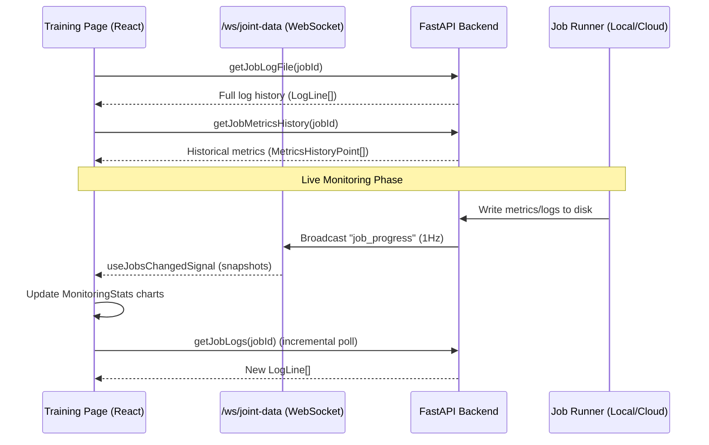
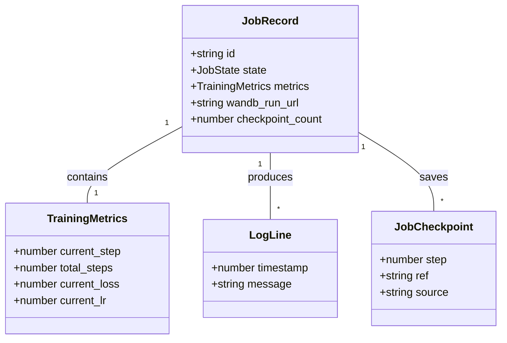
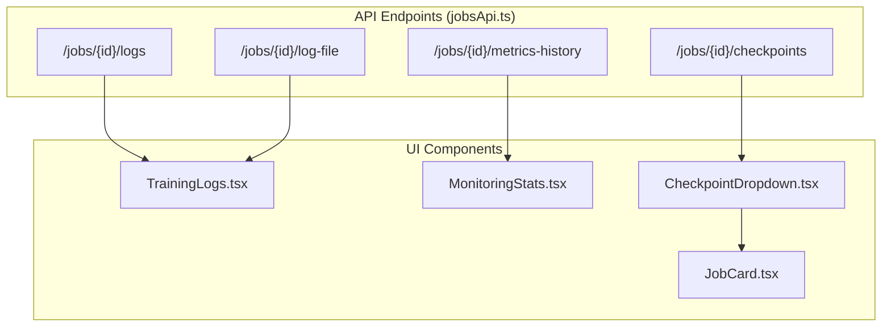

<!-- source: DeepWiki mcp.deepwiki.com · repo huggingface/leLab · page 5.4 Training Monitoring UI · fetched 2026-10-26 -->

# Training Monitoring UI

Relevant source files

The following files were used as context for generating this wiki page:

- [frontend/src/components/jobs/JobCard.tsx](frontend/src/components/jobs/JobCard.tsx)
- [frontend/src/components/jobs/JobsSection.tsx](frontend/src/components/jobs/JobsSection.tsx)
- [frontend/src/components/training/WandbInstallDialog.tsx](frontend/src/components/training/WandbInstallDialog.tsx)
- [frontend/src/components/training/monitoring/MonitoringStats.tsx](frontend/src/components/training/monitoring/MonitoringStats.tsx)
- [frontend/src/components/training/monitoring/TrainingLogs.tsx](frontend/src/components/training/monitoring/TrainingLogs.tsx)
- [frontend/src/hooks/useJobsChangedSignal.ts](frontend/src/hooks/useJobsChangedSignal.ts)
- [frontend/src/lib/checkpointsApi.ts](frontend/src/lib/checkpointsApi.ts)
- [frontend/src/lib/inferenceApi.ts](frontend/src/lib/inferenceApi.ts)
- [frontend/src/lib/jobsApi.ts](frontend/src/lib/jobsApi.ts)
- [frontend/src/pages/Inference.tsx](frontend/src/pages/Inference.tsx)
- [tests/test_datasets.py](tests/test_datasets.py)

The Training Monitoring UI provides a real-time dashboard for observing active training jobs and reviewing historical runs. It facilitates live metric visualization, log streaming, and checkpoint management for both local and Hugging Face Cloud runners.

## Monitoring Lifecycle and Data Flow

The monitoring system employs a dual-strategy for data acquisition: initial seeding followed by real-time updates via WebSockets and polling.

### 1. Log Seeding and Polling
When a user navigates to a specific job's monitoring page, the UI seeds the log buffer by calling `getJobLogFile` [frontend/src/lib/jobsApi.ts:128-141](). This retrieves the full historical log from the backend. Subsequent updates are fetched via `getJobLogs` [frontend/src/lib/jobsApi.ts:113-126](), which typically returns incremental lines. To prevent browser memory exhaustion during long-running jobs, the UI maintains a `MAX_LOG_LINES` buffer cap.

### 2. Real-time Job Progress
The UI utilizes the `useJobsChangedSignal` hook [frontend/src/hooks/useJobsChangedSignal.ts:18-71]() to subscribe to the `/ws/joint-data` WebSocket. This hook handles two critical event types:
*   **`jobs_changed`**: Triggered when a job is submitted, deleted, or finalized by the watchdog. It invokes the `onChange` callback to refresh the job list [frontend/src/hooks/useJobsChangedSignal.ts:44-46]().
*   **`job_progress`**: Pushed by the backend `watchdog` thread at approximately 1Hz. It carries `JobProgressSnapshot` objects containing the latest metrics (loss, learning rate, step count) and W&B URLs [frontend/src/hooks/useJobsChangedSignal.ts:47-52]().

### 3. Metric History
To render continuous charts without requiring the tab to remain open, `MonitoringStats` calls `getJobMetricsHistory` [frontend/src/lib/jobsApi.ts:143-156]() on mount. This seeds the `lossHistory` and `lrHistory` arrays with up to 2,000 historical points [frontend/src/components/training/monitoring/MonitoringStats.tsx:33-77]().

### System Data Flow Diagram

Title: Training Monitoring Data Flow

**Sources:** [frontend/src/lib/jobsApi.ts:113-156](), [frontend/src/hooks/useJobsChangedSignal.ts:18-71](), [frontend/src/components/training/monitoring/MonitoringStats.tsx:33-77]()

---

## Core Monitoring Components

### TrainingLogs
The `TrainingLogs` component [frontend/src/components/training/monitoring/TrainingLogs.tsx:12-51]() renders the `LogEntry` stream in a monospaced, auto-scrolling container. It formats the `timestamp` into a human-readable local time string [frontend/src/components/training/monitoring/TrainingLogs.tsx:38-40]().

### MonitoringStats
This component manages the visualization of training progress and numerical stability.
*   **Progress Bar**: Calculates percentage based on `current_step` and `total_steps` [frontend/src/components/training/monitoring/MonitoringStats.tsx:108-114]().
*   **Loss & LR Charts**: Uses `recharts` to render `LineChart` components. It includes logic to reset histories if the `current_step` regresses (indicating a job restart) [frontend/src/components/training/monitoring/MonitoringStats.tsx:81-87]().
*   **ETA Calculation**: Displays the estimated time remaining provided by the backend's `tqdm` parsing [frontend/src/components/training/monitoring/MonitoringStats.tsx:115-116]().

### Checkpoint Management
The `JobCard` [frontend/src/components/jobs/JobCard.tsx:48-197]() and the monitoring view integrate with the `checkpointsApi`.
*   **`listJobCheckpoints`**: Retrieves available model weights stored in the job's output directory [frontend/src/lib/checkpointsApi.ts:15-28]().
*   **`CheckpointDropdown`**: Allows users to select a specific step for evaluation [frontend/src/components/jobs/JobCard.tsx:178-183]().
*   **Inference Integration**: Clicking the play icon on a checkpoint triggers `onPlay`, which opens the `InferenceModal` with the selected `job.id` and `step` [frontend/src/components/jobs/JobCard.tsx:111-115]().

### Weights & Biases (W&B)
If W&B is enabled, the `JobRecord` contains a `wandb_run_url` [frontend/src/lib/jobsApi.ts:72](). The UI renders an external link to the W&B dashboard. If the `wandb` package is missing, the `WandbInstallDialog` [frontend/src/components/training/WandbInstallDialog.tsx:23-68]() facilitates runtime installation via the `/system/wandb-extra` endpoint.

**Sources:** [frontend/src/components/training/monitoring/TrainingLogs.tsx:12-51](), [frontend/src/components/training/monitoring/MonitoringStats.tsx:81-116](), [frontend/src/lib/checkpointsApi.ts:15-28](), [frontend/src/components/training/WandbInstallDialog.tsx:23-68]()

---

## Code Entity Mapping

The following diagrams map UI concepts to their underlying TypeScript interfaces and API endpoints.

Title: Monitoring UI Entity Mapping

Title: API Endpoint to UI Component Mapping

**Sources:** [frontend/src/lib/jobsApi.ts:3-85](), [frontend/src/lib/checkpointsApi.ts:3-7](), [frontend/src/components/training/monitoring/TrainingLogs.tsx:12-13](), [frontend/src/components/training/monitoring/MonitoringStats.tsx:35-40]()

---

## State Presentation
The UI uses a standardized `statePresentation` mapping to provide visual cues for job status [frontend/src/components/jobs/JobCard.tsx:38-46]():

| State | Label | Icon | Color |
| :--- | :--- | :--- | :--- |
| `running` | Running | `Loader2` (Animated) | `text-green-400` |
| `done` | Done | `CheckCircle2` | `text-slate-400` |
| `failed` | Failed | `XCircle` | `text-red-400` |
| `interrupted` | Interrupted | `AlertTriangle` | `text-amber-400` |

**Sources:** [frontend/src/components/jobs/JobCard.tsx:38-46]()

---

