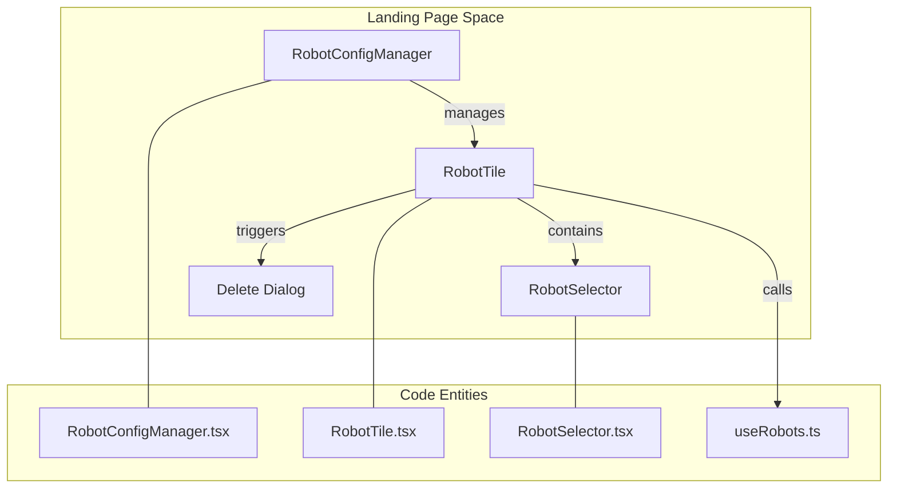
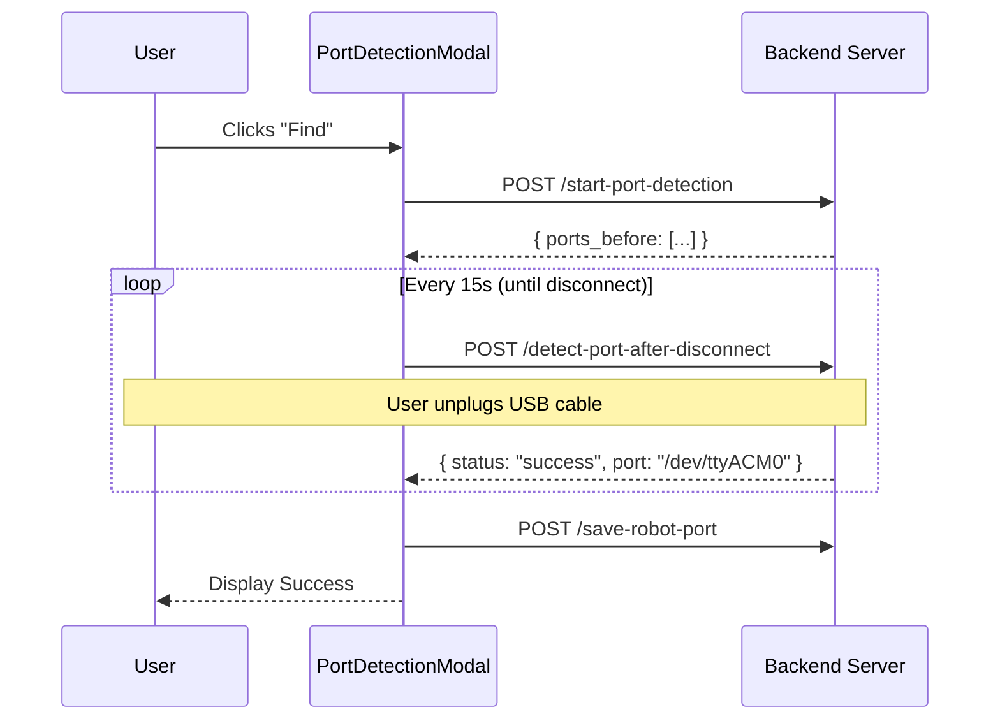

<!-- source: DeepWiki mcp.deepwiki.com · repo huggingface/leLab · page 6.1 Robot Configuration Management · fetched 2026-10-26 -->

# Robot Configuration Management

Relevant source files

The following files were used as context for generating this wiki page:

- [frontend/src/components/landing/RobotConfigManager.tsx](frontend/src/components/landing/RobotConfigManager.tsx)
- [frontend/src/components/landing/RobotSelector.tsx](frontend/src/components/landing/RobotSelector.tsx)
- [frontend/src/components/landing/RobotTile.tsx](frontend/src/components/landing/RobotTile.tsx)
- [frontend/src/components/ui/PortDetectionButton.tsx](frontend/src/components/ui/PortDetectionButton.tsx)
- [frontend/src/components/ui/PortDetectionModal.tsx](frontend/src/components/ui/PortDetectionModal.tsx)
- [frontend/src/contexts/ApiContext.tsx](frontend/src/contexts/ApiContext.tsx)
- [frontend/src/hooks/useRobots.ts](frontend/src/hooks/useRobots.ts)

Robot configuration management in LeLab handles the lifecycle of robot hardware profiles, including serial port discovery, calibration status tracking, and persistence of hardware-specific settings. The system ensures that the frontend is synchronized with the backend's robot registry while providing a user-friendly interface for identifying physical hardware ports.

## Data Structures

The core data entity for robot management is the `RobotRecord`. This structure encapsulates the connectivity parameters and state for a pair of arms (leader and follower).

### RobotRecord Interface
Defined in [frontend/src/hooks/useRobots.ts:7-15](), the `RobotRecord` contains:
| Field | Type | Description |
| :--- | :--- | :--- |
| `name` | `string` | Unique identifier for the robot profile. |
| `leader_port` | `string` | Serial port path for the leader arm. |
| `follower_port` | `string` | Serial port path for the follower arm. |
| `leader_config` | `string` | Configuration profile name for the leader (e.g., "so101"). |
| `follower_config` | `string` | Configuration profile name for the follower (e.g., "so101"). |
| `cameras` | `CameraConfig[]` | List of camera configurations associated with this robot. |
| `is_clean` | `boolean` | Indicates if the robot has been fully calibrated and is ready for use. |

## Component Architecture

The management UI is built around a hierarchical set of components that transition the user from high-level selection to low-level hardware configuration.

### RobotConfigManager
The `RobotConfigManager` acts as the primary controller for robot interactions on the Landing page. It orchestrates navigation to the `/calibration` route [frontend/src/components/landing/RobotConfigManager.tsx:31-33]() and handles the initiation of teleoperation by POSTing port and config data to the `/move-arm` backend endpoint [frontend/src/components/landing/RobotConfigManager.tsx:35-46]().

### RobotTile and RobotSelector
*   **RobotTile**: A card-based UI that displays the current status (`Ready` vs `Needs configuration`) based on the `is_clean` flag [frontend/src/components/landing/RobotTile.tsx:44-45](). It provides buttons for configuration (calibration), deletion, and teleoperation.
*   **RobotSelector**: A combobox component that allows users to search existing profiles or create new ones by typing a name [frontend/src/components/landing/RobotSelector.tsx:41-48](). It uses the `Command` and `Popover` primitives to provide a searchable interface [frontend/src/components/landing/RobotSelector.tsx:89-139]().

### Component Relationships
The following diagram maps the UI components to their functional roles in the codebase.

**Robot Configuration UI Mapping**

Sources: [frontend/src/components/landing/RobotConfigManager.tsx:6-85](), [frontend/src/components/landing/RobotTile.tsx:32-158](), [frontend/src/components/landing/RobotSelector.tsx:27-144]()

## The useRobots Hook

The `useRobots` hook provides the CRUD interface for robot profiles and manages synchronization between the backend and the browser's `localStorage`.

### Key Features
*   **Persistence**: The `selectedName` is stored in `localStorage` under the key `lelab.selectedRobot` [frontend/src/hooks/useRobots.ts:17-35]().
*   **Race Condition Protection**: Uses a `cancelled` flag within `useEffect` to ensure that state updates from async fetch operations are ignored if the component unmounts [frontend/src/hooks/useRobots.ts:49-72]().
*   **Validation**: When creating a new robot, the hook validates that the name is not empty and does not contain illegal path characters like `/`, `\`, or `..` [frontend/src/hooks/useRobots.ts:90-98]().
*   **Automatic Cleanup**: If a robot is deleted (potentially in another tab), the hook detects the missing record during its periodic fetch and clears the `selectedName` if necessary [frontend/src/hooks/useRobots.ts:59-60]().

### CRUD Operations
| Operation | Implementation | Endpoint |
| :--- | :--- | :--- |
| **List** | `fetchAll` in `useEffect` | `GET /robots` |
| **Create** | `createRobot(name)` | `POST /robots/{name}?create=true` |
| **Delete** | `deleteRobot(name)` | `DELETE /robots/{name}` |

Sources: [frontend/src/hooks/useRobots.ts:37-178]()

## Port Detection Workflow

Identifying serial ports (e.g., `/dev/tty.usbmodem...`) can be difficult for users. LeLab implements a "Port Detection by Disconnect" workflow via the `PortDetectionModal`.

### Implementation Logic
The detection process relies on comparing the set of available serial ports before and after a hardware change.

1.  **Start Detection**: The frontend calls `/start-port-detection`, which snapshots the current system ports [frontend/src/components/ui/PortDetectionModal.tsx:43-56]().
2.  **Polling for Disconnect**: The frontend enters a loop calling `/detect-port-after-disconnect`, passing the initial snapshot [frontend/src/components/ui/PortDetectionModal.tsx:61-71]().
3.  **Backend Comparison**: The backend waits for a port to disappear from the system. When a port is missing compared to the `ports_before` list, that port is identified as the target device.
4.  **Success and Persistence**: Once detected, the port is displayed to the user and automatically saved to the backend via `/save-robot-port` [frontend/src/components/ui/PortDetectionModal.tsx:105-114]().

**Port Detection Sequence**

Sources: [frontend/src/components/ui/PortDetectionModal.tsx:40-103](), [frontend/src/components/ui/PortDetectionButton.tsx:11-38]()

## API Integration

All robot management operations utilize the `ApiContext` to resolve the `baseUrl` and apply consistent headers.

*   **Headers**: The `fetchWithHeaders` utility automatically injects `Content-Type: application/json` [frontend/src/contexts/ApiContext.tsx:40-48]().
*   **Base URL**: The application determines the backend location from `localStorage` or a URL query parameter (`?api=...`), defaulting to `http://localhost:8000` [frontend/src/contexts/ApiContext.tsx:16-32]().

Sources: [frontend/src/contexts/ApiContext.tsx:1-65]()

---

