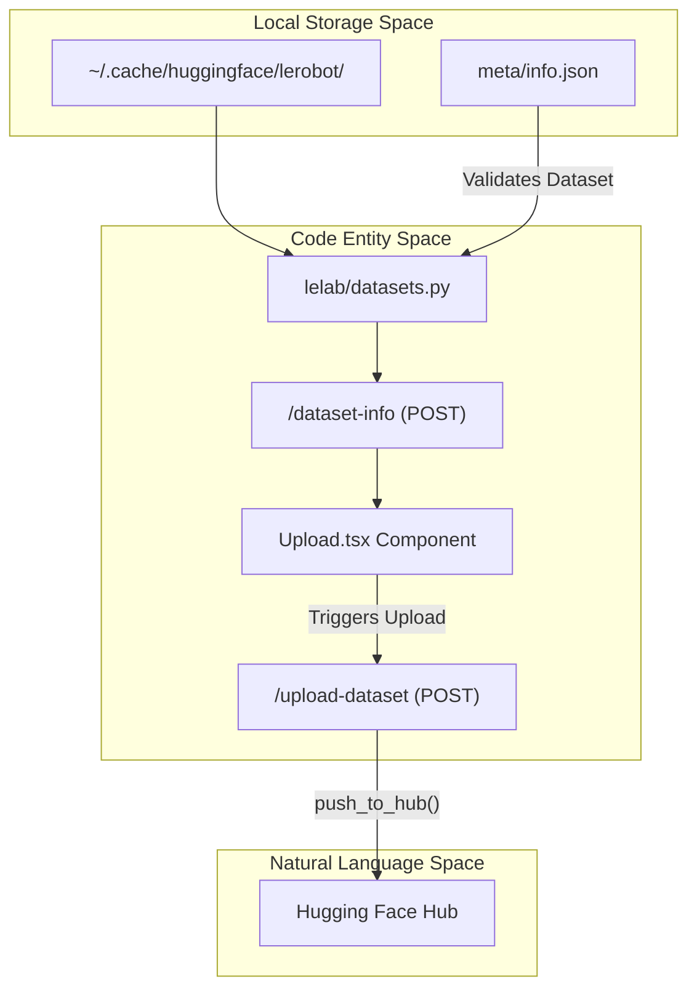

<!-- source: DeepWiki mcp.deepwiki.com · repo huggingface/leLab · page 6.2 Dataset Management and Upload · fetched 2026-10-26 -->

# Dataset Management and Upload

Relevant source files

The following files were used as context for generating this wiki page:

- [frontend/src/components/landing/DatasetPicker.tsx](frontend/src/components/landing/DatasetPicker.tsx)
- [frontend/src/hooks/useDatasets.ts](frontend/src/hooks/useDatasets.ts)
- [frontend/src/pages/Upload.tsx](frontend/src/pages/Upload.tsx)
- [lelab/datasets.py](lelab/datasets.py)
- [lelab/runners/__init__.py](lelab/runners/__init__.py)
- [lelab/train.py](lelab/train.py)

LeLab provides a comprehensive system for managing robotic datasets, encompassing local discovery, Hugging Face Hub integration, and a dedicated upload workflow. This system ensures that datasets recorded during teleoperation or automated sessions are correctly tagged, versioned, and accessible for training.

## Dataset Discovery and Source Tagging

LeLab aggregates datasets from two primary locations: the local LeRobot cache and the Hugging Face Hub. The backend logic merges these sources into a unified list, tagging each entry with its origin.

### Backend Implementation
The discovery logic is implemented in `lelab/datasets.py`. It distinguishes between three source states: `local`, `hub`, and `both`.

*   **Local Discovery**: `list_local_datasets` scans the directory defined by `HF_LEROBOT_HOME` (defaulting to `~/.cache/huggingface/lerobot`) [lelab/datasets.py:28-30](). It identifies a directory as a valid dataset if it contains a `meta/info.json` file [lelab/datasets.py:32-37](). The scanner walks one level deep to support both flat structures and `<org>/<dataset>` structures [lelab/datasets.py:48-104]().
*   **Hub Discovery**: `list_user_datasets` uses the `shared_hf_api` to query the Hugging Face Hub for datasets authored by the current user or their organizations [lelab/datasets.py:107-115](). It specifically filters for datasets tagged with "LeRobot" [lelab/datasets.py:118]().
*   **Merging Logic**: `list_all_datasets` combines these lists. If a `repo_id` exists in both locations, it is marked as `source: "both"` and the `last_modified` timestamp is set to the most recent of the two [lelab/datasets.py:136-162]().

### Data Flow: Discovery to UI
The frontend consumes this data through the `useDatasets` hook, which abstracts the API call to the `/datasets` endpoint (via `listDatasets` in `replayApi`).

Sources: `lelab/datasets.py:28-162`(), `frontend/src/hooks/useDatasets.ts:5-23`()

## DatasetPicker Component

The `DatasetPicker` is a specialized combobox used on the Landing page and Training configuration screens to select or create datasets.

### Key Features
*   **Source Visualization**: Items are grouped by "Local" and "Hugging Face" [frontend/src/components/landing/DatasetPicker.tsx:140-148]().
*   **Smart Creation**: It validates input using regex (`REPO_ID_RE`, `NAME_RE`) to determine if the user is typing a new local name or a full Hub repository ID [frontend/src/components/landing/DatasetPicker.tsx:27-48]().
*   **Hub Status**: Datasets present on both local and Hub are visually flagged with an "on Hub" badge [frontend/src/components/landing/DatasetPicker.tsx:98-100]().
*   **Privacy Indicators**: Displays a "private" badge for Hub datasets that are not public [frontend/src/components/landing/DatasetPicker.tsx:101-103]().

### Diagram: Dataset Selection Logic
This diagram bridges the user's intent in the `DatasetPicker` to the underlying `DatasetItem` properties.

| User Action | Frontend Logic (`DatasetPicker.tsx`) | Resulting `DatasetItem` Source |
| :--- | :--- | :--- |
| Select Local Item | `handlePick(item)` | `local` or `both` |
| Type new name | `onCreateNew(trimmed)` | (New local entry) |
| Type `org/repo` | `onOpenCustom(trimmed)` | `hub` |

Sources: `frontend/src/components/landing/DatasetPicker.tsx:30-175`()

## The Upload Workflow

After a recording session, users are directed to the `Upload` page (`frontend/src/pages/Upload.tsx`). This page serves as a staging area before pushing data to the Hugging Face Hub.

### Dataset Metadata Loading
Upon entry, the page calls the `/dataset-info` endpoint [frontend/src/pages/Upload.tsx:90](). This retrieves actual disk statistics (number of episodes, total frames) rather than relying solely on session state, ensuring accuracy even if a recording was interrupted [frontend/src/pages/Upload.tsx:99-107]().

### Push to Hub Implementation
The upload process involves configuring tags and privacy settings:
1.  **Default Tags**: Automatically includes `robotics` and `lerobot` [frontend/src/pages/Upload.tsx:66]().
2.  **Privacy**: Users can toggle between public and private repository visibility [frontend/src/pages/Upload.tsx:67]().
3.  **Backend Execution**: The `/upload-dataset` endpoint (invoked at [frontend/src/pages/Upload.tsx:169]()) triggers the `push_to_hub` operation. In the backend, this typically applies the `LELAB_TAG` to the repository to ensure it remains discoverable within the LeLab ecosystem.

### Deletion and Path Protection
The Upload page also provides a deletion mechanism for local datasets.
*   **UI Safety**: Requires explicit confirmation via an `AlertDialog` [frontend/src/pages/Upload.tsx:73]().
*   **Path Traversal Protection**: The backend (noted in the purpose but implemented in server-side handlers) ensures that the `dataset_repo_id` provided for deletion does not allow escaping the LeRobot cache directory.

### Diagram: Dataset Upload Data Flow
This diagram shows the transition from local storage to the Hugging Face Hub via the `Upload` component.

Sources: `frontend/src/pages/Upload.tsx:51-226`(), `lelab/datasets.py:32-37`()

## Summary of Key Functions and Classes

| Entity | Location | Role |
| :--- | :--- | :--- |
| `list_all_datasets` | `lelab/datasets.py` | Merges Hub and local dataset lists with source tagging. |
| `DatasetPicker` | `DatasetPicker.tsx` | Searchable UI component for selecting/creating datasets. |
| `useDatasets` | `useDatasets.ts` | React hook for fetching and refreshing the dataset list. |
| `TrainingRequest` | `lelab/train.py` | Schema containing `dataset_repo_id` for training jobs. |
| `Upload` | `Upload.tsx` | Page managing the lifecycle of pushing local data to the Hub. |

Sources: `lelab/datasets.py:136`(), `frontend/src/components/landing/DatasetPicker.tsx:30`(), `frontend/src/hooks/useDatasets.ts:5`(), `lelab/train.py:28`(), `frontend/src/pages/Upload.tsx:51`()

---

