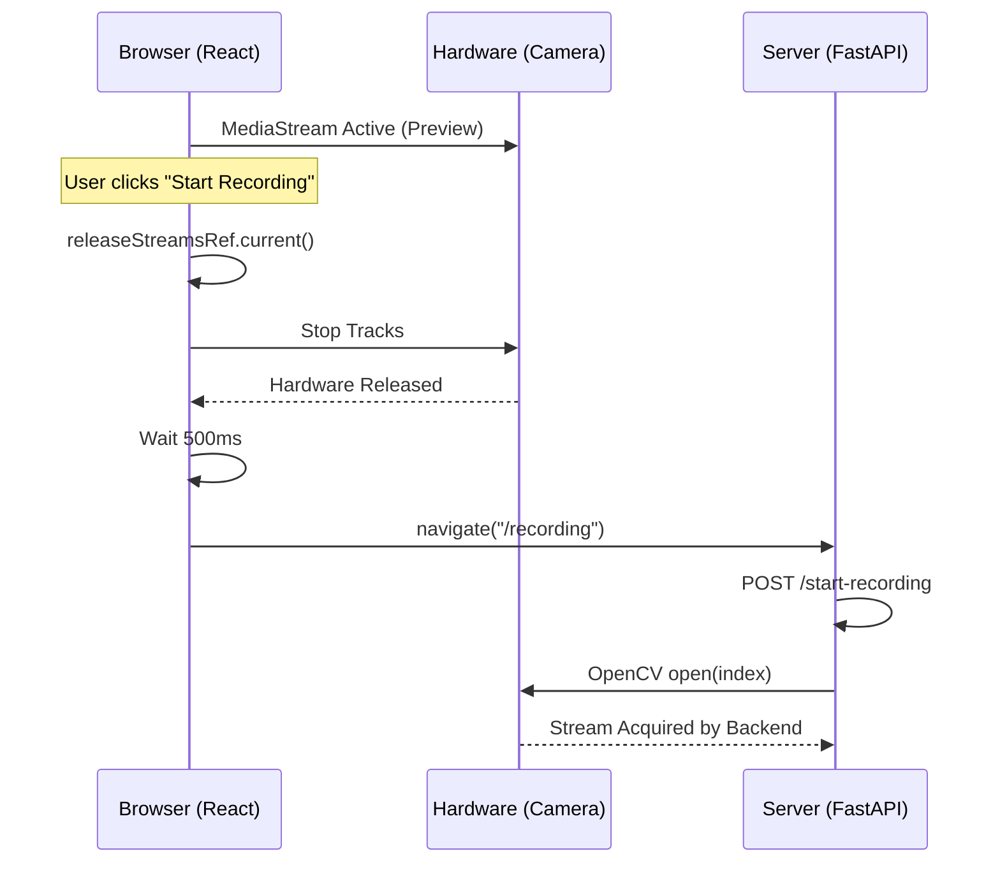

<!-- source: DeepWiki mcp.deepwiki.com · repo huggingface/leLab · page 6.3 Recording Session Setup · fetched 2026-10-26 -->

# Recording Session Setup

<details>
<summary>Relevant source files</summary>

The following files were used as context for generating this wiki page:

- [frontend/src/components/Footer.tsx](frontend/src/components/Footer.tsx)
- [frontend/src/components/landing/RecordingModal.tsx](frontend/src/components/landing/RecordingModal.tsx)
- [frontend/src/pages/Landing.tsx](frontend/src/pages/Landing.tsx)
- [frontend/src/pages/Recording.tsx](frontend/src/pages/Recording.tsx)
- [frontend/vite.config.ts](frontend/vite.config.ts)

</details>


This page details the configuration and initialization process for a dataset recording session in LeLab. The setup phase bridges the gap between hardware configuration (robot selection) and the actual recording loop, ensuring that camera resources are correctly managed and dataset metadata is properly formatted for the Hugging Face Hub.

## Recording Configuration Pipeline

The recording session is initialized on the `Landing` page [frontend/src/pages/Landing.tsx:23-216](). It involves assembling a `recordingConfig` object that contains all parameters required by the backend to orchestrate the `lerobot` recording worker.

### Data Flow: Setup to Execution

The process follows a strict pipeline:
1.  **Robot Selection**: The user selects a calibrated robot record [frontend/src/pages/Landing.tsx:134-142]().
2.  **Metadata Entry**: User provides `datasetName` and `singleTask` [frontend/src/pages/Landing.tsx:143-150]().
3.  **Parameter Tuning**: Configuration of episode counts and timing via the `RecordingModal`.
4.  **Camera Mapping**: Transformation of the UI camera state into a dictionary compatible with the backend `RecordingRequest` schema [frontend/src/pages/Landing.tsx:173-194]().
5.  **Resource Cleanup**: Releasing browser-side camera streams to prevent hardware contention [frontend/src/pages/Landing.tsx:157-171]().
6.  **Navigation**: Routing to `/recording` with the assembled configuration in the React Router state [frontend/src/pages/Landing.tsx:215]().

### Recording Session Flow Diagram

The following diagram illustrates the transition from the "Natural Language Space" (user intent) to the "Code Entity Space" (internal objects and routes).

**Title: Recording Setup and Initialization Flow**
```mermaid
graph TD
    subgraph "Natural Language Space"
        UserIntent["'I want to record 5 episodes of picking up a block'"]
    end

    subgraph "Code Entity Space (frontend/src/pages/Landing.tsx)"
        UI["Landing Component"] -->|openRecordingModal| RM["RecordingModal"]
        RM -->|handleStartRecording| Validation{"Validate Robot & Metadata"}
        Validation -->|Success| Auth["HfAuthContext Integration"]
        Auth -->|Generate Repo ID| Config["recordingConfig Object"]
        Config -->|releaseStreamsRef.current()| Cleanup["Stream Cleanup"]
        Cleanup -->|navigate('/recording')| RecPage["Recording Page"]
    end

    UserIntent --> UI
    RecPage -->|useEffect| StartAPI["POST /start-recording"]
```
Sources: [frontend/src/pages/Landing.tsx:125-216](), [frontend/src/components/landing/RecordingModal.tsx:49-121](), [frontend/src/pages/Recording.tsx:125-133]()

## The RecordingModal Component

The `RecordingModal` [frontend/src/components/landing/RecordingModal.tsx:49-69]() is the primary interface for session parameterization. It enforces validation rules, such as requiring a "clean" (calibrated) robot record [frontend/src/components/landing/RecordingModal.tsx:72]().

### Key Parameters

| Parameter | Type | Description |
| :--- | :--- | :--- |
| `numEpisodes` | `number` | Total number of episodes to record in the session [frontend/src/components/landing/RecordingModal.tsx:35](). |
| `episodeTimeS` | `number` | Maximum duration for a single recording phase [frontend/src/components/landing/RecordingModal.tsx:37](). |
| `resetTimeS` | `number` | Time allocated for the user to reset the environment between episodes [frontend/src/components/landing/RecordingModal.tsx:39](). |
| `streamingEncoding` | `boolean` | If true, encodes video frames on-the-fly to reduce post-processing time [frontend/src/components/landing/RecordingModal.tsx:41](). |

Sources: [frontend/src/components/landing/RecordingModal.tsx:27-47]()

## Hugging Face Auth Integration

The system integrates with `HfAuthContext` to determine the ownership of the resulting dataset. 

*   **Authenticated**: If the user is logged in, the `dataset_repo_id` is prefixed with their username: `${auth.username}/${datasetName}` [frontend/src/pages/Landing.tsx:152-154]().
*   **Unauthenticated**: The system uses the raw `datasetName`, which typically results in a local-only dataset unless a full repo ID is manually provided [frontend/src/pages/Landing.tsx:155]().

The `RecordingModal` provides real-time feedback on the final repository path [frontend/src/components/landing/RecordingModal.tsx:151-163]().

Sources: [frontend/src/pages/Landing.tsx:152-155](), [frontend/src/components/landing/RecordingModal.tsx:70](), [frontend/src/components/landing/RecordingModal.tsx:151-163]()

## Stream Cleanup and Handoff

A critical step in the `handleStartRecording` flow is the invocation of `releaseStreamsRef.current()` [frontend/src/pages/Landing.tsx:157-171](). 

Since the browser and the backend (OpenCV) cannot access the same camera hardware simultaneously on most operating systems, the frontend must explicitly stop all `MediaStreamTrack` objects before the backend attempts to initialize the recording worker.

1.  **Cleanup Trigger**: `handleStartRecording` checks if `cameras.length > 0`.
2.  **Execution**: It calls the function stored in `releaseStreamsRef`, which was populated by the `CameraConfiguration` component [frontend/src/pages/Landing.tsx:163]().
3.  **Delay**: A 500ms `setTimeout` is used to ensure the OS has fully released the hardware handles before the navigation to `/recording` triggers the backend start [frontend/src/pages/Landing.tsx:164]().

**Title: Hardware Handoff Sequence**

Sources: [frontend/src/pages/Landing.tsx:157-171](), [frontend/src/pages/Recording.tsx:125-133]()

## Transition to Recording State

Once the configuration is assembled and streams are released, the application navigates to the `/recording` route. 

The `Recording` page uses a `startInitiatedRef` to ensure that the `startRecordingSession` function (which calls the backend `/start-recording` endpoint) is only invoked once, even if React's `StrictMode` triggers a double-effect [frontend/src/pages/Recording.tsx:99-100](), [frontend/src/pages/Recording.tsx:125-133]().

Sources: [frontend/src/pages/Recording.tsx:77-133]()

---

