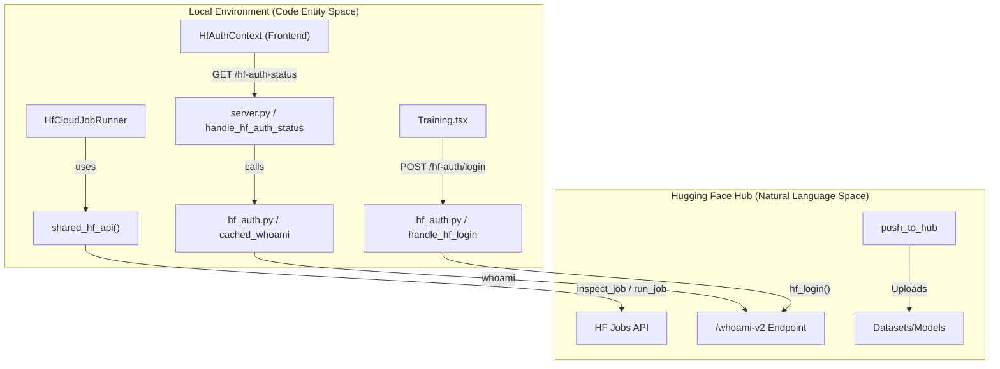
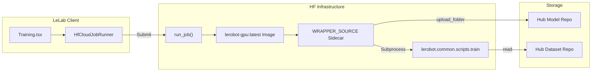

<!-- source: DeepWiki mcp.deepwiki.com · repo huggingface/leLab · page 7 Hugging Face Integration · fetched 2026-10-26 -->

# Hugging Face Integration

Relevant source files

The following files were used as context for generating this wiki page:

- [frontend/src/components/landing/HfAuthBanner.tsx](frontend/src/components/landing/HfAuthBanner.tsx)
- [frontend/src/components/training/ConfigurationTab.tsx](frontend/src/components/training/ConfigurationTab.tsx)
- [frontend/src/components/training/TrainingExtraGate.tsx](frontend/src/components/training/TrainingExtraGate.tsx)
- [frontend/src/components/training/types.ts](frontend/src/components/training/types.ts)
- [frontend/src/pages/Training.tsx](frontend/src/pages/Training.tsx)
- [lelab/runners/hf_cloud.py](lelab/runners/hf_cloud.py)
- [lelab/utils/hf_auth.py](lelab/utils/hf_auth.py)

LeLab is designed to be a bridge between local robot hardware and the Hugging Face ecosystem. It leverages the Hugging Face Hub for dataset storage, model hosting, and cloud-based GPU compute. This integration allows users to record data locally, upload it to the Hub, train policies using Hugging Face Jobs, and pull trained checkpoints back down for local inference.

### Integration Overview

The integration architecture connects the local FastAPI server to the Hugging Face Hub via `huggingface_hub`.

**Sources:** [lelab/utils/hf_auth.py:25-65](), [lelab/runners/hf_cloud.py:15-20](), [frontend/src/components/landing/HfAuthBanner.tsx:25-41]()

---

## Authentication

Authentication is the foundation of the LeLab-Hub integration. LeLab manages Hugging Face tokens to authorize dataset uploads and cloud training job submissions.

- **Backend Utilities**: The `hf_auth.py` module provides a `shared_hf_api` singleton [lelab/utils/hf_auth.py:61-65]() that implements a custom `_whoami_default_cache` [lelab/utils/hf_auth.py:38-42]() to mitigate aggressive rate-limiting on the `/whoami-v2` endpoint.
- **Frontend Context**: The `HfAuthContext` polls the backend to maintain the user's authentication state (authenticated, unauthenticated, or loading).
- **UI Components**: 
    - `HfAuthBanner`: Promptly displayed when cloud features are requested but the user is unauthenticated [frontend/src/components/landing/HfAuthBanner.tsx:15-17]().
    - `HfAuthDialog`: Allows users to paste a token with `Write` access to enable policy uploads [frontend/src/components/landing/HfAuthBanner.tsx:63-65]().

For details, see [Authentication](#7.1).

**Sources:** [lelab/utils/hf_auth.py:1-117](), [frontend/src/components/landing/HfAuthBanner.tsx:8-108]()

---

## Hub Dataset and Model Operations

LeLab treats the Hugging Face Hub as the primary remote storage for robotics data and neural network weights.

- **Dataset Management**: Users can list their Hub datasets filtered by the `lerobot` tag. The `push_to_hub` utility ensures datasets are tagged with `LELAB_TAG` [lelab/utils/config.py:38-38]() for easy discovery within the app.
- **Model Checkpoints**: During inference, the system can resolve `policy_ref` identifiers to Hub repositories, automatically downloading snapshots using `snapshot_download`.
- **UI Integration**: Components like `CheckpointDropdown` [frontend/src/pages/Training.tsx:34-34]() allow users to select specific versions of a model hosted on the Hub for local evaluation.

For details, see [Hub Dataset and Model Operations](#7.2).

**Sources:** [lelab/utils/config.py:38-38](), [lelab/runners/hf_cloud.py:82-96](), [frontend/src/pages/Training.tsx:107-126]()

---

## Cloud Training Execution

The `HfCloudJobRunner` [lelab/runners/hf_cloud.py:15-20]() allows LeLab to scale training beyond local hardware by spinning up ephemeral GPU instances on Hugging Face infrastructure.

### Cloud Workflow Entity Map

- **Sidecar Uploader**: Because the remote trainer only pushes the final model, LeLab injects a `WRAPPER_SOURCE` script [lelab/runners/hf_cloud.py:59-154]() into the cloud job. This script runs concurrently with the trainer, watching for new checkpoint directories and uploading them to the Hub in real-time [lelab/runners/hf_cloud.py:101-126]().
- **Monitoring**: The frontend `Training` page monitors these jobs by polling status and tailing logs via the `HfApi` [lelab/runners/hf_cloud.py:165-180]().

**Sources:** [lelab/runners/hf_cloud.py:59-154](), [lelab/runners/hf_cloud.py:165-180](), [frontend/src/pages/Training.tsx:169-183]()

---

