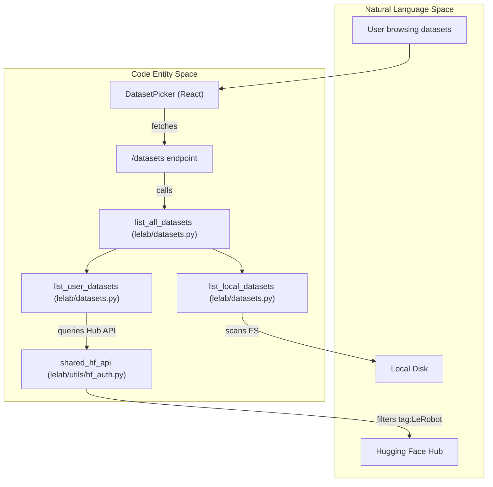
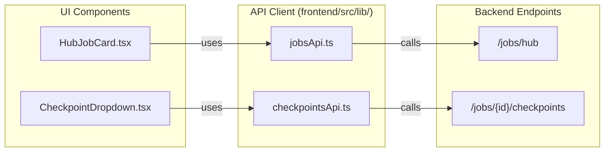

<!-- source: DeepWiki mcp.deepwiki.com · repo huggingface/leLab · page 7.2 Hub Dataset and Model Operations · fetched 2026-10-26 -->

# Hub Dataset and Model Operations

Relevant source files

The following files were used as context for generating this wiki page:

- [frontend/dist/assets/index-C5sEOO3o.css](frontend/dist/assets/index-C5sEOO3o.css)
- [frontend/dist/assets/index-b-p29zlw.js](frontend/dist/assets/index-b-p29zlw.js)
- [frontend/src/components/UrdfViewer.tsx](frontend/src/components/UrdfViewer.tsx)
- [frontend/src/components/jobs/CheckpointDropdown.tsx](frontend/src/components/jobs/CheckpointDropdown.tsx)
- [frontend/src/components/jobs/HubJobCard.tsx](frontend/src/components/jobs/HubJobCard.tsx)
- [frontend/src/components/training/WandbInstallDialog.tsx](frontend/src/components/training/WandbInstallDialog.tsx)
- [frontend/src/lib/checkpointsApi.ts](frontend/src/lib/checkpointsApi.ts)
- [frontend/src/lib/inferenceApi.ts](frontend/src/lib/inferenceApi.ts)
- [frontend/src/lib/jobsApi.ts](frontend/src/lib/jobsApi.ts)
- [frontend/src/pages/Inference.tsx](frontend/src/pages/Inference.tsx)
- [lelab/datasets.py](lelab/datasets.py)
- [lelab/runners/__init__.py](lelab/runners/__init__.py)
- [lelab/train.py](lelab/train.py)

This page describes the technical implementation of Hugging Face Hub-facing operations in LeLab, including dataset discovery, remote job monitoring, and model checkpoint management for inference.

## Dataset Operations

LeLab provides a unified interface for managing datasets across the local filesystem and the Hugging Face Hub.

### Dataset Discovery and Tagging
Datasets are discovered by scanning the local LeRobot cache and querying the Hub API. LeLab uses a specific tag filter to ensure only compatible datasets are displayed.

*   **Local Scanning**: The backend identifies local datasets by checking for the existence of `meta/info.json` within directories in the LeRobot home path [lelab/datasets.py:32-37]().
*   **Hub Filtering**: When listing user datasets, LeLab filters by the `LeRobot` tag [lelab/datasets.py:118-118]().
*   **Merging Logic**: The `list_all_datasets` function merges local and Hub results. If a dataset exists in both locations, it is marked with `source: "both"` and the most recent `last_modified` timestamp is retained [lelab/datasets.py:136-162]().

### Pushing to Hub
While the recording workflow handles initial uploads, the application ensures that datasets are properly tagged for visibility within the LeRobot ecosystem. This is typically managed via the `LELAB_TAG` during the `push_to_hub` process to facilitate easier filtering in the GUI.

### Dataset Discovery Flow
The following diagram illustrates how the system aggregates datasets from different sources into the `DatasetPicker` component.

**Diagram: Dataset Aggregation Flow**

Sources: [lelab/datasets.py:48-162](), [lelab/utils/hf_auth.py:23-23]()

---

## Hub Job and Model UI Components

LeLab provides specialized UI components for interacting with assets hosted on or managed by the Hugging Face Hub.

### HubJobCard
The `HubJobCard` component displays the status of training jobs running on Hugging Face Cloud.
*   **Status Mapping**: It maps Hub-specific stages (e.g., `RUNNING`, `QUEUED`, `COMPLETED`, `FAILED`) to visual indicators and icons [frontend/src/components/jobs/HubJobCard.tsx:37-46]().
*   **Metadata**: Displays the docker image or Space ID, hardware flavor, and relative creation time [frontend/src/components/jobs/HubJobCard.tsx:56-94]().

### HubModelCard
Used in the model selection interface, this component presents metadata for trained models stored as Hub repositories, including privacy status and last modification date [frontend/src/lib/jobsApi.ts:254-258]().

### Checkpoint Selection
The `CheckpointDropdown` allows users to select specific training steps for evaluation or inference.
*   **Data Structure**: Checkpoints are represented by the `JobCheckpoint` interface, which tracks the `step`, `source` (local vs. hub), and the `ref` (path or repo ID) [frontend/src/lib/checkpointsApi.ts:3-7]().
*   **Dynamic Loading**: The dropdown populates from the `listJobCheckpoints` API call [frontend/src/lib/checkpointsApi.ts:15-28]().

**Diagram: Hub Asset Interaction Architecture**

Sources: [frontend/src/components/jobs/HubJobCard.tsx:4-16](), [frontend/src/components/jobs/CheckpointDropdown.tsx:9-25](), [frontend/src/lib/jobsApi.ts:272-281](), [frontend/src/lib/checkpointsApi.ts:15-28]()

---

## Model Operations for Inference

Inference requires resolving a model reference (`policy_ref`) to a set of weights and configuration files.

### Checkpoint Resolution
When a user starts inference, the `policy_ref` can point to a local directory or a Hub repository. 
*   **Hub Checkpoints**: If a Hub checkpoint is selected, the backend uses `snapshot_download` to fetch the specific revision before launching the inference subprocess [frontend/src/pages/Inference.tsx:75-78]().
*   **Policy Config**: Before starting, the frontend calls `getCheckpointPolicyConfig` to retrieve the `policy_type` and expected camera dimensions (`image_features`), ensuring the hardware setup matches the model's requirements [frontend/src/lib/checkpointsApi.ts:30-43]().

### Inference Lifecycle
The inference process involves a "Setup" phase (loading weights from Hub/Disk) and a "Running" phase (the actual rollout loop).

| Phase | Indicator | Activity |
| :--- | :--- | :--- |
| **Setup** | `isSettingUp` | Policy load, snapshot download, hardware bus connection [frontend/src/pages/Inference.tsx:140-140](). |
| **Running** | `isRunning` | Policy execution loop, motor commands, camera stream processing [frontend/src/pages/Inference.tsx:141-141](). |

### Safety Mechanisms
The frontend implements a "Safety Net" for Hub-hosted models. If the rollout duration exceeds the configured time by more than 10 seconds, the system assumes the inference process is hung and triggers an automatic stop [frontend/src/pages/Inference.tsx:79-96]().

Sources: [frontend/src/pages/Inference.tsx:45-113](), [frontend/src/lib/inferenceApi.ts:3-16](), [frontend/src/lib/checkpointsApi.ts:9-13]()

---

