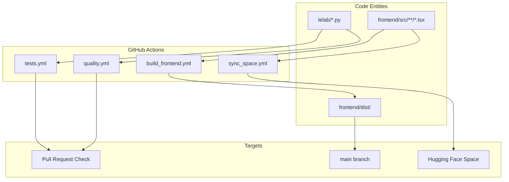

<!-- source: DeepWiki mcp.deepwiki.com · repo huggingface/leLab · page 8 Testing and CI/CD · fetched 2026-10-26 -->

# Testing and CI/CD

Relevant source files

The following files were used as context for generating this wiki page:

- [.github/workflows/tests.yml](.github/workflows/tests.yml)
- [CLAUDE.md](CLAUDE.md)
- [tests/test_rollout.py](tests/test_rollout.py)
- [tests/test_runners_hf_cloud.py](tests/test_runners_hf_cloud.py)
- [tests/test_scripts_lelab.py](tests/test_scripts_lelab.py)

This page provides an overview of the verification and deployment infrastructure for LeLab. The project employs a combination of `pytest` for backend logic validation and GitHub Actions for continuous integration, code quality enforcement, and automated deployment to Hugging Face Spaces.

## Test Suite

The test suite, located in the `tests/` directory, focuses on validating request schemas, pure helper functions, and the "idle" or "mutex" branches of the system's state machines. 

### Testing Philosophy
LeLab's testing strategy prioritizes safety and logic over full end-to-end integration in the unit test suite.
*   **Unit Tested**: Pydantic schemas, configuration resolution, device detection, and mutual exclusion logic (e.g., ensuring a second inference cannot start if one is already active) [tests/test_rollout.py:14-20]().
*   **Deliberately Not Unit Tested**: Subprocess orchestration (spawning `lerobot` CLI), real-time threading/stdout pumping, and actual hardware communication [tests/test_rollout.py:17-20](). These are verified via manual smoke testing [CLAUDE.md:30-31]().
*   **Mocks and Fixtures**: Tests use `pytest.MonkeyPatch` extensively to simulate hardware environments (e.g., mocking `torch.cuda.is_available`) [tests/test_rollout.py:62-80]() or network state (e.g., mocking `netrc` for W&B keys) [tests/test_runners_hf_cloud:35-47]().

### Test Coverage Areas
| Module | Coverage Description |
| :--- | :--- |
| `lelab.rollout` | Schema validation, device detection (`cpu`/`cuda`/`mps`), and policy path resolution [tests/test_rollout.py:40-143](). |
| `lelab.runners.hf_cloud` | Resolution of W&B API keys from environment variables and `.netrc` [tests/test_runners_hf_cloud:26-49](). |
| `lelab.scripts.lelab` | Logic for `_wait_for_port` used during server startup [tests/test_scripts_lelab:36-45](). |
| `utils` | Config persistence, HF authentication helpers, and system capability checks [CLAUDE.md:30-31](). |

For implementation details on fixtures and specific test cases, see [Test Suite](#8.1).

**Sources:** [CLAUDE.md:30-31](), [tests/test_rollout.py:14-20](), [tests/test_runners_hf_cloud:14-17](), [tests/test_scripts_lelab:14-17]()

---

## CI/CD Pipelines

LeLab uses GitHub Actions to automate the software development lifecycle, from linting to deployment.

### Workflow Orchestration
The following diagram maps the CI/CD triggers to the specific code entities and external targets they affect.

**CI/CD Pipeline Mapping**

**Sources:** [.github/workflows/tests.yml:15-38](), [CLAUDE.md:9-11](), [CLAUDE.md:28-30]()

### Automated Workflows
1.  **Tests (`tests.yml`)**: Runs the `pytest` suite on `ubuntu-latest`. It installs native dependencies required by `lerobot` (e.g., `ffmpeg`, `libusb-1.0-0-dev`) before executing tests [ .github/workflows/tests.yml:59-75]().
2.  **Quality (`quality.yml`)**: Enforces code style using `ruff check` and `ruff format` [CLAUDE.md:30-31]().
3.  **Frontend Build (`build_frontend.yml`)**: Automatically triggers when source files in `frontend/` change. It runs `npm run build` and commits the resulting `frontend/dist/` bundle back to the repository [CLAUDE.md:28-30]().
4.  **Space Sync (`sync_space.yml`)**: Force-pushes the `frontend/` directory to the [lerobot/LeLab](https://huggingface.co/spaces/lerobot/LeLab) Hugging Face Space [CLAUDE.md:9-11]().

### Deployment Architecture
The Hugging Face Space environment utilizes a `Dockerfile` located in the `frontend/` directory. While the repository contains a pre-built `dist/` folder for local Python installations, the Space builds the frontend from source during its container image creation [CLAUDE.md:9-11]().

For details on workflow triggers and environment configuration, see [CI/CD Pipelines](#8.2).

**Sources:** [CLAUDE.md:9-11](), [CLAUDE.md:28-30](), [.github/workflows/tests.yml:48-76]()

---

