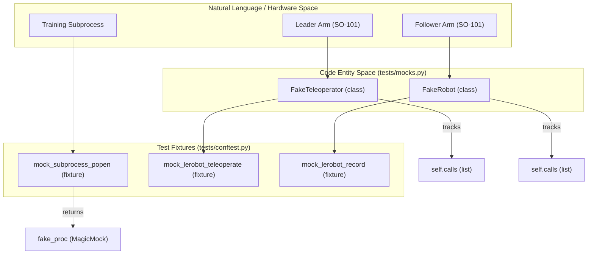
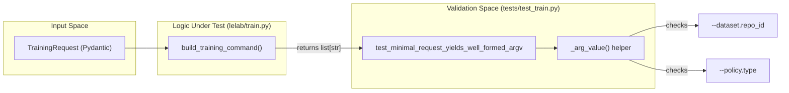

<!-- source: DeepWiki mcp.deepwiki.com · repo huggingface/leLab · page 8.1 Test Suite · fetched 2026-10-26 -->

# Test Suite

<details>
<summary>Relevant source files</summary>

The following files were used as context for generating this wiki page:

- [CLAUDE.md](CLAUDE.md)
- [tests/__init__.py](tests/__init__.py)
- [tests/conftest.py](tests/conftest.py)
- [tests/mocks.py](tests/mocks.py)
- [tests/test_record.py](tests/test_record.py)
- [tests/test_rollout.py](tests/test_rollout.py)
- [tests/test_runners_hf_cloud.py](tests/test_runners_hf_cloud.py)
- [tests/test_scripts_lelab.py](tests/test_scripts_lelab.py)
- [tests/test_server.py](tests/test_server.py)
- [tests/test_smoke.py](tests/test_smoke.py)
- [tests/test_teleoperate.py](tests/test_teleoperate.py)
- [tests/test_train.py](tests/test_train.py)
- [tests/test_utils_hf_auth.py](tests/test_utils_hf_auth.py)
- [tests/test_utils_system.py](tests/test_utils_system.py)

</details>


The LeLab test suite is located in the `tests/` directory and is designed to validate the FastAPI backend's request schemas, internal state machines, and utility functions. It employs a testing philosophy that prioritizes unit testing of pure logic and idle/mutex branches while deliberately avoiding the testing of complex hardware-driven subprocesses or external cloud integrations [CLAUDE.md:30-31]().

## Testing Philosophy

LeLab's test suite focuses on high-confidence unit testing rather than end-to-end hardware simulation.

| Category | Tested Areas | Non-Tested Areas (Manual Validation) |
| :--- | :--- | :--- |
| **Logic** | Pydantic schemas, CLI argument builders, status handlers [tests/test_train.py:27-38](), [tests/test_rollout.py:40-47]() | Real subprocess lifecycles (e.g., `lerobot-train` execution) [CLAUDE.md:30-31]() |
| **State** | Mutex branches (e.g., rejecting a start request when already active) [tests/test_rollout.py:186-191]() | Real hardware thread "happy paths" [CLAUDE.md:30-31]() |
| **Utilities** | Config path persistence, HF Auth caching, System install commands [tests/test_utils_hf_auth.py:21-49](), [tests/test_utils_system.py:21-29]() | Real Hub API network calls, actual `pip install` execution [CLAUDE.md:30-31]() |
| **Server** | Route availability, health checks, WebSocket connection tracking [tests/test_server.py:22-41](), [tests/test_server.py:68-82]() | Browser-to-Backend integration [CLAUDE.md:30-31]() |

Sources: [CLAUDE.md:30-31](), [tests/test_train.py:27-38](), [tests/test_rollout.py:40-47](), [tests/test_rollout.py:186-191](), [tests/test_utils_hf_auth.py:21-49](), [tests/test_utils_system.py:21-29](), [tests/test_server.py:22-41](), [tests/test_server.py:68-82]()

## Infrastructure and Fixtures

The test suite uses `pytest` and relies on shared fixtures defined in `tests/conftest.py` to isolate the environment and mock external dependencies.

### Environment Isolation: `tmp_lerobot_home`
To prevent tests from corrupting the user's local configuration, the `tmp_lerobot_home` fixture redirects all persistent state paths (usually in `~/.cache/huggingface/lerobot/`) to a temporary directory [tests/conftest.py:36-44](). It patches the following constants in `lelab.utils.config`:
* `CALIBRATION_BASE_PATH_TELEOP` / `CALIBRATION_BASE_PATH_ROBOTS` [tests/conftest.py:60-61]()
* `LEADER_CONFIG_PATH` / `FOLLOWER_CONFIG_PATH` [tests/conftest.py:62-63]()
* `PORT_CONFIG_PATH` / `CONFIG_STORAGE_PATH` [tests/conftest.py:64-67]()

### Mock Objects
The suite provides several specialized mocks to simulate external components:
* **`client`**: A FastAPI `TestClient` bound to the real `lelab.server.app` [tests/conftest.py:26-32]().
* **`mock_subprocess_popen`**: Patches `subprocess.Popen` in `lelab.jobs` to return a fake process with a PID and simulated status [tests/conftest.py:94-108]().
* **`FakeRobot` / `FakeTeleoperator`**: Located in `tests/mocks.py`, these classes provide the minimal interface needed to simulate SO-101 hardware without a physical connection [tests/mocks.py:21-61]().

### Hardware-to-Code Mapping
The following diagram illustrates how the test suite bridges the gap between the physical hardware concepts and the code entities used in testing.

**Mock Hardware Entity Mapping**

Sources: [tests/mocks.py:21-61](), [tests/conftest.py:75-108]()

## Coverage Areas

### Feature Handlers
Tests verify that feature modules correctly manage their internal state and reject invalid requests.
* **Teleoperation**: Validates `TeleoperateRequest` schemas and ensuring `handle_teleoperation_status` returns correct dictionaries [tests/test_teleoperate.py:21-35]().
* **Recording**: Ensures `handle_recording_status` exposes required state fields like `recording_active` and `current_phase` [tests/test_record.py:30-40]().
* **Rollout**: Tests the `_detect_device` logic for CUDA/MPS/CPU selection and ensures `_resolve_policy_path` correctly handles Hub refs (e.g., `user/repo@checkpoints/000050`) [tests/test_rollout.py:62-104](), [tests/test_rollout.py:121-143]().
* **Training**: Validates the `build_training_command` helper, which translates a `TrainingRequest` into a CLI `argv` list for `lerobot.scripts.lerobot_train` [tests/test_train.py:27-38]().

### Utility Tests
* **HF Auth**: Tests `invalidate_whoami_cache` to ensure the `_WHOAMI_API` cache is cleared and subsequent calls hit the network [tests/test_utils_hf_auth.py:21-49]().
* **System**: Verifies that `_build_install_cmd` correctly chooses between `uv pip` and `python -m pip` based on the environment [tests/test_utils_system.py:21-43]().
* **Scripts**: Tests the `_wait_for_port` helper used during startup to detect when the server is ready [tests/test_scripts_lelab.py:36-41]().

### Data Flow: Training CLI Generation
This diagram shows how the test suite validates the transformation of a frontend request into a backend command-line execution.

**Training Command Validation Flow**

Sources: [tests/test_train.py:21-38]()

## Running Tests

To run the test suite, ensure the development dependencies are installed and use `pytest`.

1. **Installation**:
   ```bash
   pip install -e ".[test]"
   ```
   [CLAUDE.md:30-31]()

2. **Execution**:
   ```bash
   pytest
   ```
   The configuration for `pytest` (including coverage and warning settings) is defined in `pyproject.toml` [CLAUDE.md:30-31]().

Sources: [CLAUDE.md:30-31]()

---

